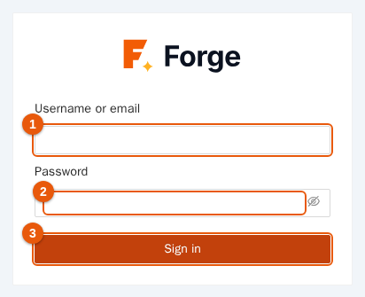
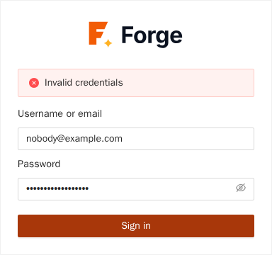
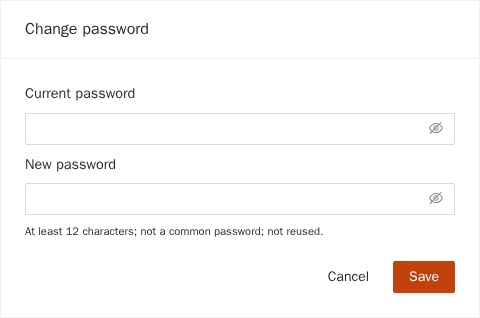
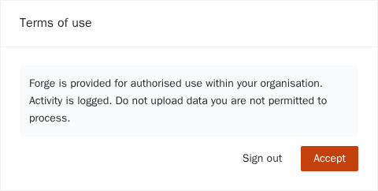
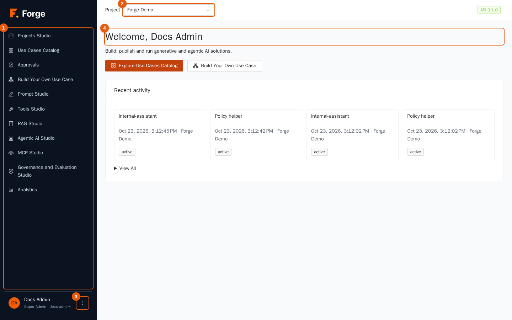
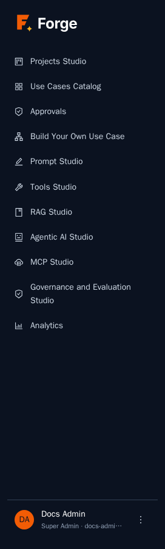
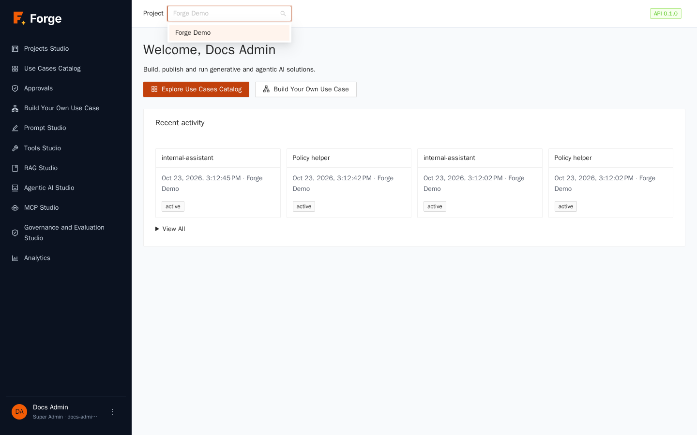
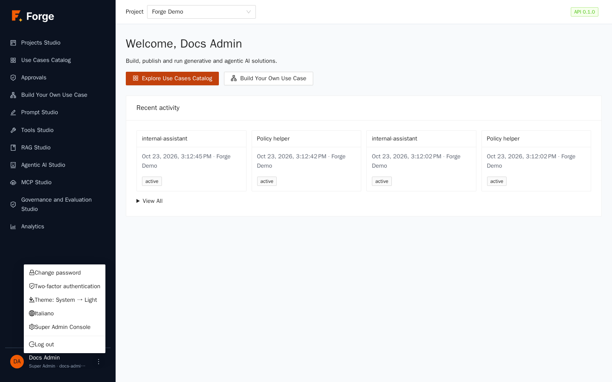
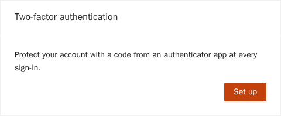

# 1. Getting started

[Index](README.md) · Next: [2. Projects Studio](02-projects-studio.md)

This chapter shows how to sign in to Forge, what the screen is made of, how to choose the project you work in, and how to set your personal preferences (password, two-factor authentication, language and theme).

> **Who is this for?** Everyone. All the roles described later start here.

## 1.1 Before you start

You need:

- the address of your Forge installation (for example `https://forge.example.com`);
- a user name (or e-mail address) and a password given to you by a Super Admin, or a company single sign-on button if your organization uses LDAP or OpenID Connect;
- a modern browser (current Chrome, Edge, Firefox or Safari).

The pictures in this guide come from a demo project called **Forge Demo**. What you see on your installation depends on your role and on your data.

## 1.2 Sign in

1. Open the Forge address in the browser. The sign-in page appears.

   

2. Type your **user name or e-mail** (marker 1) and your **password** (marker 2). The eye icon in the password field shows or hides what you type.
3. Click **Sign in** (marker 3).

If your organization uses a corporate identity provider, one or more buttons with its name appear above the form: click the button instead of typing a password.

**If two-factor authentication is enabled** for your account, a second step asks for the six-digit code of your authenticator app. If you lost your phone, click **Use a recovery code** and type one of the ten recovery codes you saved when you enabled the feature. Each recovery code works once.

### What can stop you

| Message or behaviour | Cause | What to do |
| --- | --- | --- |
| "Invalid credentials" | Wrong user name or password. The message is deliberately generic. | Check the keyboard layout and try again. |
| The account is locked for 15 minutes | Five wrong passwords within 15 minutes. | Wait, or ask a Super Admin to unlock the account (chapter 11). |
| Too many sign-in attempts | More than 20 attempts per minute from your address. | Wait one minute. |

## 1.3 First sign-in: mandatory steps

When a Super Admin creates your account, or resets your password, Forge may ask you to complete some steps **before** you can use the application. They appear one after the other, in this order:

1. **Change password.** Type the current (temporary) password and a new one. The rules are shown under the field: at least 12 characters, not a common password, and not one of your last five passwords.

   

2. **Terms of use.** Read the text and click **Accept**. If you click **Sign out** you leave without accepting and you cannot use Forge.

   

3. **Two-factor authentication**, only if your organization made it compulsory. See section 1.6.

## 1.4 The screen

After signing in you see the home page.

| Marker | Area | What it does |
| --- | --- | --- |
| 1 | **Side menu** | Opens the areas of Forge (table below). The current area is highlighted. |
| 2 | **Project** selector | Chooses the project you work in. |
| 3 | **Profile menu** (three dots) | Password, two-factor authentication, theme, language, sign out. |
| 4 | **Page** | The content of the area you opened. On the home page: a welcome, two shortcuts and your recent activity. |

The **API** tag at the top right shows the version of the Forge server you are connected to. If it turns red and says *API offline*, the server cannot be reached.

### The side menu

| Entry | What you do there | Chapter |
| --- | --- | --- |
| **Projects Studio** | Project settings: models, data, members, roles, catalogs, import and export. | [2](02-projects-studio.md), [4](04-data-and-rag.md), [10](10-integrations-and-sync.md) |
| **Use Cases Catalog** | Run the use cases published for you. | [7](07-use-cases.md) |
| **Approvals** | Decide on the steps that wait for a human. | [7](07-use-cases.md) |
| **Build Your Own Use Case** | Design a use case with the visual editor. | [7](07-use-cases.md) |
| **Prompt Studio** | Write, version, test and publish prompts. | [3](03-prompt-studio.md) |
| **Tools Studio** | Define the tools that agents can call. | [5](05-tools.md) |
| **RAG Studio** | Question your documents with cited answers. | [4](04-data-and-rag.md) |
| **Agentic AI Studio** | Create agents and chat with them. | [6](06-agents.md) |
| **MCP Studio** | Today it only shows a notice that the area arrives in a later phase. The MCP server and the chat widgets are in **Projects Studio → Integrations**. | [10](10-integrations-and-sync.md) |
| **Governance and Evaluation Studio** | Guardrails and quality evaluations. | [8](08-governance.md) |
| **Analytics** | Usage, cost, quality and activity dashboards. | [9](09-analytics.md) |

You only see the entries your role allows. A Project Admin sees everything of the project; an end user typically sees the catalog and the approvals.

## 1.5 Choose the project

Every asset in Forge (prompts, documents, agents, use cases…) belongs to **one project**, and projects are completely separate from each other: people, data and costs never mix.

1. Click the **Project** selector at the top (see below).
2. Type a few letters to filter, then click the project.

Forge remembers your choice in this browser. If the list is empty you are not a member of any project: ask a Super Admin to add you.

## 1.6 Your profile menu

Click the three dots next to your name, at the bottom of the side menu.

| Item | What it does |
| --- | --- |
| **Change password** | Opens the same page as in section 1.3. Users who sign in with LDAP or OpenID Connect change the password in their company system instead. |
| **Two-factor authentication** | Enrolment, see below. Greyed out when already enabled. |
| **Theme** | Each click moves to the next theme: system, light, dark. *System* follows your operating system. The choice is kept in this browser. |
| **English / Italiano** | Switches the interface language. The page reloads. The choice is kept in this browser. |
| **Super Admin Console** | Visible to Super Admins only (chapter 11). |
| **Sign out** | Ends the session. |

### Enable two-factor authentication

1. Open the profile menu and choose **Two-factor authentication**, then click **Set up**.

   

2. Scan the QR code with an authenticator app (any app that supports time-based one-time codes). If you cannot scan, type the key shown under the code ("Or enter this key manually").
3. Type the six-digit code shown by the app and click **Enable**.
4. Forge shows **ten recovery codes**. Click **Download** or copy them to a safe place, then click **Continue**. They are shown only once and each works once.

From now on, signing in asks for the code after the password. Once the feature is on, the menu entry is greyed out: the interface has no switch to turn it off, so ask your administrators if you need it removed (for example after losing the phone and the recovery codes).

## 1.7 Tips

- Work with the browser window at least 1280 pixels wide: tables and the visual editor need the space. On small screens the side menu collapses behind a button.
- Sessions end after a period of inactivity and after a maximum duration, both set by your administrators: when that happens, sign in again.
- The interface texts, the dates and the numbers follow the chosen language; the content you write (prompts, documents) is never translated.

Next: [2. Projects Studio](02-projects-studio.md)
