# 2. Projects Studio

[Index](README.md) · Previous: [1. Getting started](01-getting-started.md) · Next: [3. Prompt Studio](03-prompt-studio.md)

Projects Studio is where a **project** is set up: who belongs to it, which models it may call, which limits apply, which catalogs its users see. Everything else in Forge (prompts, documents, agents, use cases) lives inside a project, so this is the first place to visit after the project has been created.

> **Who is this for?** Project Admins. Builders, Operators and end users can see the tabs that their role allows, but only a Project Admin can change members, roles, models and limits. Creating projects is a Super Admin task (chapter 11).

## 2.1 The tabs of Projects Studio

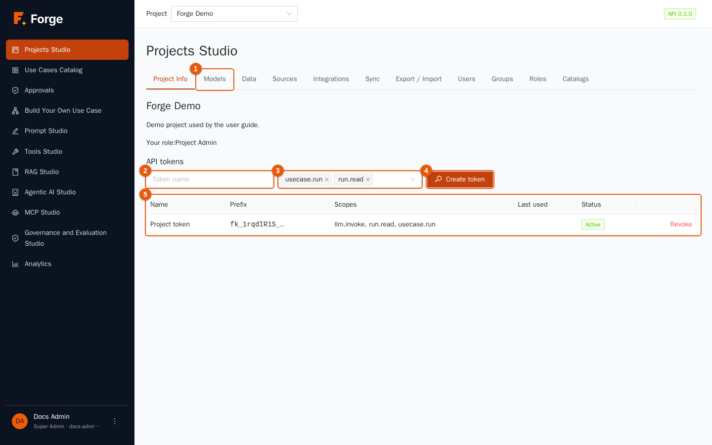

| Tab | What it contains | Where it is explained |
| --- | --- | --- |
| **Project Info** | Name, description, your role and the API tokens | section 2.2 |
| **Models** | Providers, models, aliases, limits and cache | section 2.3 |
| **Data** | Data collections (files for RAG) | [chapter 4](04-data-and-rag.md) |
| **Sources** | Scheduled synchronisation of external data | [chapter 4](04-data-and-rag.md) |
| **Integrations** | Chat widgets (the MCP server is in MCP Studio) | [chapter 10](10-integrations-and-sync.md) |
| **Sync** | Keep the project in a Git repository with `forgectl` | [chapter 10](10-integrations-and-sync.md) |
| **Export / Import** | Move assets between projects and installations | [chapter 10](10-integrations-and-sync.md) |
| **Users** | Members and their role | section 2.4 |
| **Groups** | Named groups of members | section 2.5 |
| **Roles** | Role Names of the project | section 2.6 |
| **Catalogs** | Where use cases are published, and who sees them | section 2.7 |

## 2.2 Project Info and API tokens

The first tab shows the project name and description and **your role** in it. Project Admins also see the **API tokens**: long secret strings that let programs call Forge on behalf of the project (for example an application that runs a use case, or a tool that talks to the OpenAI-compatible endpoint).

### Create a token

1. Open **Projects Studio → Project Info**.
2. Type a **Token name** (marker 2) that tells you what the token is for, for example `crm-integration`.
3. Choose the **Scopes** (marker 3). A scope is a permission; the list contains only permissions that your own role has, and the token can never do more than you can. The defaults, `usecase.run` and `run.read`, are enough to run use cases and read the results. Add `llm.invoke` to let the token call models through the OpenAI-compatible API.
4. Click **Create token** (marker 4).
5. The green box shows the token **once**. Copy it immediately and store it in your secret manager: Forge keeps only a fingerprint and cannot show it again.

The table (marker 5) lists the tokens with their **Prefix** (the first characters, to recognise a token), **Scopes**, **Last used** and **Status**. Click **Revoke** to disable a token for good; programs that use it get an authorisation error at their next call.

> **Good practice.** One token per application, with the fewest scopes that work. Revoke tokens you no longer use: the *Last used* column helps you find them.

## 2.3 Models, aliases, limits

Forge never hosts a model: every model is an **endpoint of an external provider** (a cloud service, or a server inside your company such as vLLM or Ollama). The Models tab has four blocks: usage counters at the top, then providers, models and aliases, and finally limits and cache.

### Usage counters

Four counters at the top show what the project consumed today (UTC day): **tokens today**, **requests this minute**, **calls today** and **cost today**. The first two show the value used so far and the limit (for example `120 / 500000`), or *unlimited* when no limit is set.

### Providers

A **provider** is a connection: a type (OpenAI, Azure, Anthropic, Gemini, Mistral, vLLM, Ollama, NVIDIA NIM, OpenAI-compatible…), an address and credentials. Platform providers are created by Super Admins and are shared; the **Providers** table of a project lists only the providers that belong to the project itself.

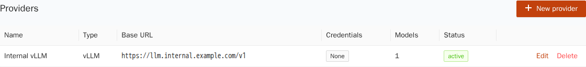

To add a project-only provider, for example your company's internal vLLM:

1. Click **New provider**.

   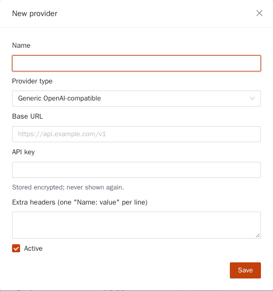

2. Fill in **Name**, **Provider type** and **Base URL** (the address of the OpenAI-compatible API, for example `https://llm.internal.example.com/v1`).
3. Type the **API key** if the service needs one. Keys and passwords are stored **encrypted**, are write-only (Forge never shows them again) and are never written to logs. To replace a key just type a new one; to delete it use **Remove the stored credentials**.
4. Plain `http://` addresses are refused. Tick **Allow plain HTTP** only for an endpoint inside a network you trust.
5. Some types ask for more fields: Azure the *API version*, Bedrock the *region* and AWS credentials, Vertex the Google Cloud *project* and *location*. **Extra headers** are added to every call (one `Name: value` per line).
6. Leave **Active** ticked and click **Save**.

### Models

A **model** is one callable model of a provider, with its limits and its prices. The table has one tab per type: **LLM** (chat), **Embedding** (turns text into numbers for search), **Reranker** (sorts search results) and **Speech**. Platform models show a blue **Platform** tag and are read-only here; the ones you create show **Project**.

To add a model of a project provider:

1. Click **New model**.

   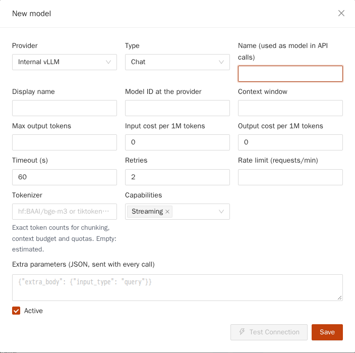

2. Pick the **Provider** and the **Type**.
3. **Name (used as model in API calls)** is the name that prompts, agents and the API use. It must be unique in the project. **Display name** is a friendly label.
4. **Model ID at the provider** is the identifier the provider expects, for example `Qwen/Qwen3-8B`.
5. Fill in what you know: **Context window** and **Max output tokens**, the **Input cost** and **Output cost per 1M tokens** (they feed the cost counters and Analytics; leave 0 for free or internal models), **Timeout**, **Retries** and a **Rate limit** in requests per minute for this model.
6. **Tokenizer** tells Forge how to count tokens exactly (a Hugging Face repository such as `hf:BAAI/bge-m3`, or a `tiktoken:` encoding). Empty means an estimate of about four characters per token.
7. **Capabilities** declare what the model supports: *streaming*, *tools*, *json*, *vision*. Agents with tools need *tools*.
8. **Extra parameters** is a JSON object sent with every call, for providers that need non-standard fields.
9. Click **Test Connection** to try the model *before* saving: Forge sends a tiny request and shows whether it worked and how long it took. Then click **Save**.

You can also test a saved model any time with the **Test** button in its row. The result appears as a green or red message under the usage counters, for example *groq-gpt-oss-20b answered in 267 ms*.

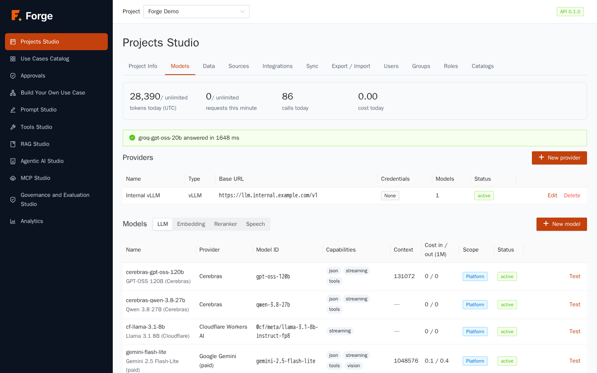

### Aliases

Prompts, agents and RAG pipelines do not call a model directly: they call an **alias**, a name such as `default-chat`, with an **ordered fallback chain** of models. Forge calls the first model; if it fails or times out, it calls the second, and so on. Changing the chain changes the behaviour of everything that uses the alias, with no edit to prompts or agents.

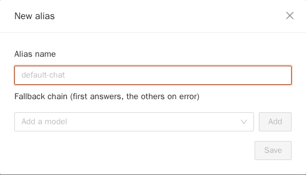

The **Defined by** column tells where an alias comes from: **Platform default** (shared, set by Super Admins) or **Project** (your own, which *overrides* a platform alias of the same name). **Reset** removes your override.

To create or change an alias:

1. Click **New alias**, or **Edit** on an existing row.
2. Type the **Alias name** (for a new one).
3. Pick a model in **Add a model** and click **Add**. Repeat. The first model answers; the others are fallbacks. Use the arrows to reorder and the cross to remove.
4. Click **Save**.

> **Good practice.** Put a fast and cheap model first for routine work, and a more capable one as fallback. Put a model from a *different provider* second, so an outage of one provider does not stop the project.

### Limits and cache

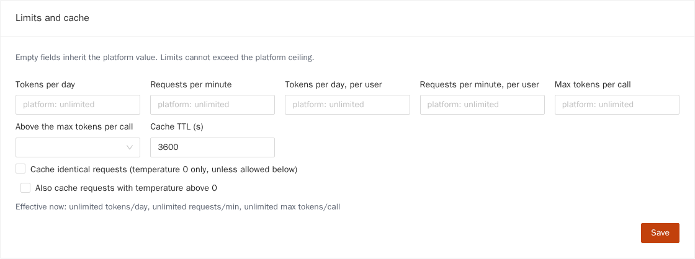

Platform administrators set ceilings for the whole installation. Here the Project Admin sets **tighter limits for this project**. An empty field inherits the platform value (shown in grey as placeholder); a value above the platform ceiling is refused.

| Field | Meaning |
| --- | --- |
| **Tokens per day**, **Requests per minute** | Limits for the whole project. |
| **Tokens per day, per user**, **Requests per minute, per user** | Limits for each single user, so one person cannot use up the project. |
| **Max tokens per call** | Largest answer allowed per call. |
| **Above the max tokens per call** | What to do when a request asks for more: *Clamp to the limit* (answer anyway, shorter) or *Reject the request*. |
| **Cache identical requests** | Reuse the answer of an identical earlier request. Off by default. A cache hit costs nothing and counts zero tokens. |
| **Cache TTL (s)** | How long cached answers stay valid. |
| **Also cache requests with temperature above 0** | By default only deterministic requests (temperature 0) are cached, because otherwise users would always get the same "creative" answer. |

The line **Effective now** under the form shows the limits that really apply after combining platform and project values. Click **Save**.

## 2.4 Users

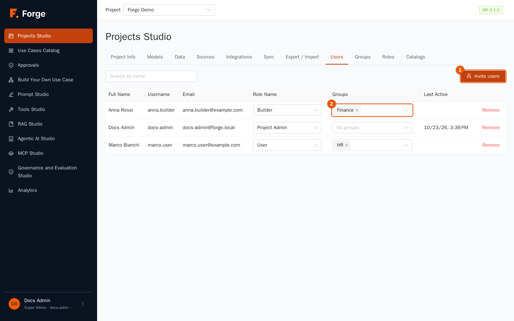

The table lists the members with their **Role Name**, **Groups** and **Last Active**. Only people who already have a Forge account can be added; creating accounts is a Super Admin task (chapter 11), unless users come from LDAP or OpenID Connect.

### Invite users

1. Click **Invite users** (marker 1).

   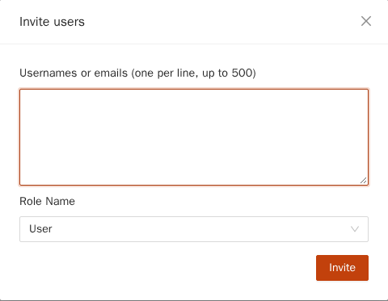

2. Type one **user name or e-mail address per line** (up to 500 at once).
3. Choose the **Role Name** they get. New members default to the role of type *User*.
4. Click **Invite**. A notice says how many people were added ("2 added.") and lists the names that were not found ("Unknown users: …"). Names can be separated by new lines, commas or semicolons.

### Change role or groups, remove

- Change the **Role Name** with the selector in the row. The change is immediate.
- Use the **Groups** selector (marker 2) to put the person in one or more groups (section 2.5).
- Click **Remove** to take the person out of the project. Their past activity stays in the history.

A user has exactly **one role per project**. The same person can have different roles in different projects.

## 2.5 Groups

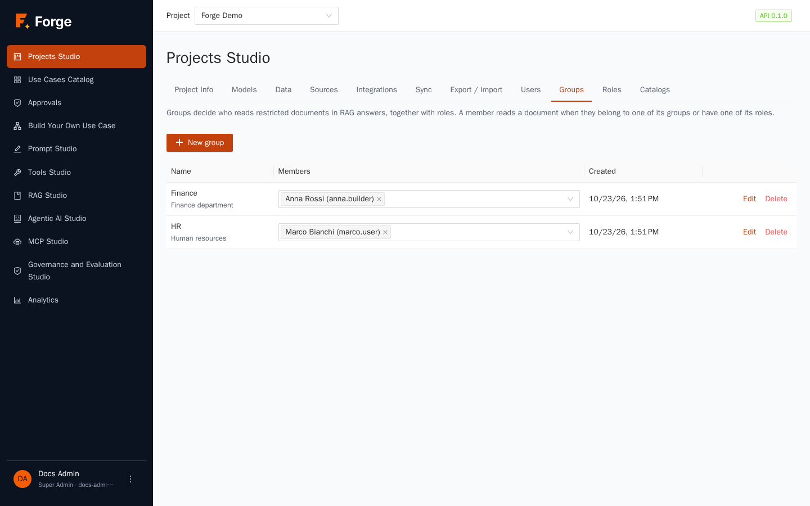

A **group** is a named list of members, such as *Finance* or *HR*. Groups exist for one purpose: to decide **who may read restricted documents** when RAG answers are built (chapter 4). A member reads a document if they belong to one of the document's groups *or* have one of its roles.

1. Click **New group**.

   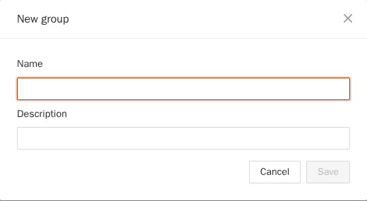

2. Type a **Name** and an optional **Description**, then save.
3. Choose the members in the **Members** column of the table (a multiple-choice selector that lists the project's members), or tick the group in the **Groups** selector of each user in the Users tab. Only project members can belong to a group.
4. **Edit** changes name and description; **Delete** removes the group (you are asked to confirm).

Groups are managed inside Forge. If your users come from LDAP or OpenID Connect, the mapping between directory groups and project roles is configured by Super Admins (chapter 11).

## 2.6 Roles

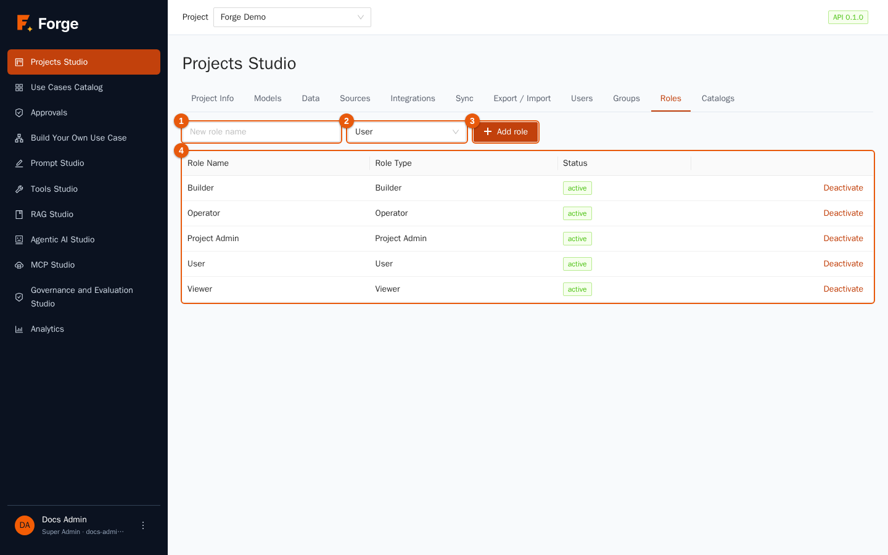

Forge has five **Role Types**, which are fixed sets of permissions, and any number of **Role Names**: labels that you create and that are tied to exactly one type. Members get a *Role Name*.

| Role Type | What it can do |
| --- | --- |
| **Project Admin** | Everything in the project: members, roles, models, limits, tokens, assets. |
| **Builder** | Create and change prompts, RAG pipelines, tools, agents and use cases; publish use cases; run; decide approvals. |
| **Operator** | Run use cases, decide approvals, read all runs. |
| **User** | Run the use cases of the catalogs enabled for their role, and read their own runs. |
| **Viewer** | Read runs and results. No changes, no runs. |

Every project starts with one Role Name for each type. To add your own, for example *Finance analyst* of type *User* (so you can show them only the finance catalog):

1. Type the **New role name** (marker 1), choose the **Role Type** (marker 2) and click **Add role** (marker 3).
2. Use **Deactivate** in the table (marker 4) to retire a role without deleting it; **Activate** brings it back. A deactivated role cannot be given to new members.

## 2.7 Catalogs

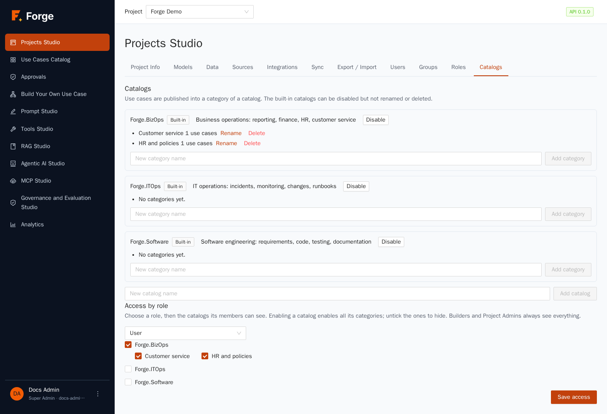

A **catalog** groups use cases that users run; each catalog has **categories**. Forge ships three built-in catalogs: **Forge.BizOps** (reporting, finance, HR, customer service), **Forge.ITOps** (incidents, monitoring, changes, runbooks) and **Forge.Software** (requirements, code, testing, documentation). You can disable a built-in catalog but not rename or delete it, and you can add your own.

- **Add a category:** type a name in the catalog block and click **Add category**. Use cases are published *into a category* (chapter 7).
- **Add a catalog:** type a name at the bottom and click **Add catalog**.
- **Access by role:** by default **no catalog is visible to a role** until you enable it. Pick a role in the selector, tick the catalogs its members may see (this enables all their categories; untick single categories to hide them) and click **Save access**. Builders and Project Admins always see everything.

> **If a user says "my catalog is empty"** this is the first thing to check: the role of that user must have at least one catalog enabled, and at least one use case must be published in it.

## 2.8 Troubleshooting

| Symptom | Cause and remedy |
| --- | --- |
| **New model** is greyed out | The project has no provider of its own. Create one in **Providers** first. |
| A model does not appear in prompts and agents | A Super Admin must enable platform models for the project (chapter 11); project models appear after you save them. |
| *Test Connection* fails with a timeout | The provider is unreachable or slow: check the address, the proxy settings of the installation and the **Timeout** field. Keys are never shown in the error. |
| Invitation says a user was not found | Accounts must exist first. Ask a Super Admin to create the user, or have them sign in once if LDAP or OpenID Connect is used. |
| Alias cannot be deleted | Something still uses it. The message lists what: change those references first. |
| A limit is refused | It is above the platform ceiling. The *Effective now* line and the grey placeholders show the ceilings. |

Next: [3. Prompt Studio](03-prompt-studio.md)
