# 3. Prompt Studio

[Index](README.md) · Previous: [2. Projects Studio](02-projects-studio.md) · Next: [4. Data and RAG Studio](04-data-and-rag.md)

A **prompt** is the set of instructions you send to a language model. In Prompt Studio a prompt is a reusable, versioned asset: it has a system part and a user part, **variables** that are filled at each use, optional **examples**, parameters such as the temperature, and a history of **versions** that you can compare, restore and publish. Agents, RAG pipelines and use cases can then use the *published* prompt, so you can improve it without touching them.

> **Who is this for?** Builders and Project Admins. Other roles do not see Prompt Studio.

## 3.1 Concepts in two minutes

| Word | Meaning |
| --- | --- |
| **System prompt** | The role, the rules and the output format. Sent first. |
| **User prompt** | The request sent each time. It contains the variables. |
| **Variable** | A placeholder written `{name}`. At run time it is replaced by a value. |
| **Example (few-shot)** | An input/output pair shown to the model before the request, to teach the expected style. |
| **Version** | Every **Save** creates a new, immutable version. Old versions are never overwritten. |
| **Draft / Published** | A prompt is *Published* while one of its versions carries the `prod` tag; otherwise it is a *Draft*. |
| **Tag** | A label on a version: `draft` (always the latest saved), `staging` (set by hand) and `prod` (set by *Publish*). |
| **Alias** | The model name a prompt calls, with a fallback chain (chapter 2). |

## 3.2 The prompt library

Open **Prompt Studio**. The **Prompt Library** tab lists the prompts of the project.

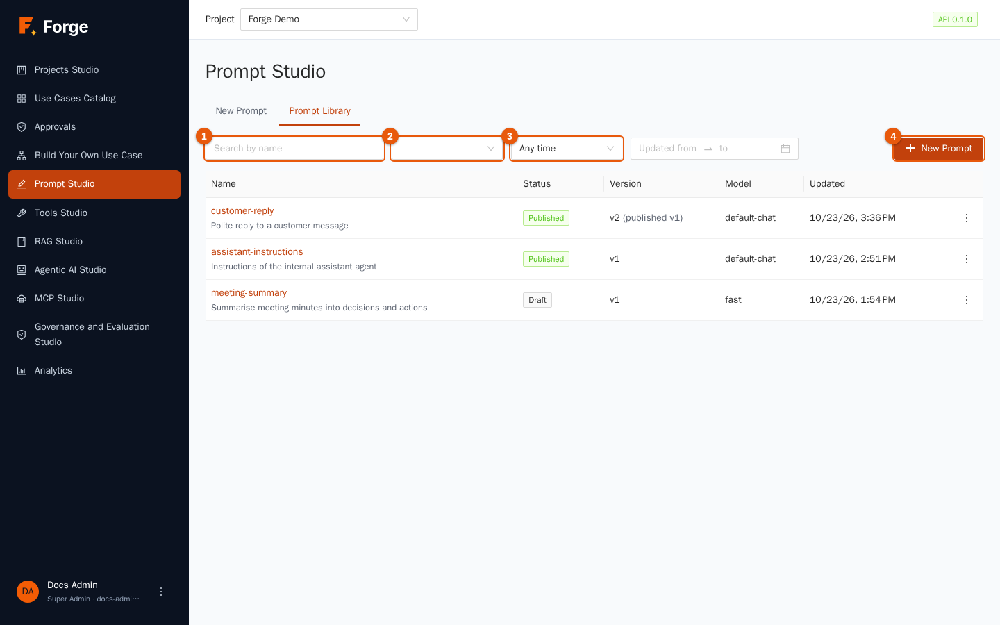

| Marker | Control | Use |
| --- | --- | --- |
| 1 | **Search by name** | Filters as you type. |
| 2 | **Status** | All statuses, *Published* or *Draft*. |
| 3 | **Time range** | Prompts updated in the last 24 hours, 7, 30 or 90 days, or a **Custom date range** (a second control appears: *Updated from … to …*). |
| 4 | **New Prompt** | Opens the editor on an empty prompt. |

The columns show the **Name** (click to open it) with its description, the **Status**, the **Version** (for example *v2 (published v1)*: the latest version is 2, but version 1 is the one in production), the **Model** (alias or model name) and the **Updated** date. Click **Load more** at the bottom for older prompts.

The three dots at the end of a row open the actions:

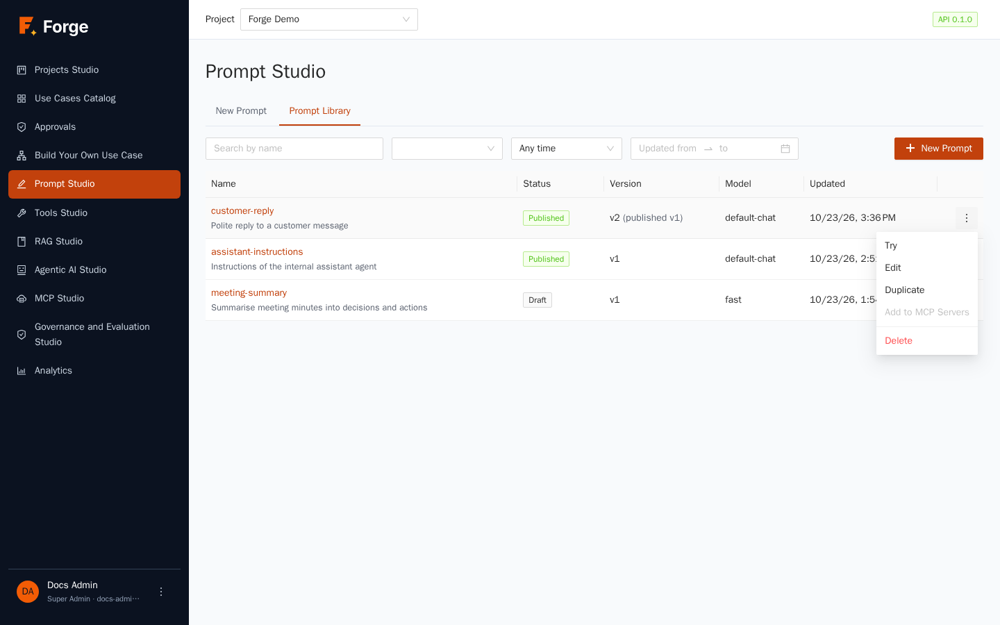

- **Try** opens the test page (section 3.6).
- **Edit** opens the editor.
- **Duplicate** creates a new prompt, under a name you choose, whose first version is a copy of the latest version of this one (the note says *Duplicated from …*). Use it to start from a good prompt.
- **Add to MCP Servers** is greyed out here. To expose a prompt to external applications use the *Integrations* tab of Projects Studio (chapter 10).
- **Delete** removes the prompt and its versions after you confirm. If an agent or pipeline still uses it, deletion is refused and the message names what uses it.

## 3.3 Write a prompt

Click **New Prompt** (or **Edit** on an existing prompt). The editor opens.

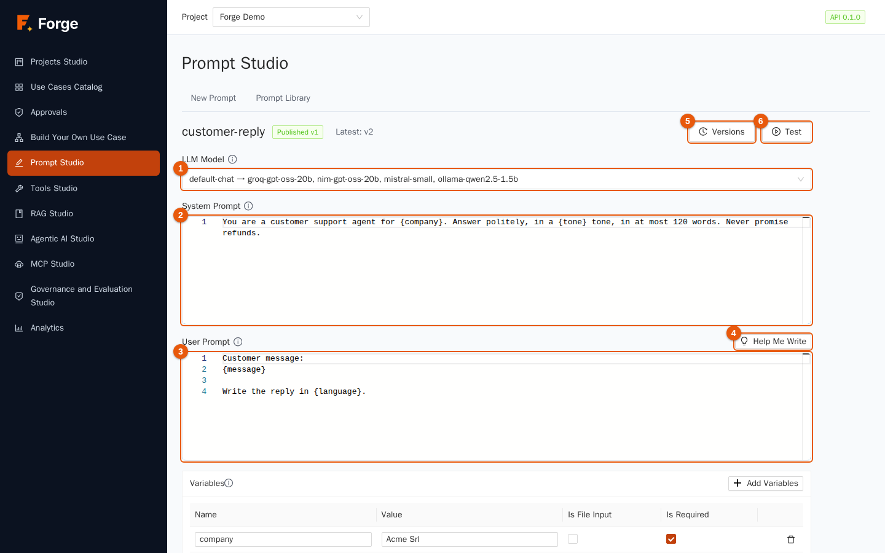

1. **Name.** Click the title (initially *Untitled Prompt*) and type a clear name, for example `customer-reply`. Names are unique in the project. Press Enter to confirm.
2. **LLM Model** (marker 1). Choose an **alias** (shown as `alias → first model, second model…`; recommended, because it follows the project's model configuration and has fallbacks) or a **model** (shown as `Display name (name)`) to pin one model. If the list is empty the project has no chat model: see chapter 2.
3. **System Prompt** (marker 2). Write the role, the rules and the output format, for example: *You are a customer support agent for {company}. Answer politely, in a {tone} tone, in at most 120 words. Never promise refunds.*
4. **User Prompt** (marker 3). Write the request, for example: *Customer message: {message}. Write the reply in {language}.*
5. Anything between single braces is a **variable**. As you type, the *Variables* table below fills in by itself.

Both text boxes are code editors with line numbers. For advanced needs the template language **Jinja2** also works: `{{ name|upper }}`, `…`, `…`. The templates run in a sandbox that refuses anything dangerous, so a faulty or hostile template cannot harm the server. Curly braces that are not a variable name, such as JSON in your text, are left untouched.

### Let Forge write the first draft: Help Me Write

Click **Help Me Write** (marker 4).

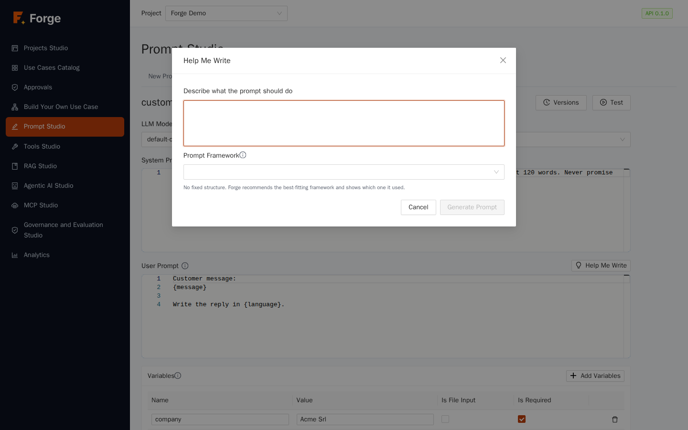

1. Describe in a few lines what the prompt should do (at least 10 characters).
2. Choose a **Prompt Framework**, a proven structure for prompts. **Free Form** (the default) lets Forge recommend the best-fitting framework and tells you which one it used. The others are CO-STAR (context, objective, style, tone, audience, response format), RISEN (role, instructions, steps, end goal, narrowing), RTF (role, task, format) and CRISPE (capacity, insight, statement, personality, experiment).
3. Click **Generate Prompt**. A system prompt and a user prompt appear for review. Click **Re-generate** for another attempt, or **Insert** to copy them into the editor. Nothing is saved until you click **Save**.

Help Me Write calls a chat model of the project, so it consumes a few tokens.

### Variables

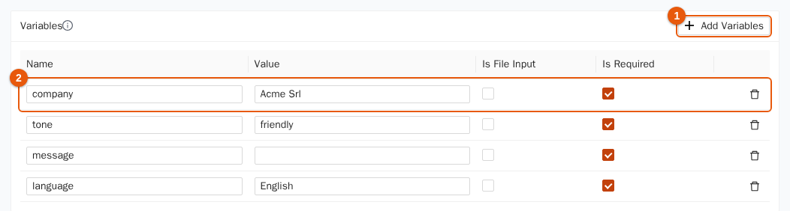

Each variable is a row of the **Variables** table:

| Column | Meaning |
| --- | --- |
| **Name** | The name used between braces. |
| **Value** | The **default** used when you test. At run time a caller can override it. |
| **Is File Input** | The value is the content of a text file (up to 256 KB on the test page), for example meeting minutes. |
| **Is Required** | A run without a value for it is refused. |

Variables found in the templates are added automatically as *required*. **Add Variables** (marker 1) adds one by hand; the bin icon on the right removes it. A variable that no template uses gets an orange tag, **not in the prompt**, so you can delete it. Variables used in a template but not declared are added for you when you save.

### Examples (few-shot)

Under the variables, **Add example** creates an **Input / Output** pair. Examples are sent to the model *between* the system prompt and the user prompt, as if the user had already asked and the assistant had already answered. Two or three good examples fix the style better than a long description. Examples are literal text: variables are not replaced in them.

### Parameters and version note

- **Temperature**: low values (0 to 0.3) give consistent, repeatable answers; higher values (0.7 and above) give more varied, creative ones. Empty uses the model default.
- **Max output tokens**: the longest answer allowed.
- **Version note**: a short sentence saved with the version, such as *Shorter and warmer*, to remember why it changed.

### Save

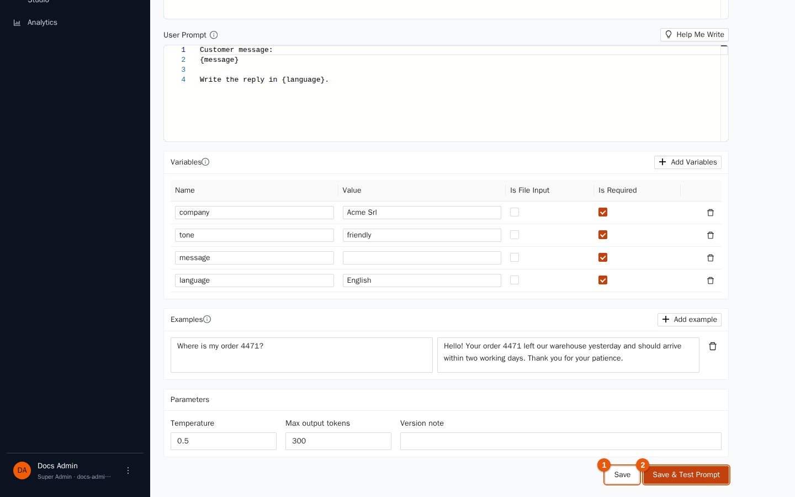

- **Save** (marker 1) creates the **next version** and moves the `draft` tag to it. It does *not* change what is in production.
- **Save & Test Prompt** (marker 2) saves and opens the test page.

## 3.4 Versions

Every save adds a version. Click **Versions** (marker 5 of the editor figure) to open the history.

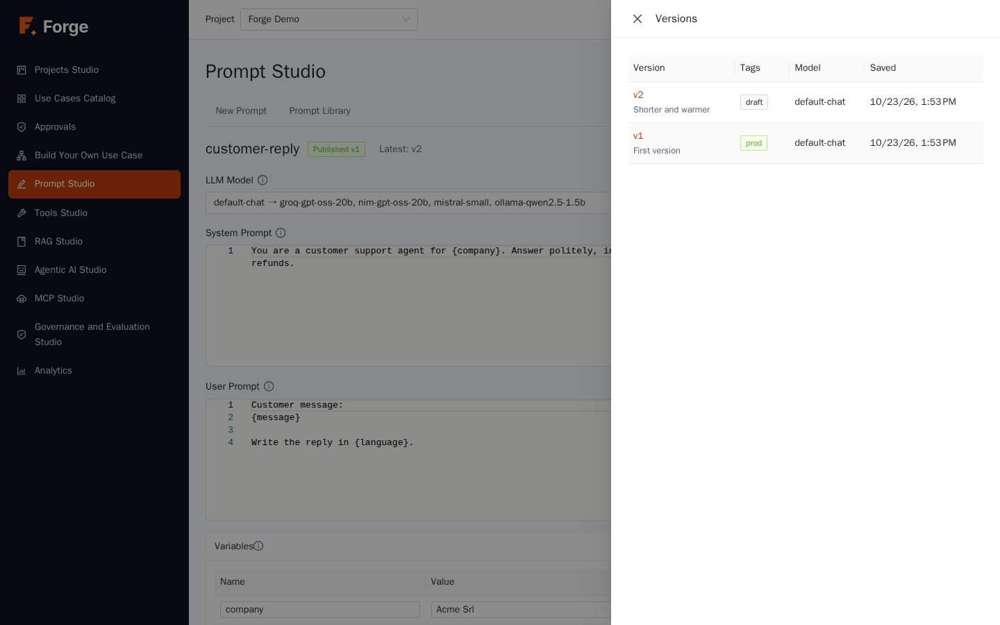

The table shows the **Version** number and its note, the **Tags** (`draft`, `staging`, `prod`), the **Model** and the **Saved** date. Click a version to see its system and user prompts in read-only form, then **Load into editor** to bring that content back. Saving after that creates a *new* version: history is never rewritten, so restoring an old version is always safe and reversible.

## 3.5 Publish

A prompt becomes **Published** when one version gets the `prod` tag. Agents and use cases that follow the published prompt then use that version, and keep using it until you publish another.

1. Open the test page of the version you want (section 3.6) and check that it works.
2. Click **Publish v…** at the top of the test page. The status in the library changes to *Published*, and the *Version* column shows *v2 (published v1)* when production lags behind the latest version.
3. To go back to an earlier version, publish that version again. To stop using a prompt without deleting it, remove its `prod` tag: it becomes a *Draft* again.

The `staging` tag can be set by hand to mark a candidate. A good routine is: save, test, move `staging` to the new version, ask a colleague to check, publish.

## 3.6 Test a prompt

Click **Test** in the editor, **Try** in the library, or **Save & Test Prompt**.

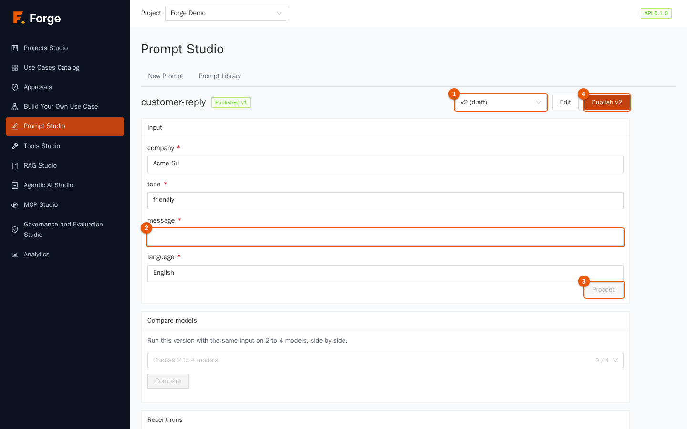

1. Choose the **version** to test (marker 1). The latest is the default; *draft* means "not published".
2. Fill in the **variables** (marker 2). The default values from the editor are already there; required ones are marked with a red asterisk. For **file inputs** pick a text file.
3. Click **Proceed** (marker 3). The model is called and the answer appears under **Result**.

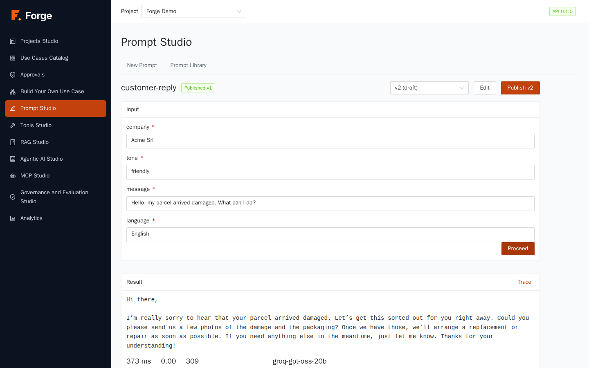

Click **Trace** to open the detail of the call: the **Model** that really answered (useful when a fallback was used), **Latency**, **Cost**, **Tokens**, the exact messages that were sent (system, examples, rendered user prompt), the **Output** and the **Metadata** (parameters, variables, finish reason, whether the answer came from the cache). If a model fails, the run is shown as failed with the reason, instead of a generic error.

The page also has **Edit** (back to the editor) and **Publish v…** (marker 4).

### Compare models

Under the input there is a **Compare models** card. Use it to see how different models answer the *same* input.

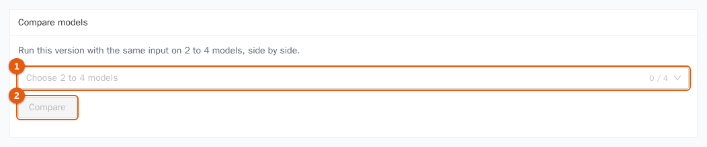

1. In **Choose 2 to 4 models** (marker 1) pick aliases and/or models: it is the same list as the model selector of the editor. Two aliases are a handy way to compare, say, your cheap chain with your most capable one.
2. Click **Compare** (marker 2). All models are called at the same time with the same version and the same variables.
3. The answers appear side by side, each with its **Latency**, **Tokens** and **Cost**. A model that fails shows its error without hiding the others.

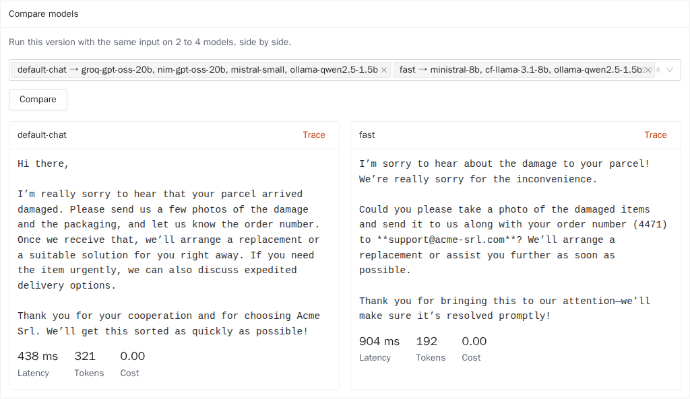

### Recent runs

The **Recent runs** table at the bottom lists the earlier tests of the prompt with **When**, **Kind** (test or comparison), **Version**, **Model**, **Status** and **Latency**. Click a row to reopen its trace.

## 3.7 Good practice

- **One prompt, one job.** If a prompt keeps growing, split it in two prompts used by an agent or use case.
- **Use variables for everything that changes** (names, languages, documents), not for what is always the same.
- **Test with awkward input** — empty fields, very long text, another language — before publishing.
- **Use aliases, not model names**, so you can change models for the whole project from one place.
- **Do not put secrets in a prompt.** Versions are kept forever and visible to every Builder of the project.
- **Write the version note.** Six months later it is the only memory of why the prompt changed.

## 3.8 Troubleshooting

| Symptom | Cause and remedy |
| --- | --- |
| "Prompt Studio needs the Builder or Project Admin role" | Your role cannot edit prompts. Ask a Project Admin. |
| The model list is empty | The project has no chat model or alias. See chapter 2 (a Super Admin must enable platform models for the project). |
| Test fails with *missing variables* | A required variable has no value. Fill it in, or give it a default in the editor. |
| Test fails with an unknown variable | The call names a variable the prompt does not declare. Remove it or declare it. |
| "The file is larger than 256 KB" | File inputs on the test page accept text files up to 256 KB. Shorten the file. |
| The template is refused | It uses something the sandbox forbids (for example `import`, `include` or private attributes), or it is too large (templates up to 32,000 characters). Simplify it. |
| A run fails with an upstream error | The model provider answered with an error or timed out. The trace shows the reason; check the alias fallback chain (chapter 2). |

Next: [4. Data and RAG Studio](04-data-and-rag.md)
