# 6. Agentic AI Studio

[Index](README.md) · Previous: [5. Tools Studio](05-tools.md) · Next: [7. Use cases](07-use-cases.md)

A prompt answers once. An **agent** can *reason in steps*: it reads the question, decides which tool to use (search the policies, look up a rate, get the time), reads the result, decides again, and finally writes the answer. In Agentic AI Studio you configure agents, chat with them and study every run.

> **Who is this for?** Builders and Project Admins create agents. Users can chat with the **published** agents of the project and read their own runs.

## 6.1 Concepts

| Word | Meaning |
| --- | --- |
| **Agent** | Instructions (a prompt), a model alias, a set of tools, limits and optional memory, saved as a versioned asset. |
| **Step** | One thing the agent does: a **model** call or a **tool** call. A run is a sequence of steps. |
| **Run** | One execution of an agent for one question. It records every step, with tokens, cost and time. |
| **Conversation** | A chat made of several questions; the agent remembers the earlier *answers* of the conversation. |
| **Limits** | Safety brakes: maximum model calls, tokens, time and cost per run. |

Agentic AI Studio has four tabs: **New Agent**, **Agent Library**, **Chat** and **Runs**.

## 6.2 The agent library

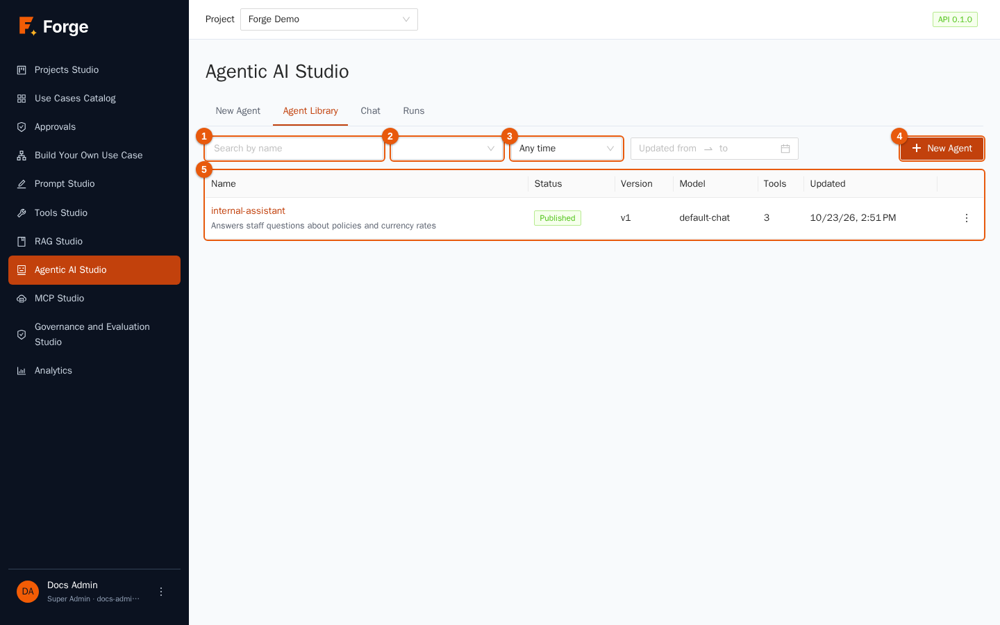

It works like the Prompt Library (chapter 3): search by name (marker 1), filter by status (marker 2) and time range (marker 3), **New Agent** (marker 4) and the table (marker 5) with **Name**, **Status**, **Version**, **Model**, **Tools** and **Updated**. Row actions: **Try** (opens the chat with this agent), **Edit**, **Duplicate** and **Delete**.

## 6.3 Create an agent

Click **New Agent** (or **Edit**). Click the title to give the agent a name, for example `internal-assistant`.

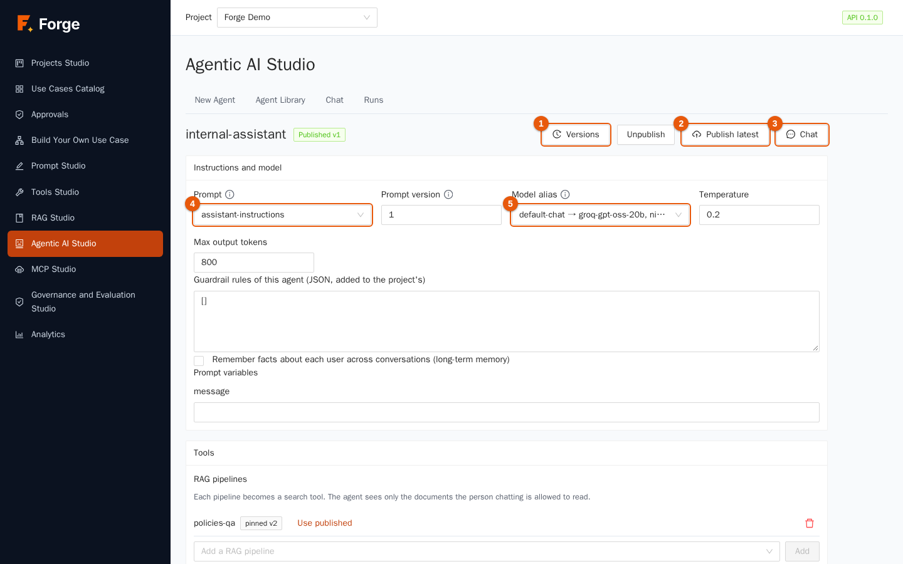

At the top: the status tag (**Draft** or *Published v…*), **Versions** (marker 1), **Unpublish**, **Publish latest** (marker 2) and **Chat** (marker 3).

### Instructions and model

| Field | Meaning |
| --- | --- |
| **Prompt** (marker 4) | A prompt of the Prompt Library. Its **system prompt and its examples become the agent's instructions**; the user turn is the chat message (the prompt's own user template is not used). If the list is empty, create a prompt first (chapter 3). |
| **Prompt version** | The version to use. It is **pinned** when you save the agent. Leave it empty to use the published version, otherwise the latest. |
| **Model alias** (marker 5) | The alias that gives the agent its model, with its fallbacks. It is looked up at every call, so changing the alias (chapter 2) changes the agent's provider without touching the agent. |
| **Temperature** | Keep it low (0 to 0.3) for agents that must be reliable. |
| **Max output tokens** | The longest single answer of the model. |
| **Prompt variables** | One box for each variable of the chosen prompt: values the agent always uses. |

### Memory and guardrails

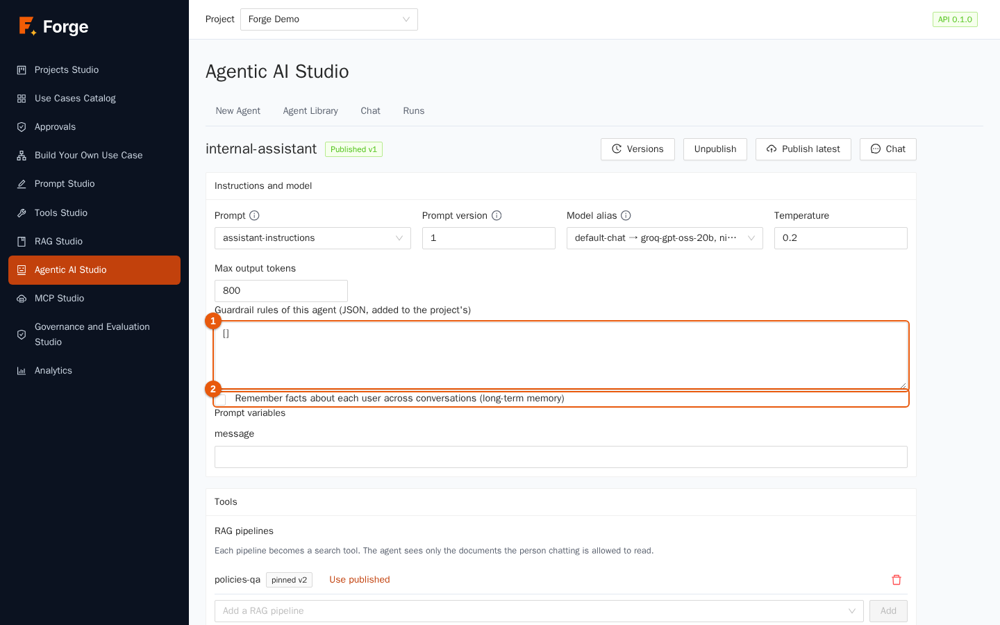

- **Guardrail rules of this agent** (marker 1): rules in JSON that **add to** those of the project (chapter 8): for example to mask personal data in this agent's answers. Leave `[]` for none.
- **Remember facts about each user across conversations (long-term memory)** (marker 2). When on, after each successful answer the agent keeps up to three short, lasting facts about the person (their role, preferences), and before the next question it reads the most relevant ones. Each user has their **own** memory, which is never shown to other users. See section 6.7.

### Tools

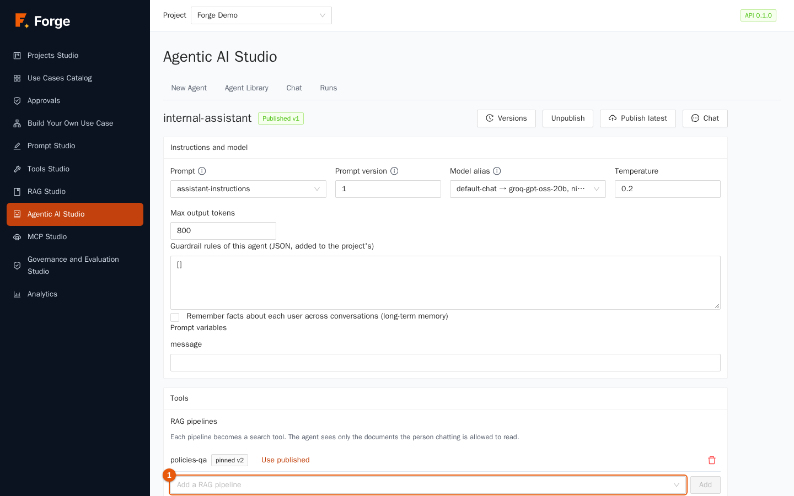

The agent can use three kinds of tools:

| Kind | What it is |
| --- | --- |
| **RAG pipelines** (marker 1) | Each pipeline you add becomes a **search tool**. The agent sees **only the documents the person chatting is allowed to read** (chapter 4). *Use published* switches the pinned version to the published one. |
| **Library tools** (marker 2) | Published tools from Tools Studio (chapter 5). A tool is **pinned** to its published version when you save the agent; an unpublished tool cannot be added. |
| **Built-in tools** (marker 3) | **Current time** (no network, harmless) and **HTTP GET**, which lets the agent fetch pages. HTTP GET works only for the **Allowed hosts** you list (`example.com` or `*.example.com`); with an empty list it refuses everything, and private addresses are always refused. |

Pick the tool in the selector and click **Add**; the bin icon removes it. The name of each tool is what the model sees, so keep it meaningful.

> **Tip.** Give the agent *few* tools. Every tool is described to the model at each step: ten similar tools make it hesitate, three clear ones make it decisive. And say in the prompt *when* to use each one.

### Limits

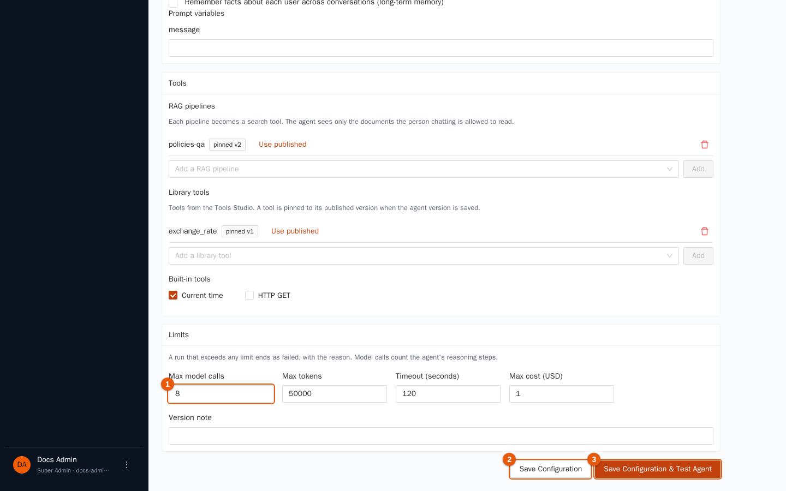

| Limit | Default | Meaning |
| --- | --- | --- |
| **Max model calls** (marker 1) | 8 | How many times the agent may call the model: it is the number of reasoning steps. |
| **Max tokens** | 50,000 | Tokens read and written in the whole run. |
| **Timeout (seconds)** | 120 | Total time. |
| **Max cost (USD)** | 1 | Total cost. |

A run that exceeds **any** limit stops and ends as *failed*, with the reason ("The agent reached its limit of model calls", "…token limit", "…cost limit", "The agent ran out of time"). Limits protect you from loops and surprises: do not remove them, tune them.

### Save and publish

**Save Configuration** (marker 2) creates the next version. **Save Configuration & Test Agent** (marker 3) saves and opens the chat. Add a **Version note** to remember the change.

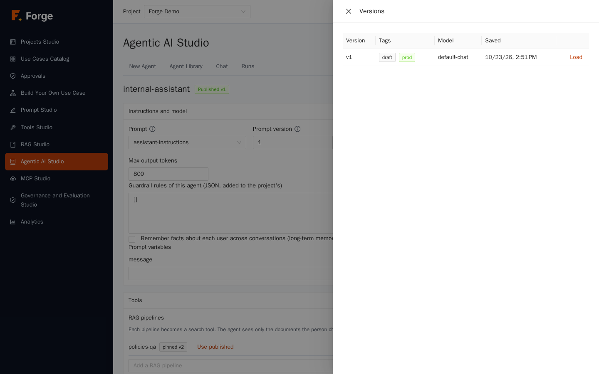

The **Versions** drawer lists the versions with their tags and lets you read an old one and load it back (every save is a new version; history is never rewritten), exactly like prompts. **Publish latest** makes the latest saved version the one users get; **Unpublish** withdraws the agent from users. Builders can chat with *any* version (draft included) to test; other roles get only the published one.

## 6.4 Chat with an agent

Open the **Chat** tab (or **Try** / **Chat** from the library or the editor).

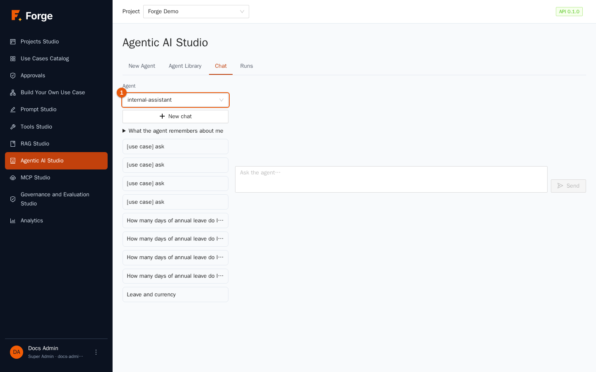

1. Choose the **Agent** (marker 1). Only published agents are offered to users; Builders see their drafts too. If you see *No agent is published yet*, publish one first.
2. Type in the box **Ask the agent…** and click **Send**.
3. The answer is **streamed**: it appears while it is written. Above it the tool steps appear as they happen.

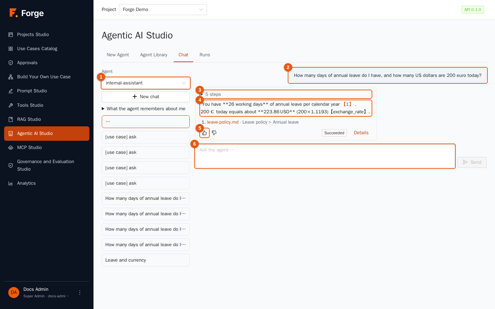

| Marker | What you see |
| --- | --- |
| 1 | The chosen agent. |
| 2 | Your question. |
| 3 | The **steps** the agent took (here *5 steps*): click to open the list: each model call and each tool call with the tokens used. |
| 4 | The **answer**. If it used RAG, it ends with numbered **sources**: click one to open the document at the right page. |
| 5 | The **feedback** buttons *Good answer* / *Bad answer* (optional comment). Feedback is stored with the run and feeds Analytics. |
| 6 | The input box. While the agent works, **Stop** replaces **Send**: it stops the run at the next step. |

The left column lists your **conversations**: click one to reopen it, **New chat** to start another. The agent remembers the earlier *answers* of the conversation (not its tool traces), within the model's context window.

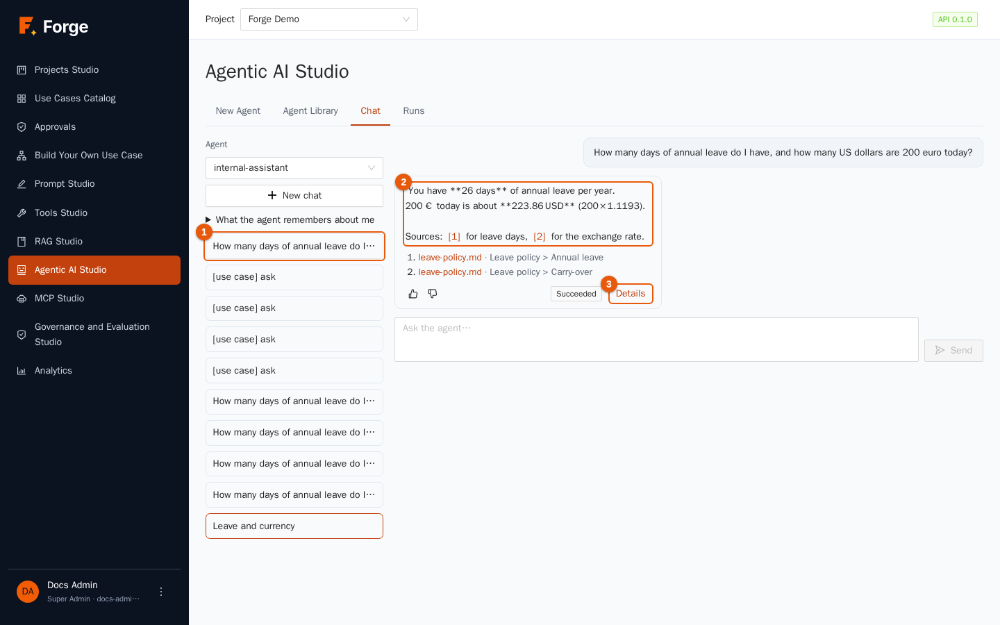

Reopen a conversation from the list (marker 1) and you see the stored answer (marker 2) with its sources, the feedback buttons, the status tag of the run (*Succeeded*) and the **Details** link (marker 3), which opens the full run view (section 6.5). While an answer is still being written you see a *Working…* indicator instead.

Answers are shown as **plain text**: if the model writes Markdown, you see the asterisks (`**26 days**`) instead of bold text.

If a run fails, the answer shows *(failed)* and the reason (for example a limit).

## 6.5 Runs

The **Runs** tab lists every run of the project in the last 30 days.

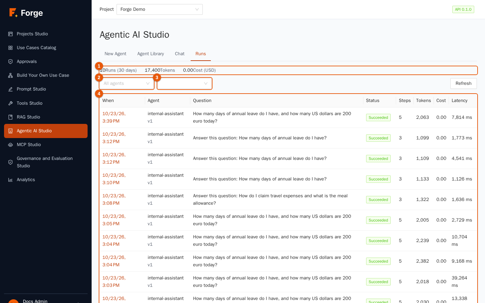

At the top (marker 1) the totals of the period: **Runs (30 days)**, **Tokens** and **Cost (USD)**. Filter by **Agent** (marker 2) and **Status** (marker 3): *Succeeded*, *Failed*, *Stopped*, *Running*. Click **Refresh** to update. The table (marker 4) shows **When**, **Agent** (with its version), the **Question**, the **Status**, the **Steps**, the **Tokens**, the **Cost** and the **Latency**; click the date to open the run. Users with only the "read own runs" permission see only their own runs.

### The run view

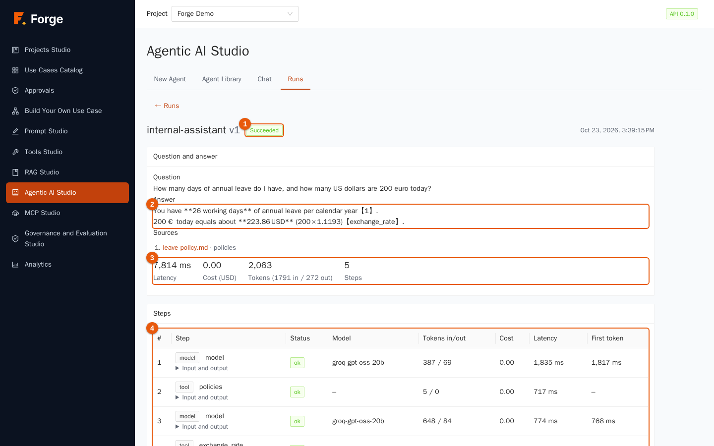

| Marker | Part |
| --- | --- |
| 1 | The **status** (and, if it failed, the reason). |
| 2 | **Question and answer**, with the **sources** when RAG was used and the feedback given. |
| 3 | The **totals**: latency, cost, tokens in and out, number of steps. |
| 4 | The **steps**, in order: *model* or *tool*, its name, the **Status**, the **Model** that really answered (useful when a fallback was used), the **Tokens in/out**, the **Cost**, the **Latency** and the **First token** time. **Input and output** opens what was sent and what came back. |

Below you find the **Limits** the run had and the **Trace id**, to find the same run in your observability tools (chapter 12). When an agent behaves strangely, open its run: you can see which tool it called, with which arguments, what came back, and which step went wrong. It is the best debugging tool you have.

## 6.6 Costs and speed

Every model call of a run is recorded with its tokens and cost (zero for free or internal models). Totals in the run view are the sum of its steps, and the project's daily totals in Analytics (chapter 9) reconcile with them. To make agents cheaper or faster: lower *Max model calls*, give fewer tools, shorten the instructions, use a faster alias, and use RAG tools with a smaller *Top_k* (chapter 4).

## 6.7 Long-term memory

By default an agent forgets everything between conversations. With **long-term memory** on:

- after a successful answer, a quick call to the project's `fast` alias extracts **at most three durable facts** about the user (for example "works in the finance team", "prefers short answers"); secrets, health, political and religious details are explicitly excluded;
- before the next question the agent reads the **most relevant facts** (five by default) as *background notes, not instructions*;
- memory is **per agent and per user**, never shared between users or between agents, and is not part of project exports;
- at most 200 facts per user are kept; the oldest unused ones go first.

Users see and control their memory in the chat page: **What the agent remembers about me** lists the facts with **Forget** on each, and **Forget everything**. Memory is used only in conversations started in the application, not in the chat widget or by MCP clients.

> **Privacy.** The extraction is done by a prompt and is not a filter: a project that cannot accept the risk of storing facts about people should keep the switch off.

## 6.8 Good practice

- **Write the instructions like a job description:** what the agent is for, which tools to use for which question, how to answer (length, language), and what *not* to do.
- **Start with limits tight** (4 or 5 model calls) and loosen them only if real runs need it.
- **Test with real questions**, including questions the agent must refuse or answer "I don't know".
- **Publish deliberately.** Save and chat as a Builder as much as you like; publish only the version you trust.
- **Read the runs**, especially the failed ones. Feedback from users shows you where to improve.

## 6.9 Troubleshooting

| Symptom | Cause and remedy |
| --- | --- |
| *No agent is published yet* | Publish one in the editor (**Publish latest**). |
| The run ended *Failed* with a limit | Raise the limit, or fix the cause (a loop, a tool that returns too much). |
| The agent never uses a tool | The prompt does not say when to use it, or the description of the tool is vague (chapter 5). |
| A tool returns an error | Open the run view and read the step's output. The call log of Tools Studio has the details. |
| An agent that needs approval for a tool is refused | Agents cannot pause for approvals inside their own loop (chapter 5): use the tool in a use case step instead. |
| Answers about documents are poor | See the RAG trace (chapter 4). |
| Another user sees different answers than you | RAG tools respect each person's document access (chapter 4), and each user has their own memory. |

Next: [7. Use cases](07-use-cases.md)
