# 7. Use cases

[Index](README.md) · Previous: [6. Agentic AI Studio](06-agents.md) · Next: [8. Governance and Evaluation Studio](08-governance.md)

A **use case** packages a complete piece of work for people who are *not* AI specialists: "Reply to a customer", "Answer a policy question", "Summarise the minutes". It has a simple **form**, a **workflow** behind it (prompts, agents, tools, branches, human approvals) and an **output**. Builders create use cases; everybody else just fills in the form and gets the result. This chapter covers both sides: *using* the catalog (sections 7.1 to 7.4), *deciding* approvals (7.5) and *building* use cases (7.6 to 7.11).

> **Who is this for?** Everyone for sections 7.1–7.5. Builders and Project Admins for 7.6–7.11.

## 7.1 The catalog

Open **Use Cases Catalog** in the side menu.

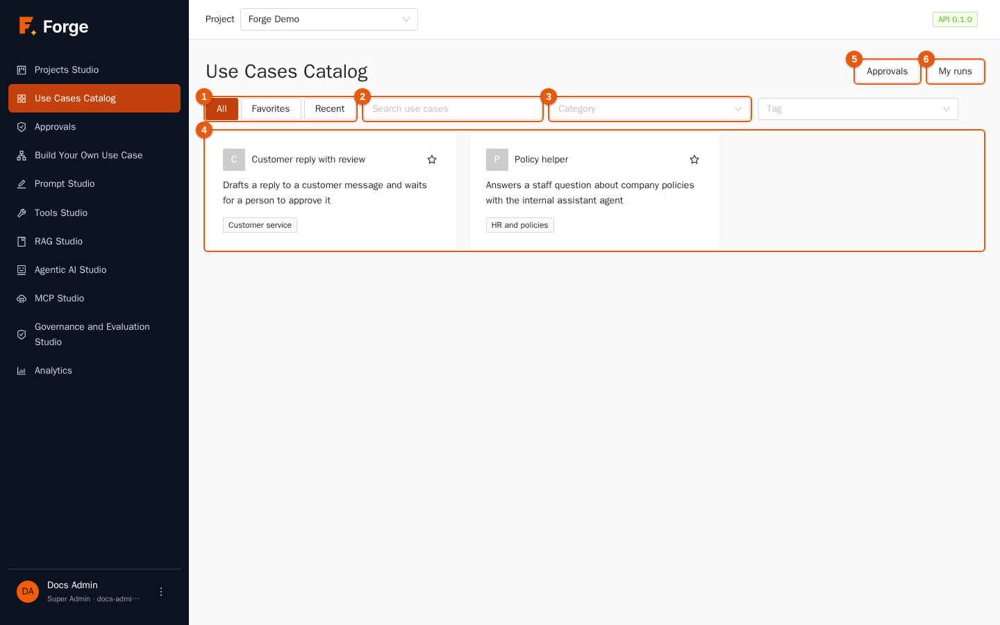

| Marker | Control | Use |
| --- | --- | --- |
| 1 | **All / Favorites / Recent** | *All* the use cases you may run, the ones you starred, or the last twelve you ran. |
| 2 | **Search use cases** | Searches names and descriptions. |
| 3 | **Category** (and **Tag**) | Filters by catalog category (such as *Customer service*) or by tag. |
| 4 | The cards | One card per use case, with its description and category. The star adds it to *Favorites*. |
| 5 | **Approvals** | Opens the approvals waiting for you (section 7.5). Shown to people who may decide approvals. |
| 6 | **My runs** | Your history of runs (section 7.4). |

You see only the use cases that are **published** and that the catalogs enabled for your role contain. If the page says *No use case is available for your role yet*, ask a Project Admin to enable a catalog for your role (chapter 2, *Catalogs*). End users never see the agents, prompts or tools behind a use case.

## 7.2 Run a use case

1. Click a card. The use case page shows the description and a **form** made for this use case.

   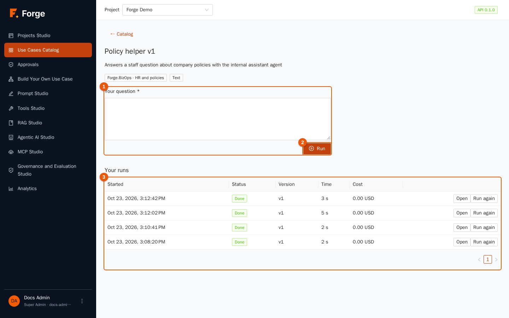

2. Fill in the fields (marker 1). Fields can be text, long text, numbers, a choice, a **file** (text, Markdown, CSV, JSON, PDF, Word or Excel; up to 100 MB) or a data collection. Required fields are marked.
3. Click **Run** (marker 2). The run page opens at once.

Under the form, **Your runs** (marker 3) lists your earlier runs of this use case, each with **Open** and **Run again**.

## 7.3 Follow a run and get the result

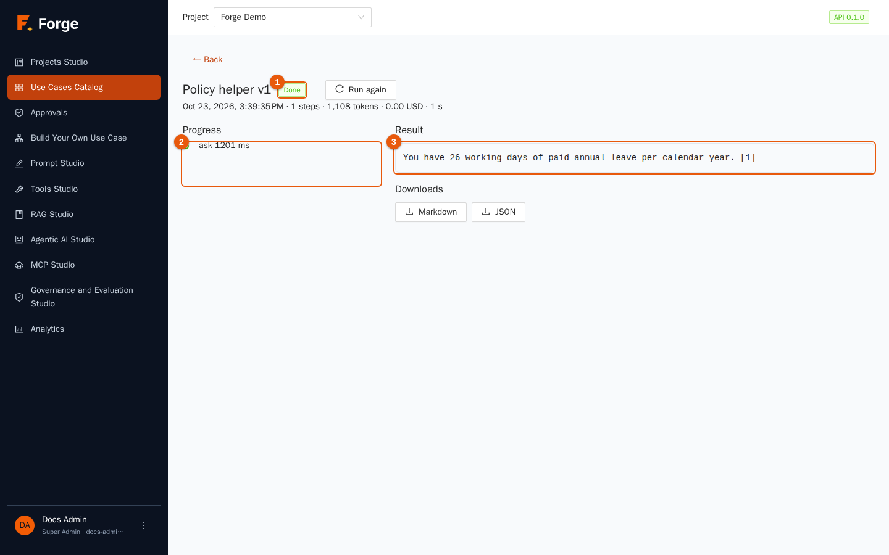

| Marker | Part |
| --- | --- |
| 1 | The **status**: *Queued*, *Running*, *Waiting for approval*, *Done*, *Failed* or *Stopped*. Next to it, **Stop** (while running) and **Run again**. Below the title: when it started, the steps, tokens, cost and time. |
| 2 | **Progress**: each step of the workflow as it starts and finishes. You see step names and their status, not the inner details. |
| 3 | The **Result**. It appears when the run ends; while it runs the page says *The result appears here when the run is done.* |

Under the result, **Downloads** offers **Markdown** and **JSON**, and a **Word**, **Excel** or **PDF** file when the use case was built to produce one. The page updates by itself; if you close it, the run keeps going and you can find it again in **My runs**. If a run fails, the page says *The run failed* and gives the reason; **Run again** starts a new run with the same inputs on the *current* published version.

## 7.4 Your run history

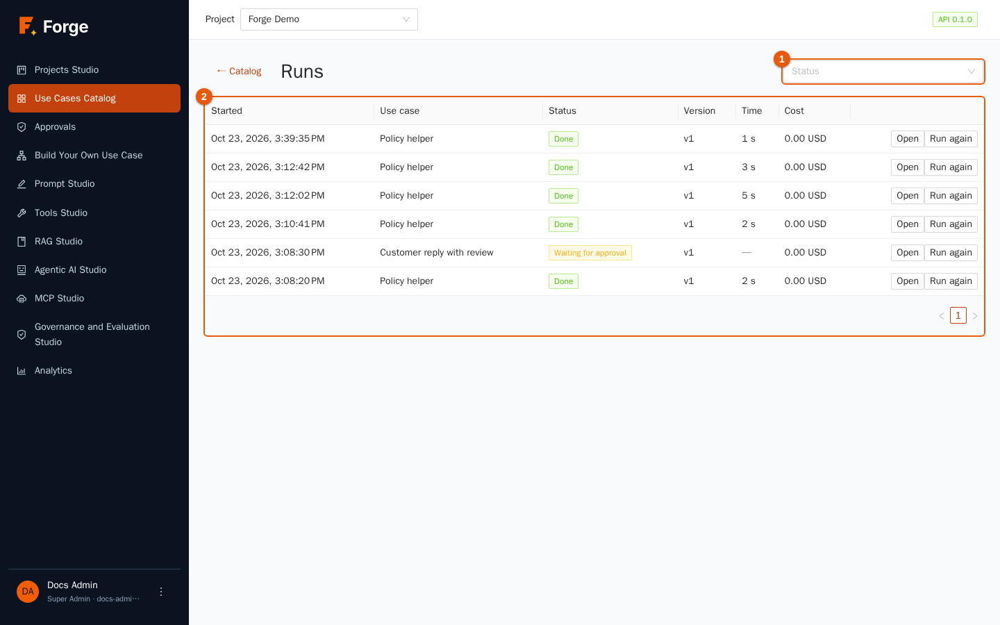

**My runs** lists your runs with **Status** filter, **Started**, **Use case**, **Version**, **Time** and **Cost**, with **Open** and **Run again**. Operators, Builders and Project Admins see the runs of the whole project; end users see their own. A run stays attached to the version that was live when it started, so later changes never alter a past result.

## 7.5 Approvals

Some workflows stop and ask **a person** to check something before going on: a draft reply, a document, the arguments of a tool that changes data. Those requests are called *approvals*. Open **Approvals** in the side menu.

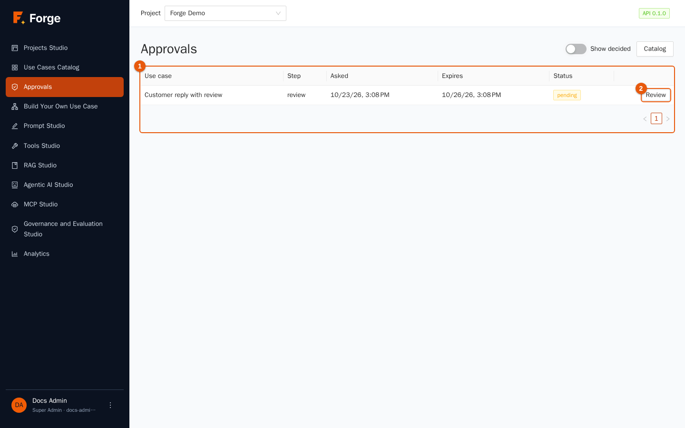

The list (marker 1) shows the **Use case**, the **Step**, when it was **Asked**, when it **Expires**, the **Status** and a **Review** button (marker 2). Tick **Show decided** to see the ones already handled. If nothing needs you, the page says *Nothing is waiting for you*. You can decide approvals if your role is Project Admin, Builder or Operator (or one of the roles the builder chose as *assignees* for that step).

### Review and decide

Click **Review**.

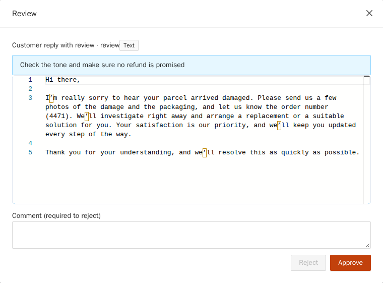

1. Read the instruction at the top (here *Check the tone and make sure no refund is promised*).
2. Read the content in the editor. For a text it is **editable**: fix what is wrong. For a tool it shows the planned arguments as JSON, also editable.
3. Choose:
   - **Approve**: the run continues with the content as shown.
   - **Approve with changes**: appears when you edited the text; the run continues with *your* version.
   - **Reject**: stops the step. A **Comment** is **required** to reject. For an agent step marked "human in the loop", a rejection sends the comment back to the agent, which tries again (up to three times); for other steps the run fails and shows your comment.

An approval **expires** if nobody decides in time (72 hours by default); the run then fails with *Expired: nobody decided in time*. If the run is stopped, the approval is *Cancelled*.

You can also be notified: Builders can have approvers receive an **e-mail with a one-time link** that opens the review without signing in, or a **webhook** call; a link works once and stops working when the approval is decided or expires.

## 7.6 Build your own use case: overview

Open **Build Your Own Use Case**, then **Use case library**. Building has three steps that match three pages: **1. Requirements**, **2. Workflow**, **3. Test workflow**, plus a **Settings** page for everything else.

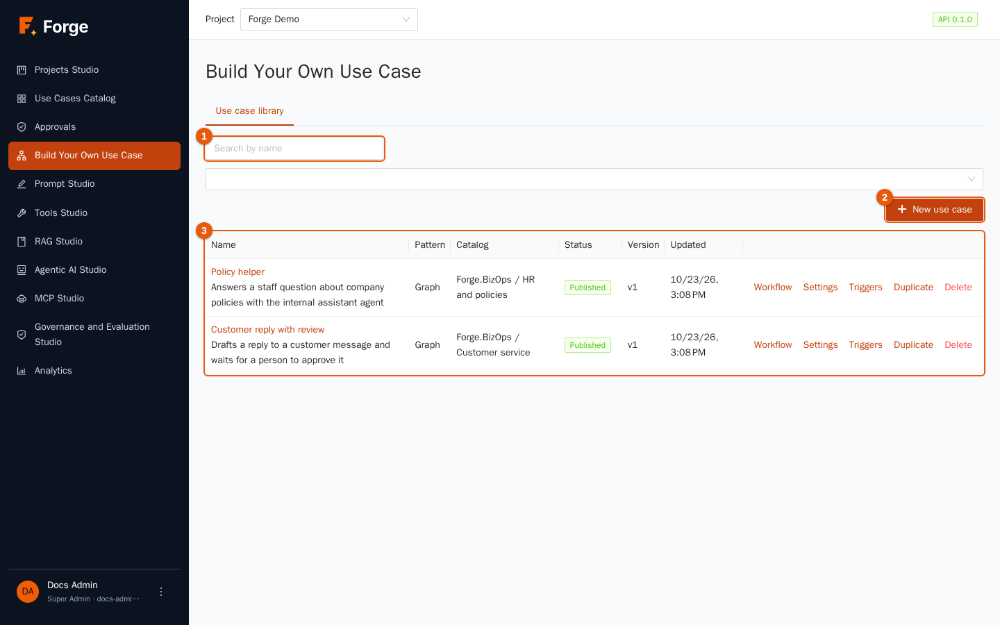

The library lists your use cases (marker 3) with **Name**, **Pattern**, **Catalog**, **Status** (*Draft*, *Testing*, *Published*, *Deprecated*), **Version** and **Updated**. Search by name (marker 1) and filter by status; **New use case** (marker 2) starts the builder. Row actions: **Workflow**, **Settings**, **Triggers**, **Duplicate**, **Delete** (refused while the use case is filed in a catalog category or has runs).

There are two **patterns**:

| Pattern | Use it for |
| --- | --- |
| **Agent team** (*supervisor*) | A team of agents working **in order**, each with its task, like a small assembly line. Simple to build. |
| **Graph** | Nodes connected by arrows, with branches, loops, parallel work and human approvals. Use it as soon as you need conditions or approvals. |

## 7.7 Step 1: requirements

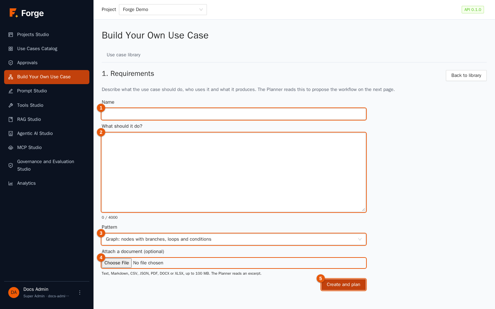

1. Give the use case a **Name** (marker 1).
2. In **What should it do?** (marker 2) describe, in a few lines, what the use case does, who uses it and what it produces (up to 4,000 characters). The Planner reads this text.
3. Choose the **Pattern** (marker 3).
4. Optionally **attach a document** (marker 4: text, Markdown, CSV, JSON, PDF, DOCX or XLSX, up to 100 MB): the Planner reads an excerpt. **Continue without the file** skips it.
5. Click **Create and plan** (marker 5). The draft is saved and step 2 opens.

## 7.8 Step 2: the workflow

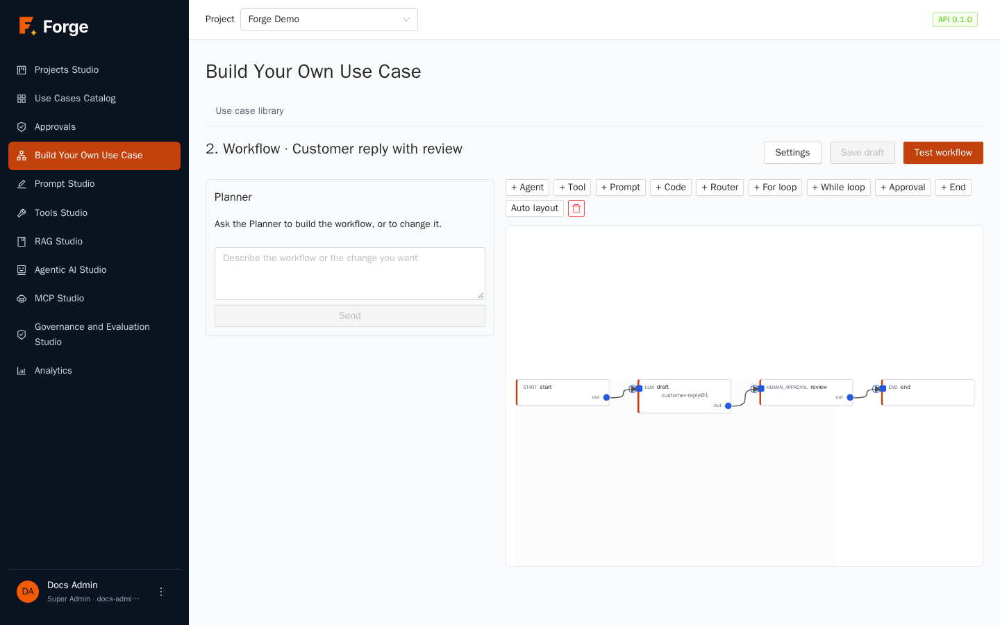

The page has the **Planner** chat on the left and the workflow on the right.

### The Planner

Describe what you want ("Draft a reply, then let a person check it before it is sent") and click **Send**. The Planner proposes a complete workflow using **only what exists in your library**: *published* agents, tools and prompts. It checks its own proposal for errors and fixes them (up to three attempts). Then:

- read its reply;
- if something is missing, it lists **Missing capabilities** with a suggested name and purpose, and a **Create agent** link to the agent editor;
- click **Apply to workflow** to put the proposal in the editor. The Planner never saves anything: **Save draft** stores what you see.

You can ask for changes in plain words ("add a step that translates the answer to Italian") as often as you like.

### The canvas (graph pattern)

Above the canvas, buttons add nodes: **Agent**, **Tool**, **Prompt**, **Code**, **Router**, **For loop**, **While loop**, **Approval** and **End**; **Auto layout** tidies the diagram and the bin removes the selected node. Drag from a node's output dot to another node's input to connect them: an arrow means *"run after"*. Nodes that depend on the same earlier node run **in parallel**. **Double-click** a node to open its settings:

| Node | What it does | Main settings |
| --- | --- | --- |
| **start** | The entry point. | none |
| **agent** | Runs a library agent. | the agent, the **task**, the input, the name of the output variable, *human in the loop* |
| **tool** | Calls a library tool. | the tool, its arguments (JSON), output variable |
| **llm** (*Prompt*) | Runs a library prompt once. | the prompt, its variables (JSON), output variable |
| **code** | Runs a few lines of Python in the sandbox (chapter 5). | the code and arguments |
| **router** | Chooses the path: ordered **sections** with conditions *(field, operator `=`, `!=`, `>`, `<`, `contains`, value)* combined with AND/OR; several sections may match; a *default* path catches the rest. Paths not taken are marked *skipped*. | the sections |
| **for_each / while** | Repeats for every item of a list, or while a condition holds. | the items or condition, **maximum iterations** (always required) |
| **human_approval** | Stops and asks a person (section 7.5). | the text to show, the instructions, who may decide, how long to wait |
| **end** | Produces the final result from a template. | the result, for example `{final}` |

Values flow between nodes through **variables**: a node's *output variable* (for example `draft`) can be used in later nodes as `{draft}`; the form fields (`{message}`) are variables too. Nodes with problems are highlighted and listed under **The workflow needs attention**.

### The team (agent-team pattern)

The page shows a tile for each agent, in running order. Drag to reorder, edit each **Task**, **Remove agent**, or pick an agent in **Add an agent from the library** and click **Add**. The team needs at least one agent.

Click **Save draft** often. **Test workflow** goes to step 3. **Settings** opens the settings page.

## 7.9 Step 3: test

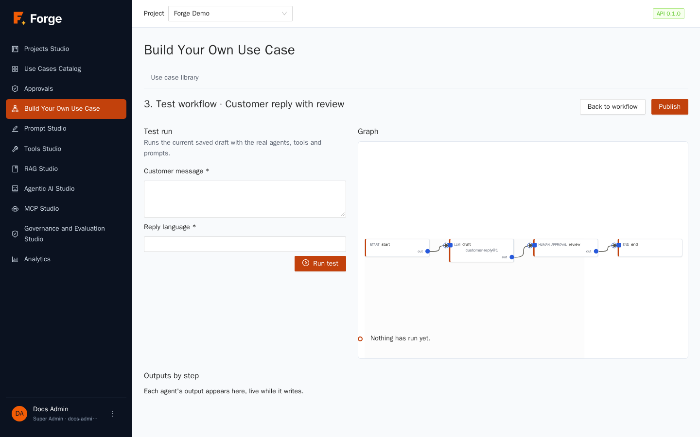

1. Fill the **form** on the left with sample values and click **Run test** (a test run is real: it calls real models and tools and costs real tokens).
2. The **graph** shows which node is running (colours: running, succeeded, failed, skipped) and the **Timeline** lists the steps.
3. **Outputs by step** shows each step's output, **live while an agent is writing**.
4. If the workflow reaches an approval, the page says *The run waits for a person to approve a step* with an **Open Approvals** button: approve it yourself to see the end of the run.
5. When you are satisfied, click **Publish**: add a **Description**, choose the **Catalog** and **Category** and a **Note**, then confirm. The use case appears in the catalog for the roles that may see that catalog.

Publishing requires a **valid and complete** definition and that every agent, tool and prompt it uses is **published** (prompts tagged *prod*). The error tells you which one is not.

## 7.10 Settings, versions and lifecycle

Click **Settings** (or **Edit** from the library).

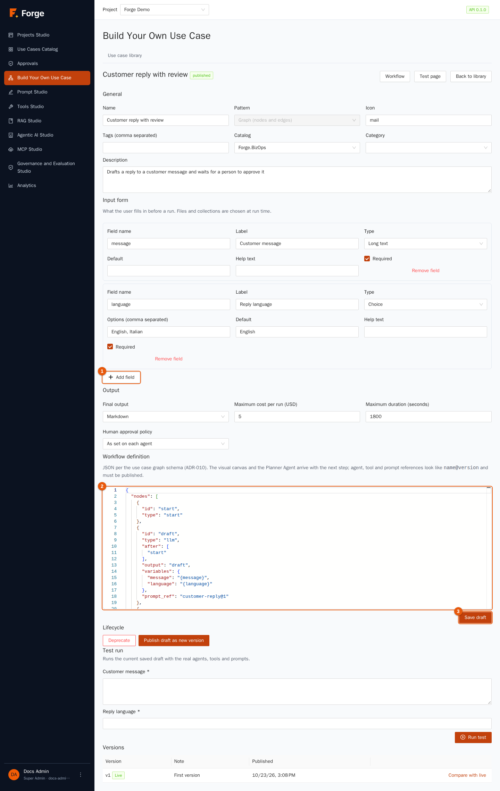

| Section | What you set |
| --- | --- |
| **General** | **Name**, **Pattern** (fixed after creation), **Icon**, **Tags**, **Catalog**, **Category**, **Description**. |
| **Input form** | The fields users fill in (**Add field**, marker 1): **Field name** (lower case, digits and underscores; it becomes the variable), **Label**, **Type** (*Text*, *Long text*, *Number*, *Choice*, *File*, *Data collection*), **Options** and **Default** for choices, **Help text** and **Required**. |
| **Output** | **Final output**: *Markdown*, *JSON (with schema)*, *Word*, *Excel*, *PDF* or *Chat transcript*. **Maximum cost per run (USD)** and **Maximum duration (seconds)** stop runaway runs. **Human approval policy**: *As set on each agent*, *Always* or *Never*. |
| **Workflow definition** | The same workflow as JSON, in a code editor (marker 2): for advanced users and for copying between projects. |

Click **Save draft** (marker 3). A draft can be saved with references to things not yet published; testing and publishing refuse them.

### Lifecycle and versions

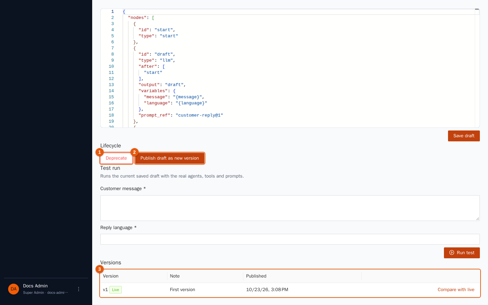

A use case moves through **Draft → Testing → Published → Deprecated**:

- **Move to testing** / **Back to draft** mark where you are (and check the definition).
- **Publish draft as new version** (marker 2) turns the draft into a new, immutable version. Runs already started keep the version they began with.
- **Deprecate** (marker 1) withdraws it from the catalog without deleting it.

The **Versions** table (marker 3) shows every published version with its note and a **Live** tag on the current one. **Compare with live** shows what differs between the draft or a version and the live one. **Roll back to this** makes an old version live again and replaces the draft with it (references are checked again).

## 7.11 Triggers: start a use case without a person

A **trigger** starts a run of the **published** version on a schedule, or when another system calls a URL. Click **Triggers** in the library row.

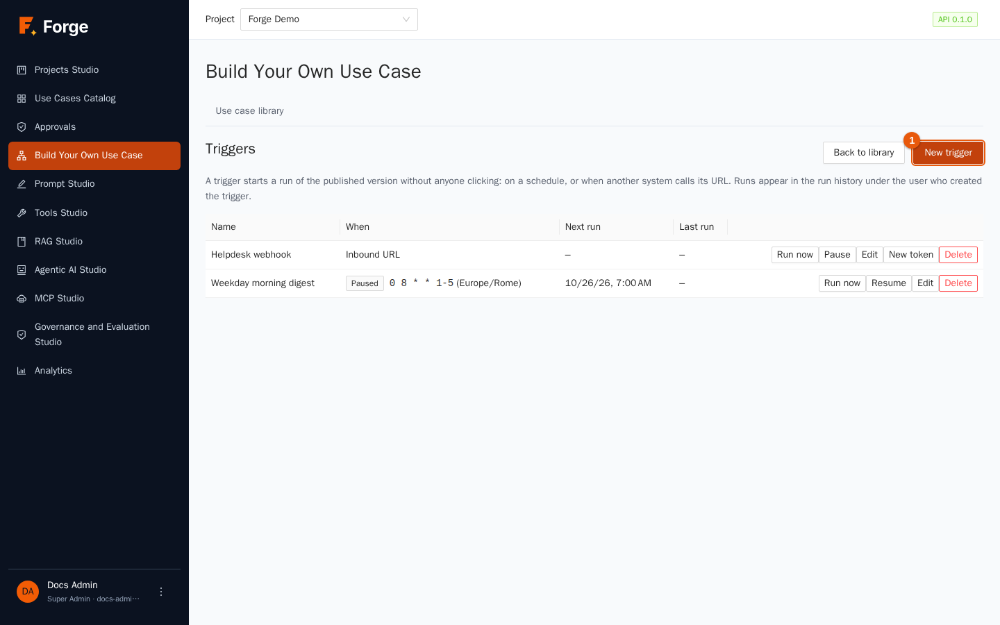

The table shows each trigger's **Name**, **When** (the schedule, or *Inbound URL*), **Next run** and **Last run**; actions: **Run now**, **Pause** / **Resume**, **Edit**, **New token** (for URLs) and **Delete**.

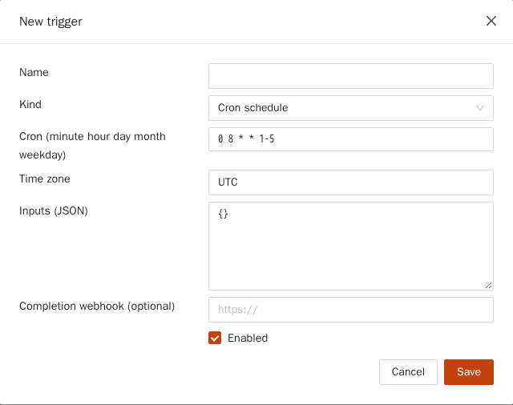

Click **New trigger** and choose the **Kind**:

| Kind | You provide |
| --- | --- |
| **Cron schedule** | A five-field cron expression *(minute hour day month weekday)*, for example `0 8 * * 1-5` for 08:00 on weekdays, and the **Time zone** (for example `Europe/Rome`). |
| **Every N minutes** | The interval in minutes (at least 5). |
| **Inbound URL (called by another system)** | Nothing: Forge creates a secret URL. |

Then fill in **Inputs (JSON)** — the fixed values of the form — and, if you want to be told when each run ends, a **Completion webhook (optional)**; keep **Enabled** ticked and **Save**. For an inbound URL, **copy the URL right away**: it is shown **once**, and anyone who has it can start the use case, so treat it like a password. Call it with `POST`; an optional JSON body with an `inputs` field adds or overrides inputs. **New token** replaces the URL (the old one stops working).

Good to know: a trigger runs **as the person who created it**; only published use cases run (otherwise the attempt is recorded as failed, and a schedule is **paused after five failures in a row**); a schedule that is due while the previous run is still going skips that slot; file inputs are not supported; runs appear in the run history of the creator.

## 7.12 Good practice

- **Start with the form.** Few fields, clear labels and help text; people who do not understand the form will not use the use case.
- **Put a person where it matters:** approvals before anything is sent outside the company or written to a system.
- **Test with realistic and bad input** before publishing; read the *Outputs by step*.
- **Publish a version, then keep improving the draft.** Users keep the stable version until you publish again.
- **Set cost and time limits** that fit the use case.
- **File it in the right category** and check, with a test user, that the intended roles see it.

## 7.13 Troubleshooting

| Symptom | Cause and remedy |
| --- | --- |
| The catalog is empty | No catalog is enabled for your role (chapter 2), or nothing is published in it. |
| *Your role cannot run use cases in this project* | The Viewer role cannot run use cases. |
| The run stays *Waiting for approval* | Someone must decide it in **Approvals** (or open the e-mail link). It expires after the waiting time. |
| Publishing is refused | An agent, tool or prompt it uses is not published, or the workflow is incomplete. The message names the node. |
| The workflow page says *needs attention* | Click the highlighted node; the drawer lists the problem (a missing field, an unknown variable, an unbounded loop). |
| A trigger shows *Paused* | It failed five times in a row, or you paused it. Fix the cause and click **Resume**. |
| An inbound URL stopped working | The trigger is paused or its token was replaced (**New token**). |
| A Word, Excel or PDF output has no file | The file could not be built; the result text is still available and the run shows the reason. |

Next: [8. Governance and Evaluation Studio](08-governance.md)
