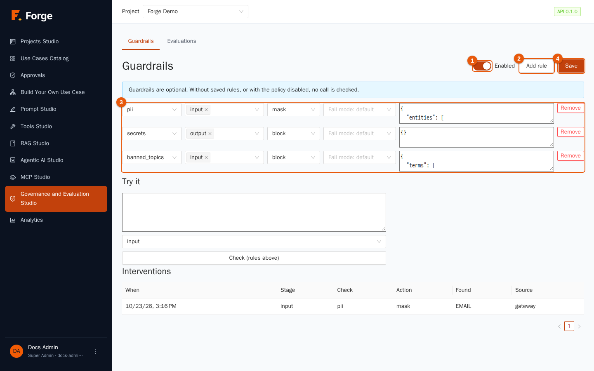
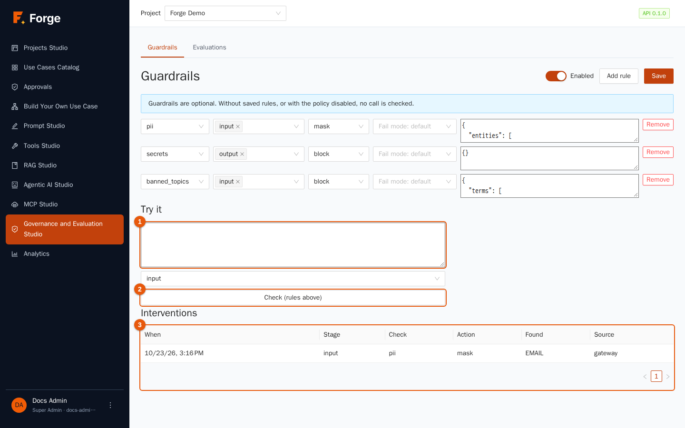
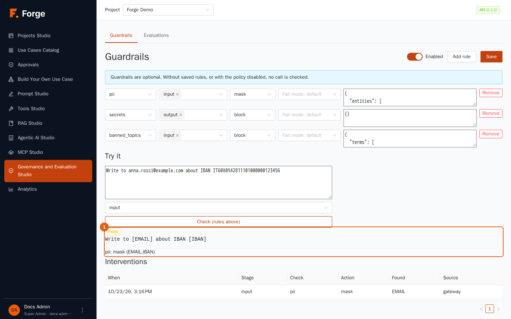
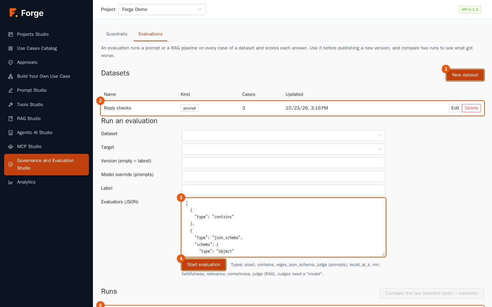
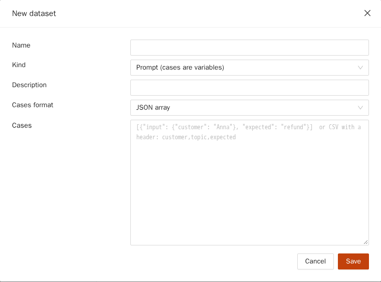
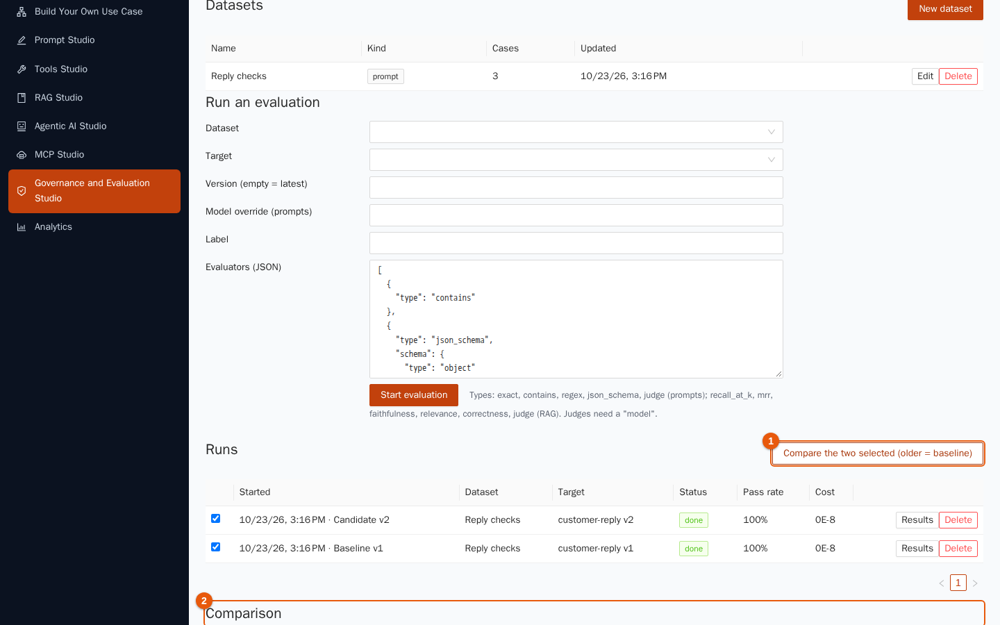

# 8. Governance and Evaluation Studio

[Index](README.md) · Previous: [7. Use cases](07-use-cases.md) · Next: [9. Analytics](09-analytics.md)

Two questions every organisation asks before trusting AI: *"Can it leak something it should not?"* and *"Is the new version actually better than the old one?"* This studio answers them with two tools: **Guardrails** check what goes into and out of the models, and **Evaluations** measure the quality of prompts and RAG pipelines on a fixed set of test cases.

> **Who is this for?** **Guardrails**: Project Admins only. **Evaluations**: Builders and Project Admins. The studio has two tabs: **Guardrails** and **Evaluations**.

## 8.1 Guardrails

A **guardrail policy** is a list of **rules** applied to every call that goes through the Forge model gateway: chats, prompts, agents, use case steps, the Planner. Because the check lives in the gateway, nothing can bypass it, whichever screen or API started the call.



> **Guardrails are optional.** A new project checks nothing. *Without saved rules, or with the policy disabled, no call is checked.* Decide, with your security team, which rules your use cases need.

### The page

| Marker | Control | Use |
| --- | --- | --- |
| 1 | **Enabled** | Switches the whole policy on or off without losing the rules. |
| 2 | **Add rule** | Adds an empty rule row. |
| 3 | The rules | One row per rule (see below). **Remove** deletes a row. |
| 4 | **Save** | Saves the policy. A message confirms (*Policy saved*) or tells what is wrong. |

### Anatomy of a rule

Each row has five parts, left to right:

| Part | Choices and meaning |
| --- | --- |
| **Check** (the first selector) | **pii** (personal data), **injection** (prompt-injection attempts), **secrets** (keys, tokens, passwords), **urls** (allowed and forbidden web addresses), **banned_topics** (terms you do not want to see), **json_schema** (the answer must be JSON of a given shape), **toxicity** (harmful content), **grounding** (is the answer supported by the sources). |
| **Stage** | Where to check: **input** (what is sent to the model), **output** (what comes back), **tool_args** (the arguments of a tool call, before it runs). Choose one or more. |
| **Action** | **log** (only record it), **mask** (replace what was found with a label such as `[EMAIL]`), **rewrite**, **block** (refuse the call), **escalate** (today it blocks). When several rules apply, the **strictest** action wins. |
| **Fail mode** | What to do if the check *cannot run* (for example a guard model is down): *default* (a rule that would change or stop text blocks the call; a *log* rule lets it through), *closed* (block) or *open* (let it through). |
| **Parameters (JSON)** | Settings of the check. A hint with an example is filled in when you choose the check. |

Examples of parameters:

| Check | Example | Notes |
| --- | --- | --- |
| **pii** | `{"entities": ["EMAIL", "CREDIT_CARD", "IBAN", "IT_FISCAL_CODE", "PHONE", "IP_ADDRESS"]}` | Also `PERSON`, `LOCATION`, `ORGANIZATION` for names, places and organisations (slower, less precise: see below). Phone numbers need an international prefix (`+39…`) to be recognised. Card numbers, IBANs and Italian fiscal codes are validated, so random digits are not flagged. |
| **banned_topics** | `{"terms": ["insider trading"]}` | Case-insensitive terms. |
| **urls** | `{"allow": ["example.com"], "deny": ["evil.test"]}` | Restrict the addresses that may appear. |
| **secrets** | `{"patterns": ["regex"]}` | Common secret formats are built in; add your own patterns. |
| **json_schema** | `{"schema": {"type": "object", "required": ["answer"]}}` | For use cases that must return structured data. |
| **injection** | `{"model": "guard-or-chat-model", "judge": false, "threshold": 0.8}` | Built-in rules in English and Italian run first. With a `model` a *guard* model is asked as well; with `"judge": true` an ordinary chat model acts as the judge. |
| **toxicity** | `{"model": "guard-model-name", "categories": []}` | Needs a *guard* model (or a judge); each checked text costs one extra model call. |
| **grounding** | `{"model": "chat-model-name"}` | Asks a model whether the answer follows from the sources. |

How the actions behave in practice:

- **mask** replaces the text *before* the model sees it, so the raw value never reaches the provider, and it also keeps it out of the response cache. A **mask on a check that has nothing to cut** (such as an injection attempt) blocks instead.
- An **input block** refuses the request before any model is paid; an **output block** answers with an error (the model's fault, not the caller's) and the tokens are counted because the provider was paid.
- If a rule uses **streaming**, answers are checked whole: with output rules the first word appears only when the whole answer is ready.
- Checks of **names, places and organisations** use a language model for entities (English and Italian). It is a small model: it misses some names and sometimes tags a company as a place. Use it as a safety net, not as a guarantee.
- **Tool arguments** are checked one value at a time, before the tool runs and before any human approval; masking changes what the tool receives (`[EMAIL]` instead of the address) without telling the agent.

An **agent** can add its own rules on top of the project's (chapter 6).

### Try before you trust

Under the rules, **Try it** runs your rules on sample text **without calling any model**.



1. Type a sample in the box (marker 1), choose the **stage** and click **Check (rules above)** (marker 2). The rules used are the ones **on screen**, even if not saved yet.
2. The result shows the action taken, the text after masking and what was found.



### Interventions

At the bottom, the **Interventions** table (marker 3 of the previous figure) lists every time a rule acted: **When**, **Stage**, **Check**, **Action**, **Found** (the label, for example *EMAIL*) and **Source** (*gateway* for model calls). **The log never stores the text itself**, only what was found, so it is safe to read.

### Good practice for guardrails

- Start with **log** to see how often a rule fires, then move to **mask** or **block**.
- Use **mask** for personal data you *want* to keep working with, **block** for things that must never pass.
- Test with real, awkward samples in **Try it**; keep a list of examples that must be blocked and ones that must pass.
- A guard or judge model sees the text: use one that your organisation allows to receive it.
- Remember the limits: guardrails reduce risk; they do not replace access control, careful prompts and human approvals for sensitive actions.

## 8.2 Evaluations

An **evaluation** runs a prompt or a RAG pipeline on **every case of a dataset** and scores each answer. Use it **before publishing a new version**, and **compare two runs** to see what got better or worse.



### Datasets

A **dataset** is a list of test cases. Click **New dataset** (marker 1).



| Field | Meaning |
| --- | --- |
| **Name**, **Description** | Free text. |
| **Kind** | *prompt* (cases call a prompt) or *rag* (cases question a RAG pipeline). |
| **Cases format** | How you write the cases: **JSON array**, **JSON Lines** or **CSV**. |
| **Cases** | The cases. For a **prompt** dataset every case has an `input` with the prompt's variables (all text) and, optionally, an `expected` answer. For a **RAG** dataset the `input` is `{"query": "…"}`, optionally with `expected` and `expected_sources` (file names). |

A dataset has at most 1,000 cases. The table (marker 2) lists the datasets with their **Kind**, number of **Cases** and **Updated**; **Edit** and **Delete** are in the row. Example of a prompt dataset (JSON):

```json
[
  {"input": {"message": "Where is my order 4471?", "language": "English"}, "expected": "4471"},
  {"input": {"message": "My parcel arrived damaged.", "language": "English"}, "expected": "sorry"}
]
```

### Run an evaluation

Fill in **Run an evaluation**:

1. **Dataset** and **Target** (the prompt or RAG pipeline to test). The target must match the dataset's kind.
2. **Version (empty = latest)**: the version to test. Leave empty for the latest.
3. **Model override (prompts)**: test the same prompt on another model.
4. **Label**: a name for the run, for example *Baseline v1*.
5. **Evaluators (JSON)** (marker 3): *how* answers are scored. A list; each item has a `type`:

| Evaluator | For | What it checks |
| --- | --- | --- |
| `exact` | prompts | The answer equals `expected` (spaces and case ignored by default). |
| `contains` | prompts | The answer contains `expected`. |
| `regex` | prompts | The answer matches a `pattern`. |
| `json_schema` | prompts | The answer is JSON that fits a `schema`. |
| `judge` | prompts and RAG | A model scores the answer from 0 to 1 against your `criteria`; needs a `model`. |
| `recall_at_k` | RAG | Did the *expected* documents appear among the first *k* results? |
| `mrr` | RAG | How high was the first expected document ranked? |
| `faithfulness` | RAG | Is the answer supported by the passages it cites? (a judge) |
| `relevance` | RAG | Does the answer address the question? (a judge) |
| `correctness` | RAG | Does the answer agree with `expected`? (a judge) |

6. Click **Start evaluation** (marker 4). The run appears in **Runs** (marker 5) and executes in the background; the page refreshes.

A case **passes** when **all** the evaluators that could score it pass; a case with nothing to compare does not pass by luck. Default thresholds: 1.0 for deterministic checks and 0.7 for judges; set `threshold` in an evaluator to change it. Judges are ordinary model calls: they cost tokens and, like all calls, go through your guardrails.

### Read the results

The **Runs** table shows **Started** (with the label), **Dataset**, **Target** (with the version), **Status**, **Pass rate** and **Cost**. **Cancel** stops a running one; **Results** opens the detail: for each case the **Input**, the **Expected** answer, the **Output** and the **Scores**, with a link to the full trace of the call.

### Compare two runs

Tick **two runs** and click **Compare the two selected (older = baseline)** (marker 1).



The **Comparison** (marker 2) shows the **Pass rate change** between the **Baseline** (the older run) and the **Candidate**, and lists the cases that **improved** and the ones that **regressed**, so a version that is better on average but breaks an important case does not slip through. Typical routine for a prompt change: run the dataset on the published version (*Baseline*), save the new version, run it on the same dataset (*Candidate*), compare, and publish only if nothing important regressed.

### Evaluations in your pipeline

The same thing can be done from the command line, for example in a build pipeline (`forgectl eval`, chapter 10), which can fail the build when the pass rate drops below a threshold or below a baseline.

### Good practice for evaluations

- **Build the dataset from real questions**, including the awkward ones, and grow it every time you find a failure.
- **Keep it small and sharp** at first (20 to 50 cases). A dataset you run often is worth more than a huge one you never run.
- **Prefer deterministic evaluators** where you can (`contains`, `regex`, `json_schema`): they are cheap and repeatable. Use judges for open-ended quality, and read a sample of their verdicts.
- **Compare like with like**: same dataset, same evaluators.
- Evaluation runs run inside the API server; a restart of the API loses a run in progress (run it again).

## 8.3 Troubleshooting

| Symptom | Cause and remedy |
| --- | --- |
| "Only Project Admins manage guardrails." | Your role cannot edit the policy. |
| "Evaluations need the Builder or Project Admin role." | Ask a Project Admin. |
| A rule is *unavailable* or blocks everything | It needs something that is missing: a guard or judge model that is not enabled for the project, or the models for names and places. A rule that cannot run **blocks** unless its action is *log* or its fail mode is *open*. |
| Saving the policy is refused | A rule names a model that does not exist, is not enabled for the project or is not a guard model; or the parameters are not valid JSON. |
| Phone numbers are not masked | They need an international prefix, such as `+39` or `0039`. |
| An evaluation stays *running* then becomes *interrupted* | The API restarted, or the process stopped answering for five minutes. Start it again. |
| Pass rate is 0% on `exact` | The model adds words around the answer. Use `contains`, or ask the prompt for the bare value. |
| The judge always fails | Judges need a `model` in the evaluator; check that the model is enabled for the project. |

Next: [9. Analytics](09-analytics.md)
