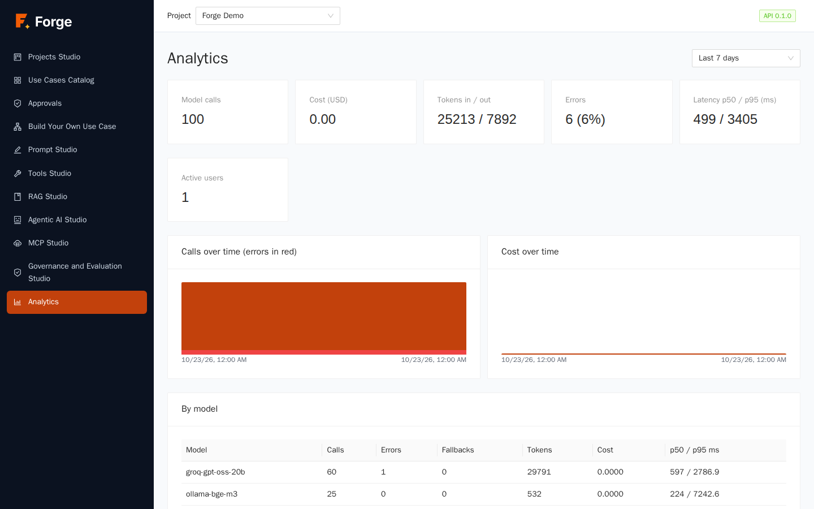
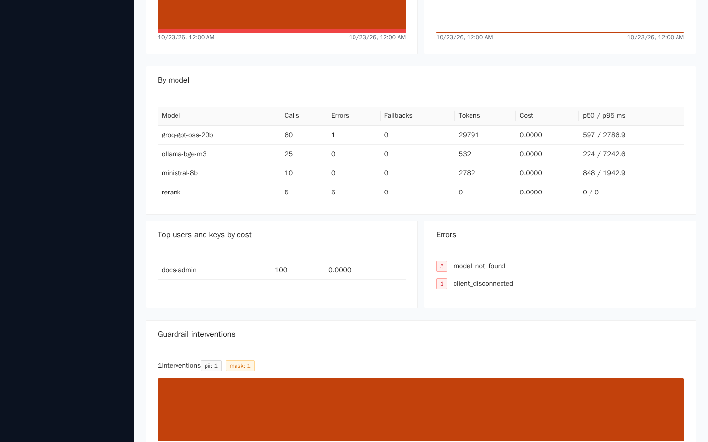
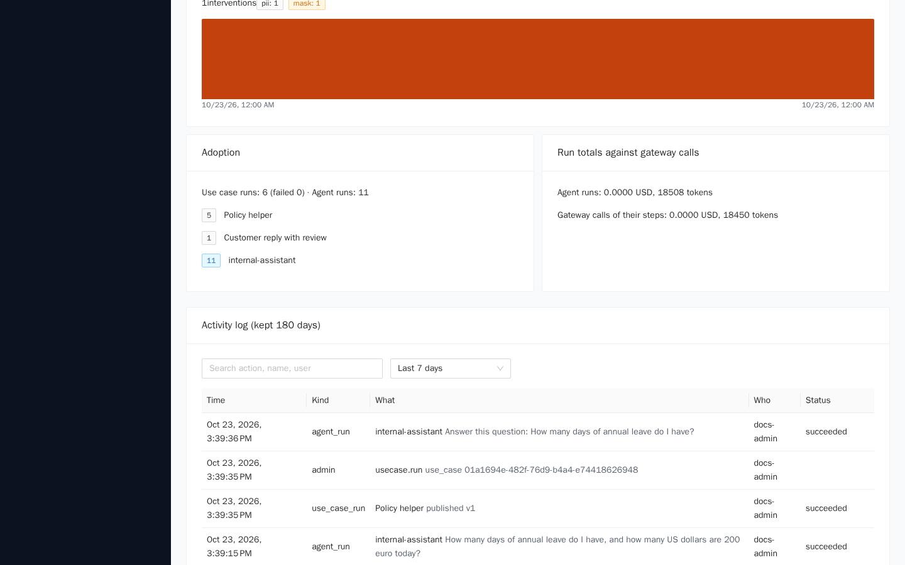
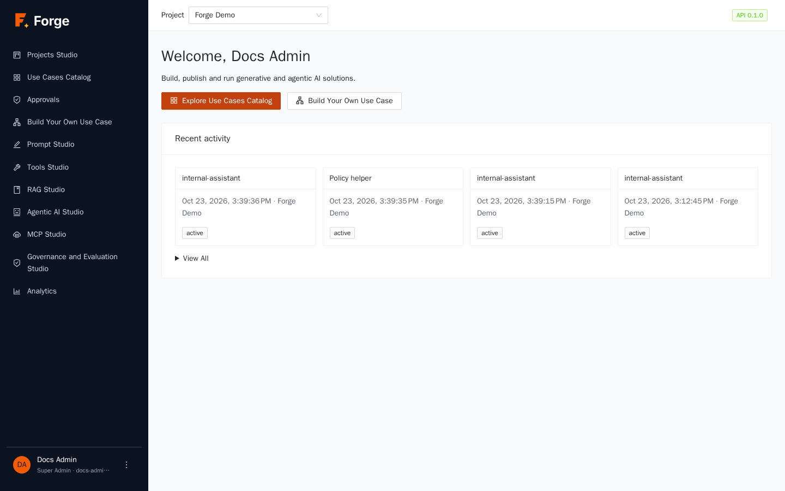

# 9. Analytics

[Index](README.md) · Previous: [8. Governance and Evaluation Studio](08-governance.md) · Next: [10. Integrations, sync and transfer](10-integrations-and-sync.md)

Analytics answers: *how much is the project used, what does it cost, how fast and how reliable is it, who is using it and what has been going on?* Every figure is computed from the records Forge already keeps for each model call, run and administrative action, so the numbers always agree with the run views you saw in the previous chapters.

> **Who is this for?** **Project Admins** (the Analytics page shows costs, so Builders and end users do not see it). Everybody sees their own **Recent activity** on the home page (section 9.5). Super Admins also have platform-wide insights (chapter 11).

## 9.1 The dashboard

Open **Analytics** in the side menu.

At the top right, the **period** selector: **Last 24 hours**, **Last 7 days** (default), **Last 30 days**, **Last 90 days** or **Last 180 days**. The upper limit is the *retention* set by your administrators (180 days by default).

### The tiles

| Tile | Meaning |
| --- | --- |
| **Model calls** | Number of calls to models in the period (chats, prompts, agent steps, embeddings, guard and judge calls). |
| **Cost (USD)** | Estimated cost: tokens times the price registered for each model (chapter 2). Free and internal models cost 0, and a call answered from the cache costs 0. |
| **Tokens in / out** | Tokens sent to and received from models. |
| **Errors** | How many calls failed, with the percentage. A call refused for quota, validation or a guardrail block counts as an error. |
| **Latency p50 / p95 (ms)** | Median time (half the calls are faster) and the time that 95% of calls beat. The p95 shows how slow the slow ones are. |
| **Active users** | Distinct people who made calls. |

### Charts

**Calls over time (errors in red)** and **Cost over time** use hourly bars up to three days and daily bars beyond. A red base on the calls chart shows the share of errors.

### By model

The **By model** table breaks the period down per model: **Calls**, **Errors**, **Fallbacks** (calls where the first model failed and a backup answered), **Tokens**, **Cost** and **p50 / p95 ms**. Use it to see which models carry the load, which one fails, and whether the *fallback chain* of an alias (chapter 2) is being used.

### Top users and keys by cost

Who spends: people and API tokens, ranked by cost, with their number of calls. Calls made with a project token are attributed to the person who created it.

### Errors

A list of **error codes** with how many times each occurred (for example `model_not_found`, `upstream_unavailable`, a quota code). If there is nothing, the card says *No errors in this period*. A code that appears again and again is worth a look: it usually points at a missing alias, an unreachable provider or a limit that is too low.

### Guardrail interventions

How many times the project's guardrails acted (chapter 8), split by check and action, with a small chart over time.

### Adoption

How much the **use cases** and **agents** are used: **Use case runs** (with how many **failed**) and **Agent runs**, plus the number of active users.

### Reconciliation

**Run totals against gateway calls** compares the tokens and cost *summed from the runs* with the *model calls recorded for their steps*. The two must match; if they ever differ, something is wrong in the accounting and it should be reported. It is a built-in proof that the cost you see per run is the cost you really incur.

## 9.2 The activity log

At the bottom of the page, the **Activity log** lists, newest first, what has happened in the project during the period: administrative actions (members, models, tools, publishing), use case runs and agent runs.

| Column | Meaning |
| --- | --- |
| **Time** | When it happened. |
| **Kind** | The type of event (an action, a use case run, an agent run). |
| **What** | What happened and to which object. |
| **Who** | The person or token. |
| **Status** | The outcome, for runs. |

Use the **search** box (*Search action, name, user*) and the period buttons to find, for example, who published a use case or who deleted a model. Logins and the reading of data are not in this log; the Super Admin **audit log** (chapter 11) is the complete security record. The log is a *window*: records are kept, but you see only the retention period.

## 9.3 Cost: what to look at

- **A tile that jumped**: open *By model* and *Top users and keys by cost* to find where.
- **Many fallbacks**: your first model is unreliable or rate-limited; fix it or reorder the alias.
- **High p95**: a slow model or a long agent. Compare with the run view (chapter 6).
- **Costly agent runs**: look at *Max model calls*, the number of tools, and the size of retrieved context (*Top_k*, chapter 4).
- **Set limits**: tokens per day and per user (chapter 2) protect the budget before the dashboard shows the damage.

## 9.4 Limits to keep in mind

- **Cost is an estimate**: it uses the prices you entered in the model registry; it is not an invoice. Models registered with price 0 show 0.
- Charts are simple bars; there is **no export** to CSV yet.
- Dashboards show **model calls**. Time spent in tools, queues or approvals is not part of the model latency.

## 9.5 Your recent activity (home page)

Every signed-in user sees **Recent activity** on the home page: the last runs they started in the last 15 days, as cards with the name, the date, the project and the status. **View All** opens the full list.

## 9.6 Troubleshooting

| Symptom | Cause and remedy |
| --- | --- |
| Analytics is not in my menu / is empty | Only Project Admins see the dashboards. |
| Cost is always 0.00 | The models have price 0 in the registry (free or internal), or the calls came from the cache. |
| The reconciliation box shows a difference | Report it to your platform administrators: it should always be zero. |
| I cannot select more than 180 days | That is the retention window; a Super Admin can change it (chapter 11). |
| The activity log does not show a login | Logins are in the Super Admin audit log, not here. |

Next: [10. Integrations, sync and transfer](10-integrations-and-sync.md)
