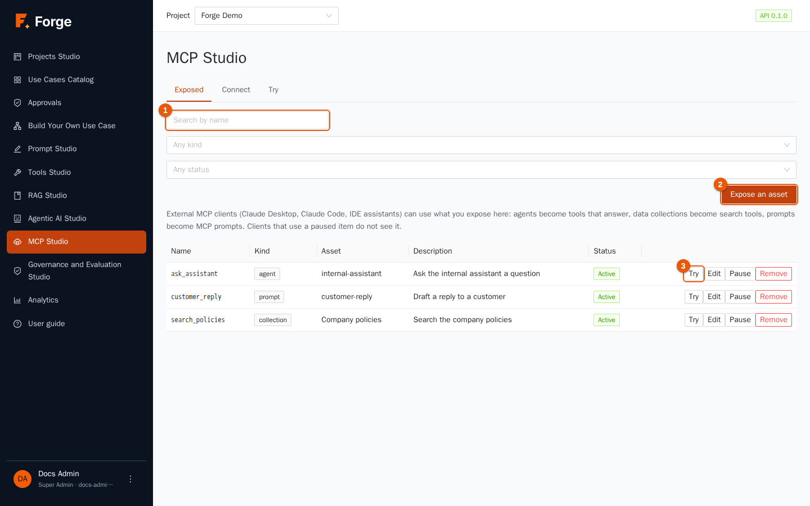
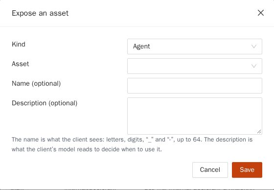
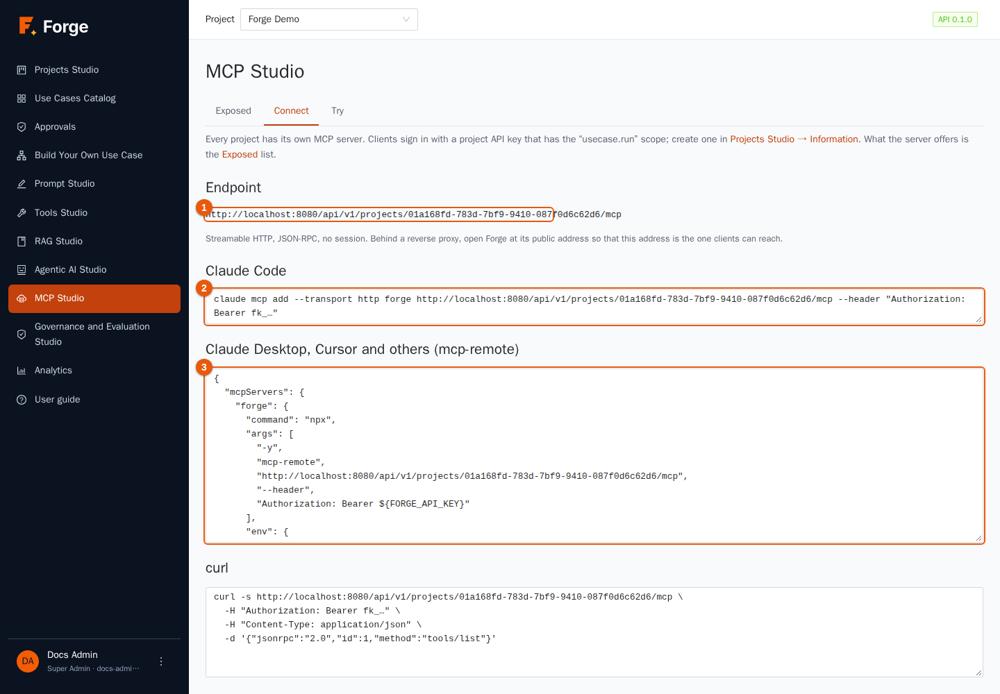
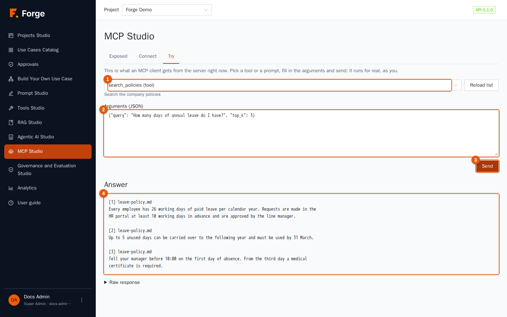
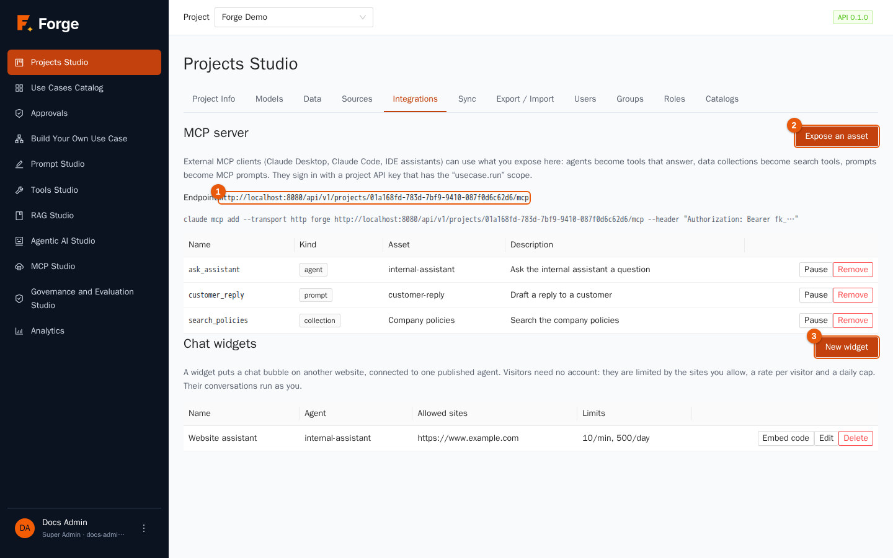
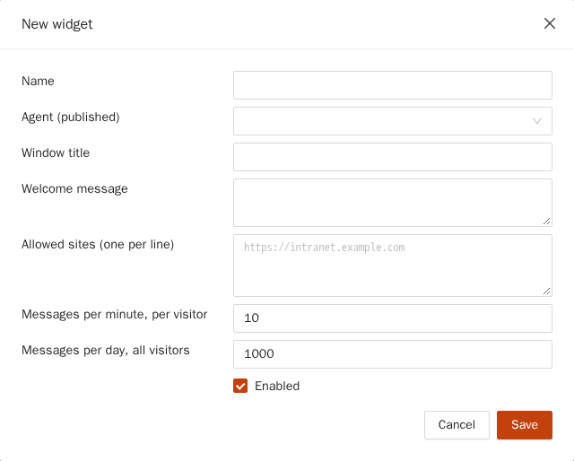
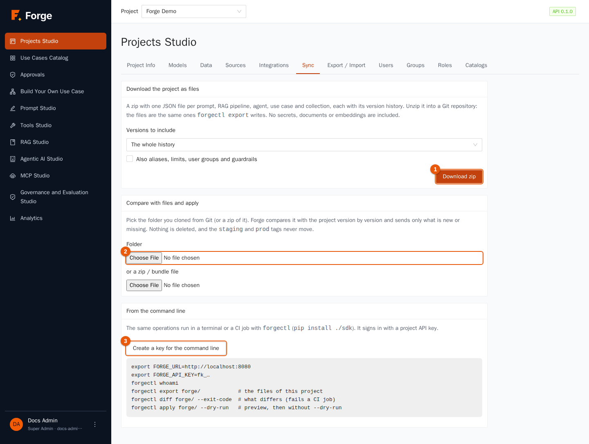
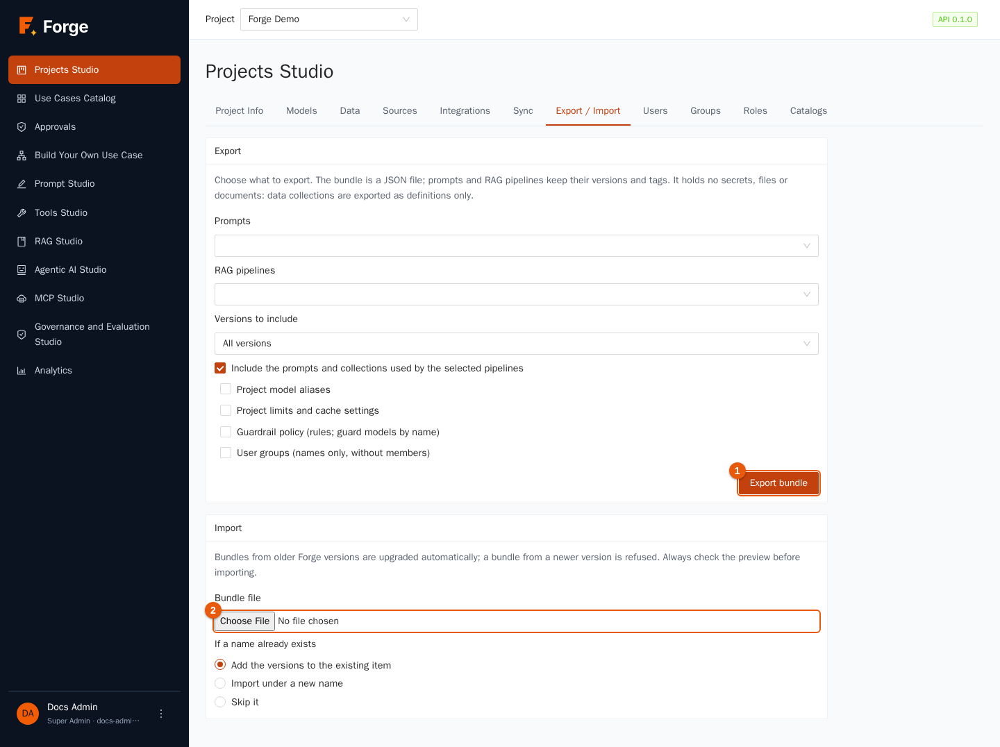

# 10. Integrations, sync and transfer

[Index](README.md) · Previous: [9. Analytics](09-analytics.md) · Next: [11. Super Admin console](11-administration.md)

Forge does not live alone. This chapter shows how to **let other applications use what you built** (an MCP server, a chat bubble for a website, an OpenAI-compatible API, runs started from scripts), how to **keep your assets in Git** (the `forgectl` command line and the *Sync* page), and how to **move assets** between projects and installations (*Export / Import*).

> **Who is this for?** Project Admins and developers. Building the integrations that call Forge needs a project **API token** (chapter 2).

## 10.1 Which door for which need?

| You want to… | Use | Section |
| --- | --- | --- |
| let an AI assistant (Claude Desktop, Claude Code, an IDE) call your agents, search your documents or use your prompts | the **MCP server** of the project | 10.2 |
| put a chat bubble connected to an agent on a website | a **chat widget** | 10.3 |
| call models from any program that speaks the OpenAI API, with your aliases, limits, cache, guardrails and accounting | the **OpenAI-compatible API** | 10.4 |
| start a use case from a script, a scheduler or another system | the **run API**, a **trigger URL**, or `forgectl run` | 10.5 |
| keep prompts, pipelines, agents and use cases in Git, review changes, deploy them | **Sync** and `forgectl` | 10.6 |
| copy assets to another project or another Forge | **Export / Import** | 10.7 |

> **Where things are.** The MCP server is in **MCP Studio** (side menu). The chat widgets are in **Projects Studio → Integrations**.

## 10.2 The project's MCP server

**MCP** (Model Context Protocol) is the standard way for AI assistants to use outside tools. Each Forge project is an MCP server: you choose **what to expose**, and MCP clients see it as tools and prompts. Everything about it is in **MCP Studio** (side menu), in three tabs: **Exposed**, **Connect** and **Try**. Project Admins and Builders can open it.

### Exposed: what the server offers



The table lists each exposure with its **Name** (what the client sees), **Kind**, **Asset**, **Description** and **Status**: **Active**, or **Inactive** when paused. Use the search box (marker 1) and the two filters to narrow the list. The row buttons are **Try** (marker 3, section below), **Edit** (name and description), **Pause / Resume** (an inactive exposure is invisible to clients) and **Remove**. Deleting the asset removes its exposure. The same list can be started from a prompt: in the Prompt Library, **Add to MCP Servers** opens this page with the form filled in.

Click **Expose an asset** (marker 2).



1. Choose the kind: **Agent** (only published agents are listed), **Data collection** or **Prompt**, then **pick the asset**.
2. Optionally give it a **Name** (the tool name seen by the client: letters, digits, `_` and `-`, up to 64) and a **Description** that tells the *client's model* when to use it.
3. Click **Save**.

How each kind appears to a client:

| Kind | Becomes | Behaviour |
| --- | --- | --- |
| **agent** | a **tool** that answers a question | The client sends a message; Forge runs the agent as the owner of the token and returns its answer (waiting up to about three minutes). A conversation id lets the client continue the same conversation. |
| **collection** | a **search tool** over the documents | Hybrid search on the newest ready index; the client picks how many results (1 to 10). Tokens see only documents readable by the **whole project** (chapter 4). |
| **prompt** | an **MCP prompt** | The client fills in the prompt's variables; Forge returns the rendered text. The latest version is served. |

> **Think before exposing.** Whoever holds the token can use everything exposed, and an agent runs with the *token owner's* rights. Create a dedicated token with only `mcp.invoke`, expose only what is needed and avoid exposing agents with tools that change data.

### Connect: how a client signs in



The tab shows the **Endpoint** (marker 1), the address clients connect to, and ready-to-copy settings for the common clients: the `claude mcp add` command for Claude Code (marker 2), a JSON block for Claude Desktop, Cursor and other clients that go through `mcp-remote` (marker 3), and a `curl` example. Replace `fk_…` with a **project API token** that has the `mcp.invoke` scope (section 2.2). Clients use only what is exposed, with the permissions of the token.

> If Forge sits behind a reverse proxy, open it at its public address: the endpoint shown is built from the address in your browser.

### Try: see what a client sees



**Try** asks the server, as a client would, for its tools and prompts. Pick one (marker 1), edit the **Arguments (JSON)** (marker 2; a skeleton with the declared properties is filled in for you) and click **Send** (marker 3). The **Answer** (marker 4) is shown as text; **Raw response** shows the JSON the client receives. Remember that it runs for real, as you: an agent answers (and costs what it costs), a search reads documents. If the list is empty, nothing is exposed or everything is paused. **Reload list** asks again.

## 10.3 Chat widgets

A **widget** puts a chat bubble on **another website**, connected to **one published agent**. Visitors need no account.

> **Choose the agent with care.** Visitors are strangers and the conversation runs with *your* rights. Forge accepts any published agent, but an agent with tools that act on someone's behalf can be driven by a stranger, and long-term memory is shared by every visitor. Prefer an agent that only searches public documents.

Open **Projects Studio → Integrations**.



The page explains the link to MCP Studio (marker 1) and lists the widgets. Click **New widget** (marker 2).



| Field | Meaning |
| --- | --- |
| **Name** | Internal name. |
| **Agent (published)** | The agent that answers. |
| **Window title**, **Welcome message** | What visitors see. |
| **Allowed sites (one per line)** | The addresses (origins) of the sites allowed to show the widget, for example `https://www.example.com`. A site not on the list is refused. |
| **Messages per minute, per visitor** | Rate limit per visitor address. |
| **Messages per day, all visitors** | Daily cap of the whole widget. |
| **Enabled** | Pause the widget without deleting it. |

After saving, **Embed code** shows the snippet: *paste it before the closing `body` tag of the page* (the site must be in the allowed list). **Edit**, **Pause / Resume** and **Delete** manage it.

Know the rules of the road:

- Conversations of visitors **run with the rights of the Project Admin who created the widget** and appear among that person's chats. Visitors are anonymous.
- Because nobody is authenticated, **do not connect agents that have tools acting on someone's behalf**; give the widget an agent with read-only knowledge, ideally a RAG tool over public documents.
- Answers are plain text, polled about every second (not streamed); there are no file uploads and no citations.
- If the application is behind a reverse proxy, the embed code uses the address your browser is on: make sure it is the public one.

## 10.4 The OpenAI-compatible API

Forge exposes the endpoints `/v1/chat/completions` (with streaming), `/v1/embeddings` and `/v1/models`, so any OpenAI SDK works by changing two settings. This is the way to give your own applications **governed** access to models: your aliases and fallbacks, project limits, cache, guardrails and cost accounting all apply.

1. Create a **project API token** with the `llm.invoke` scope (section 2.2).
2. Point the client at your Forge (`base_url` = `https://<your-forge>/v1`) and use the token as the API key.
3. Use an **alias** (or model name) as the `model`.

```python
from openai import OpenAI

client = OpenAI(base_url="https://forge.example.com/v1", api_key="fk_…")
answer = client.chat.completions.create(
    model="default-chat",              # an alias of the project
    messages=[{"role": "user", "content": "Say hello"}],
)
print(answer.choices[0].message.content)
```

`GET /v1/models` lists the models and aliases the token may use. Errors follow the OpenAI format. A response served from the cache carries the header `x-forge-cache: hit`.

## 10.5 Starting use cases from outside

Three ways, all for **published** use cases:

- **Trigger URL** (chapter 7, section 7.11): Forge creates a secret address; any system that can send a `POST` starts the run.
- **Run API**: `POST /api/v1/projects/<project>/use-cases/<id>/runs` with a token that has `usecase.run` (and `run.read` to read the result). The body has the `inputs` and a `delivery`: `async` (answers at once with the run; poll it or give a `webhook_url` to be called when it ends), `sync` (waits up to `timeout_s`, at most 300 s) or `stream` (a live stream of events).
- **Command line**: `forgectl run "Policy helper" -i question="How many days of leave?"` (section 10.6).

A webhook receives a small JSON message when the run ends. The address must be on the project's allowed hosts (chapter 5).

## 10.6 Keep your assets in Git: Sync and `forgectl`

Prompts, RAG pipelines, agents and use cases are **versioned assets**. Putting them in Git lets you review changes in pull requests, keep a history, and deploy the same files to test and production. Open **Projects Studio → Sync**.



**Everything the command line does can be done on this page**, and both use the same server code.

### Download the project as files

1. Choose **Versions to include**: **The whole history**, **Published version only** or **Latest version only**. Tick **Also aliases, limits, user groups and guardrails** to include the project configuration (needs the project-admin permission).
2. Click **Download zip** (marker 1) and unzip it into a Git repository.

The zip holds one **JSON file per item** (`prompts/<name>.json`, `agents/<name>.json`…) plus `forge.json`. Files are stable: exporting twice gives identical files, so a Git diff shows only real changes. **Not included**: documents, chunks, embeddings, secrets and credentials.

### Compare with files and apply

1. Pick the **Folder** you cloned (marker 2) or **a zip / bundle file**.
2. **Comparison with the project** lists every item with its status: *new*, *changed* (with the versions to send), *unchanged*, *differs* (only fields outside the versions differ, such as a description: an import cannot update them) and *only in the project* (never deleted).
3. Choose **If a name already exists**: **Add the missing versions to the existing item** (default), **Import under a new name** or **Skip it**.
4. Click **Preview**: nothing is changed yet; you see what would happen. Then **Apply changes**; the **Result** table shows items, **Versions** and **Notes**.

How it works: items are matched by **name**, versions by **content** (version numbers, notes, timestamps and tags do not count). Only the versions the project lacks are sent, in order. A **revert in Git becomes a new version** in Forge. **Nothing is ever deleted**, and the `staging` and `prod` tags **never move**: *publishing stays a deliberate act inside Forge*. To release a change, append a version to the item's file (copy the last one and edit it), commit, and apply.

### The command line: `forgectl`

**Create a key for the command line** (marker 3) makes a project API token and shows it once, with the commands to copy. `forgectl` is a small Python program (`pip install ./sdk` from the Forge repository) configured by `FORGE_URL`, `FORGE_API_KEY` and `FORGE_PROJECT` (or flags `--url`, `--api-key`, `--project`).

| Command | What it does | Token scope needed |
| --- | --- | --- |
| `forgectl whoami` | Shows the project and permissions of the key. | any |
| `forgectl export forge/` | Writes the project's assets as files (`--versions all\|published\|latest`, `--config`). | `asset.write` (+ `project.manage` for `--config`) |
| `forgectl diff forge/` | Compares the folder with the project (`--all`, `--exit-code` to fail when different: ideal in CI). | `asset.write` |
| `forgectl apply forge/` | Imports what changed (`--dry-run`, `--policy new_version\|rename\|skip`). | `asset.write` |
| `forgectl run NAME -i key=value` | Runs a published use case and prints the result (`--input-json FILE`, `--no-wait`). | `usecase.run`, `run.read` |
| `forgectl eval DATASET TARGET --evaluators FILE` | Runs an evaluation (chapter 8); `--fail-under 0.9` fails below a pass rate; `--baseline RUN_ID --no-regressions` fails if anything got worse. | `asset.write` |
| `forgectl chat MODEL "text"` | One chat call through the gateway. | `llm.invoke` |

A typical pipeline: *pull request → `forgectl diff` shows what would change → merge → `forgectl apply` on test → `forgectl eval --fail-under` → a person publishes in Forge*. Exit status: 0 success, 1 for differences/failures where requested, 2 for usage or API errors.

## 10.7 Export / Import

For a one-off copy of a few assets (rather than a Git workflow) use **Export / Import**.



### Export

1. Choose the **Prompts** and the **RAG pipelines** to export (two pickers). Data collections come along as **definitions only** (no files) when a selected pipeline uses them. Agents and use cases are moved with *Sync* (section 10.6) or the API.
2. **Versions to include**: **All versions**, **Published version only** or **Latest version only**.
3. Optionally tick **Include the prompts and collections used by the selected pipelines** (dependencies), and the project configuration: **Project model aliases**, **Project limits and cache settings**, **Guardrail policy (rules; guard models by name)**, **User groups (names only, without members)**.
4. Click **Export bundle** (marker 1): you get one **JSON file**. It contains **no secrets, files or documents**.

### Import

1. Choose the **Bundle file** (marker 2). Bundles made by an *older* Forge are upgraded automatically; one from a *newer* Forge is refused.
2. Choose **If a name already exists**: **Add the versions to the existing item**, **Import under a new name** or **Skip it**.
3. Check the **Preview (nothing has been changed yet)**: type, name, result, versions and notes.
4. Confirm; the **Import result** shows what was created or added.

Items refer to each other **by name**, so a pipeline imported into a project finds the prompt and collection of the same name. Tools, credentials, data sources, MCP exposures, widgets and triggers are **not** part of bundles (they hold or depend on secrets and addresses): recreate them in the target project.

## 10.8 Good practice

- **One token per integration**, with the fewest scopes, named after what uses it; revoke it when the integration ends.
- **Use aliases in applications**, never provider model names: you can change models without touching the code.
- **Start with Git for anything that goes to production**; use bundles for quick copies.
- **Publish in Forge, not from the pipeline**: let the pipeline propose and test, and a person decide.
- **Test an exposure** with **Try** and then from a real MCP client before announcing it.

## 10.9 Troubleshooting

| Symptom | Cause and remedy |
| --- | --- |
| An MCP client gets 401/403 | Wrong token, or the token lacks `mcp.invoke`. |
| The client sees no tools | Nothing is exposed, or the exposure is paused (**Pause** / **Resume**). Open the **Try** tab of MCP Studio to see what a client gets. |
| The widget does not appear | The site is not in **Allowed sites** (exact origin, including `https://`), or the widget is disabled. |
| The widget says it is busy | A rate limit was hit (per visitor or daily). Raise it or wait. |
| `/v1` returns "model not found" | The alias or model is not enabled for the project (chapter 2). |
| `forgectl` says unauthorized | Check `FORGE_URL`, the key and its scopes (table above). |
| `diff` shows *differs* but `apply` does nothing | Fields outside the versions (for example a description) cannot be updated by an import. Edit them in Forge. |
| An import says a reference is missing | A pipeline refers to a prompt or collection that is not in the bundle or the project. Export with the dependencies option. |

Next: [11. Super Admin console](11-administration.md)
