# 11. Super Admin console

[Index](README.md) · Previous: [10. Integrations, sync and transfer](10-integrations-and-sync.md) · Next: [12. Installing and operating Forge](12-operations.md)

The **Super Admin console** is where the people who run the installation manage what is shared by **all** projects: user accounts, the projects themselves, the external model providers, how people sign in, security settings, the audit trail, e-mail, the secrets vault and platform-wide model usage.

> **Who is this for?** **Super Admins** only. Open the console from the profile menu (three dots next to your name) → **Super Admin Console** (chapter 1). The console has its own tab bar: **Users · Projects · Model providers · Authentication · Settings · Audit log · Email · Secrets vault · Model Insights**.
>
> **Keep Super Admins few.** A Super Admin sees and changes everything and is not limited by projects. Give the role to a small number of named people, never to shared accounts.

## 11.1 Users

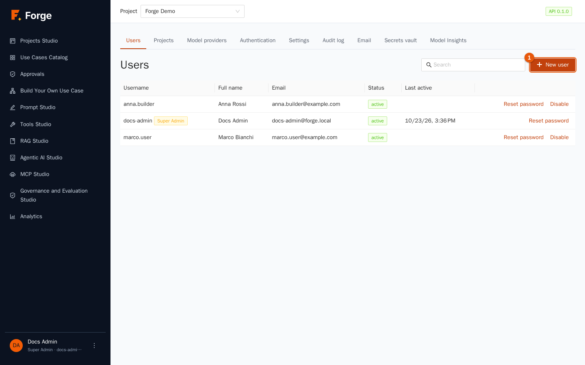

The table lists every account with **Username**, **Full name**, **Email**, **Status** and **Last active**. Use **Search** to filter. People who sign in with LDAP or OpenID Connect appear here automatically after their first sign-in.

### Create a user

1. Click **New user** (marker 1).

   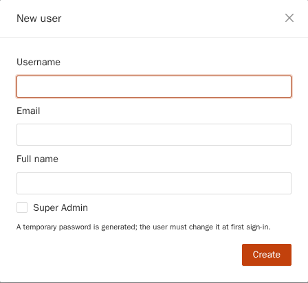

2. Fill in **Username**, **Email** and **Full name**. Tick **Super Admin** only for platform administrators (it is shown afterwards as an orange tag).
3. Click **Create**. A green notice shows a **temporary password, once**. Send it to the person through a safe channel; at the first sign-in they must change it, accept the terms of use and, if required, enrol two-factor authentication (chapter 1).

### Other actions on a user

| Action | Effect |
| --- | --- |
| **Unlock** (shown only for a locked account) | Removes the temporary lock after too many wrong passwords (see *Account lockout* in the settings). |
| **Reset password** | Generates a new temporary password (shown once); the user must change it at the next sign-in. |
| **Disable** / **Enable** | A disabled user cannot sign in and their sessions are closed; nothing is deleted, so history stays complete. |
| **Super Admin** (orange tag next to the user name) | Marks platform administrators. It is set when the user is created. You cannot disable your own account. |

Users cannot be deleted, only disabled, to keep the audit trail meaningful. Adding a person to a project is a **Project Admin** job (chapter 2).

## 11.2 Projects

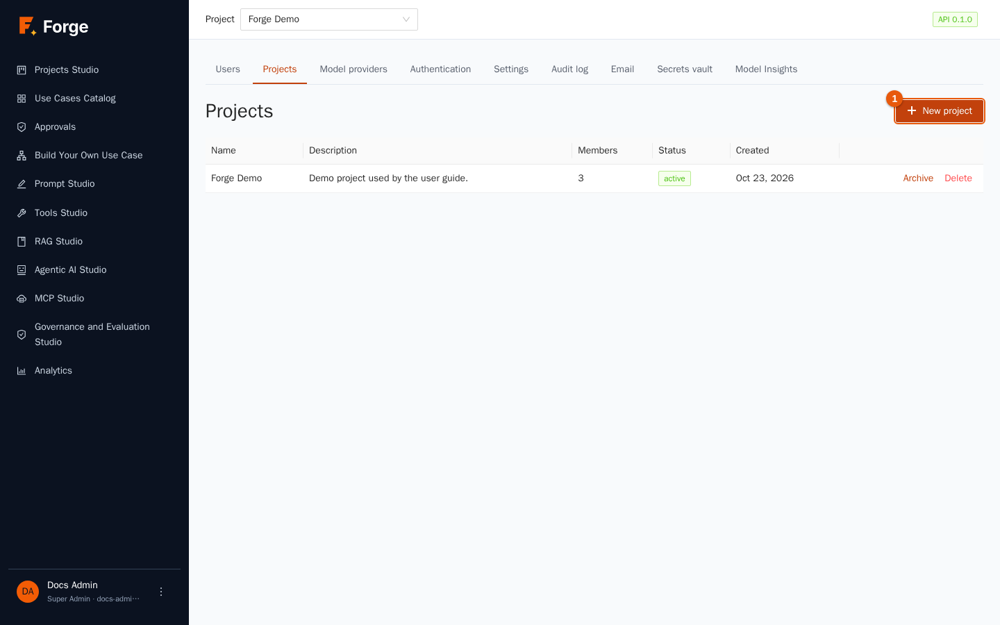

The table shows each project with **Name**, **Description**, **Members**, **Status** and **Created**.

### Create a project

1. Click **New project** (marker 1).

   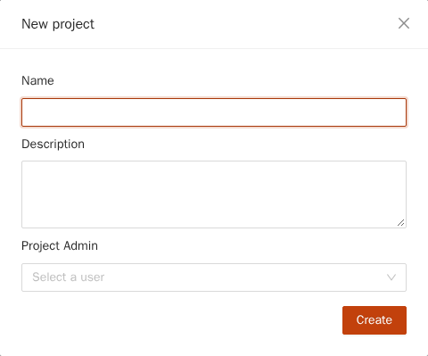

2. Type the **Name** and **Description**.
3. Choose the **Project Admin**: the user (select one) who will manage the project. They are added with the *Project Admin* role.
4. Click **Create**. The notice also shows a **Project token, once**: an API token with the default scopes, for first integrations. Store it or revoke it later (chapter 2).

Then enable the platform models for the project (section 11.3) and ask the Project Admin to invite the team.

### Archive, restore, delete

- **Archive** takes a project out of use but keeps its data. **Restore** brings it back.
- **Delete** (with a mandatory **Reason**) removes the project, its data and its operations, and members lose access at once. It is **irreversible** and is recorded in the audit log. Prefer *Archive* unless you are certain.

## 11.3 Model providers (platform level)

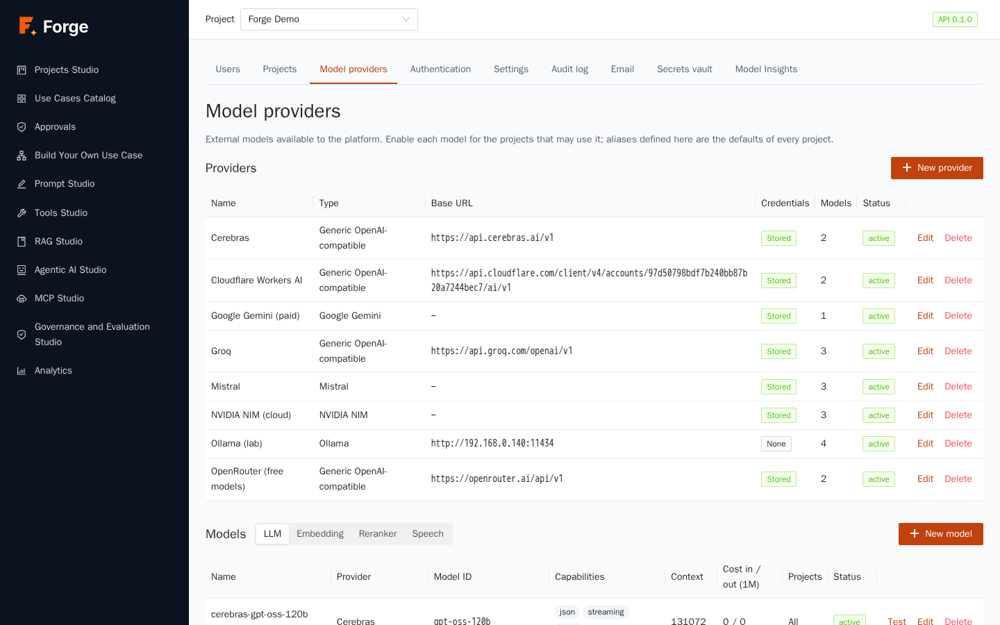

This page is the **platform registry** of external model providers, models and aliases. It works exactly like the project-level page described in chapter 2, with two differences:

- what you create here is **shared** (the *Platform* scope) and can be used by projects;
- every model has **Enabled for all projects** or a list of **Enabled projects**: *a project can use a platform model only if you enabled it for that project*. This is the control that decides who may use which provider, and who therefore pays for what.

The **aliases** defined here (for example `default-chat`, `fast`, `embedding`, `guard`, `rerank`) are the **defaults of every project**; a Project Admin can override one by creating a project alias with the same name. Keep the standard alias names working: prompts, RAG, agents, long-term memory and guardrails refer to them.

Provider credentials are stored encrypted and are never displayed again (section 11.8). Use **Test Connection** before enabling a model.

> **Good practice.** Register models with their real **prices**: Analytics and cost limits depend on them. Enable first for one pilot project, observe, then widen.

## 11.4 Authentication

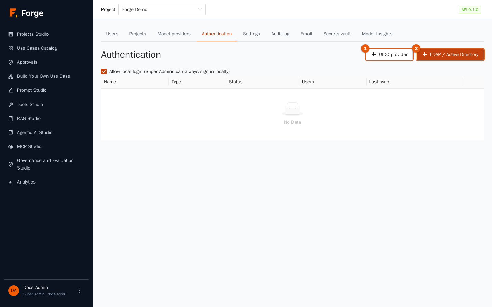

Forge always supports **local accounts**. For companies it can also sign people in with **LDAP / Active Directory** (user name and password checked against the directory) and **OpenID Connect** (a "Sign in with…" button for your identity provider, for example Microsoft Entra ID, Keycloak, Okta, Google). Use **New provider** to add one (the buttons **OIDC provider** and **LDAP / Active Directory** choose the type).

At the top, **Allow local login (Super Admins can always sign in locally)** lets you turn off passwords for everybody except Super Admins once an external provider works. It cannot be turned off while no provider is enabled.

### LDAP / Active Directory

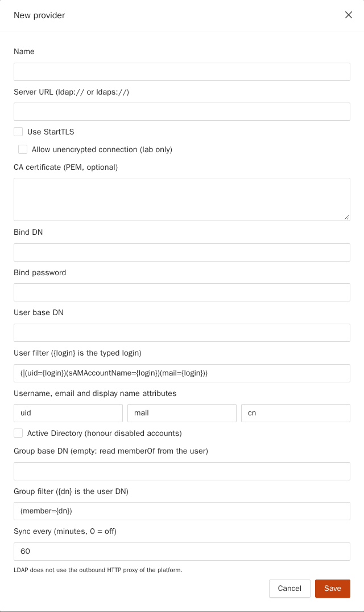

| Field | Meaning |
| --- | --- |
| **Name** | Shown in the list. |
| **Server URL** | `ldap://` or `ldaps://` address. Prefer `ldaps://` or **Use StartTLS**. **Allow unencrypted connection (lab only)** is for tests: never in production. |
| **CA certificate (PEM, optional)** | The certificate of your directory's authority, if it is not public. |
| **Bind DN** / **Bind password** | A service account that can search the directory. The password is stored encrypted. |
| **User base DN**, **User filter** (the field under it) | Where to look for users and how to find one from the typed login (`{login}` is replaced). |
| **Username, email and display name attributes** | The directory attributes to use (`uid`, `mail`, `cn`, or `sAMAccountName`…). |
| **Active Directory (honour disabled accounts)** | Tick for AD so disabled accounts cannot sign in. |
| **Group base DN**, **Group filter** | Where groups are; leave the base empty to read `memberOf` from the user. |
| **Sync every (minutes, 0 = off)** | How often Forge reads the whole directory to apply group changes and disable users who left. |

LDAP connections do not use the platform's HTTP proxy; for TLS inspection use the CA field.

### OpenID Connect

Fill in **Name**, **Issuer URL**, **Client ID**, **Client secret** (stored encrypted), **Scopes**, the **Claims** that carry username, email, name and groups, and the **Button label** shown on the sign-in page. Register Forge's callback address in your identity provider as instructed by the provider. *Allow http:// issuer (lab only)* is for tests.

### Test, sync, groups

In the provider's row: **Test** checks the connection; **Test user** looks a user up (by username or email) without signing them in, so you can check attributes and groups; **Sync now** runs the directory sync (a notice reports users seen, added, removed, disabled); **Groups** opens the mappings; **Edit**, **Enable / Disable** and **Delete** manage the provider.

### Group mappings: from directory groups to project roles

Nobody gets access to anything just by being in the directory. **Mappings** connect a directory group to a **project and a Role Name**. In the dialog opened by **Groups**:

1. Open **Groups** on the provider.
2. Fill in **Group DN or name** (the **External group**), choose the **Project** and the **Role Name** (chapter 2), and click **Add**.

At every sign-in and sync, Forge gives each user, for each project, the **highest-ranking role** among the groups they hold, creating, updating or removing the memberships it created (*mapped* memberships). Memberships added by hand by a Project Admin are never touched. A user with no mapped group can sign in but sees no project. If a directory entry has the same e-mail or user name as an existing local account, sign-in is **refused** and an audit event is recorded: accounts are never merged automatically, so a directory attribute cannot take over a local account.

## 11.5 Settings

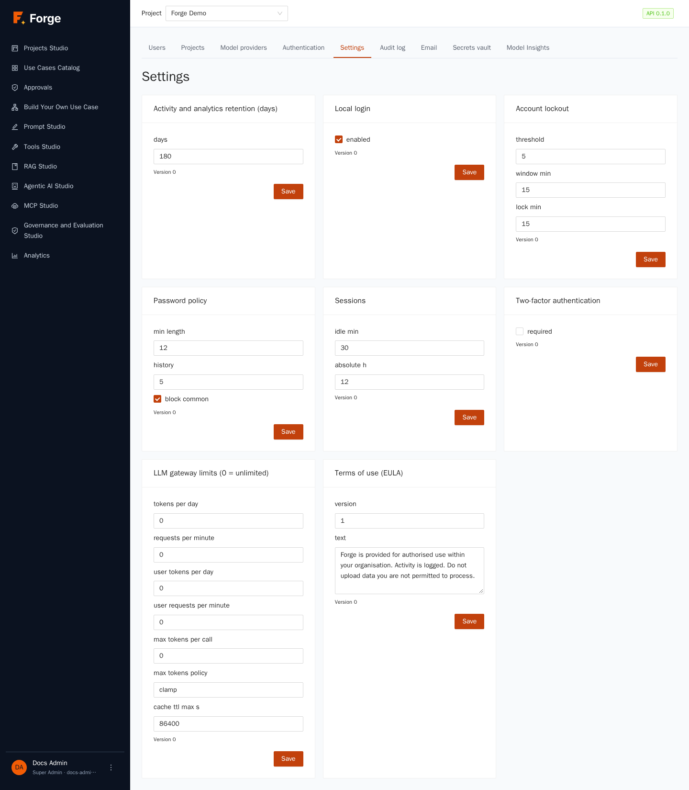

Each card is saved separately and **applied without a restart** ("Saved; applied without restart"). The field names are shown as they are stored.

| Card | Settings |
| --- | --- |
| **Password policy** | *min length* (12 by default), *history* (how many previous passwords cannot be reused, 5), *block common* (refuse the most common passwords). |
| **Account lockout** | *threshold* (failed attempts, 5), *window min* (within how many minutes, 15), *lock min* (how long the account stays locked, 15). |
| **Sessions** | *idle min* (sign out after this much inactivity, 30) and *absolute h* (maximum session length whatever the activity, 12). |
| **Two-factor authentication** | *required*: when on, every user must enrol an authenticator app at the next sign-in. |
| **Local login** | *enabled*: see section 11.4. |
| **Terms of use (EULA)** | The *version* and the *text* people must accept at sign-in. **Increase the version** to make everybody accept again. |
| **LLM gateway limits (0 = unlimited)** | Platform ceilings per project: *tokens per day*, *requests per minute*, the same per user, *max tokens per call*, the *max tokens policy* (*clamp* or *reject*) and the cache's *ttl max*. Project Admins can only go **below** these (chapter 2). |
| **Activity and analytics retention (days)** | The window shown by the activity log and Analytics (1 to 3650, default 180). Nothing is deleted: it is a reading window. |

## 11.6 Audit log

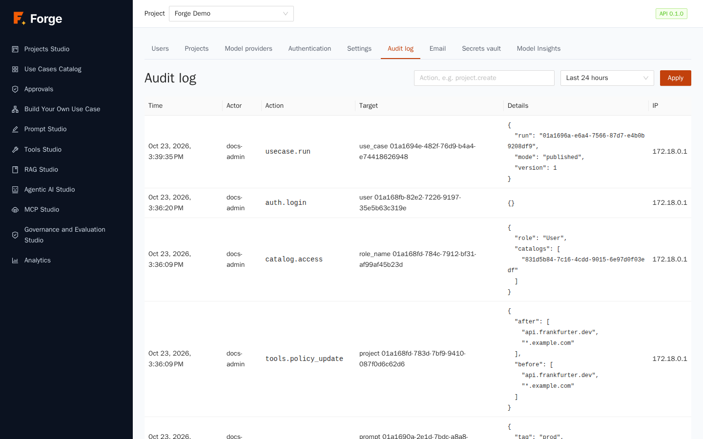

The **audit log** is the **complete security record** of the platform: sign-ins and failures, user and project changes, role and membership changes, secrets and settings, model and provider changes, document uploads and deletions, publications, and more. It is append-only: nobody can edit or delete entries.

Columns: **Time**, **Actor**, **Action** (a code such as `project.create`), **Target**, **Details** and **IP**. Filter with the **Action** box (for example `project.create`, `auth.login_failed`) and the period (**Last 24 hours**, **7 days**, **30 days**) and click **Apply**. Secrets and prompts are never written to the log; names and ids are.

Use it to answer *who did what, when and from where*, for incident review and for compliance.

## 11.7 Email

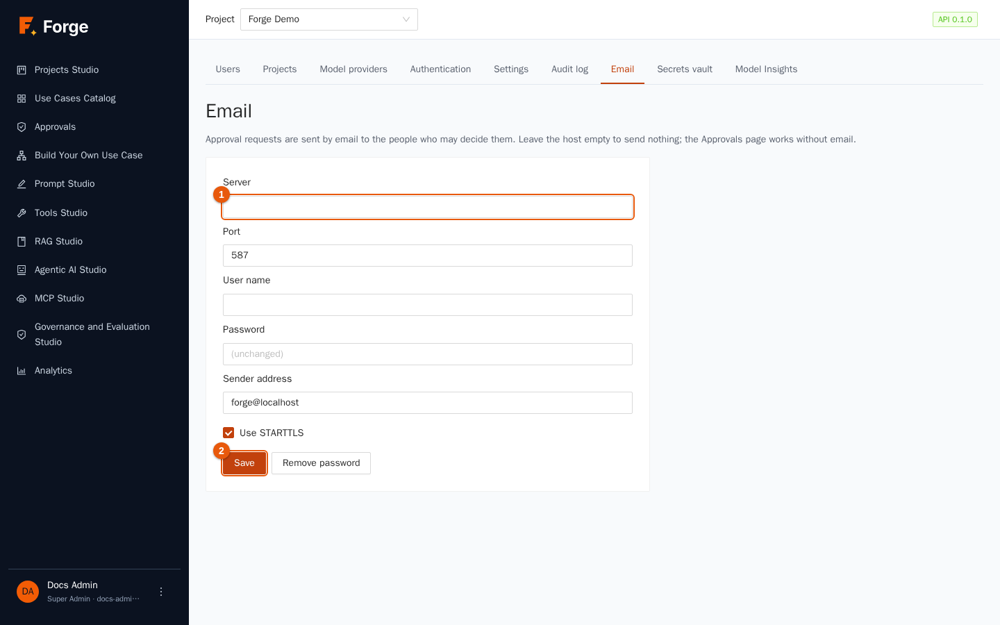

Forge sends **e-mail only for approval requests** (chapter 7): the people who may decide get a message with a one-time link. Without e-mail the **Approvals** page keeps working; people just are not notified.

Fill in **Server** (and **Port**), **User name**, **Password**, **Sender address** and **Use STARTTLS**, then **Save**. Leave the server empty to send nothing. **Remove password** deletes the stored one. **Send a test message** to an address to check the setup; the notice says *Message sent* or shows the error. Values coming from the server's environment (`FORGE_SMTP_*`) are used until you save here, and saving here replaces them. The password is stored encrypted and shown as *(unchanged)*.

## 11.8 Secrets vault

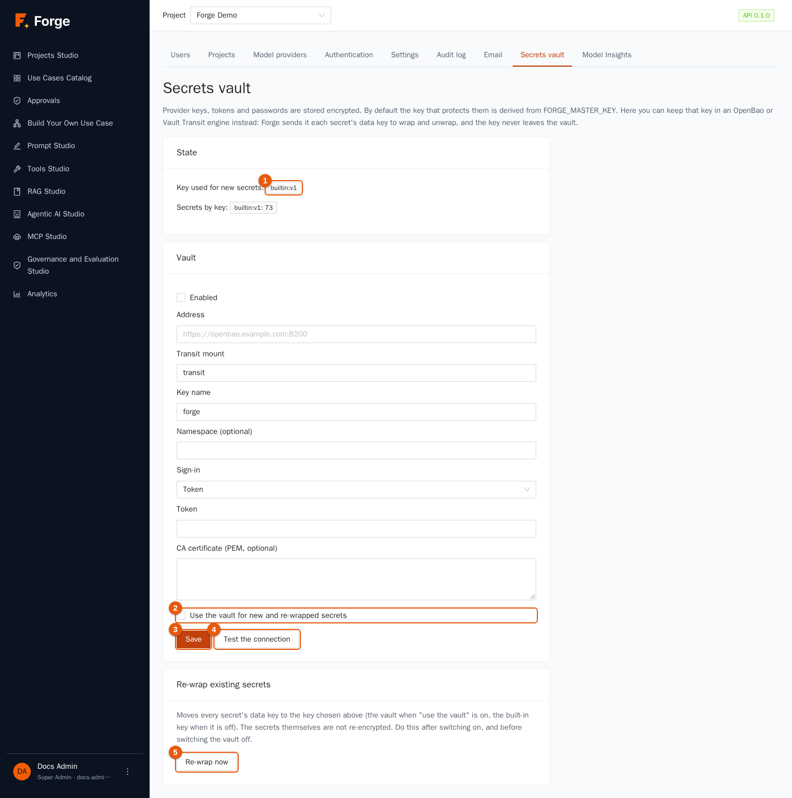

Every secret in Forge (provider keys, tool credentials, database passwords, LDAP and OIDC secrets, webhook secrets) is stored **encrypted**. Each secret has its own data key; data keys are protected by a **master key (KEK)**. By default the KEK is derived from the installation's `FORGE_MASTER_KEY`. Here you can instead keep the KEK in an **OpenBao or HashiCorp Vault *Transit* engine**, so the key that protects everything never sits in Forge's configuration, and you get the vault's own audit and rotation.

The top shows the **State** (marker 1): the **Key used for new secrets** (built-in or the vault key) and **Secrets by key** (how many secrets sit under each key).

### Switch on the vault

1. In **Vault** fill in **Address** (the vault URL), **Transit mount** and **Key name** (create the Transit key in the vault first; a plain `aes256-gcm96` key), an optional **Namespace**, and the **Sign-in**: a **Token**, or an **AppRole** (**Role id** and **AppRole secret id**). Add the vault's **CA certificate (PEM, optional)** if needed. Leave the credential fields empty to keep the stored one.
2. Click **Save** (marker 3). Forge checks the settings with a **real round trip** before accepting them. **Test the connection** (marker 4) repeats the check at any time.
3. Tick **Use the vault for new and re-wrapped secrets** (marker 2) and save.
4. Click **Re-wrap now** under **Re-wrap existing secrets** (marker 5): it moves every existing secret's data key under the vault key. The secrets themselves are not re-encrypted.

### Rules to know

- If the vault is **unreachable**, secrets protected by it cannot be read (the calls fail with *vault unavailable*): Forge never falls back to a weaker key. Run the vault in high availability.
- `FORGE_MASTER_KEY` **stays required**: it protects the vault's own credential and is the way back.
- **To switch the vault off**: first stop using it (untick the option) and **Re-wrap** everything back to the built-in key; Forge refuses to disable it while secrets still depend on it.
- Rotating the Transit key inside the vault is transparent. Rotating the sign-in credential: paste the new one here.

## 11.9 Model Insights

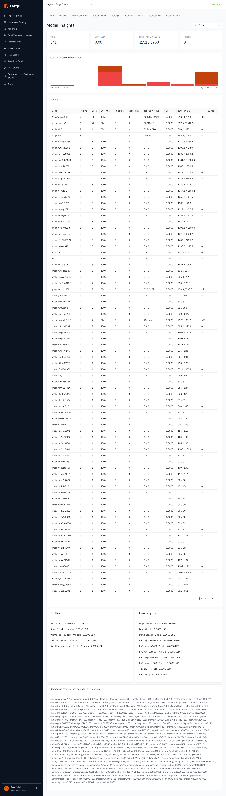

The platform-wide twin of the project dashboard: usage of **every model across all projects**, over **Last 24 hours / 7 / 30 / 90 days**. You find the **Calls over time** chart, the **Models** table (**Projects** using it, **Calls**, **Error rate**, **Fallbacks**, **Cache hits**, **Tokens in / out**, **Cost**, **p50 / p95 ms**, **TTFT p50 ms**), the **Providers** with calls and errors, **Projects by cost**, and **Registered models with no calls in this period**, a handy list of models you can retire. Use it to decide which models to keep, which provider is unreliable, and which project drives the cost.

## 11.10 Routine tasks

| When | Do |
| --- | --- |
| A new project starts | Create the project (11.2) → enable the right platform models (11.3) → map directory groups (11.4) or ask the Project Admin to invite people. |
| Someone leaves | Disable their account (11.1); with LDAP/OIDC the sync does it for you. Check the project's tokens (chapter 2). |
| A user is locked out | **Unlock** (11.1) or **Reset password**. |
| Rotating a provider key | Edit the provider (11.3), type the new key. |
| Quarterly | Review Super Admins, the audit log of sensitive actions, the models with no calls (11.9) and the project list (archive the dead ones). |

## 11.11 Troubleshooting

| Symptom | Cause and remedy |
| --- | --- |
| A user signs in but sees no project | No mapping matches their groups and nobody added them manually. Use **Test user** to see their groups, then add the mapping or invite them. |
| LDAP sign-in fails for everybody | Check **Test** on the provider: server address, TLS/CA, bind account. Remember Super Admins can still sign in locally. |
| A directory user is refused after a change of e-mail | Their e-mail or user name now matches another account: the conflict is in the audit log; resolve it by hand. |
| "Local login cannot be turned off" | No external provider is enabled; enable one first. |
| A project cannot see a platform model | The model is not enabled for that project (11.3). |
| Secrets cannot be read after a vault outage | The vault must come back; do not try to disable it while secrets depend on it (11.8). |
| Settings changes seem ignored | Each card has its own **Save**; look for *Saved; applied without restart*. |

Next: [12. Installing and operating Forge](12-operations.md)
