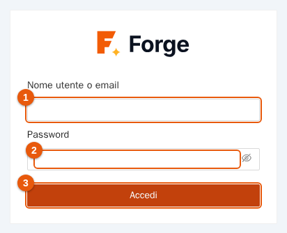
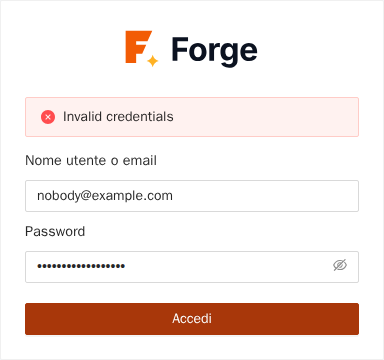
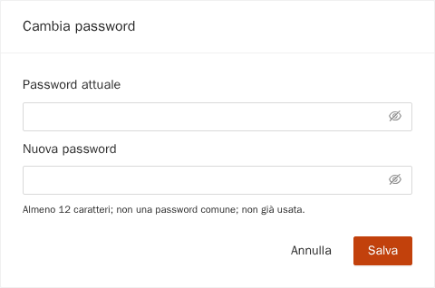
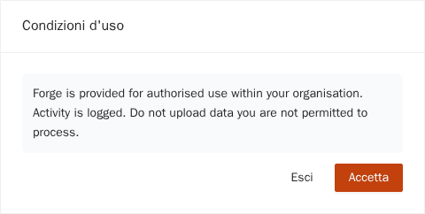
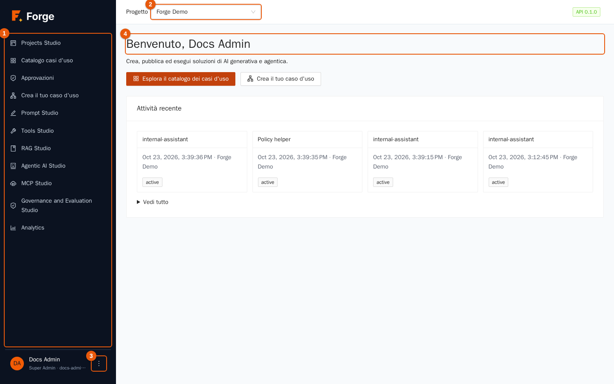
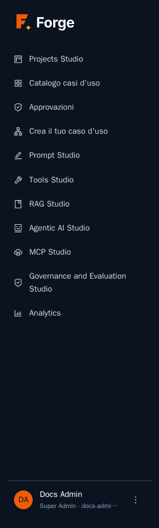
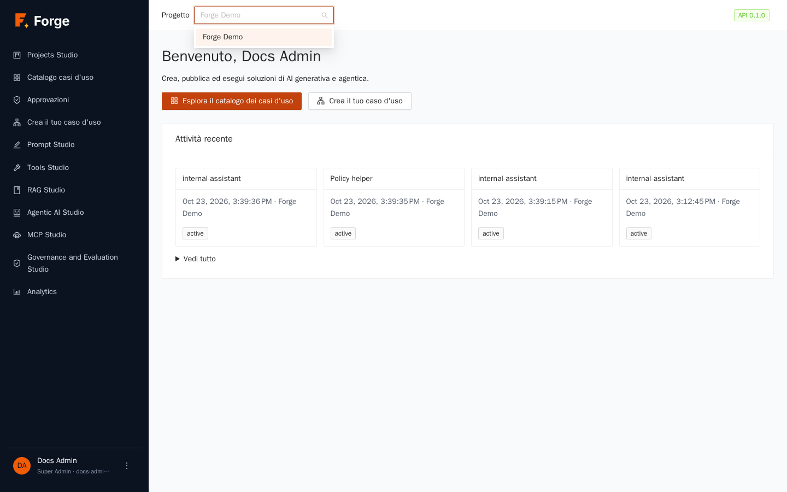
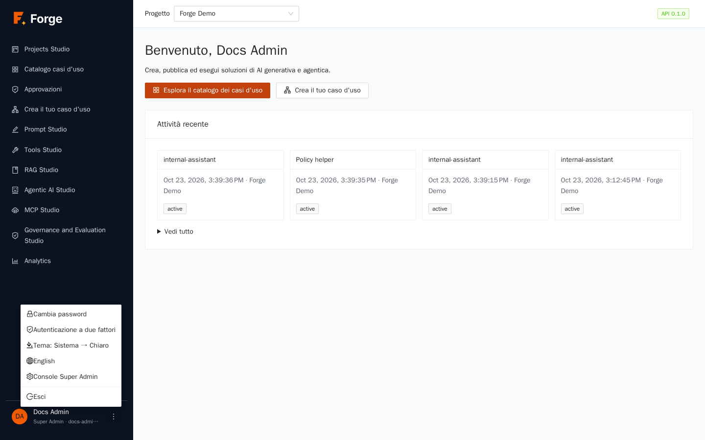
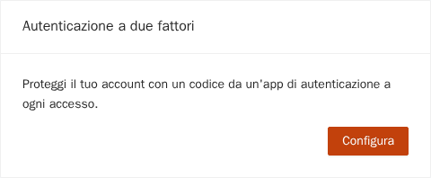

# 1. Per iniziare

[Indice](README.md) · Prossimo: [2. Projects Studio](02-projects-studio.md)

Questo capitolo mostra come accedere a Forge, com'è fatta la schermata, come scegliere il progetto in cui lavori e come impostare le preferenze personali (password, autenticazione a due fattori, lingua e tema).

> **A chi serve?** A tutti. Tutti i ruoli descritti nei capitoli successivi partono da qui.

## 1.1 Prima di iniziare

Ti servono:

- l'indirizzo della tua installazione di Forge (per esempio `https://forge.example.com`);
- un nome utente (o un indirizzo email) e una password che ti ha dato un Super Admin, oppure il pulsante di accesso aziendale (single sign-on) se la tua organizzazione usa LDAP o OpenID Connect;
- un browser recente (Chrome, Edge, Firefox o Safari aggiornati).

Le immagini di questa guida vengono da un progetto dimostrativo chiamato **Forge Demo**. Ciò che vedi nella tua installazione dipende dal tuo ruolo e dai tuoi dati. I testi dei dati dimostrativi (nomi e descrizioni di prompt, agenti e così via) sono in inglese in entrambe le lingue, perché sono contenuto e non interfaccia.

## 1.2 Accedere

1. Apri l'indirizzo di Forge nel browser. Compare la pagina di accesso.

   

2. Scrivi il **nome utente o l'email** (indicatore 1) e la **password** (indicatore 2). L'icona a forma di occhio nel campo password mostra o nasconde ciò che digiti.
3. Premi **Accedi** (indicatore 3).

Se la tua organizzazione usa un identity provider aziendale, sopra il modulo compaiono uno o più pulsanti con il suo nome: premi il pulsante invece di scrivere la password.

**Se per il tuo account è attiva l'autenticazione a due fattori**, un secondo passaggio chiede il codice a sei cifre della tua app di autenticazione. Se hai perso il telefono, premi **Usa un codice di recupero** e scrivi uno dei dieci codici di recupero che hai salvato quando hai attivato la funzione. Ogni codice di recupero vale una volta sola.

### Cosa può impedirti di entrare

I messaggi di errore arrivano dal server e sono in inglese anche nell'interfaccia italiana.

| Messaggio o comportamento | Causa | Cosa fare |
| --- | --- | --- |
| «Invalid credentials» | Nome utente o password sbagliati. Il messaggio è volutamente generico. | Controlla la tastiera e riprova. |
| L'account è bloccato per 15 minuti | Cinque password errate in 15 minuti. | Attendi, oppure chiedi a un Super Admin di sbloccare l'account (capitolo 11). |
| Troppi tentativi di accesso | Più di 20 tentativi al minuto dal tuo indirizzo. | Attendi un minuto. |

## 1.3 Primo accesso: passaggi obbligatori

Quando un Super Admin crea il tuo account, o reimposta la tua password, Forge può chiederti di completare alcuni passaggi **prima** di usare l'applicazione. Compaiono uno dopo l'altro, in quest'ordine:

1. **Cambia password.** Scrivi la password attuale (temporanea) e una nuova. Le regole sono sotto il campo: almeno 12 caratteri, non una password comune, non una delle ultime cinque usate.

   

2. **Condizioni d'uso.** Leggi il testo e premi **Accetta**. Se premi **Esci** te ne vai senza accettare e non puoi usare Forge.

   

3. **Autenticazione a due fattori**, solo se la tua organizzazione l'ha resa obbligatoria. Vedi la sezione 1.6.

## 1.4 La schermata

Dopo l'accesso vedi la home page.

| Indicatore | Area | A cosa serve |
| --- | --- | --- |
| 1 | **Menu laterale** | Apre le aree di Forge (tabella sotto). L'area corrente è evidenziata. |
| 2 | Selettore **Progetto** | Sceglie il progetto in cui lavori. |
| 3 | **Menu del profilo** (tre puntini) | Password, autenticazione a due fattori, tema, lingua, uscita. |
| 4 | **Pagina** | Il contenuto dell'area aperta. Nella home: un benvenuto, due scorciatoie e la tua attività recente. |

L'etichetta **API** in alto a destra mostra la versione del server Forge a cui sei collegato. Se diventa rossa e dice *API non raggiungibile*, il server non è raggiungibile.

### Il menu laterale

| Voce | Cosa si fa | Capitolo |
| --- | --- | --- |
| **Projects Studio** | Impostazioni del progetto: modelli, dati, membri, ruoli, cataloghi, import ed export. | [2](02-projects-studio.md), [4](04-dati-e-rag.md), [10](10-integrazioni-e-sincronizzazione.md) |
| **Catalogo casi d'uso** | Eseguire i casi d'uso pubblicati per te. | [7](07-casi-d-uso.md) |
| **Approvazioni** | Decidere sui passaggi che attendono una persona. | [7](07-casi-d-uso.md) |
| **Crea il tuo caso d'uso** | Progettare un caso d'uso con l'editor visuale. | [7](07-casi-d-uso.md) |
| **Prompt Studio** | Scrivere, versionare, provare e pubblicare prompt. | [3](03-prompt-studio.md) |
| **Tools Studio** | Definire gli strumenti che gli agenti possono chiamare. | [5](05-strumenti.md) |
| **RAG Studio** | Interrogare i documenti con risposte citate. | [4](04-dati-e-rag.md) |
| **Agentic AI Studio** | Creare agenti e conversare con loro. | [6](06-agenti.md) |
| **MCP Studio** | Oggi mostra solo un avviso che l'area arriverà in una fase successiva. Il server MCP e i widget di chat sono in **Projects Studio → Integrazioni**. | [10](10-integrazioni-e-sincronizzazione.md) |
| **Governance and Evaluation Studio** | Guardrail e valutazioni di qualità. | [8](08-governance.md) |
| **Analytics** | Dashboard di utilizzo, costi, qualità e attività. | [9](09-analytics.md) |

I nomi dei sei Studio e di Analytics sono nomi di prodotto e restano in inglese anche nell'interfaccia italiana.

Vedi solo le voci consentite dal tuo ruolo. Un Project Admin vede tutto il progetto; un utente finale di solito vede il catalogo e le approvazioni.

## 1.5 Scegliere il progetto

Ogni risorsa di Forge (prompt, documenti, agenti, casi d'uso…) appartiene a **un solo progetto**, e i progetti sono completamente separati tra loro: persone, dati e costi non si mescolano mai.

1. Premi il selettore **Progetto** in alto (vedi sotto).
2. Scrivi qualche lettera per filtrare, poi premi il progetto.

Forge ricorda la scelta in questo browser. Se l'elenco è vuoto non sei membro di nessun progetto: chiedi a un Super Admin di aggiungerti.

## 1.6 Il menu del tuo profilo

Premi i tre puntini accanto al tuo nome, in fondo al menu laterale.

| Voce | Cosa fa |
| --- | --- |
| **Cambia password** | Apre la stessa pagina della sezione 1.3. Chi accede con LDAP o OpenID Connect cambia la password nel sistema aziendale. |
| **Autenticazione a due fattori** | Attivazione, vedi sotto. Disattivata (grigia) se è già attiva. |
| **Tema** | Ogni clic passa al tema successivo: sistema, chiaro, scuro. *Sistema* segue il sistema operativo. La scelta resta in questo browser. |
| **English / Italiano** | Cambia la lingua dell'interfaccia. La pagina si ricarica. La scelta resta in questo browser. La voce mostra la lingua verso cui si passa. |
| **Console Super Admin** | Visibile solo ai Super Admin (capitolo 11). |
| **Esci** | Chiude la sessione. |

### Attivare l'autenticazione a due fattori

1. Apri il menu del profilo e scegli **Autenticazione a due fattori**, poi premi **Configura**.

   

2. Inquadra il codice QR con un'app di autenticazione (qualsiasi app che supporti i codici monouso a tempo). Se non puoi inquadrarlo, scrivi la chiave mostrata sotto il codice («Oppure inserisci questa chiave manualmente»).
3. Scrivi il codice a sei cifre mostrato dall'app e premi **Attiva**.
4. Forge mostra **dieci codici di recupero**. Premi **Scarica** oppure copiali in un posto sicuro, poi premi **Continua**. Sono mostrati una sola volta e ognuno vale una volta sola.

Da quel momento, l'accesso chiede il codice dopo la password. Una volta attiva la funzione, la voce di menu è grigia: l'interfaccia non ha un interruttore per disattivarla, quindi se serve toglierla (per esempio dopo aver perso il telefono e i codici di recupero) rivolgiti ai tuoi amministratori.

## 1.7 Consigli

- Lavora con la finestra del browser larga almeno 1280 pixel: tabelle ed editor visuale hanno bisogno di spazio. Sugli schermi piccoli il menu laterale si nasconde dietro un pulsante.
- Le sessioni terminano dopo un periodo di inattività e dopo una durata massima, entrambi impostati dagli amministratori: quando succede, accedi di nuovo.
- I testi dell'interfaccia, le date e i numeri seguono la lingua scelta; il contenuto che scrivi (prompt, documenti) non viene mai tradotto.

Prossimo: [2. Projects Studio](02-projects-studio.md)
