# 2. Projects Studio

[Indice](README.md) · Precedente: [1. Per iniziare](01-per-iniziare.md) · Prossimo: [3. Prompt Studio](03-prompt-studio.md)

Projects Studio è il posto in cui si configura un **progetto**: chi ne fa parte, quali modelli può chiamare, quali limiti valgono, quali cataloghi vedono i suoi utenti. Tutto il resto di Forge (prompt, documenti, agenti, casi d'uso) vive dentro un progetto, quindi questa è la prima area da visitare dopo la creazione del progetto.

> **A chi serve?** Ai Project Admin. Builder, Operatori e utenti finali vedono le schede consentite dal loro ruolo, ma solo un Project Admin può cambiare membri, ruoli, modelli e limiti. Creare i progetti è un compito del Super Admin (capitolo 11).

## 2.1 Le schede di Projects Studio

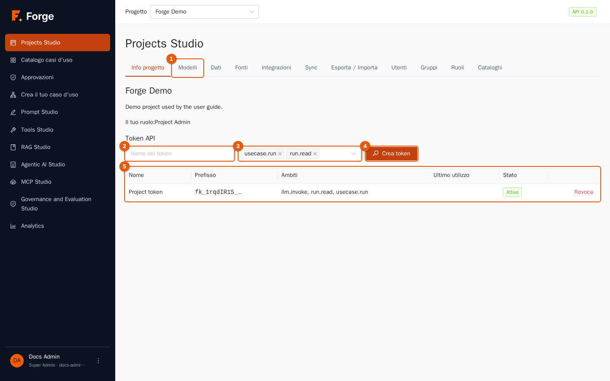

| Scheda | Cosa contiene | Dove è spiegata |
| --- | --- | --- |
| **Info progetto** | Nome, descrizione, il tuo ruolo e i token API | sezione 2.2 |
| **Modelli** | Provider, modelli, alias, limiti e cache | sezione 2.3 |
| **Dati** | Raccolte di dati (file per il RAG) | [capitolo 4](04-dati-e-rag.md) |
| **Fonti** | Sincronizzazione programmata di dati esterni | [capitolo 4](04-dati-e-rag.md) |
| **Integrazioni** | Server MCP e widget di chat | [capitolo 10](10-integrazioni-e-sincronizzazione.md) |
| **Sync** | Tenere il progetto in un repository Git con `forgectl` | [capitolo 10](10-integrazioni-e-sincronizzazione.md) |
| **Esporta / Importa** | Spostare risorse tra progetti e installazioni | [capitolo 10](10-integrazioni-e-sincronizzazione.md) |
| **Utenti** | Membri e relativo ruolo | sezione 2.4 |
| **Gruppi** | Gruppi di membri con un nome | sezione 2.5 |
| **Ruoli** | I Nome ruolo del progetto | sezione 2.6 |
| **Cataloghi** | Dove si pubblicano i casi d'uso e chi li vede | sezione 2.7 |

## 2.2 Info progetto e token API

La prima scheda mostra nome e descrizione del progetto e **il tuo ruolo**. I Project Admin vedono anche i **Token API**: stringhe segrete lunghe che permettono a un programma di chiamare Forge per conto del progetto (per esempio un'applicazione che esegue un caso d'uso, o uno strumento che usa l'endpoint compatibile con OpenAI).

### Creare un token

1. Apri **Projects Studio → Info progetto**.
2. Scrivi un **Nome del token** (indicatore 2) che dica a cosa serve, per esempio `integrazione-crm`.
3. Scegli gli **Ambiti** (indicatore 3). Un ambito (*scope*) è un permesso; l'elenco contiene solo i permessi che ha il tuo ruolo, e il token non potrà mai fare più di te. I predefiniti, `usecase.run` e `run.read`, bastano per eseguire casi d'uso e leggerne i risultati. Aggiungi `llm.invoke` per permettere al token di chiamare i modelli tramite l'API compatibile con OpenAI.
4. Premi **Crea token** (indicatore 4).
5. Il riquadro verde mostra il token **una sola volta**. Copialo subito e conservalo nel tuo gestore di segreti: Forge ne tiene solo un'impronta e non può mostrarlo di nuovo.

La tabella (indicatore 5) elenca i token con **Prefisso** (i primi caratteri, per riconoscerli), **Ambiti**, **Ultimo utilizzo** e **Stato**. Premi **Revoca** per disattivare definitivamente un token: i programmi che lo usano ricevono un errore di autorizzazione alla chiamata successiva.

> **Buona pratica.** Un token per applicazione, con il minor numero di ambiti che bastano. Revoca i token che non usi più: la colonna *Ultimo utilizzo* aiuta a trovarli.

## 2.3 Modelli, alias, limiti

Forge non ospita nessun modello: ogni modello è un **endpoint di un provider esterno** (un servizio cloud, oppure un server dentro l'azienda come vLLM o Ollama). La scheda Modelli ha quattro blocchi: i contatori d'uso in alto, poi provider, modelli e alias, infine limiti e cache.

### Contatori d'uso

Quattro contatori in alto mostrano ciò che il progetto ha consumato oggi (giorno UTC): **token oggi**, **richieste in questo minuto**, **chiamate oggi** e **costo oggi**. I primi due mostrano il valore usato finora e il limite (per esempio `120 / 500000`), oppure *illimitato* se non c'è un limite.

### Provider

Un **provider** è una connessione: un tipo (OpenAI, Azure, Anthropic, Gemini, Mistral, vLLM, Ollama, NVIDIA NIM, compatibile con OpenAI…), un indirizzo e delle credenziali. I provider della piattaforma li creano i Super Admin e sono condivisi; la tabella **Provider** di un progetto elenca solo quelli che appartengono al progetto stesso.

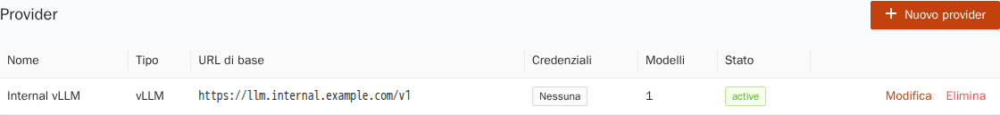

Per aggiungere un provider solo del progetto, per esempio il vLLM interno dell'azienda:

1. Premi **Nuovo provider**.

   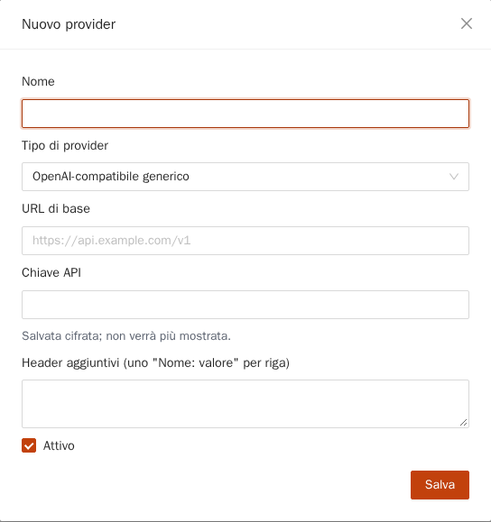

2. Compila **Nome**, **Tipo di provider** e **URL di base** (l'indirizzo dell'API compatibile con OpenAI, per esempio `https://llm.internal.example.com/v1`).
3. Scrivi la **chiave API** se il servizio la richiede. Chiavi e password sono memorizzate **cifrate**, sono di sola scrittura (Forge non le mostra più) e non finiscono mai nei log. Per sostituire una chiave scrivine una nuova; per cancellarla usa **Rimuovi le credenziali salvate**.
4. Gli indirizzi `http://` in chiaro sono rifiutati. Spunta **Consenti HTTP in chiaro** solo per un endpoint dentro una rete fidata.
5. Alcuni tipi chiedono altri campi: Azure la *versione API*, Bedrock la *regione* e le credenziali AWS, Vertex il *progetto* e la *posizione* Google Cloud. Gli **Header aggiuntivi** si aggiungono a ogni chiamata (uno `Nome: valore` per riga).
6. Lascia spuntato **Attivo** e premi **Salva**.

### Modelli

Un **modello** è un modello richiamabile di un provider, con i suoi limiti e i suoi prezzi. La tabella ha una scheda per tipo: **LLM** (chat), **Embedding** (trasforma il testo in numeri per la ricerca), **Reranker** (riordina i risultati di ricerca) e **Voce**. I modelli della piattaforma hanno l'etichetta blu **Piattaforma** e qui sono di sola lettura; quelli che crei tu mostrano **Progetto**.

Per aggiungere un modello di un provider del progetto:

1. Premi **Nuovo modello**.

   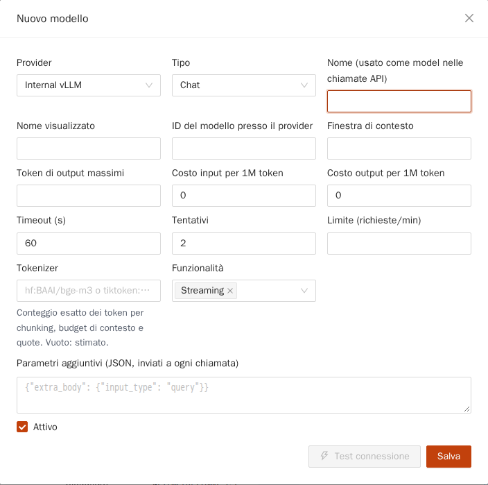

2. Scegli il **Provider** e il **Tipo**.
3. **Nome (usato come model nelle chiamate API)** è il nome che usano prompt, agenti e API. Deve essere unico nel progetto. **Nome visualizzato** è un'etichetta comprensibile.
4. **ID del modello presso il provider** è l'identificatore che il provider si aspetta, per esempio `Qwen/Qwen3-8B`.
5. Compila ciò che sai: **Finestra di contesto** e **Token di output massimi**, **Costo input** e costo output **per 1M token** (alimentano i contatori dei costi e Analytics; lascia 0 per modelli gratuiti o interni), **Timeout (s)**, **Tentativi** e un **Limite (richieste/min)** per questo modello.
6. **Tokenizer** dice a Forge come contare i token in modo esatto (un repository Hugging Face come `hf:BAAI/bge-m3`, oppure una codifica `tiktoken:`). Vuoto significa una stima di circa quattro caratteri per token.
7. **Funzionalità** dichiara cosa supporta il modello: *streaming*, *tools*, *json*, *vision*. Gli agenti con strumenti richiedono *tools*.
8. **Parametri aggiuntivi** è un oggetto JSON inviato a ogni chiamata, per i provider che richiedono campi non standard.
9. Premi **Test connessione** per provare il modello *prima* di salvare: Forge invia una richiesta minima e mostra se ha funzionato e in quanto tempo. Poi premi **Salva**.

Puoi anche provare un modello già salvato in qualsiasi momento con il pulsante **Prova** nella sua riga. Il risultato compare come messaggio verde o rosso sotto i contatori d'uso, per esempio *groq-gpt-oss-20b ha risposto in 267 ms*.

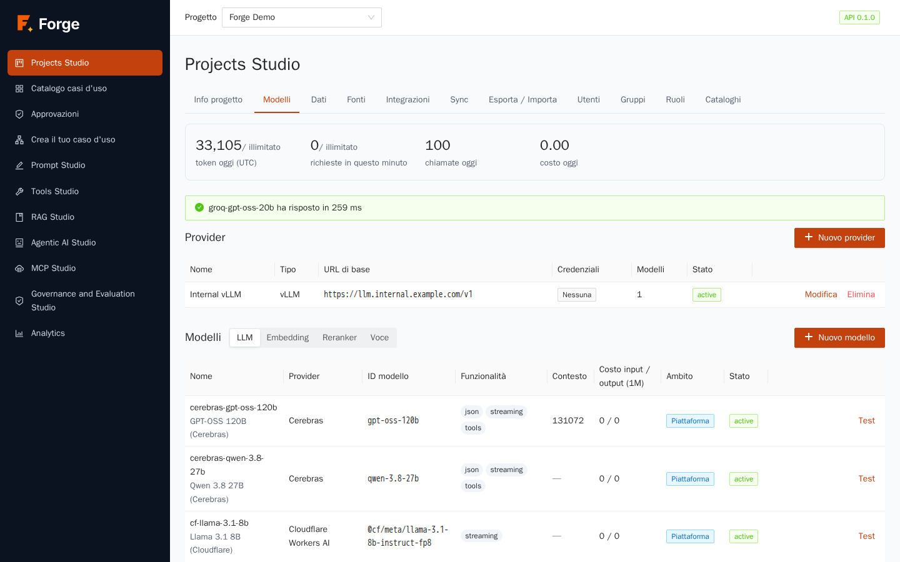

### Alias

Prompt, agenti e pipeline RAG non chiamano un modello direttamente: chiamano un **alias**, un nome come `default-chat`, con una **catena di fallback ordinata** di modelli. Forge chiama il primo modello; se fallisce o va in timeout chiama il secondo, e così via. Cambiare la catena cambia il comportamento di tutto ciò che usa l'alias, senza modificare prompt o agenti.

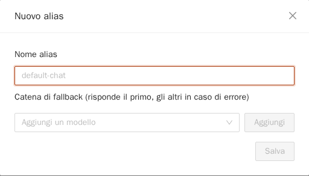

La colonna **Definito da** dice da dove viene un alias: **Predefinito della piattaforma** (condiviso, impostato dai Super Admin) oppure **Progetto** (il tuo, che *sostituisce* un alias della piattaforma con lo stesso nome). **Ripristina** toglie la tua sostituzione.

Per creare o modificare un alias:

1. Premi **Nuovo alias**, oppure **Modifica** su una riga esistente.
2. Scrivi il **Nome alias** (per un alias nuovo).
3. Scegli un modello in **Aggiungi un modello** e premi **Aggiungi**. Ripeti. Risponde il primo modello; gli altri sono di riserva. Usa le frecce per riordinare e la croce per togliere.
4. Premi **Salva**.

> **Buona pratica.** Metti per primo un modello veloce ed economico per il lavoro di routine, e uno più capace come riserva. Metti al secondo posto un modello di un *provider diverso*, così un'interruzione di un provider non ferma il progetto.

### Limiti e cache

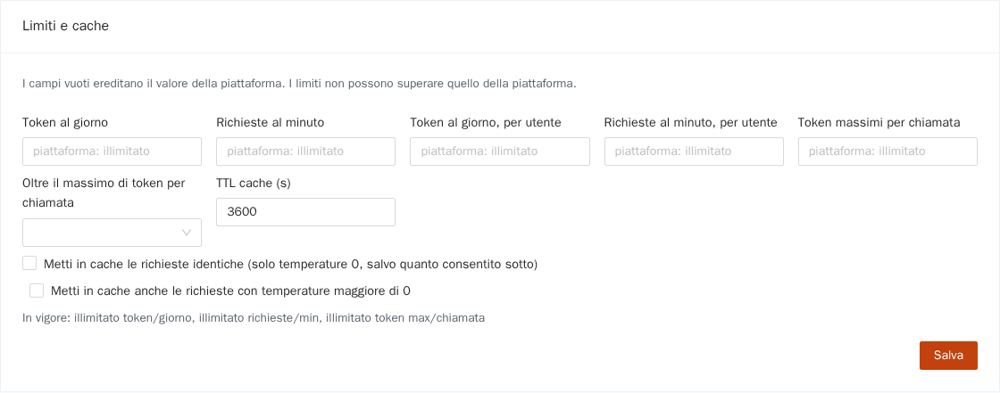

Gli amministratori della piattaforma fissano dei tetti per l'intera installazione. Qui il Project Admin imposta **limiti più stretti per questo progetto**. Un campo vuoto eredita il valore della piattaforma (in grigio come suggerimento); un valore sopra il tetto della piattaforma viene rifiutato.

| Campo | Significato |
| --- | --- |
| **Token al giorno**, **Richieste al minuto** | Limiti per l'intero progetto. |
| **Token al giorno, per utente**, **Richieste al minuto, per utente** | Limiti per ogni singolo utente, così una persona non esaurisce il progetto. |
| **Token massimi per chiamata** | Risposta più lunga consentita per chiamata. |
| **Oltre il massimo di token per chiamata** | Cosa fare quando una richiesta ne chiede di più: *Riduci al limite* (risponde comunque, più breve) oppure *Rifiuta la richiesta*. |
| **Metti in cache le richieste identiche** | Riusa la risposta di una richiesta identica precedente. Disattivata per impostazione predefinita. Un successo della cache non costa nulla e conta zero token. |
| **TTL cache (s)** | Per quanto tempo restano valide le risposte in cache. |
| **Metti in cache anche le richieste con temperature maggiore di 0** | Per impostazione predefinita si memorizzano solo le richieste deterministiche (temperature 0), altrimenti gli utenti riceverebbero sempre la stessa risposta «creativa». |

La riga **In vigore** sotto il modulo mostra i limiti che valgono davvero dopo aver combinato i valori della piattaforma e del progetto. Premi **Salva**.

## 2.4 Utenti

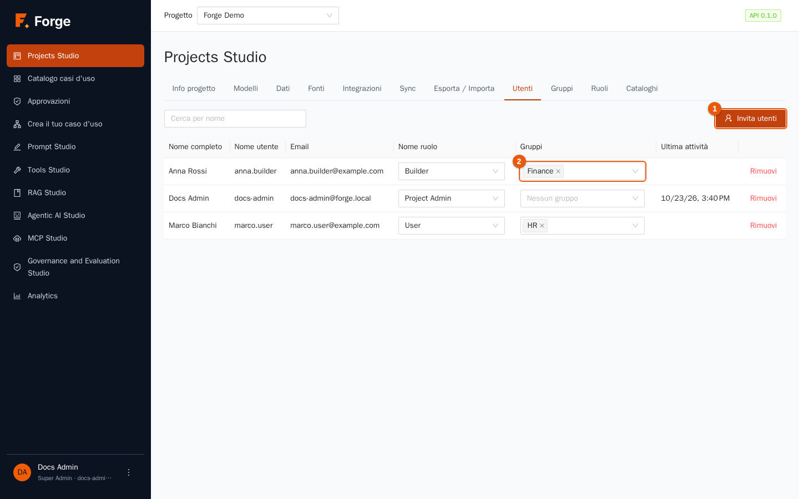

La tabella elenca i membri con **Nome ruolo**, **Gruppi** e **Ultima attività**. Si possono aggiungere solo persone che hanno già un account Forge; creare gli account è un compito del Super Admin (capitolo 11), salvo che gli utenti arrivino da LDAP o OpenID Connect.

### Invitare utenti

1. Premi **Invita utenti** (indicatore 1).

   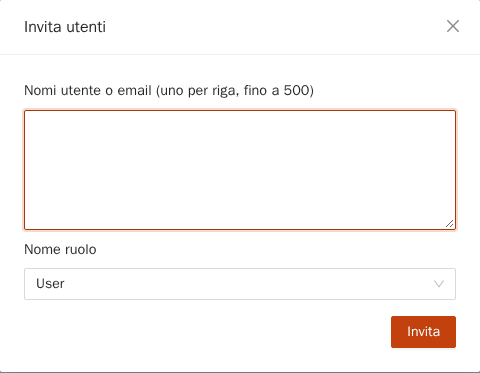

2. Scrivi **un nome utente o indirizzo email per riga** (fino a 500 alla volta).
3. Scegli il **Nome ruolo** che riceveranno. I nuovi membri hanno per impostazione predefinita il ruolo di tipo *Utente*.
4. Premi **Invita**. Un avviso dice quante persone sono state aggiunte («2 aggiunti.») ed elenca i nomi non trovati («Utenti sconosciuti: …»). I nomi possono essere separati da a capo, virgole o punti e virgola.

### Cambiare ruolo o gruppi, rimuovere

- Cambia il **Nome ruolo** con il selettore nella riga. La modifica è immediata.
- Usa il selettore **Gruppi** (indicatore 2) per mettere la persona in uno o più gruppi (sezione 2.5).
- Premi **Rimuovi** per togliere la persona dal progetto. La sua attività passata resta nello storico.

Un utente ha **un solo ruolo per progetto**. La stessa persona può avere ruoli diversi in progetti diversi.

## 2.5 Gruppi

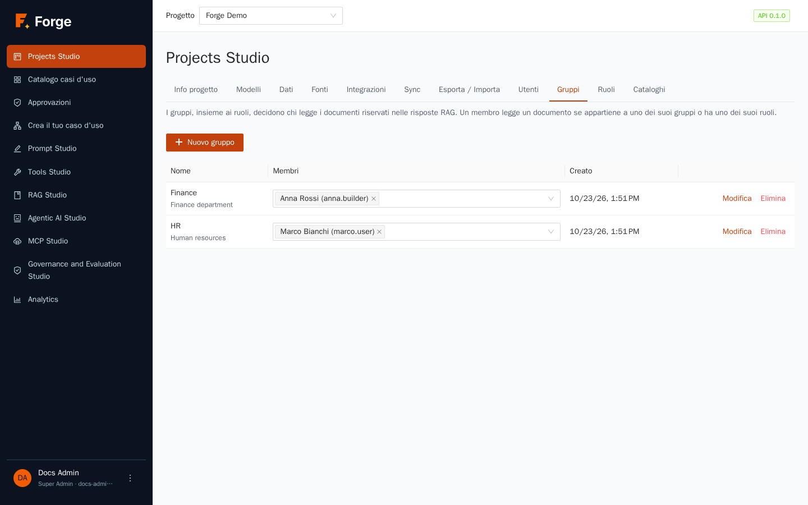

Un **gruppo** è un elenco di membri con un nome, come *Finance* o *HR*. I gruppi esistono per uno scopo: decidere **chi può leggere i documenti riservati** quando si costruiscono le risposte RAG (capitolo 4). Un membro legge un documento se appartiene a uno dei gruppi del documento *oppure* ha uno dei suoi ruoli.

1. Premi **Nuovo gruppo**.

   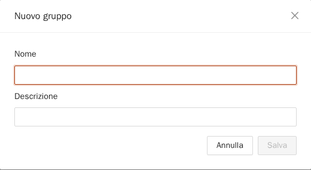

2. Scrivi un **Nome** e una **Descrizione** facoltativa, poi salva.
3. Scegli i membri nella colonna **Membri** della tabella (un selettore a scelta multipla che elenca i membri del progetto), oppure spunta il gruppo nel selettore **Gruppi** di ogni utente nella scheda Utenti. Possono far parte di un gruppo solo i membri del progetto.
4. **Modifica** cambia nome e descrizione; **Elimina** rimuove il gruppo (ti viene chiesta conferma).

I gruppi si gestiscono dentro Forge. Se i tuoi utenti arrivano da LDAP o OpenID Connect, la corrispondenza tra i gruppi della directory e i ruoli del progetto la configurano i Super Admin (capitolo 11).

## 2.6 Ruoli

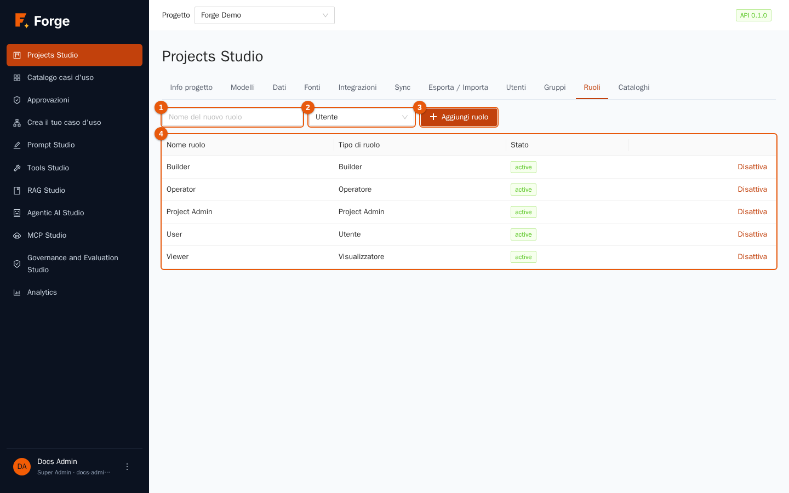

Forge ha cinque **Tipi di ruolo**, che sono insiemi fissi di permessi, e un numero qualsiasi di **Nome ruolo**: etichette che crei tu e che sono legate a un solo tipo. I membri ricevono un *Nome ruolo*.

| Tipo di ruolo | Cosa può fare |
| --- | --- |
| **Project Admin** | Tutto nel progetto: membri, ruoli, modelli, limiti, token, risorse. |
| **Builder** | Creare e modificare prompt, pipeline RAG, strumenti, agenti e casi d'uso; pubblicare casi d'uso; eseguire; decidere le approvazioni. |
| **Operatore** | Eseguire casi d'uso, decidere le approvazioni, leggere tutte le esecuzioni. |
| **Utente** | Eseguire i casi d'uso dei cataloghi abilitati per il suo ruolo e leggere le proprie esecuzioni. |
| **Visualizzatore** | Leggere esecuzioni e risultati. Nessuna modifica, nessuna esecuzione. |

Ogni progetto parte con un Nome ruolo per ciascun tipo. Per aggiungerne uno tuo, per esempio *Analista finanza* di tipo *Utente* (così puoi mostrargli solo il catalogo finanza):

1. Scrivi il **Nome del nuovo ruolo** (indicatore 1), scegli il **Tipo di ruolo** (indicatore 2) e premi **Aggiungi ruolo** (indicatore 3).
2. Usa **Disattiva** nella tabella (indicatore 4) per mettere a riposo un ruolo senza eliminarlo; **Attiva** lo riporta in uso. Un ruolo disattivato non può essere assegnato a nuovi membri.

## 2.7 Cataloghi

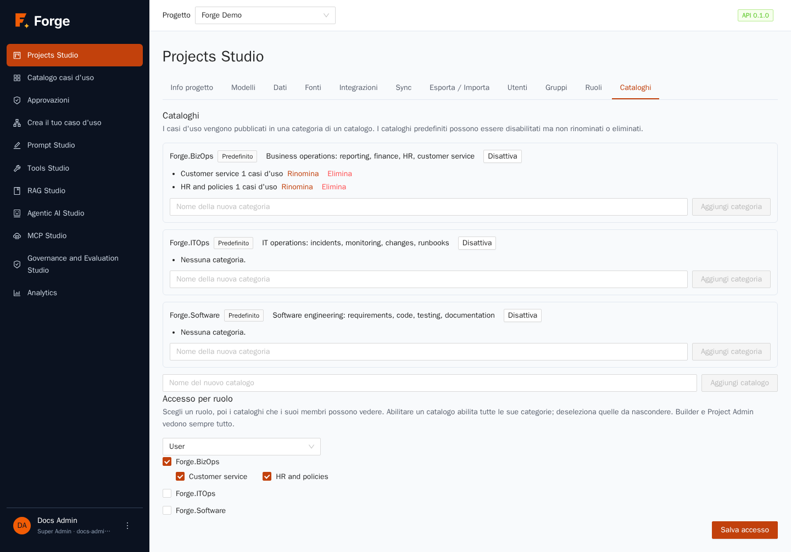

Un **catalogo** raggruppa i casi d'uso che gli utenti eseguono; ogni catalogo ha delle **categorie**. Forge include tre cataloghi predefiniti: **Forge.BizOps** (reportistica, finanza, HR, assistenza clienti), **Forge.ITOps** (incidenti, monitoraggio, cambiamenti, runbook) e **Forge.Software** (requisiti, codice, test, documentazione). Un catalogo predefinito si può disabilitare ma non rinominare né eliminare, e puoi aggiungere i tuoi.

- **Aggiungere una categoria:** scrivi un nome nel blocco del catalogo e premi **Aggiungi categoria**. I casi d'uso si pubblicano *dentro una categoria* (capitolo 7).
- **Aggiungere un catalogo:** scrivi un nome in fondo e premi **Aggiungi catalogo**.
- **Accesso per ruolo:** per impostazione predefinita **nessun catalogo è visibile a un ruolo** finché non lo abiliti. Scegli un ruolo nel selettore, spunta i cataloghi che i suoi membri possono vedere (abilita tutte le loro categorie; deseleziona le singole categorie per nasconderle) e premi **Salva accesso**. Builder e Project Admin vedono sempre tutto.

> **Se un utente dice «il mio catalogo è vuoto»** questa è la prima cosa da controllare: il ruolo di quell'utente deve avere almeno un catalogo abilitato, e almeno un caso d'uso deve essere pubblicato al suo interno.

## 2.8 Risoluzione dei problemi

| Sintomo | Causa e rimedio |
| --- | --- |
| **Nuovo modello** è grigio | Il progetto non ha un provider proprio. Crea prima un provider in **Provider**. |
| Un modello non compare in prompt e agenti | Un Super Admin deve abilitare i modelli della piattaforma per il progetto (capitolo 11); i modelli del progetto compaiono dopo il salvataggio. |
| *Test connessione* fallisce per timeout | Il provider non è raggiungibile o è lento: controlla l'indirizzo, le impostazioni del proxy dell'installazione e il campo **Timeout (s)**. Le chiavi non compaiono mai nell'errore. |
| L'invito dice che un utente non è stato trovato | Gli account devono esistere prima. Chiedi a un Super Admin di creare l'utente, oppure fallo accedere una volta se si usa LDAP o OpenID Connect. |
| Un alias non si può eliminare | Qualcosa lo usa ancora. Il messaggio elenca cosa: cambia prima quei riferimenti. |
| Un limite viene rifiutato | È sopra il tetto della piattaforma. La riga *In vigore* e i suggerimenti in grigio mostrano i tetti. |

Prossimo: [3. Prompt Studio](03-prompt-studio.md)
