# 3. Prompt Studio

[Indice](README.md) · Precedente: [2. Projects Studio](02-projects-studio.md) · Prossimo: [4. Dati e RAG Studio](04-dati-e-rag.md)

Un **prompt** è l'insieme di istruzioni che invii a un modello linguistico. In Prompt Studio un prompt è una risorsa riutilizzabile e versionata: ha una parte di sistema e una parte utente, **variabili** che si riempiono a ogni uso, **esempi** facoltativi, parametri come la temperatura e uno storico di **versioni** che puoi confrontare, ripristinare e pubblicare. Agenti, pipeline RAG e casi d'uso possono usare il prompt *pubblicato*, così puoi migliorarlo senza toccarli.

> **A chi serve?** A Builder e Project Admin. Gli altri ruoli non vedono Prompt Studio.

## 3.1 I concetti in due minuti

| Parola | Significato |
| --- | --- |
| **System prompt** | Il ruolo, le regole e il formato dell'output. Viene inviato per primo. |
| **User prompt** | La richiesta inviata a ogni uso. Contiene le variabili. |
| **Variabile** | Un segnaposto scritto `{nome}`. Al momento dell'esecuzione viene sostituito da un valore. |
| **Esempio (few-shot)** | Una coppia input/output mostrata al modello prima della richiesta, per insegnargli lo stile atteso. |
| **Versione** | Ogni **Salva** crea una nuova versione immutabile. Le versioni vecchie non vengono mai sovrascritte. |
| **Bozza / Pubblicato** | Un prompt è *Pubblicato* finché una sua versione ha il tag `prod`; altrimenti è una *Bozza*. |
| **Tag** | Un'etichetta su una versione: `draft` (sempre l'ultima salvata), `staging` (impostato a mano) e `prod` (impostato da *Pubblica*). |
| **Alias** | Il nome del modello che un prompt chiama, con una catena di fallback (capitolo 2). |

## 3.2 La libreria dei prompt

Apri **Prompt Studio**. La scheda **Libreria dei prompt** elenca i prompt del progetto.

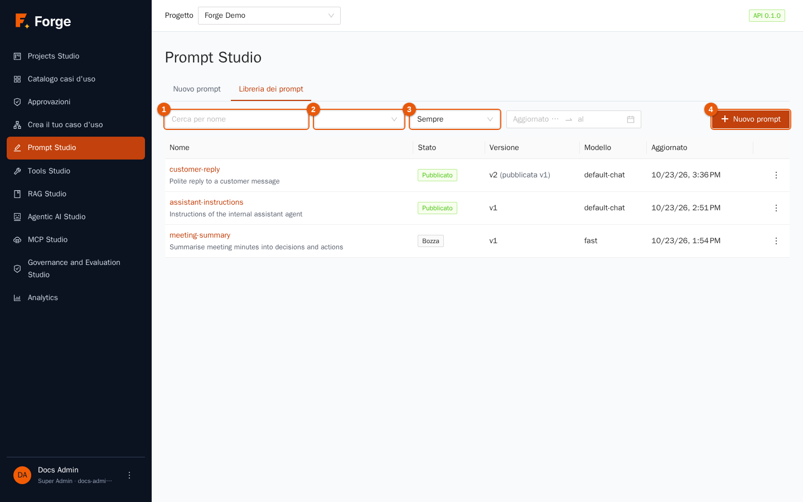

| Indicatore | Controllo | Uso |
| --- | --- | --- |
| 1 | **Cerca per nome** | Filtra mentre scrivi. |
| 2 | **Stato** | Tutti gli stati, *Pubblicato* o *Bozza*. |
| 3 | **Periodo** | Prompt aggiornati nelle ultime 24 ore, 7, 30 o 90 giorni, oppure un **Intervallo di date personalizzato** (compare un secondo controllo: *Aggiornato dal … al*). |
| 4 | **Nuovo prompt** | Apre l'editor su un prompt vuoto. |

Le colonne mostrano il **Nome** (premilo per aprirlo) con la descrizione, lo **Stato**, la **Versione** (per esempio *v2 (pubblicata v1)*: l'ultima versione è la 2, ma quella in produzione è la 1), il **Modello** (alias o nome del modello) e la data di **Aggiornato**. Premi **Carica altri** in fondo per i prompt più vecchi.

I tre puntini a fine riga aprono le azioni:

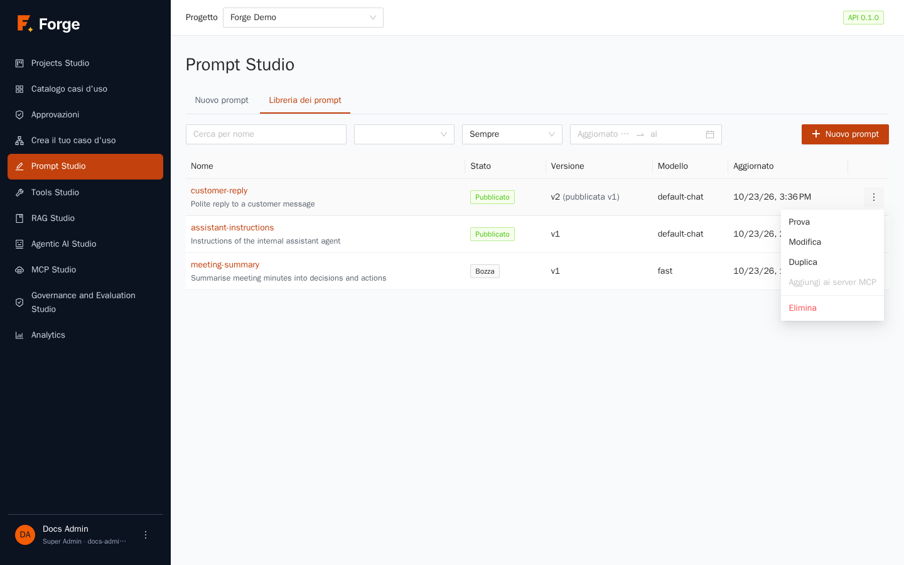

- **Prova** apre la pagina di test (sezione 3.6).
- **Modifica** apre l'editor.
- **Duplica** crea un nuovo prompt, con il nome che scegli, la cui prima versione è una copia dell'ultima versione di questo (la nota dice *Duplicated from …*). Usalo per partire da un prompt ben riuscito.
- **Aggiungi ai server MCP** apre MCP Studio con questo prompt pronto da esporre ad applicazioni esterne (capitolo 10).
- **Elimina** rimuove il prompt e le sue versioni dopo conferma. Se un agente o una pipeline lo usa ancora, l'eliminazione è rifiutata e il messaggio indica cosa lo usa.

## 3.3 Scrivere un prompt

Premi **Nuovo prompt** (oppure **Modifica** su un prompt esistente). Si apre l'editor.

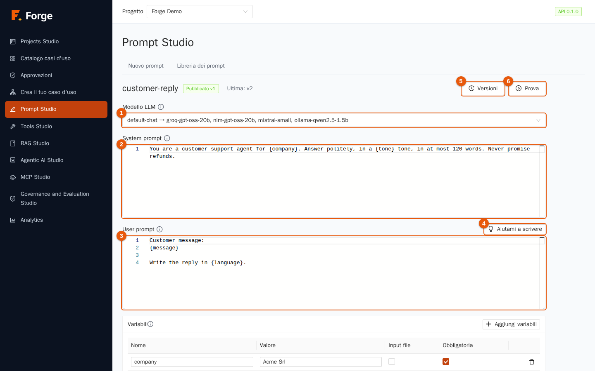

1. **Nome.** Premi il titolo (all'inizio *Prompt senza titolo*) e scrivi un nome chiaro, per esempio `customer-reply`. I nomi sono unici nel progetto. Premi Invio per confermare.
2. **Modello LLM** (indicatore 1). Scegli un **alias** (mostrato come `alias → primo modello, secondo modello…`; consigliato, perché segue la configurazione dei modelli del progetto e ha dei fallback) oppure un **modello** (mostrato come `Nome visualizzato (nome)`) per fissarne uno. Se l'elenco è vuoto il progetto non ha modelli di chat: vedi il capitolo 2.
3. **System prompt** (indicatore 2). Scrivi il ruolo, le regole e il formato dell'output, per esempio: *Sei un operatore del servizio clienti di {company}. Rispondi con cortesia, con un tono {tone}, in al massimo 120 parole. Non promettere mai rimborsi.*
4. **User prompt** (indicatore 3). Scrivi la richiesta, per esempio: *Messaggio del cliente: {message}. Scrivi la risposta in {language}.*
5. Tutto ciò che sta tra parentesi graffe singole è una **variabile**. Mentre scrivi, la tabella *Variabili* qui sotto si compila da sola.

Le due caselle di testo sono editor di codice con i numeri di riga. Per esigenze avanzate funziona anche il linguaggio di template **Jinja2**: `{{ name|upper }}`, `…`, `…`. I template girano in una sandbox che rifiuta tutto ciò che è pericoloso, quindi un template difettoso o ostile non può danneggiare il server. Le parentesi graffe che non sono un nome di variabile, come il JSON nel testo, restano intatte.

### Fai scrivere a Forge la prima bozza: Aiutami a scrivere

Premi **Aiutami a scrivere** (indicatore 4).

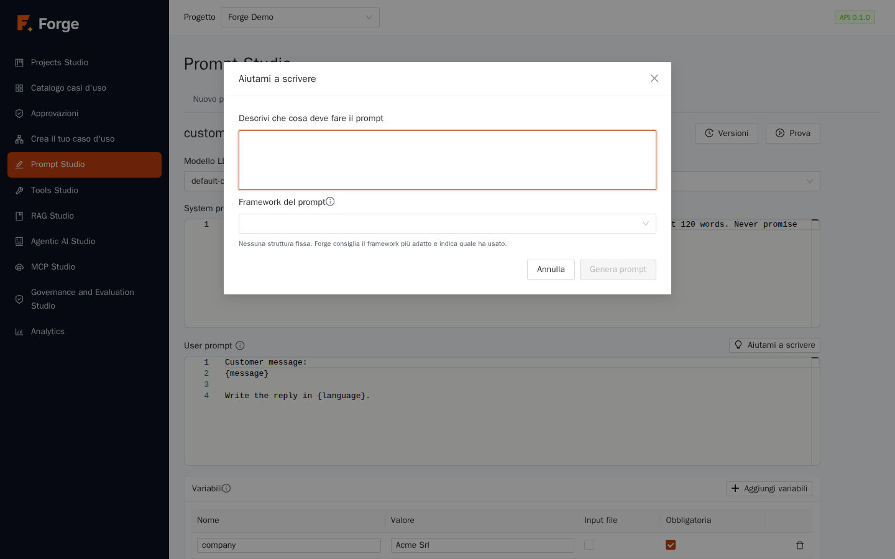

1. Descrivi in poche righe che cosa deve fare il prompt (almeno 10 caratteri).
2. Scegli un **Framework del prompt**, una struttura collaudata per i prompt. **Forma libera** (l'impostazione predefinita) lascia che Forge consigli il framework più adatto e ti dice quale ha usato. Gli altri sono CO-STAR (contesto, obiettivo, stile, tono, pubblico, formato della risposta), RISEN (ruolo, istruzioni, passi, obiettivo finale, restrizioni), RTF (ruolo, compito, formato) e CRISPE (capacità, intuizione, dichiarazione, personalità, esperimento).
3. Premi **Genera prompt**. Compaiono un system prompt e uno user prompt da rivedere. Premi **Rigenera** per un altro tentativo, oppure **Inserisci** per copiarli nell'editor. Non viene salvato nulla finché non premi **Salva**.

Aiutami a scrivere chiama un modello di chat del progetto, quindi consuma qualche token.

### Variabili

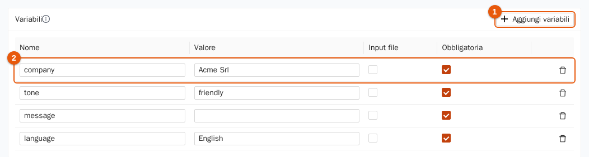

Ogni variabile è una riga della tabella **Variabili**:

| Colonna | Significato |
| --- | --- |
| **Nome** | Il nome usato tra le parentesi graffe. |
| **Valore** | Il valore **predefinito** usato nei test. Al momento dell'esecuzione chi chiama può sostituirlo. |
| **Input file** | Il valore è il contenuto di un file di testo (fino a 256 KB nella pagina di test), per esempio il verbale di una riunione. |
| **Obbligatoria** | Un'esecuzione senza un valore per questa variabile viene rifiutata. |

Le variabili trovate nei template vengono aggiunte automaticamente come *obbligatorie*. **Aggiungi variabili** (indicatore 1) ne aggiunge una a mano; l'icona del cestino a destra la rimuove. Una variabile che nessun template usa riceve l'etichetta arancione **non presente nel prompt**, così puoi cancellarla. Le variabili usate in un template ma non dichiarate vengono aggiunte per te al salvataggio.

### Esempi (few-shot)

Sotto le variabili, **Aggiungi esempio** crea una coppia **Input / Output**. Gli esempi vengono inviati al modello *tra* il system prompt e lo user prompt, come se l'utente avesse già chiesto e l'assistente avesse già risposto. Due o tre buoni esempi fissano lo stile meglio di una lunga descrizione. Gli esempi sono testo letterale: le variabili al loro interno non vengono sostituite.

### Parametri e nota di versione

- **Temperatura**: valori bassi (da 0 a 0,3) danno risposte coerenti e ripetibili; valori più alti (0,7 e oltre) danno risposte più varie e creative. Vuoto usa il valore predefinito del modello.
- **Token di output massimi**: la risposta più lunga consentita.
- **Nota di versione**: una breve frase salvata con la versione, come *Più breve e più cordiale*, per ricordare perché è cambiata.

### Salvare

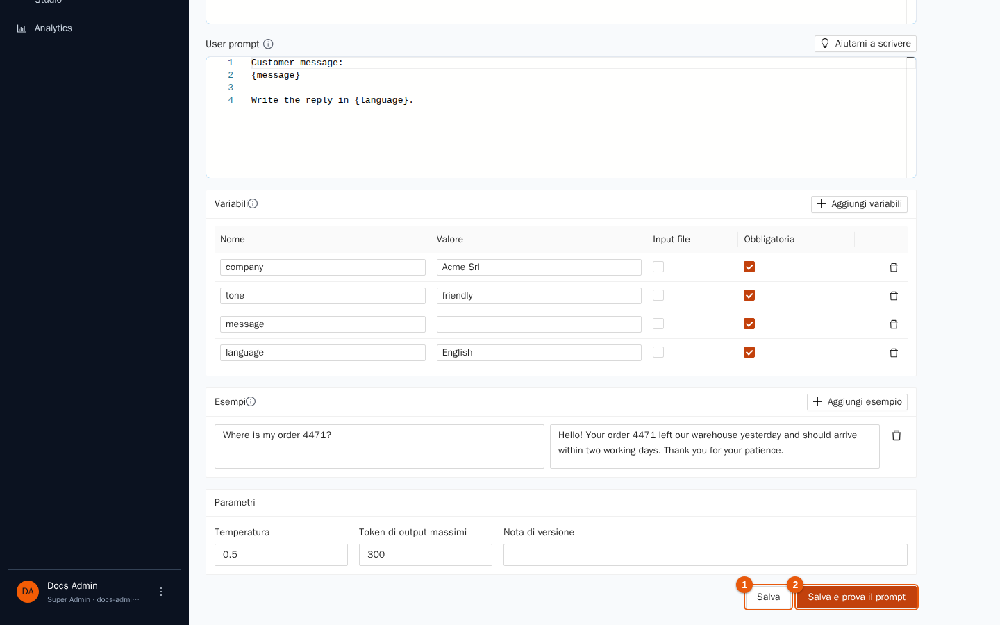

- **Salva** (indicatore 1) crea la **versione successiva** e sposta il tag `draft` su di essa. **Non** cambia ciò che è in produzione.
- **Salva e prova il prompt** (indicatore 2) salva e apre la pagina di test.

## 3.4 Versioni

Ogni salvataggio aggiunge una versione. Premi **Versioni** (indicatore 5 della figura dell'editor) per aprire lo storico.

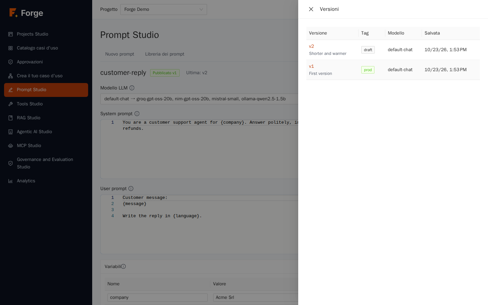

La tabella mostra il numero di **Versione** e la sua nota, i **Tag** (`draft`, `staging`, `prod`), il **Modello** e la data di **Salvata**. Premi una versione per vederne il system prompt e lo user prompt in sola lettura, poi **Carica nell'editor** per riportarne il contenuto. Salvare dopo questa operazione crea una *nuova* versione: lo storico non viene mai riscritto, quindi ripristinare una versione vecchia è sempre sicuro e reversibile.

## 3.5 Pubblicare

Un prompt diventa **Pubblicato** quando una versione riceve il tag `prod`. Gli agenti e i casi d'uso che seguono il prompt pubblicato usano allora quella versione, e continuano a usarla finché non ne pubblichi un'altra.

1. Apri la pagina di test della versione che vuoi (sezione 3.6) e verifica che funzioni.
2. Premi **Pubblica v…** in alto nella pagina di test. Lo stato nella libreria diventa *Pubblicato*, e la colonna *Versione* mostra *v2 (pubblicata v1)* quando la produzione è indietro rispetto all'ultima versione.
3. Per tornare a una versione precedente, pubblica di nuovo quella versione. Per smettere di usare un prompt senza eliminarlo, togli il suo tag `prod`: torna una *Bozza*.

Il tag `staging` si può impostare a mano per segnare un candidato. Una buona routine è: salva, prova, sposta `staging` sulla nuova versione, chiedi a un collega di controllare, pubblica.

## 3.6 Provare un prompt

Premi **Prova** nell'editor, **Prova** nella libreria, oppure **Salva e prova il prompt**.

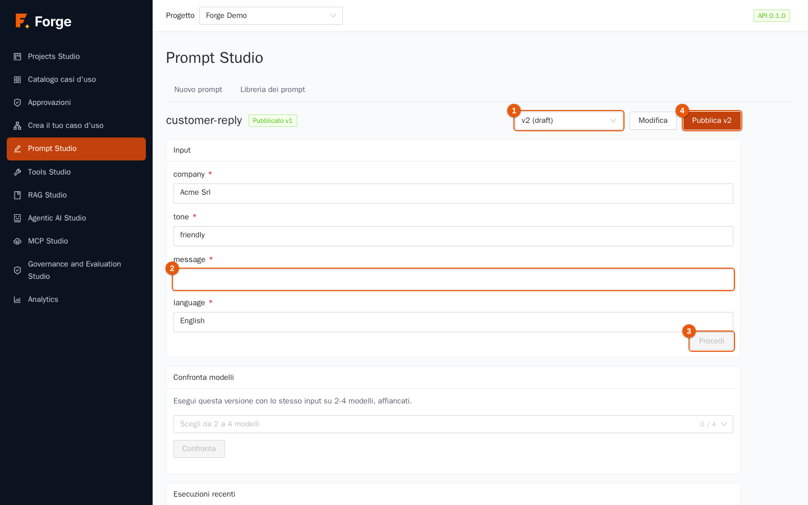

1. Scegli la **versione** da provare (indicatore 1). Di default c'è l'ultima; *draft* significa «non pubblicata».
2. Compila le **variabili** (indicatore 2). I valori predefiniti dell'editor ci sono già; quelle obbligatorie hanno un asterisco rosso. Per gli **input file** scegli un file di testo.
3. Premi **Procedi** (indicatore 3). Il modello viene chiamato e la risposta compare sotto **Risultato**.

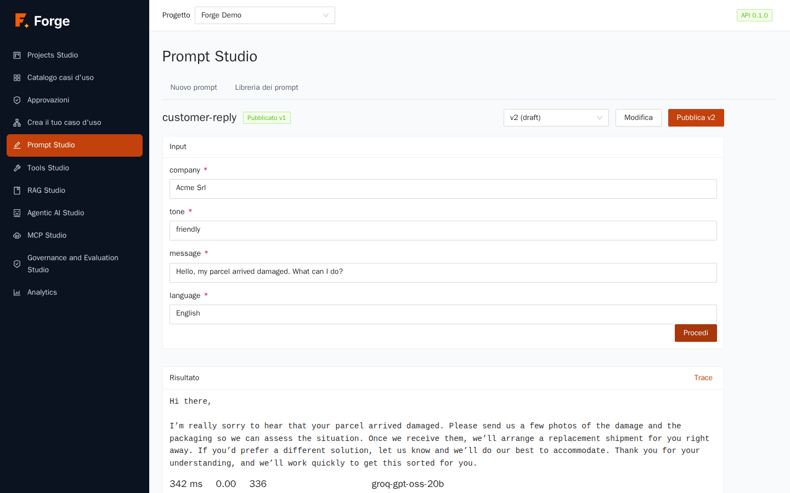

Premi **Trace** per aprire il dettaglio della chiamata: il **Modello** che ha risposto davvero (utile quando è intervenuto un fallback), **Latenza**, **Costo**, **Token**, i messaggi esatti inviati (system, esempi, user prompt composto), l'**Output** e i **Metadati** (parametri, variabili, motivo di fine, se la risposta veniva dalla cache). Se un modello fallisce, l'esecuzione appare come fallita con il motivo, invece di un errore generico.

La pagina ha anche **Modifica** (torna all'editor) e **Pubblica v…** (indicatore 4).

### Confrontare i modelli

Sotto l'input c'è la scheda **Confronta modelli**. Usala per vedere come rispondono modelli diversi allo *stesso* input.

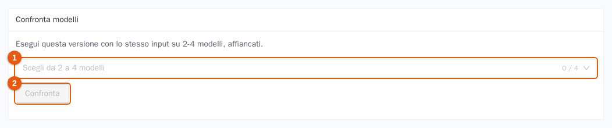

1. In **Scegli da 2 a 4 modelli** (indicatore 1) scegli alias e/o modelli: è lo stesso elenco del selettore del modello nell'editor. Due alias sono un modo comodo per confrontare, per esempio, la tua catena economica con quella più capace.
2. Premi **Confronta** (indicatore 2). Tutti i modelli vengono chiamati nello stesso momento con la stessa versione e le stesse variabili.
3. Le risposte compaiono affiancate, ciascuna con **Latenza**, **Token** e **Costo**. Un modello che fallisce mostra il suo errore senza nascondere gli altri.

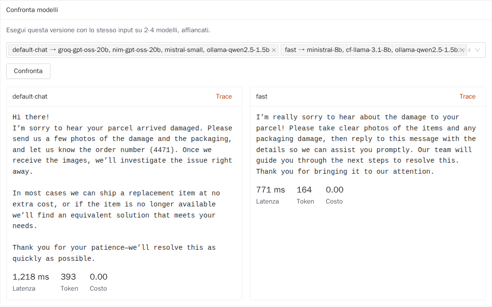

### Esecuzioni recenti

La tabella **Esecuzioni recenti** in fondo elenca le prove precedenti del prompt con **Quando**, **Tipo** (prova o confronto), **Versione**, **Modello**, **Stato** e **Latenza**. Premi una riga per riaprirne il trace.

## 3.7 Buone pratiche

- **Un prompt, un compito.** Se un prompt continua a crescere, dividilo in due prompt usati da un agente o da un caso d'uso.
- **Usa le variabili per tutto ciò che cambia** (nomi, lingue, documenti), non per ciò che è sempre uguale.
- **Prova con input scomodi** — campi vuoti, testi molto lunghi, un'altra lingua — prima di pubblicare.
- **Usa gli alias, non i nomi dei modelli**, così puoi cambiare modello per tutto il progetto da un solo punto.
- **Non mettere segreti in un prompt.** Le versioni si conservano per sempre e le vede ogni Builder del progetto.
- **Scrivi la nota di versione.** Sei mesi dopo è l'unica memoria del motivo per cui il prompt è cambiato.

## 3.8 Risoluzione dei problemi

| Sintomo | Causa e rimedio |
| --- | --- |
| «Prompt Studio richiede il ruolo Builder o Project Admin» | Il tuo ruolo non può modificare i prompt. Chiedi a un Project Admin. |
| L'elenco dei modelli è vuoto | Il progetto non ha un modello di chat né un alias. Vedi il capitolo 2 (un Super Admin deve abilitare i modelli della piattaforma per il progetto). |
| La prova fallisce con *variabili mancanti* | Una variabile obbligatoria non ha valore. Compilala, oppure dalle un valore predefinito nell'editor. |
| La prova fallisce con una variabile sconosciuta | La chiamata nomina una variabile che il prompt non dichiara. Toglila o dichiarala. |
| «The file is larger than 256 KB» | Gli input file nella pagina di test accettano file di testo fino a 256 KB. Accorcia il file. |
| Il template viene rifiutato | Usa qualcosa che la sandbox vieta (per esempio `import`, `include` o attributi privati), oppure è troppo grande (template fino a 32.000 caratteri). Semplificalo. |
| Un'esecuzione fallisce con un errore a monte | Il provider del modello ha risposto con un errore o è andato in timeout. Il trace mostra il motivo; controlla la catena di fallback dell'alias (capitolo 2). |

Prossimo: [4. Dati e RAG Studio](04-dati-e-rag.md)
