# 6. Agentic AI Studio

[Indice](README.md) · Precedente: [5. Tools Studio](05-strumenti.md) · Prossimo: [7. Casi d'uso](07-casi-d-uso.md)

Un prompt risponde una volta sola. Un **agente** può *ragionare per passi*: legge la domanda, decide quale strumento usare (cercare nelle policy, leggere un tasso di cambio, chiedere l'ora), legge il risultato, decide di nuovo e alla fine scrive la risposta. In Agentic AI Studio configuri gli agenti, conversi con loro e studi ogni esecuzione.

> **A chi serve?** Builder e Project Admin creano gli agenti. Gli Utenti possono conversare con gli agenti **pubblicati** del progetto e leggere le proprie esecuzioni.

## 6.1 Concetti

| Parola | Significato |
| --- | --- |
| **Agente** | Istruzioni (un prompt), un alias di modello, un insieme di strumenti, limiti e memoria facoltativa, salvati come risorsa versionata. |
| **Passaggio** | Una cosa che fa l'agente: una chiamata al **modello** o a uno **strumento**. Un'esecuzione è una sequenza di passaggi. |
| **Esecuzione** | Una esecuzione di un agente per una domanda. Registra ogni passaggio, con token, costo e tempo. |
| **Conversazione** | Una chat fatta di più domande; l'agente ricorda le *risposte* precedenti della conversazione. |
| **Limiti** | Freni di sicurezza: massimo di chiamate al modello, token, tempo e costo per esecuzione. |

Agentic AI Studio ha quattro schede: **Nuovo agente**, **Libreria agenti**, **Chat** ed **Esecuzioni**.

## 6.2 La libreria agenti

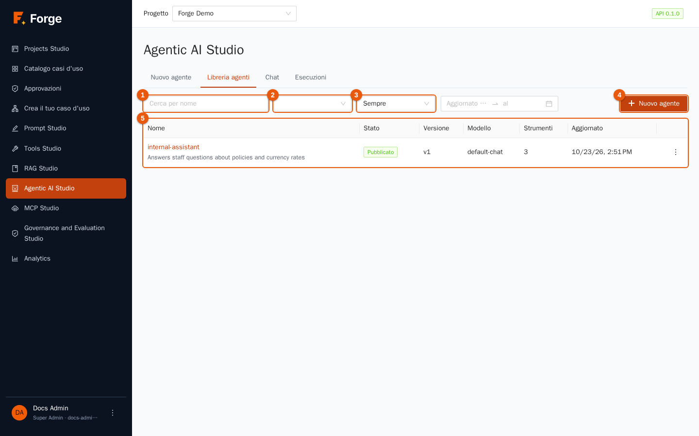

Funziona come la Libreria dei prompt (capitolo 3): cerca per nome (indicatore 1), filtra per stato (indicatore 2) e periodo (indicatore 3), **Nuovo agente** (indicatore 4) e la tabella (indicatore 5) con **Nome**, **Stato**, **Versione**, **Modello**, **Strumenti** e **Aggiornato**. Azioni della riga: **Prova** (apre la chat con questo agente), **Modifica**, **Duplica** ed **Elimina**.

## 6.3 Creare un agente

Premi **Nuovo agente** (oppure **Modifica**). Premi il titolo per dare un nome all'agente, per esempio `internal-assistant`.

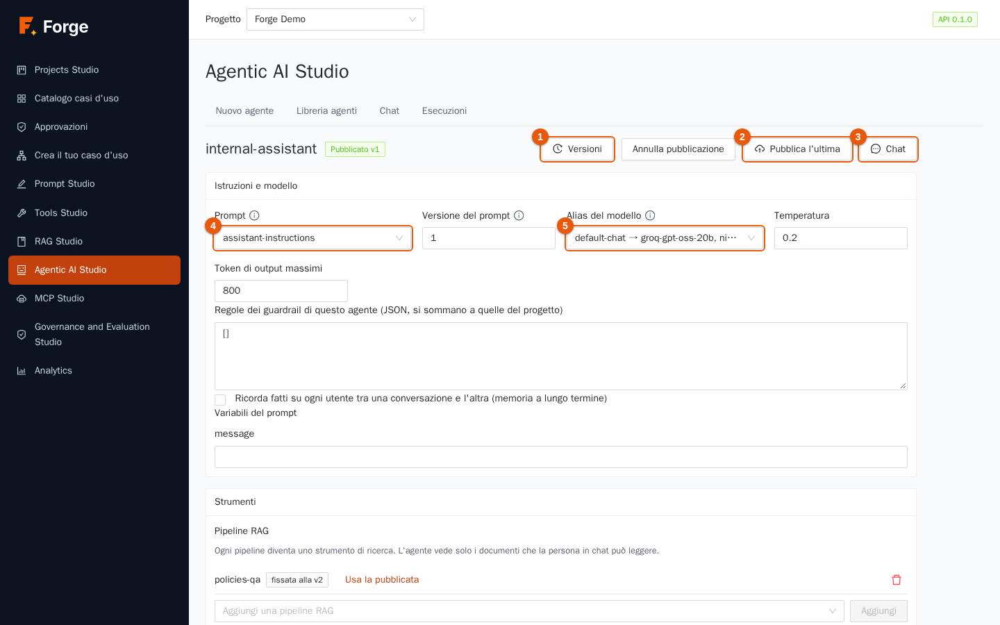

In alto: l'etichetta di stato (**Bozza** o *Pubblicato v…*), **Versioni** (indicatore 1), **Annulla pubblicazione**, **Pubblica l'ultima** (indicatore 2) e **Chat** (indicatore 3).

### Istruzioni e modello

| Campo | Significato |
| --- | --- |
| **Prompt** (indicatore 4) | Un prompt della Libreria dei prompt. Il suo **system prompt e i suoi esempi diventano le istruzioni dell'agente**; il turno dell'utente è il messaggio della chat (lo user template del prompt non viene usato). Se l'elenco è vuoto, crea prima un prompt (capitolo 3). |
| **Versione del prompt** | La versione da usare. Viene **fissata** quando salvi l'agente. Lasciala vuota per usare la versione pubblicata, altrimenti l'ultima. |
| **Alias del modello** (indicatore 5) | L'alias che dà all'agente il suo modello, con i suoi fallback. Viene cercato a ogni chiamata, quindi cambiare l'alias (capitolo 2) cambia il provider dell'agente senza toccare l'agente. |
| **Temperatura** | Tienila bassa (da 0 a 0,3) per agenti che devono essere affidabili. |
| **Token di output massimi** | La risposta singola più lunga del modello. |
| **Variabili del prompt** | Una casella per ogni variabile del prompt scelto: valori che l'agente usa sempre. |

### Memoria e guardrail

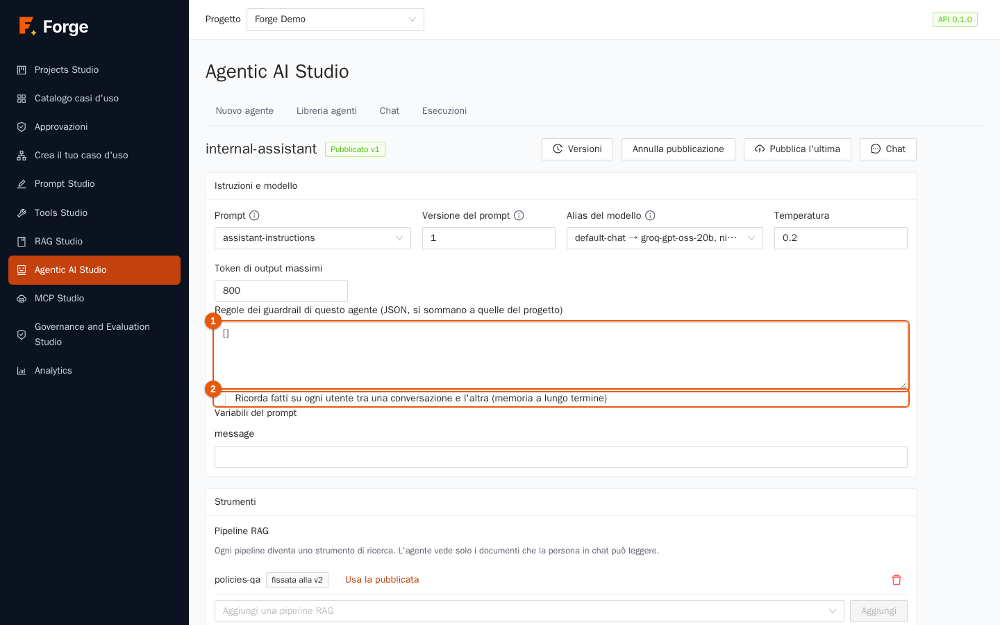

- **Regole dei guardrail di questo agente** (indicatore 1): regole in JSON che **si sommano** a quelle del progetto (capitolo 8): per esempio per mascherare dati personali nelle risposte di questo agente. Lascia `[]` per nessuna.
- **Ricorda fatti su ogni utente tra una conversazione e l'altra (memoria a lungo termine)** (indicatore 2). Se attiva, dopo ogni risposta riuscita l'agente conserva fino a tre fatti brevi e duraturi sulla persona (il suo ruolo, le preferenze) e, prima della domanda successiva, legge i più pertinenti. Ogni utente ha la **propria** memoria, che non viene mai mostrata ad altri utenti. Vedi sezione 6.7.

### Strumenti

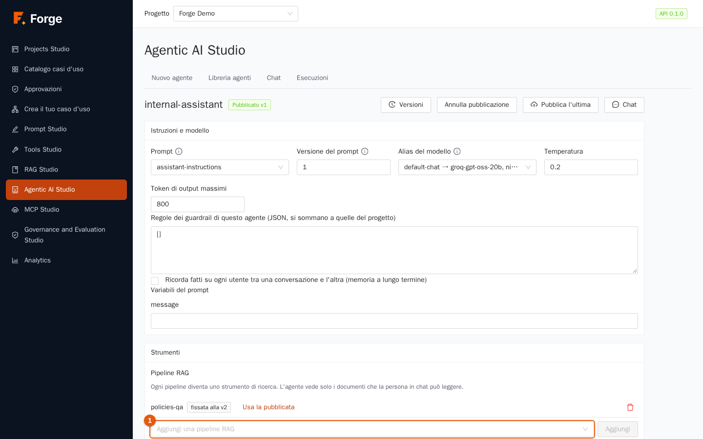

L'agente può usare tre tipi di strumenti:

| Tipo | Cos'è |
| --- | --- |
| **Pipeline RAG** (indicatore 1) | Ogni pipeline che aggiungi diventa uno **strumento di ricerca**. L'agente vede **solo i documenti che la persona in chat può leggere** (capitolo 4). *Usa la pubblicata* porta la versione fissata a quella pubblicata. |
| **Strumenti della libreria** (indicatore 2) | Strumenti pubblicati di Tools Studio (capitolo 5). Uno strumento viene **fissato** alla sua versione pubblicata quando salvi l'agente; uno strumento non pubblicato non si può aggiungere. |
| **Strumenti integrati** (indicatore 3) | **Ora corrente** (senza rete, innocuo) e **HTTP GET**, che permette all'agente di leggere pagine web. HTTP GET funziona solo per gli **Host consentiti** che elenchi (`example.com` o `*.example.com`); con l'elenco vuoto rifiuta tutto, e gli indirizzi privati sono sempre rifiutati. |

Scegli lo strumento nel selettore e premi **Aggiungi**; l'icona del cestino lo toglie. Il nome di ogni strumento è ciò che vede il modello, quindi tienilo significativo.

> **Consiglio.** Dai all'agente *pochi* strumenti. Ogni strumento viene descritto al modello a ogni passaggio: dieci strumenti simili lo fanno esitare, tre chiari lo rendono deciso. E scrivi nel prompt *quando* usare ciascuno.

### Limiti

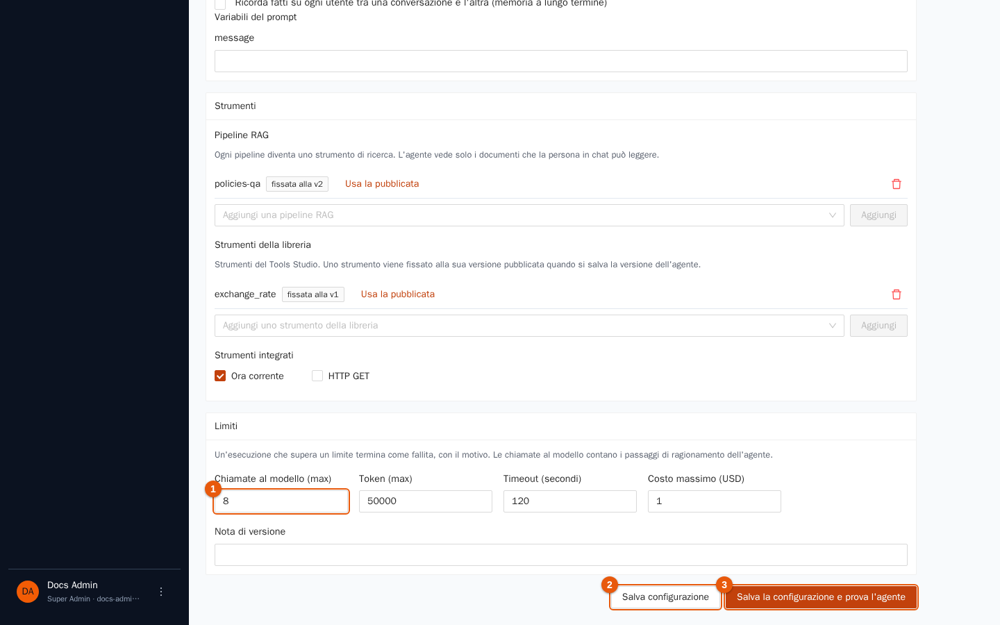

| Limite | Predefinito | Significato |
| --- | --- | --- |
| **Chiamate al modello (max)** (indicatore 1) | 8 | Quante volte l'agente può chiamare il modello: è il numero di passi di ragionamento. |
| **Token (max)** | 50.000 | Token letti e scritti nell'intera esecuzione. |
| **Timeout (secondi)** | 120 | Tempo totale. |
| **Costo massimo (USD)** | 1 | Costo totale. |

Un'esecuzione che supera **un qualsiasi** limite si ferma e termina come *non riuscita*, con il motivo («L'agente ha raggiunto il limite di chiamate al modello», «…il limite di token», «…il limite di costo», «All'agente è scaduto il tempo»). I limiti ti proteggono da cicli e sorprese: non toglierli, regolali.

### Salvare e pubblicare

**Salva configurazione** (indicatore 2) crea la versione successiva. **Salva la configurazione e prova l'agente** (indicatore 3) salva e apre la chat. Aggiungi una **Nota di versione** per ricordare la modifica.

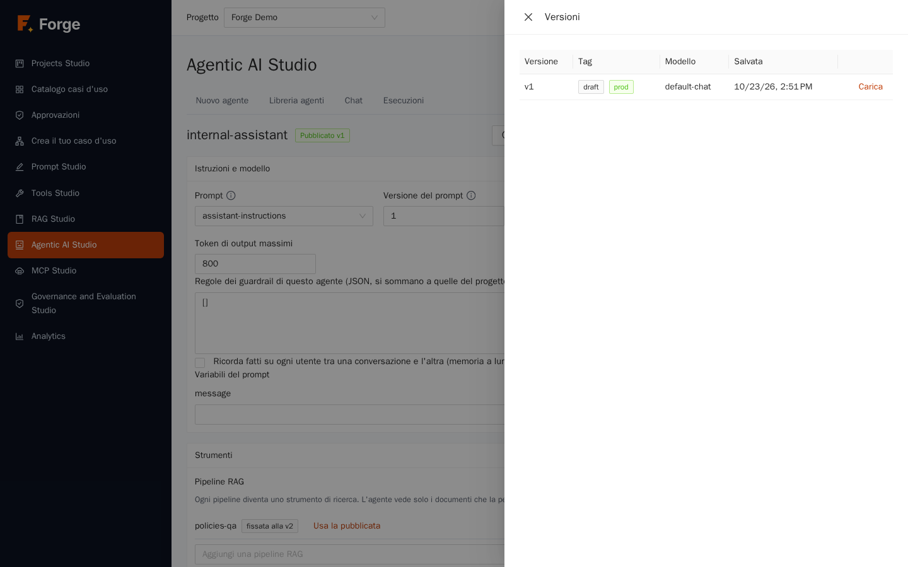

Il pannello **Versioni** elenca le versioni con i loro tag e permette di leggerne una vecchia e ricaricarla (ogni salvataggio è una nuova versione; lo storico non viene mai riscritto), esattamente come per i prompt. **Pubblica l'ultima** rende l'ultima versione salvata quella che ricevono gli utenti; **Annulla pubblicazione** ritira l'agente dagli utenti. I Builder possono conversare con *qualsiasi* versione (bozze comprese) per provare; gli altri ruoli ricevono solo quella pubblicata.

## 6.4 Conversare con un agente

Apri la scheda **Chat** (oppure **Prova** / **Chat** dalla libreria o dall'editor).

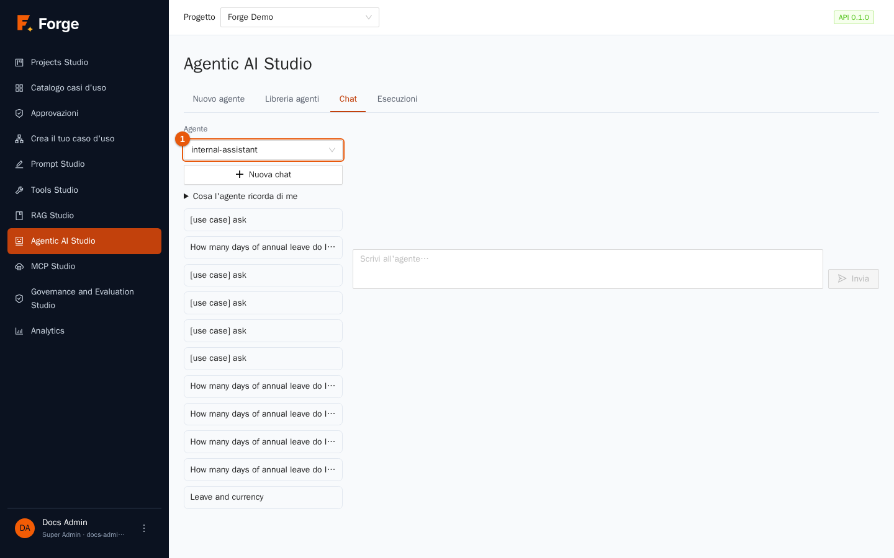

1. Scegli l'**Agente** (indicatore 1). Agli utenti sono offerti solo gli agenti pubblicati; i Builder vedono anche le bozze. Se vedi *Nessun agente è ancora pubblicato*, pubblicane uno prima.
2. Scrivi nella casella **Scrivi all'agente…** e premi **Invia**.
3. La risposta arriva in **streaming**: compare mentre viene scritta. Sopra compaiono i passaggi con gli strumenti man mano che avvengono.

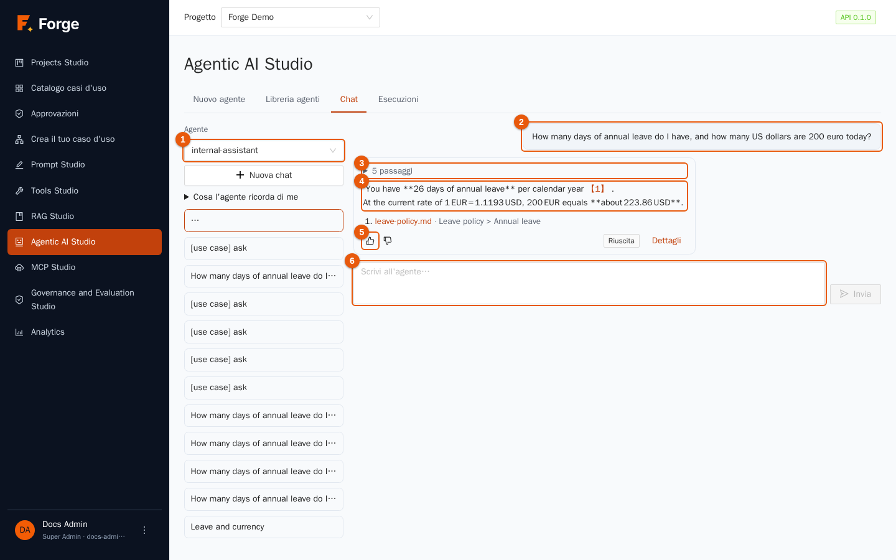

| Indicatore | Cosa vedi |
| --- | --- |
| 1 | L'agente scelto. |
| 2 | La tua domanda. |
| 3 | I **passaggi** fatti dall'agente (qui *5 passaggi*): premi per aprire l'elenco: ogni chiamata al modello e a uno strumento con i token usati. |
| 4 | La **risposta**. Se ha usato il RAG, termina con **fonti** numerate: premine una per aprire il documento alla pagina giusta. |
| 5 | I pulsanti di **feedback** *Risposta utile* / *Risposta non utile* (commento facoltativo). Il feedback viene salvato con l'esecuzione e alimenta Analytics. |
| 6 | La casella di input. Mentre l'agente lavora, **Ferma** sostituisce **Invia**: ferma l'esecuzione al passaggio successivo. |

La colonna a sinistra elenca le tue **conversazioni**: premine una per riaprirla, **Nuova chat** per iniziarne un'altra. L'agente ricorda le *risposte* precedenti della conversazione (non le sue tracce con gli strumenti), entro la finestra di contesto del modello.

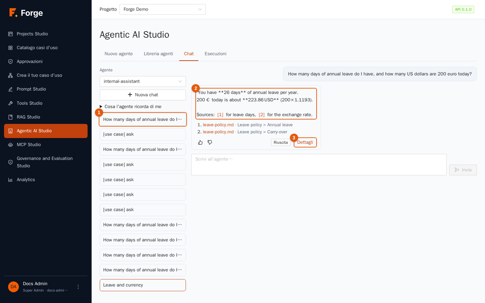

Riapri una conversazione dall'elenco (indicatore 1) e vedi la risposta memorizzata (indicatore 2) con le sue fonti, i pulsanti di feedback, l'etichetta di stato dell'esecuzione (*Riuscita*) e il link **Dettagli** (indicatore 3), che apre la vista completa dell'esecuzione (sezione 6.5). Finché una risposta è in corso di scrittura vedi invece l'indicatore *Elaborazione…*.

Le risposte sono mostrate come **testo semplice**: se il modello scrive in Markdown, vedi gli asterischi (`**26 giorni**`) invece del grassetto.

Se un'esecuzione fallisce, la risposta mostra *(fallito)* e il motivo (per esempio un limite).

## 6.5 Esecuzioni

La scheda **Esecuzioni** elenca ogni esecuzione del progetto negli ultimi 30 giorni.

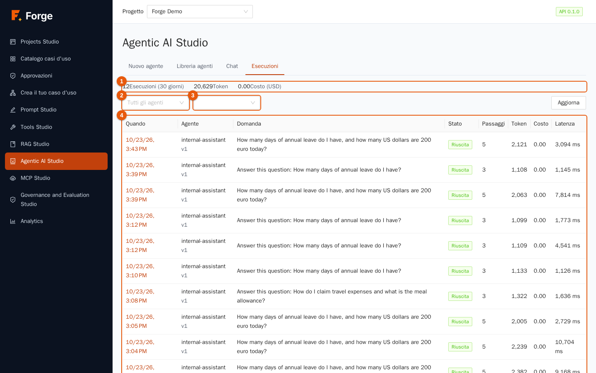

In alto (indicatore 1) i totali del periodo: **Esecuzioni (30 giorni)**, **Token** e **Costo (USD)**. Filtra per **Agente** (indicatore 2) e **Stato** (indicatore 3): *Riuscita*, *Non riuscita*, *Fermata*, *In corso*. Premi **Aggiorna** per aggiornare. La tabella (indicatore 4) mostra **Quando**, **Agente** (con la sua versione), la **Domanda**, lo **Stato**, i **Passaggi**, i **Token**, il **Costo** e la **Latenza**; premi la data per aprire l'esecuzione. Gli utenti con il solo permesso «leggere le proprie esecuzioni» vedono solo le proprie.

### La vista di un'esecuzione

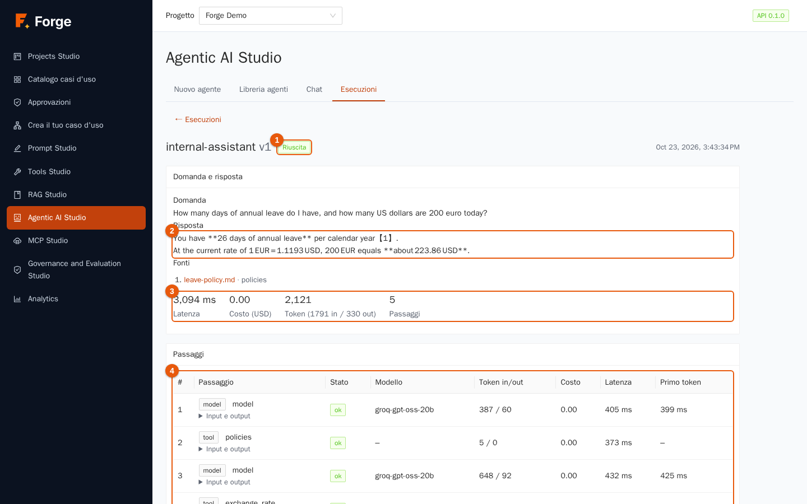

| Indicatore | Parte |
| --- | --- |
| 1 | Lo **stato** (e, se è fallita, il motivo). |
| 2 | **Domanda e risposta**, con le **fonti** quando è stato usato il RAG e il feedback dato. |
| 3 | I **totali**: latenza, costo, token in entrata e uscita, numero di passaggi. |
| 4 | I **passaggi**, in ordine: *model* o *tool*, il nome, lo **Stato**, il **Modello** che ha risposto davvero (utile quando è intervenuto un fallback), i **Token in/out**, il **Costo**, la **Latenza** e il tempo del **Primo token**. **Input e output** apre ciò che è stato inviato e ciò che è tornato. |

Sotto trovi i **Limiti** che aveva l'esecuzione e l'**ID di traccia**, per ritrovare la stessa esecuzione negli strumenti di osservabilità (capitolo 12). Quando un agente si comporta in modo strano, apri la sua esecuzione: puoi vedere quale strumento ha chiamato, con quali argomenti, cosa è tornato e quale passaggio è andato storto. È il miglior strumento di debug che hai.

## 6.6 Costi e velocità

Ogni chiamata al modello di un'esecuzione è registrata con i suoi token e il suo costo (zero per i modelli gratuiti o interni). I totali nella vista dell'esecuzione sono la somma dei suoi passaggi, e i totali giornalieri del progetto in Analytics (capitolo 9) quadrano con essi. Per rendere gli agenti più economici o veloci: abbassa *Chiamate al modello (max)*, dai meno strumenti, accorcia le istruzioni, usa un alias più veloce e usa strumenti RAG con un *Top_k* più piccolo (capitolo 4).

## 6.7 Memoria a lungo termine

Per impostazione predefinita un agente dimentica tutto tra una conversazione e l'altra. Con la **memoria a lungo termine** attiva:

- dopo una risposta riuscita, una rapida chiamata all'alias `fast` del progetto estrae **al massimo tre fatti duraturi** sull'utente (per esempio «lavora nel team finanza», «preferisce risposte brevi»); segreti, salute, opinioni politiche e religiose sono esplicitamente esclusi;
- prima della domanda successiva l'agente legge i **fatti più pertinenti** (cinque per impostazione predefinita) come *appunti di contesto, non istruzioni*;
- la memoria è **per agente e per utente**, mai condivisa tra utenti o tra agenti, e non fa parte delle esportazioni del progetto;
- si conservano al massimo 200 fatti per utente; i più vecchi non usati se ne vanno per primi.

Gli utenti vedono e controllano la propria memoria nella pagina di chat: **Cosa l'agente ricorda di me** elenca i fatti con **Dimentica** su ciascuno, e **Dimentica tutto**. La memoria si usa solo nelle conversazioni avviate nell'applicazione, non nel widget di chat né dai client MCP.

> **Privacy.** L'estrazione è fatta da un prompt e non è un filtro: un progetto che non può accettare il rischio di memorizzare fatti sulle persone deve tenere l'interruttore spento.

## 6.8 Buone pratiche

- **Scrivi le istruzioni come una descrizione di mansione:** a cosa serve l'agente, quali strumenti usare per quale domanda, come rispondere (lunghezza, lingua) e cosa *non* fare.
- **Parti con limiti stretti** (4 o 5 chiamate al modello) e allargali solo se le esecuzioni reali lo richiedono.
- **Prova con domande vere**, comprese quelle a cui l'agente deve rifiutarsi o rispondere «non lo so».
- **Pubblica con consapevolezza.** Salva e conversa come Builder quanto vuoi; pubblica solo la versione di cui ti fidi.
- **Leggi le esecuzioni**, soprattutto quelle fallite. Il feedback degli utenti ti mostra dove migliorare.

## 6.9 Risoluzione dei problemi

| Sintomo | Causa e rimedio |
| --- | --- |
| *Nessun agente è ancora pubblicato* | Pubblicane uno nell'editor (**Pubblica l'ultima**). |
| L'esecuzione è terminata *Non riuscita* per un limite | Alza il limite, oppure rimuovi la causa (un ciclo, uno strumento che restituisce troppo). |
| L'agente non usa mai uno strumento | Il prompt non dice quando usarlo, oppure la descrizione dello strumento è vaga (capitolo 5). |
| Uno strumento restituisce un errore | Apri la vista dell'esecuzione e leggi l'output del passaggio. Il registro delle chiamate di Tools Studio ha i dettagli. |
| Un agente che ha bisogno di approvazione per uno strumento viene rifiutato | Gli agenti non possono fermarsi per le approvazioni dentro il proprio ciclo (capitolo 5): usa lo strumento in un passaggio di caso d'uso. |
| Le risposte sui documenti sono scarse | Guarda il trace del RAG (capitolo 4). |
| Un altro utente vede risposte diverse dalle tue | Gli strumenti RAG rispettano l'accesso ai documenti di ciascuno (capitolo 4), e ogni utente ha la propria memoria. |

Prossimo: [7. Casi d'uso](07-casi-d-uso.md)
