# 7. Casi d'uso

[Indice](README.md) · Precedente: [6. Agentic AI Studio](06-agenti.md) · Prossimo: [8. Governance and Evaluation Studio](08-governance.md)

Un **caso d'uso** (*use case*) confeziona un lavoro completo per persone che *non* sono specialisti di AI: «Rispondi a un cliente», «Rispondi a una domanda sulle policy», «Riassumi il verbale». Ha un **modulo** semplice, un **workflow** dietro (prompt, agenti, strumenti, rami, approvazioni umane) e un **output**. I Builder creano i casi d'uso; tutti gli altri compilano il modulo e ottengono il risultato. Questo capitolo copre entrambi i lati: *usare* il catalogo (sezioni da 7.1 a 7.4), *decidere* le approvazioni (7.5) e *costruire* casi d'uso (da 7.6 a 7.11).

> **A chi serve?** A tutti per le sezioni 7.1–7.5. A Builder e Project Admin per 7.6–7.11.

## 7.1 Il catalogo

Apri **Catalogo casi d'uso** nel menu laterale.

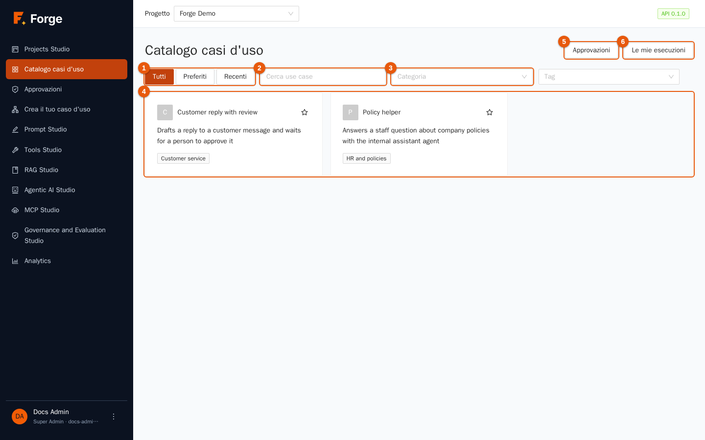

| Indicatore | Controllo | Uso |
| --- | --- | --- |
| 1 | **Tutti / Preferiti / Recenti** | *Tutti* i casi d'uso che puoi eseguire, quelli con la stella, oppure gli ultimi dodici che hai eseguito. |
| 2 | **Cerca use case** | Cerca nei nomi e nelle descrizioni. |
| 3 | **Categoria** (e **Tag**) | Filtra per categoria del catalogo (come *Customer service*) o per tag. |
| 4 | Le schede | Una scheda per caso d'uso, con descrizione e categoria. La stella lo aggiunge ai *Preferiti*. |
| 5 | **Approvazioni** | Apre le approvazioni che ti aspettano (sezione 7.5). Mostrato a chi può decidere le approvazioni. |
| 6 | **Le mie esecuzioni** | Il tuo storico delle esecuzioni (sezione 7.4). |

Vedi solo i casi d'uso **pubblicati** e contenuti nei cataloghi abilitati per il tuo ruolo. Se la pagina dice *Nessun use case è ancora disponibile per il tuo ruolo*, chiedi a un Project Admin di abilitare un catalogo per il tuo ruolo (capitolo 2, *Cataloghi*). Gli utenti finali non vedono mai gli agenti, i prompt o gli strumenti dietro un caso d'uso.

## 7.2 Eseguire un caso d'uso

1. Premi una scheda. La pagina del caso d'uso mostra la descrizione e un **modulo** fatto per quel caso d'uso.

   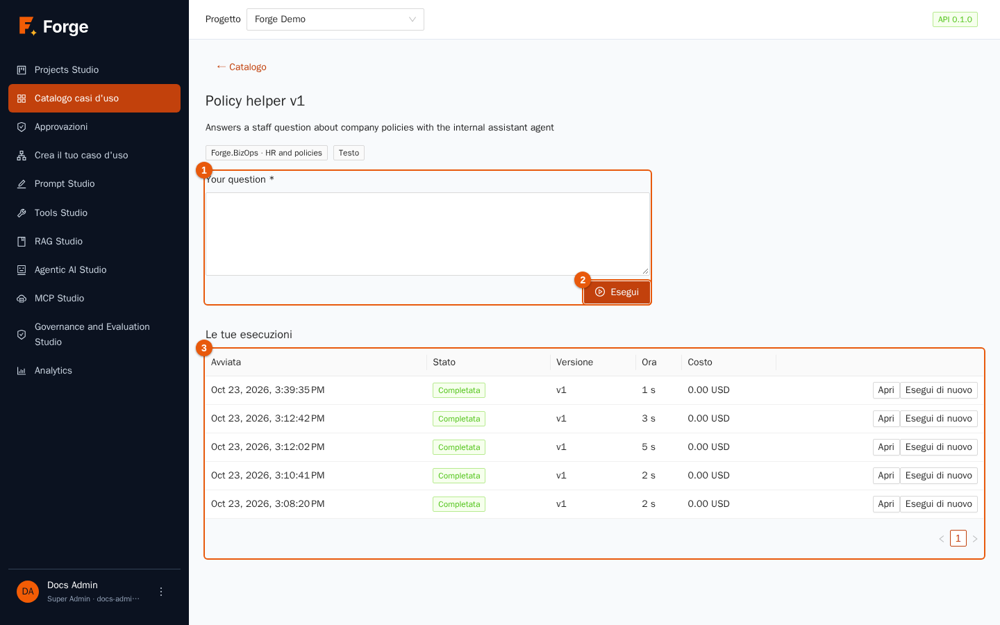

2. Compila i campi (indicatore 1). I campi possono essere testo, testo lungo, numeri, una scelta, un **file** (testo, Markdown, CSV, JSON, PDF, Word o Excel; fino a 100 MB) o una data collection. I campi obbligatori sono segnati.
3. Premi **Esegui** (indicatore 2). Si apre subito la pagina dell'esecuzione.

Sotto il modulo, **Le tue esecuzioni** (indicatore 3) elenca le tue esecuzioni precedenti di questo caso d'uso, ciascuna con **Apri** ed **Esegui di nuovo**.

## 7.3 Seguire un'esecuzione e ottenere il risultato

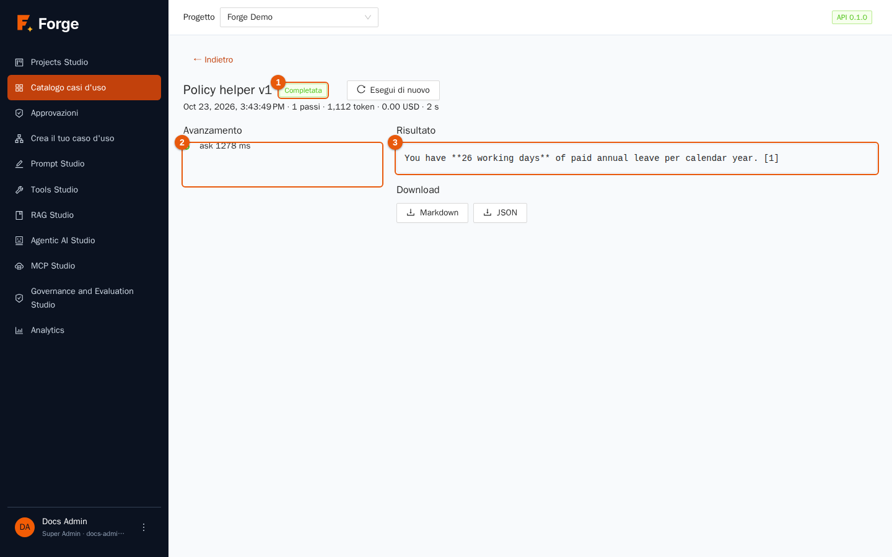

| Indicatore | Parte |
| --- | --- |
| 1 | Lo **stato**: *In coda*, *In corso*, *In attesa di approvazione*, *Completata*, *Non riuscita* o *Fermata*. Accanto, **Ferma** (durante l'esecuzione) ed **Esegui di nuovo**. Sotto il titolo: quando è iniziata, i passaggi, i token, il costo e il tempo. |
| 2 | **Avanzamento**: ogni passaggio del workflow man mano che inizia e finisce. Vedi i nomi dei passaggi e il loro stato, non i dettagli interni. |
| 3 | Il **Risultato**. Compare quando l'esecuzione termina; mentre gira la pagina dice che il risultato compare quando l'esecuzione è finita. |

Sotto il risultato, **Download** offre **Markdown** e **JSON**, e un file **Word**, **Excel** o **PDF** quando il caso d'uso è stato costruito per produrne uno. La pagina si aggiorna da sola; se la chiudi, l'esecuzione prosegue e la ritrovi in **Le mie esecuzioni**. Se un'esecuzione fallisce, la pagina dice *L'esecuzione è fallita* e indica il motivo; **Esegui di nuovo** avvia una nuova esecuzione con gli stessi input sulla versione pubblicata *attuale*.

## 7.4 Il tuo storico delle esecuzioni

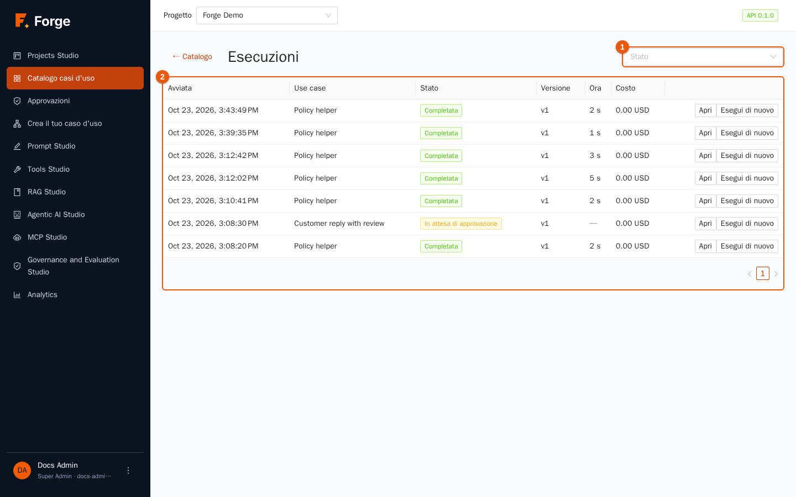

**Le mie esecuzioni** elenca le tue esecuzioni con il filtro **Stato**, **Avviata**, **Use case**, **Versione**, **Tempo** e **Costo**, con **Apri** ed **Esegui di nuovo**. Operatori, Builder e Project Admin vedono le esecuzioni dell'intero progetto; gli utenti finali vedono le proprie. Un'esecuzione resta legata alla versione che era attiva quando è partita, quindi le modifiche successive non alterano mai un risultato passato.

## 7.5 Approvazioni

Alcuni workflow si fermano e chiedono a **una persona** di controllare qualcosa prima di proseguire: una bozza di risposta, un documento, gli argomenti di uno strumento che modifica dati. Queste richieste si chiamano *approvazioni*. Apri **Approvazioni** nel menu laterale.

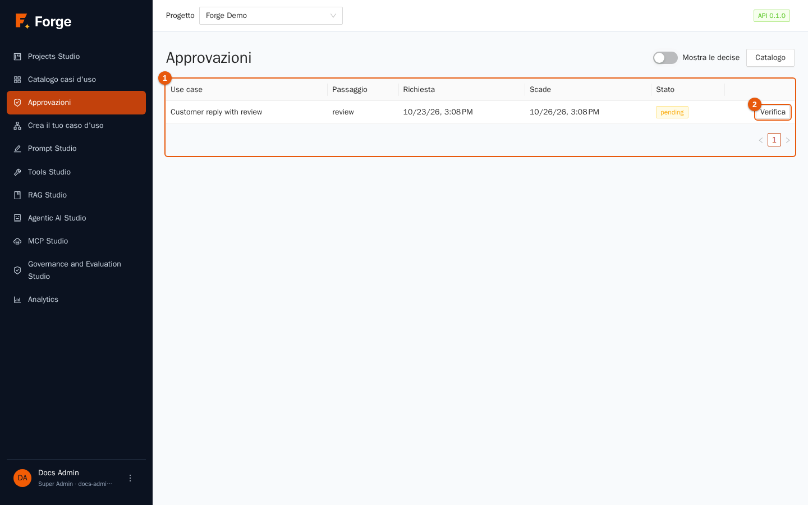

L'elenco (indicatore 1) mostra lo **Use case**, il **Passaggio**, quando è stata **Richiesta**, quando **Scade**, lo **Stato** e un pulsante **Verifica** (indicatore 2). Spunta **Mostra le decise** per vedere quelle già gestite. Se nulla ti aspetta, la pagina dice *Nessuna approvazione ti aspetta*. Puoi decidere le approvazioni se il tuo ruolo è Project Admin, Builder o Operatore (o uno dei ruoli scelti dal builder come *assegnatari* di quel passaggio).

### Verificare e decidere

Premi **Verifica**.

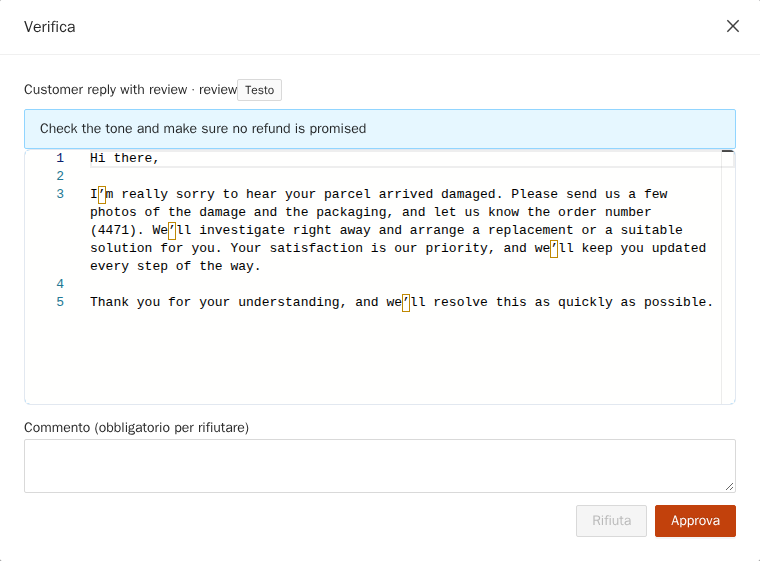

1. Leggi l'istruzione in alto (qui *Check the tone and make sure no refund is promised*, cioè «controlla il tono e assicurati che non si prometta alcun rimborso»).
2. Leggi il contenuto nell'editor. Per un testo è **modificabile**: correggi ciò che non va. Per uno strumento mostra gli argomenti previsti come JSON, anch'essi modificabili.
3. Scegli:
   - **Approva**: l'esecuzione prosegue con il contenuto così com'è.
   - **Approva con modifiche**: compare quando hai modificato il testo; l'esecuzione prosegue con la *tua* versione.
   - **Rifiuta**: ferma il passaggio. Un **Commento** è **obbligatorio** per rifiutare. Per un passaggio agente segnato «human in the loop», un rifiuto rimanda il commento all'agente, che riprova (fino a tre volte); per gli altri passaggi l'esecuzione fallisce e mostra il tuo commento.

Un'approvazione **scade** se nessuno decide in tempo (72 ore per impostazione predefinita); l'approvazione risulta *Scaduta: nessuno ha deciso in tempo* e l'esecuzione fallisce. Se l'esecuzione viene fermata, l'approvazione risulta *Annullata: l'esecuzione è stata interrotta*.

Puoi anche essere avvisato: i Builder possono far ricevere agli approvatori un'**email con un link monouso** che apre la verifica senza accedere, oppure una chiamata **webhook**; un link funziona una volta sola e smette di funzionare quando l'approvazione è decisa o scade.

## 7.6 Costruire un proprio caso d'uso: panoramica

Apri **Crea il tuo caso d'uso**, poi **Libreria dei casi d'uso**. La costruzione ha tre passi che corrispondono a tre pagine: **1. Requisiti**, **2. Workflow**, **3. Prova del workflow**, più una pagina **Impostazioni** per tutto il resto.

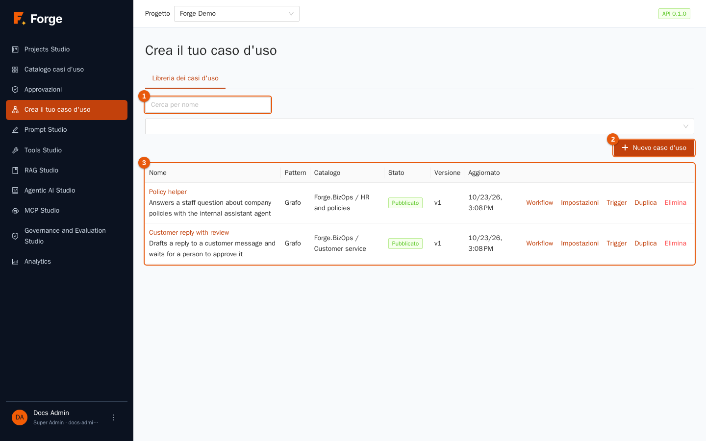

La libreria elenca i tuoi casi d'uso (indicatore 3) con **Nome**, **Pattern**, **Catalogo**, **Stato** (*Bozza*, *In test*, *Pubblicato*, *Deprecato*), **Versione** e **Aggiornato**. Cerca per nome (indicatore 1) e filtra per stato; **Nuovo caso d'uso** (indicatore 2) avvia il builder. Azioni della riga: **Workflow**, **Impostazioni**, **Trigger**, **Duplica**, **Elimina** (rifiutato finché il caso d'uso è archiviato in una categoria di un catalogo o ha esecuzioni).

Ci sono due **pattern**:

| Pattern | Quando usarlo |
| --- | --- |
| **Team di agenti** (*supervisor*) | Un team di agenti che lavorano **in ordine**, ciascuno con il suo compito, come una piccola catena di montaggio. Semplice da costruire. |
| **Grafo** | Nodi collegati da frecce, con rami, cicli, lavoro in parallelo e approvazioni umane. Usalo appena servono condizioni o approvazioni. |

## 7.7 Passo 1: requisiti

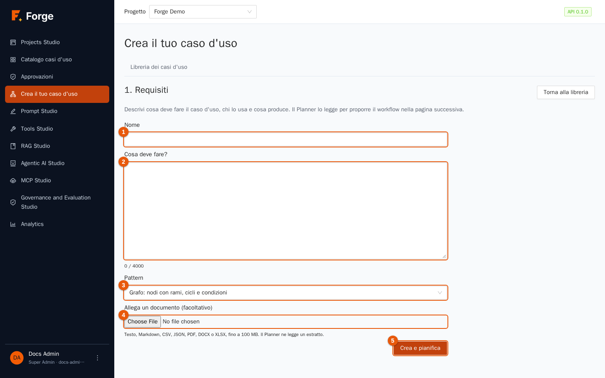

1. Dai un **Nome** al caso d'uso (indicatore 1).
2. In **Cosa deve fare?** (indicatore 2) descrivi, in poche righe, cosa fa il caso d'uso, chi lo usa e cosa produce (fino a 4.000 caratteri). Il Planner legge questo testo.
3. Scegli il **Pattern** (indicatore 3).
4. Facoltativamente **allega un documento** (indicatore 4: testo, Markdown, CSV, JSON, PDF, DOCX o XLSX, fino a 100 MB): il Planner ne legge un estratto. **Continua senza il file** lo salta.
5. Premi **Crea e pianifica** (indicatore 5). La bozza viene salvata e si apre il passo 2.

## 7.8 Passo 2: il workflow

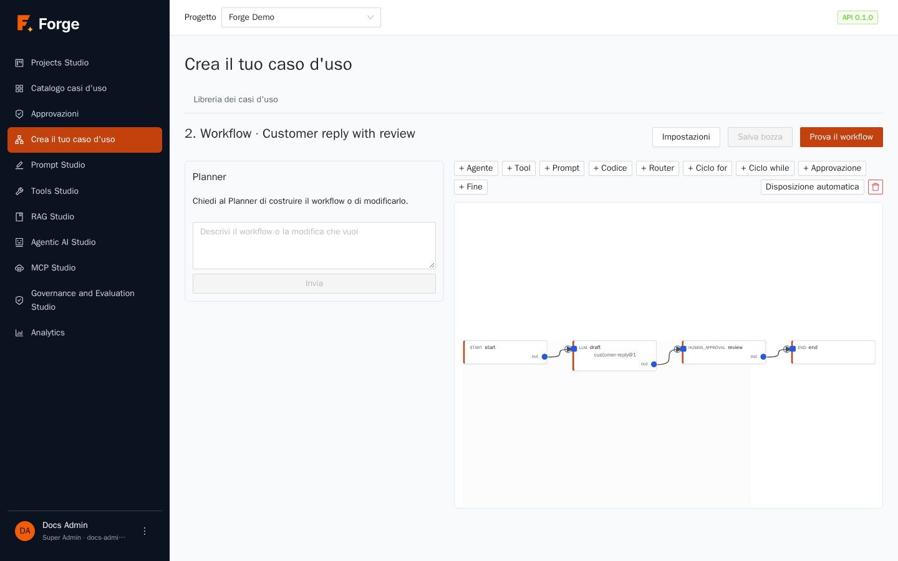

La pagina ha la chat del **Planner** a sinistra e il workflow a destra.

### Il Planner

Descrivi cosa vuoi («Prepara una risposta, poi fai controllare a una persona prima dell'invio») e premi **Invia**. Il Planner propone un workflow completo usando **solo ciò che esiste nella tua libreria**: agenti, strumenti e prompt *pubblicati*. Controlla da sé la propria proposta e corregge gli errori (fino a tre tentativi). Poi:

- leggi la sua risposta;
- se manca qualcosa, elenca le **Capacità mancanti** con un nome e uno scopo suggeriti, e un link **Crea agente** verso l'editor degli agenti;
- premi **Applica al workflow** per mettere la proposta nell'editor. Il Planner non salva mai nulla: **Salva bozza** memorizza ciò che vedi.

Puoi chiedere modifiche a parole («aggiungi un passaggio che traduce la risposta in italiano») quante volte vuoi.

### La tela (pattern grafo)

Sopra la tela, dei pulsanti aggiungono nodi: **Agent**, **Tool**, **Prompt**, **Code**, **Router**, **For loop**, **While loop**, **Approval** ed **End**; **Auto layout** riordina il diagramma e il cestino rimuove il nodo selezionato. Trascina dal punto di uscita di un nodo all'ingresso di un altro per collegarli: una freccia significa *«esegui dopo»*. I nodi che dipendono dallo stesso nodo precedente girano **in parallelo**. Fai **doppio clic** su un nodo per aprirne le impostazioni:

| Nodo | Cosa fa | Impostazioni principali |
| --- | --- | --- |
| **start** | Il punto di ingresso. | nessuna |
| **agent** | Esegue un agente della libreria. | l'agente, il **compito**, l'input, il nome della variabile di output, *human in the loop* |
| **tool** | Chiama uno strumento della libreria. | lo strumento, i suoi argomenti (JSON), la variabile di output |
| **llm** (*Prompt*) | Esegue una volta un prompt della libreria. | il prompt, le sue variabili (JSON), la variabile di output |
| **code** | Esegue poche righe di Python nella sandbox (capitolo 5). | il codice e gli argomenti |
| **router** | Sceglie il percorso: **sezioni** ordinate con condizioni *(campo, operatore `=`, `!=`, `>`, `<`, `contains`, valore)* combinate con AND/OR; più sezioni possono corrispondere; un percorso *default* raccoglie il resto. I percorsi non presi sono segnati come *skipped* (saltati). | le sezioni |
| **for_each / while** | Ripete per ogni elemento di una lista, o finché vale una condizione. | gli elementi o la condizione, **iterazioni massime** (sempre obbligatorie) |
| **human_approval** | Si ferma e chiede a una persona (sezione 7.5). | il testo da mostrare, le istruzioni, chi può decidere, quanto attendere |
| **end** | Produce il risultato finale da un template. | il risultato, per esempio `{final}` |

I valori passano da un nodo all'altro tramite **variabili**: la *variabile di output* di un nodo (per esempio `draft`) si può usare nei nodi successivi come `{draft}`; anche i campi del modulo (`{message}`) sono variabili. I nodi con problemi sono evidenziati ed elencati sotto **Il workflow richiede attenzione**.

### Il team (pattern team di agenti)

La pagina mostra un riquadro per ogni agente, nell'ordine di esecuzione. Trascina per riordinare, modifica ogni **Compito**, **Rimuovi agente**, oppure scegli un agente in **Aggiungi un agente dalla libreria** e premi **Aggiungi**. Il team ha bisogno di almeno un agente.

Premi spesso **Salva bozza**. **Prova il workflow** porta al passo 3. **Impostazioni** apre la pagina delle impostazioni.

## 7.9 Passo 3: prova

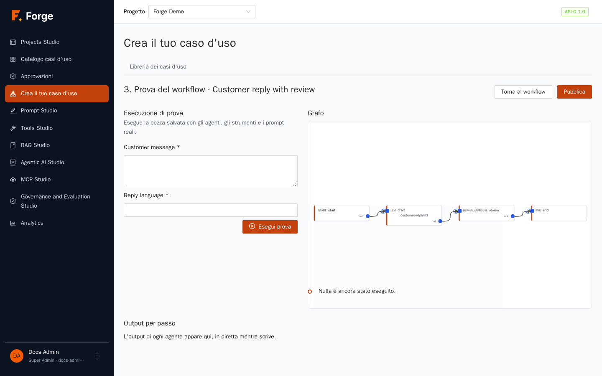

1. Compila il **modulo** a sinistra con valori di esempio e premi **Esegui prova** (una prova è reale: chiama modelli e strumenti veri e costa token veri).
2. Il **grafo** mostra quale nodo è in esecuzione (colori: in corso, riuscito, fallito, saltato) e la **Cronologia** elenca i passaggi.
3. **Output per passo** mostra l'output di ogni passaggio, **in diretta mentre un agente scrive**.
4. Se il workflow arriva a un'approvazione, la pagina dice che l'esecuzione attende che una persona approvi un passaggio, con un pulsante **Apri Approvazioni**: approvala tu per vedere la fine dell'esecuzione.
5. Quando sei soddisfatto, premi **Pubblica**: aggiungi una **Descrizione**, scegli il **Catalogo** e la **Categoria** e una **Nota**, poi conferma. Il caso d'uso compare nel catalogo per i ruoli che possono vedere quel catalogo.

Pubblicare richiede una definizione **valida e completa** e che ogni agente, strumento e prompt usato sia **pubblicato** (prompt con tag *prod*). L'errore ti dice quale non lo è.

## 7.10 Impostazioni, versioni e ciclo di vita

Premi **Impostazioni** (oppure **Modifica** dalla libreria).

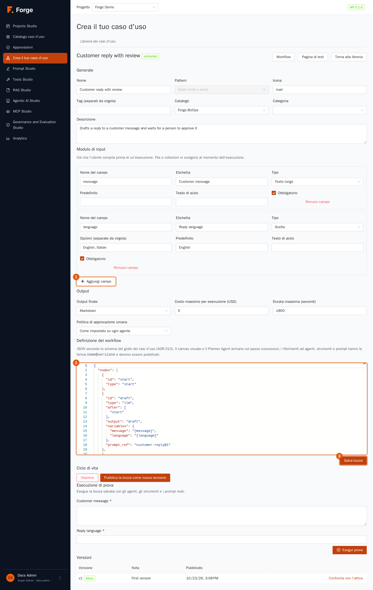

| Sezione | Cosa imposti |
| --- | --- |
| **Generale** | **Nome**, **Pattern** (fisso dopo la creazione), **Icona**, **Tag**, **Catalogo**, **Categoria**, **Descrizione**. |
| **Modulo di input** | I campi che gli utenti compilano (**Aggiungi campo**, indicatore 1): **Nome del campo** (minuscole, cifre e underscore; diventa la variabile), **Etichetta**, **Tipo** (*Testo*, *Testo lungo*, *Numero*, *Scelta*, *File*, *Collezione di dati*), **Opzioni (separate da virgola)** e **Predefinito** per le scelte, **Testo di aiuto** e **Obbligatorio**. |
| **Output** | **Output finale**: *Markdown*, *JSON (con schema)*, *Word*, *Excel*, *PDF* o *Trascrizione della chat*. **Costo massimo per esecuzione (USD)** e **Durata massima (secondi)** fermano le esecuzioni fuori controllo. **Politica di approvazione umana**: *Come impostato su ogni agente*, *Sempre* o *Mai*. |
| **Definizione del workflow** | Lo stesso workflow come JSON, in un editor di codice (indicatore 2): per utenti avanzati e per copiare tra progetti. |

Premi **Salva bozza** (indicatore 3). Una bozza si può salvare con riferimenti a cose non ancora pubblicate; la prova e la pubblicazione li rifiutano.

### Ciclo di vita e versioni

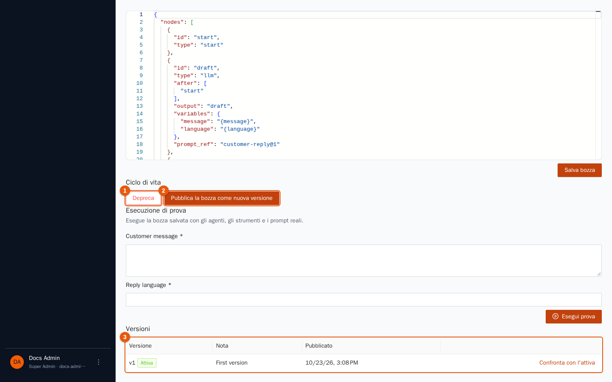

Un caso d'uso passa da **Bozza → In test → Pubblicato → Deprecato**:

- **Passa a test** / **Torna a bozza** segnano a che punto sei (e controllano la definizione).
- **Pubblica la bozza come nuova versione** (indicatore 2) trasforma la bozza in una nuova versione immutabile. Le esecuzioni già partite mantengono la versione con cui sono iniziate.
- **Depreca** (indicatore 1) lo ritira dal catalogo senza eliminarlo.

La tabella **Versioni** (indicatore 3) mostra ogni versione pubblicata con la sua nota e l'etichetta **Attiva** su quella corrente. **Confronta con l'attiva** mostra cosa differisce tra la bozza o una versione e quella attiva. **Ripristina questa** rende di nuovo attiva una versione vecchia e sostituisce la bozza con essa (i riferimenti vengono ricontrollati).

## 7.11 Trigger: avviare un caso d'uso senza una persona

Un **trigger** avvia un'esecuzione della versione **pubblicata** a orari prestabiliti, oppure quando un altro sistema chiama un URL. Premi **Trigger** nella riga della libreria.

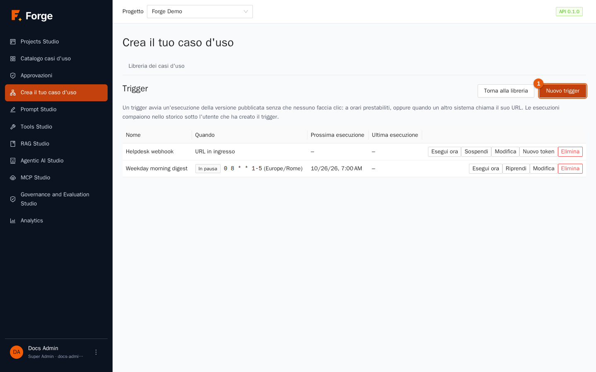

La tabella mostra di ogni trigger **Nome**, **Quando** (la pianificazione, oppure *URL in ingresso*), **Prossima esecuzione** e **Ultima esecuzione**; azioni: **Esegui ora**, **Sospendi** / **Riprendi**, **Modifica**, **Nuovo token** (per gli URL) ed **Elimina**.

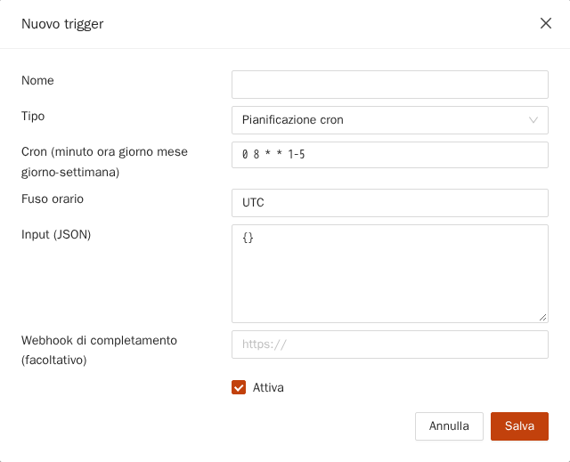

Premi **Nuovo trigger** e scegli il **Tipo**:

| Tipo | Cosa fornisci |
| --- | --- |
| **Pianificazione cron** | Un'espressione cron a cinque campi *(minuto ora giorno mese giorno-della-settimana)*, per esempio `0 8 * * 1-5` per le 08:00 nei giorni feriali, e il **Fuso orario** (per esempio `Europe/Rome`). |
| **Ogni N minuti** | L'intervallo in minuti (almeno 5). |
| **URL in ingresso (chiamato da un altro sistema)** | Nulla: Forge crea un URL segreto. |

Poi compila **Input (JSON)** — i valori fissi del modulo — e, se vuoi essere avvisato alla fine di ogni esecuzione, un **Webhook di completamento (facoltativo)**; lascia spuntato **Attiva** e **Salva**. Per un URL in ingresso, **copia subito l'URL**: viene mostrato **una sola volta**, e chiunque lo abbia può avviare il caso d'uso, quindi trattalo come una password. Chiamalo con `POST`; un corpo JSON facoltativo con un campo `inputs` aggiunge o sostituisce gli input. **Nuovo token** sostituisce l'URL (il vecchio smette di funzionare).

Da sapere: un trigger gira **come la persona che l'ha creato**; girano solo i casi d'uso pubblicati (altrimenti il tentativo è registrato come fallito, e una pianificazione viene **sospesa dopo cinque fallimenti di fila**); una pianificazione in scadenza mentre l'esecuzione precedente è ancora in corso salta quello slot; gli input file non sono supportati; le esecuzioni compaiono nello storico di chi ha creato il trigger.

## 7.12 Buone pratiche

- **Parti dal modulo.** Pochi campi, etichette chiare e testo di aiuto; chi non capisce il modulo non userà il caso d'uso.
- **Metti una persona dove conta:** approvazioni prima di qualsiasi cosa venga inviata fuori dall'azienda o scritta in un sistema.
- **Prova con input realistici e cattivi** prima di pubblicare; leggi gli *Output per passo*.
- **Pubblica una versione, poi continua a migliorare la bozza.** Gli utenti mantengono la versione stabile finché non ne pubblichi un'altra.
- **Imposta limiti di costo e di tempo** adatti al caso d'uso.
- **Archivialo nella categoria giusta** e verifica, con un utente di prova, che i ruoli previsti lo vedano.

## 7.13 Risoluzione dei problemi

| Sintomo | Causa e rimedio |
| --- | --- |
| Il catalogo è vuoto | Nessun catalogo è abilitato per il tuo ruolo (capitolo 2), oppure non c'è nulla di pubblicato. |
| *Il tuo ruolo non può eseguire use case in questo progetto* | Il ruolo Visualizzatore non può eseguire casi d'uso. |
| L'esecuzione resta *In attesa di approvazione* | Qualcuno deve deciderla in **Approvazioni** (o aprire il link nell'email). Scade dopo il tempo di attesa. |
| La pubblicazione è rifiutata | Un agente, strumento o prompt usato non è pubblicato, oppure il workflow è incompleto. Il messaggio nomina il nodo. |
| La pagina del workflow dice che richiede attenzione | Premi il nodo evidenziato; il pannello elenca il problema (un campo mancante, una variabile sconosciuta, un ciclo senza limite). |
| Un trigger mostra *In pausa* | Ha fallito cinque volte di fila, oppure l'hai sospeso. Rimuovi la causa e premi **Riprendi**. |
| Un URL in ingresso ha smesso di funzionare | Il trigger è sospeso o il suo token è stato sostituito (**Nuovo token**). |
| Un output Word, Excel o PDF non ha il file | Non è stato possibile costruire il file; il testo del risultato resta disponibile e l'esecuzione mostra il motivo. |

Prossimo: [8. Governance and Evaluation Studio](08-governance.md)
