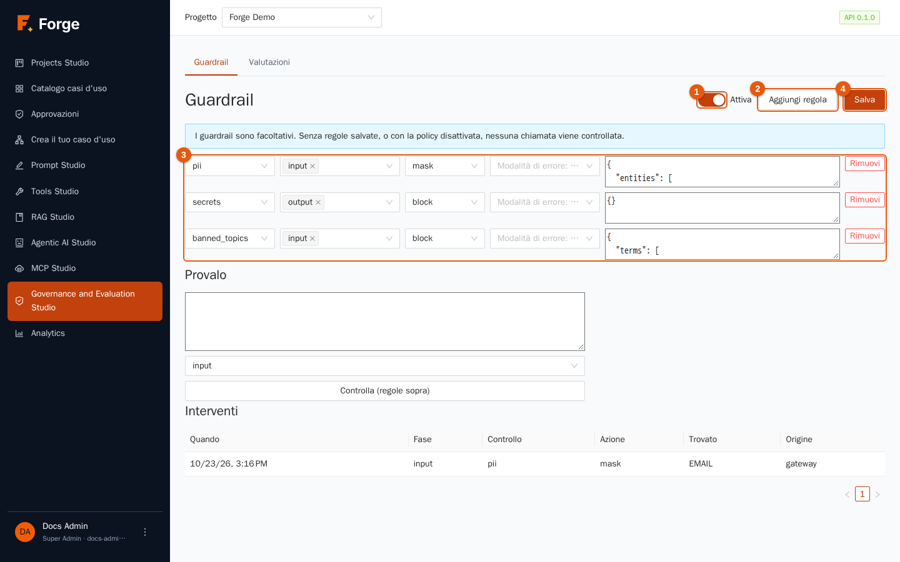
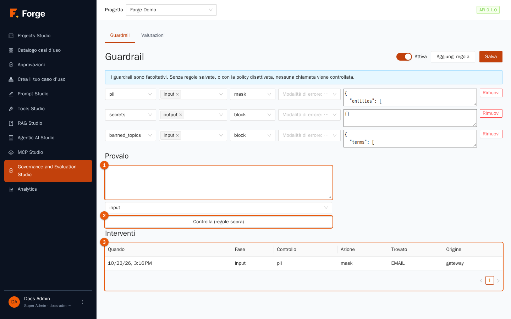
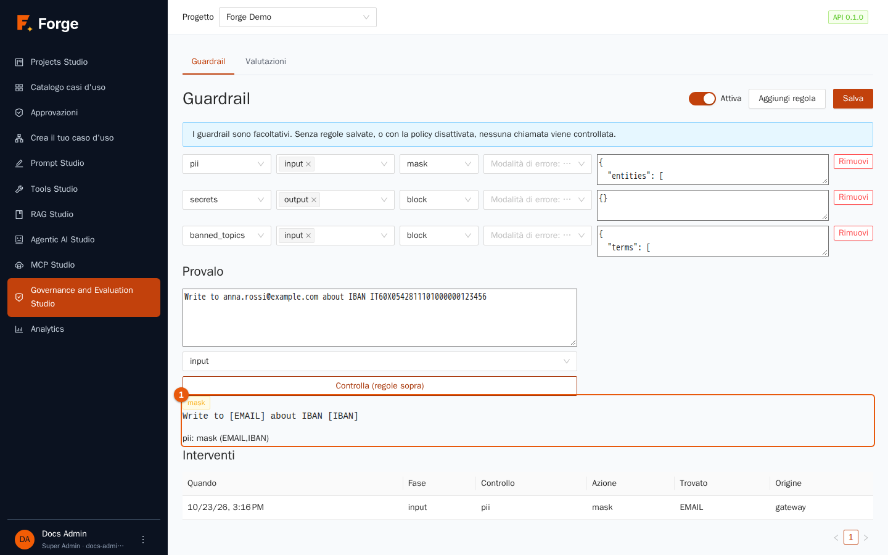
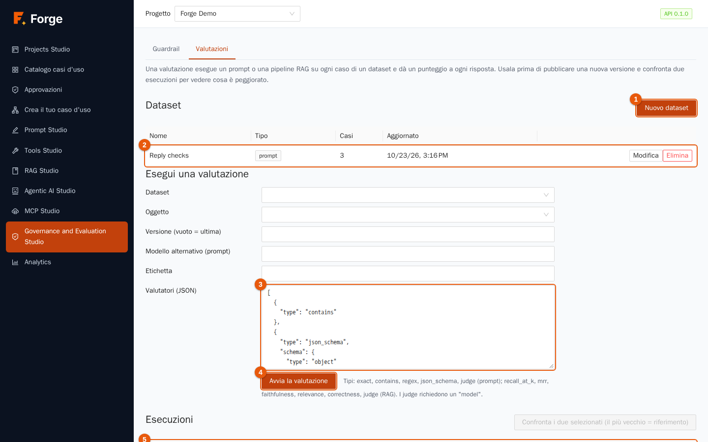
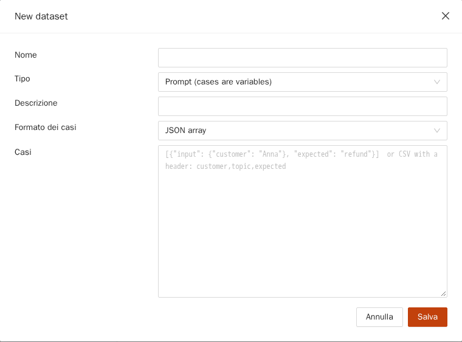
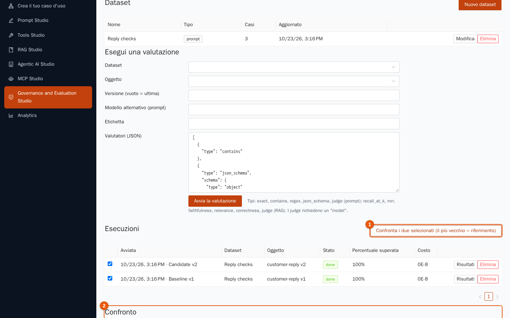

# 8. Governance and Evaluation Studio

[Indice](README.md) · Precedente: [7. Casi d'uso](07-casi-d-uso.md) · Prossimo: [9. Analytics](09-analytics.md)

Due domande che ogni organizzazione si pone prima di fidarsi dell'AI: *«Può far trapelare qualcosa che non dovrebbe?»* e *«La nuova versione è davvero migliore della vecchia?»* Questo studio risponde con due strumenti: i **Guardrail** controllano ciò che entra e esce dai modelli, e le **Valutazioni** misurano la qualità di prompt e pipeline RAG su un insieme fisso di casi di prova.

> **A chi serve?** **Guardrail**: solo Project Admin. **Valutazioni**: Builder e Project Admin. Lo studio ha due schede: **Guardrail** e **Valutazioni**.

## 8.1 Guardrail

Una **policy di guardrail** è un elenco di **regole** applicate a ogni chiamata che passa dal gateway dei modelli di Forge: chat, prompt, agenti, passaggi dei casi d'uso, il Planner. Poiché il controllo vive nel gateway, nulla può aggirarlo, qualunque schermata o API abbia avviato la chiamata.



> **I guardrail sono facoltativi.** Un progetto nuovo non controlla nulla. *Senza regole salvate, o con la policy disattivata, nessuna chiamata viene controllata.* Decidi, con il tuo team di sicurezza, di quali regole hanno bisogno i tuoi casi d'uso.

### La pagina

| Indicatore | Controllo | Uso |
| --- | --- | --- |
| 1 | **Attiva** | Accende o spegne l'intera policy senza perdere le regole. |
| 2 | **Aggiungi regola** | Aggiunge una riga di regola vuota. |
| 3 | Le regole | Una riga per regola (vedi sotto). **Rimuovi** cancella una riga. |
| 4 | **Salva** | Salva la policy. Un messaggio conferma (*Policy salvata*) o dice cosa non va. |

### Anatomia di una regola

Ogni riga ha cinque parti, da sinistra a destra:

| Parte | Scelte e significato |
| --- | --- |
| **Controllo** (il primo selettore) | **pii** (dati personali), **injection** (tentativi di prompt injection), **secrets** (chiavi, token, password), **urls** (indirizzi web consentiti e vietati), **banned_topics** (termini che non vuoi vedere), **json_schema** (la risposta deve essere JSON di una certa forma), **toxicity** (contenuti dannosi), **grounding** (la risposta è sostenuta dalle fonti). |
| **Fase** | Dove controllare: **input** (ciò che va al modello), **output** (ciò che torna), **tool_args** (gli argomenti di una chiamata a uno strumento, prima che parta). Scegline una o più. |
| **Azione** | **log** (registra e basta), **mask** (sostituisce ciò che è stato trovato con un'etichetta come `[EMAIL]`), **rewrite**, **block** (rifiuta la chiamata), **escalate** (oggi blocca). Quando si applicano più regole, vince l'azione **più severa**. |
| **Modalità di errore** | Cosa fare se il controllo *non può girare* (per esempio un modello guard è giù): *predefinita* (una regola che cambierebbe o fermerebbe il testo blocca la chiamata; una regola *log* la lascia passare), *closed* (blocca) oppure *open* (lascia passare). |
| **Parametri (JSON)** | Impostazioni del controllo. Quando scegli il controllo viene compilato un suggerimento con un esempio. |

Esempi di parametri:

| Controllo | Esempio | Note |
| --- | --- | --- |
| **pii** | `{"entities": ["EMAIL", "CREDIT_CARD", "IBAN", "IT_FISCAL_CODE", "PHONE", "IP_ADDRESS"]}` | Anche `PERSON`, `LOCATION`, `ORGANIZATION` per nomi, luoghi e organizzazioni (più lento, meno preciso: vedi sotto). I numeri di telefono richiedono un prefisso internazionale (`+39…`) per essere riconosciuti. Carte, IBAN e codici fiscali sono validati, quindi cifre a caso non vengono segnalate. |
| **banned_topics** | `{"terms": ["insider trading"]}` | Termini senza distinzione tra maiuscole e minuscole. |
| **urls** | `{"allow": ["example.com"], "deny": ["evil.test"]}` | Limita gli indirizzi che possono comparire. |
| **secrets** | `{"patterns": ["regex"]}` | I formati di segreti più comuni sono integrati; aggiungi i tuoi pattern. |
| **json_schema** | `{"schema": {"type": "object", "required": ["answer"]}}` | Per i casi d'uso che devono restituire dati strutturati. |
| **injection** | `{"model": "guard-or-chat-model", "judge": false, "threshold": 0.8}` | Prima girano le regole integrate in inglese e italiano. Con un `model` viene interrogato anche un modello *guard*; con `"judge": true` un normale modello di chat fa da giudice. |
| **toxicity** | `{"model": "guard-model-name", "categories": []}` | Richiede un modello *guard* (o un giudice); ogni testo controllato costa una chiamata al modello in più. |
| **grounding** | `{"model": "chat-model-name"}` | Chiede a un modello se la risposta discende dalle fonti. |

Come si comportano le azioni in pratica:

- **mask** sostituisce il testo *prima* che lo veda il modello, quindi il valore grezzo non arriva mai al provider, e lo tiene fuori anche dalla cache delle risposte. Un **mask su un controllo che non ha nulla da tagliare** (come un tentativo di injection) blocca invece.
- Un **blocco in input** rifiuta la richiesta prima che si paghi un modello; un **blocco in output** risponde con un errore (colpa del modello, non di chi chiama) e i token vengono contati perché il provider è stato pagato.
- Se una regola riguarda lo **streaming**, le risposte sono controllate per intero: con regole in output la prima parola compare solo quando l'intera risposta è pronta.
- I controlli su **nomi, luoghi e organizzazioni** usano un modello linguistico per le entità (inglese e italiano). È un modello piccolo: manca alcuni nomi e a volte scambia un'azienda per un luogo. Usalo come rete di sicurezza, non come garanzia.
- Gli **argomenti degli strumenti** sono controllati un valore alla volta, prima che lo strumento parta e prima di qualsiasi approvazione umana; il mascheramento cambia ciò che lo strumento riceve (`[EMAIL]` invece dell'indirizzo) senza avvisare l'agente.

Un **agente** può aggiungere regole proprie a quelle del progetto (capitolo 6).

### Prova prima di fidarti

Sotto le regole, **Provalo** esegue le tue regole su un testo di esempio **senza chiamare alcun modello**.



1. Scrivi un esempio nella casella (indicatore 1), scegli la **fase** e premi **Controlla (regole sopra)** (indicatore 2). Le regole usate sono quelle **a schermo**, anche se non ancora salvate.
2. Il risultato mostra l'azione intrapresa, il testo dopo il mascheramento e ciò che è stato trovato.



### Interventi

In fondo, la tabella **Interventi** (indicatore 3 della figura precedente) elenca ogni volta che una regola è intervenuta: **Quando**, **Fase**, **Controllo**, **Azione**, **Trovato** (l'etichetta, per esempio *EMAIL*) e **Origine** (*gateway* per le chiamate ai modelli). **Il registro non memorizza mai il testo**, solo ciò che è stato trovato, quindi è sicuro da leggere.

### Buone pratiche per i guardrail

- Parti da **log** per vedere quanto spesso scatta una regola, poi passa a **mask** o **block**.
- Usa **mask** per i dati personali con cui *vuoi* continuare a lavorare, **block** per ciò che non deve mai passare.
- Prova con esempi veri e scomodi in **Provalo**; tieni un elenco di esempi che devono essere bloccati e di altri che devono passare.
- Un modello guard o giudice vede il testo: usane uno che la tua organizzazione consente di far ricevere quel testo.
- Ricorda i limiti: i guardrail riducono il rischio; non sostituiscono il controllo degli accessi, i prompt curati e le approvazioni umane per le azioni sensibili.

## 8.2 Valutazioni

Una **valutazione** esegue un prompt o una pipeline RAG su **ogni caso di un dataset** e dà un punteggio a ogni risposta. Usala **prima di pubblicare una nuova versione**, e **confronta due esecuzioni** per vedere cosa è migliorato o peggiorato.



### Dataset

Un **dataset** è un elenco di casi di prova. Premi **Nuovo dataset** (indicatore 1).



| Campo | Significato |
| --- | --- |
| **Nome**, **Descrizione** | Testo libero. |
| **Tipo** | *prompt* (i casi chiamano un prompt) o *rag* (i casi interrogano una pipeline RAG). |
| **Formato dei casi** | Come scrivi i casi: **JSON array**, **JSON Lines** o **CSV**. |
| **Casi** | I casi. Per un dataset **prompt** ogni caso ha un `input` con le variabili del prompt (tutte testo) e, facoltativamente, una risposta `expected`. Per un dataset **RAG** l'`input` è `{"query": "…"}`, facoltativamente con `expected` ed `expected_sources` (nomi di file). |

Un dataset ha al massimo 1.000 casi. La tabella (indicatore 2) elenca i dataset con **Tipo**, numero di **Casi** e **Aggiornato**; **Modifica** ed **Elimina** sono nella riga. Esempio di dataset per prompt (JSON):

```json
[
  {"input": {"message": "Where is my order 4471?", "language": "English"}, "expected": "4471"},
  {"input": {"message": "My parcel arrived damaged.", "language": "English"}, "expected": "sorry"}
]
```

### Eseguire una valutazione

Compila **Esegui una valutazione**:

1. **Dataset** e **Oggetto** (il prompt o la pipeline RAG da provare). L'oggetto deve corrispondere al tipo del dataset.
2. **Versione (vuoto = ultima)**: la versione da provare. Lascia vuoto per l'ultima.
3. **Modello alternativo (prompt)**: prova lo stesso prompt su un altro modello.
4. **Etichetta**: un nome per l'esecuzione, per esempio *Baseline v1*.
5. **Valutatori (JSON)** (indicatore 3): *come* si valutano le risposte. Un elenco; ogni voce ha un `type`:

| Valutatore | Per | Cosa controlla |
| --- | --- | --- |
| `exact` | prompt | La risposta è uguale a `expected` (spazi e maiuscole ignorati di default). |
| `contains` | prompt | La risposta contiene `expected`. |
| `regex` | prompt | La risposta corrisponde a un `pattern`. |
| `json_schema` | prompt | La risposta è JSON conforme a uno `schema`. |
| `judge` | prompt e RAG | Un modello dà alla risposta un punteggio da 0 a 1 rispetto ai tuoi `criteria`; richiede un `model`. |
| `recall_at_k` | RAG | I documenti *attesi* compaiono tra i primi *k* risultati? |
| `mrr` | RAG | A che posizione è arrivato il primo documento atteso? |
| `faithfulness` | RAG | La risposta è sostenuta dai passaggi che cita? (un giudice) |
| `relevance` | RAG | La risposta affronta la domanda? (un giudice) |
| `correctness` | RAG | La risposta concorda con `expected`? (un giudice) |

6. Premi **Avvia la valutazione** (indicatore 4). L'esecuzione compare in **Esecuzioni** (indicatore 5) e gira in background; la pagina si aggiorna.

Un caso **supera** la prova quando **tutti** i valutatori che hanno potuto dargli un punteggio la superano; un caso senza nulla da confrontare non passa per fortuna. Soglie predefinite: 1,0 per i controlli deterministici e 0,7 per i giudici; imposta `threshold` in un valutatore per cambiarla. I giudici sono normali chiamate a modelli: costano token e, come tutte le chiamate, passano dai tuoi guardrail.

### Leggere i risultati

La tabella **Esecuzioni** mostra **Avviata** (con l'etichetta), **Dataset**, **Oggetto** (con la versione), **Stato**, **Percentuale superata** e **Costo**. **Annulla** ferma un'esecuzione in corso; **Risultati** apre il dettaglio: per ogni caso l'**Input**, la risposta **Atteso**, l'**Output** e i **Punteggi**, con un link al trace completo della chiamata.

### Confrontare due esecuzioni

Spunta **due esecuzioni** e premi **Confronta i due selezionati (il più vecchio = riferimento)** (indicatore 1).



Il **Confronto** (indicatore 2) mostra la **Variazione della percentuale superata** tra il **Riferimento** (l'esecuzione più vecchia) e il **Candidato**, ed elenca i casi **migliorati** e quelli **peggiorati**, così una versione migliore in media ma che rompe un caso importante non passa inosservata. Routine tipica per la modifica di un prompt: esegui il dataset sulla versione pubblicata (*Riferimento*), salva la nuova versione, eseguila sullo stesso dataset (*Candidato*), confronta, e pubblica solo se nulla di importante è peggiorato.

### Valutazioni nella tua pipeline

La stessa cosa si può fare da riga di comando, per esempio in una pipeline di build (`forgectl eval`, capitolo 10), che può far fallire la build quando la percentuale superata scende sotto una soglia o sotto un riferimento.

### Buone pratiche per le valutazioni

- **Costruisci il dataset da domande vere**, comprese quelle scomode, e fallo crescere ogni volta che trovi un errore.
- **Tienilo piccolo e mirato** all'inizio (da 20 a 50 casi). Un dataset che esegui spesso vale più di uno enorme che non esegui mai.
- **Preferisci i valutatori deterministici** dove puoi (`contains`, `regex`, `json_schema`): sono economici e ripetibili. Usa i giudici per la qualità aperta, e leggi un campione dei loro verdetti.
- **Confronta cose omogenee**: stesso dataset, stessi valutatori.
- Le esecuzioni di valutazione girano dentro il server API; un riavvio dell'API perde un'esecuzione in corso (eseguila di nuovo).

## 8.3 Risoluzione dei problemi

| Sintomo | Causa e rimedio |
| --- | --- |
| «Solo i Project Admin gestiscono i guardrail.» | Il tuo ruolo non può modificare la policy. |
| «Le valutazioni richiedono il ruolo Builder o Project Admin.» | Chiedi a un Project Admin. |
| Una regola è *non disponibile* o blocca tutto | Richiede qualcosa che manca: un modello guard o giudice non abilitato per il progetto, oppure i modelli per nomi e luoghi. Una regola che non può girare **blocca** salvo che la sua azione sia *log* o la sua modalità di errore sia *open*. |
| Il salvataggio della policy viene rifiutato | Una regola nomina un modello che non esiste, non è abilitato per il progetto o non è un modello guard; oppure i parametri non sono JSON valido. |
| I numeri di telefono non vengono mascherati | Richiedono un prefisso internazionale, come `+39` o `0039`. |
| Una valutazione resta *in corso* poi diventa *interrotta* | L'API si è riavviata, oppure il processo ha smesso di rispondere per cinque minuti. Avviala di nuovo. |
| La percentuale superata è 0% con `exact` | Il modello aggiunge parole attorno alla risposta. Usa `contains`, oppure chiedi al prompt il solo valore. |
| Il giudice fallisce sempre | I giudici richiedono un `model` nel valutatore; controlla che il modello sia abilitato per il progetto. |

Prossimo: [9. Analytics](09-analytics.md)
