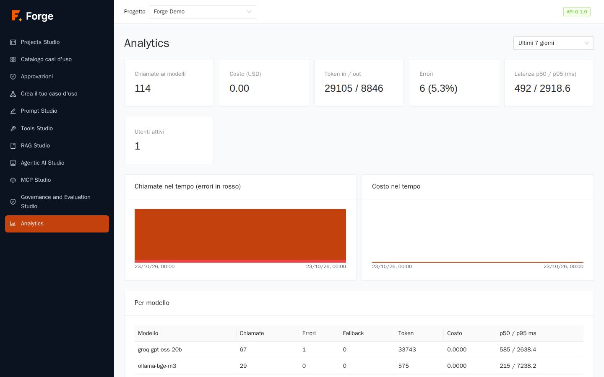
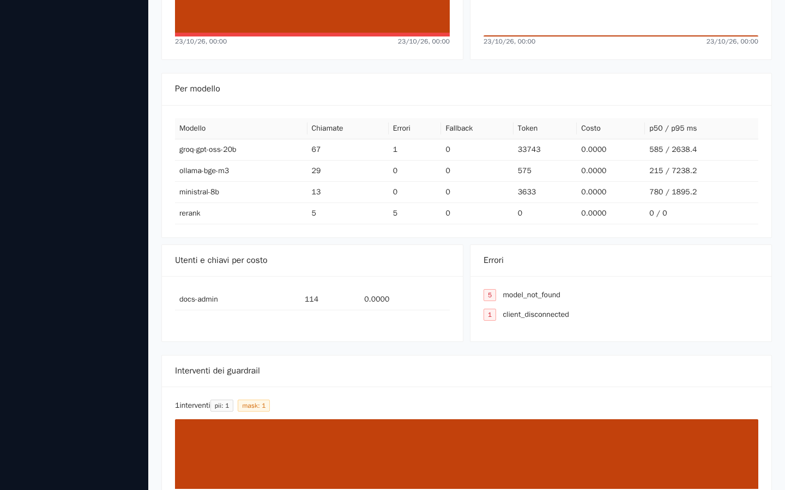
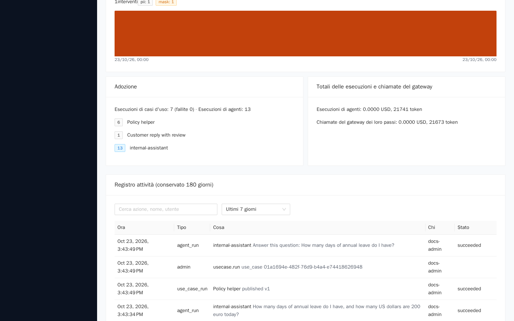
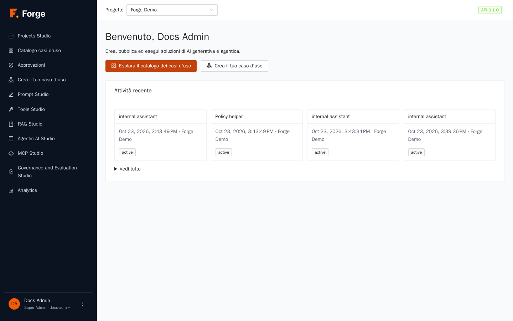

# 9. Analytics

[Indice](README.md) · Precedente: [8. Governance and Evaluation Studio](08-governance.md) · Prossimo: [10. Integrazioni, sincronizzazione e trasferimento](10-integrazioni-e-sincronizzazione.md)

Analytics risponde a: *quanto è usato il progetto, quanto costa, quanto è veloce e affidabile, chi lo usa e cosa è successo?* Ogni cifra è calcolata dai record che Forge già conserva per ogni chiamata a un modello, esecuzione e azione amministrativa, quindi i numeri concordano sempre con le viste delle esecuzioni dei capitoli precedenti.

> **A chi serve?** Ai **Project Admin** (la pagina Analytics mostra i costi, quindi Builder e utenti finali non la vedono). Tutti vedono la propria **Attività recente** nella home page (sezione 9.5). I Super Admin hanno anche le analisi di tutta la piattaforma (capitolo 11).

## 9.1 La dashboard

Apri **Analytics** nel menu laterale.

In alto a destra, il selettore del **periodo**: **Ultime 24 ore**, **Ultimi 7 giorni** (predefinito), **Ultimi 30 giorni**, **Ultimi 90 giorni** o **Ultimi 180 giorni**. Il limite superiore è la *conservazione* impostata dagli amministratori (180 giorni per impostazione predefinita).

### I riquadri

| Riquadro | Significato |
| --- | --- |
| **Chiamate ai modelli** | Numero di chiamate ai modelli nel periodo (chat, prompt, passi degli agenti, embedding, chiamate guard e giudice). |
| **Costo (USD)** | Costo stimato: token per il prezzo registrato per ogni modello (capitolo 2). I modelli gratuiti e interni costano 0, e una chiamata servita dalla cache costa 0. |
| **Token in / out** | Token inviati ai modelli e ricevuti da essi. |
| **Errori** | Quante chiamate sono fallite, con la percentuale. Una chiamata rifiutata per quota, validazione o blocco di un guardrail conta come errore. |
| **Latenza p50 / p95 (ms)** | Il tempo mediano (metà delle chiamate è più veloce) e il tempo che il 95% delle chiamate batte. Il p95 mostra quanto sono lente le lente. |
| **Utenti attivi** | Persone distinte che hanno fatto chiamate. |

### Grafici

**Chiamate nel tempo (errori in rosso)** e **Costo nel tempo** usano barre orarie fino a tre giorni e giornaliere oltre. Una base rossa nel grafico delle chiamate mostra la quota di errori.

### Per modello

La tabella **Per modello** scompone il periodo per modello: **Chiamate**, **Errori**, **Fallback** (chiamate in cui il primo modello è fallito e ha risposto uno di riserva), **Token**, **Costo** e **p50 / p95 ms**. Usala per vedere quali modelli reggono il carico, quale fallisce, e se la *catena di fallback* di un alias (capitolo 2) viene usata.

### Utenti e chiavi per costo

Chi spende: persone e token API, ordinati per costo, con il numero di chiamate. Le chiamate fatte con un token del progetto sono attribuite alla persona che l'ha creato.

### Errori

Un elenco di **codici di errore** con quante volte si è verificato ciascuno (per esempio `model_not_found`, `upstream_unavailable`, un codice di quota). Se non c'è nulla, la scheda dice *Nessun errore nel periodo*. Un codice che ricorre di continuo merita uno sguardo: di solito indica un alias mancante, un provider irraggiungibile o un limite troppo basso.

### Interventi dei guardrail

Quante volte sono intervenuti i guardrail del progetto (capitolo 8), suddivisi per controllo e azione, con un piccolo grafico nel tempo.

### Adozione

Quanto sono usati i **casi d'uso** e gli **agenti**: **Esecuzioni di casi d'uso** (con quante **fallite**) ed **Esecuzioni di agenti**, più il numero di utenti attivi.

### Riconciliazione

**Totali delle esecuzioni e chiamate del gateway** confronta i token e il costo *sommati dalle esecuzioni* con le *chiamate ai modelli registrate per i loro passi*. I due valori devono coincidere; se mai differiscono, qualcosa non va nella contabilità e va segnalato. È una prova integrata che il costo che vedi per esecuzione è il costo che sostieni davvero.

## 9.2 Il registro attività

In fondo alla pagina, il **Registro attività** elenca, dal più recente, ciò che è accaduto nel progetto nel periodo: azioni amministrative (membri, modelli, strumenti, pubblicazioni), esecuzioni di casi d'uso ed esecuzioni di agenti.

| Colonna | Significato |
| --- | --- |
| **Ora** | Quando è accaduto. |
| **Tipo** | Il tipo di evento (un'azione, un'esecuzione di caso d'uso, un'esecuzione di agente). |
| **Cosa** | Cosa è successo e a quale oggetto. |
| **Chi** | La persona o il token. |
| **Stato** | L'esito, per le esecuzioni. |

Usa la casella di **ricerca** (*Cerca azione, nome, utente*) e i pulsanti del periodo per trovare, per esempio, chi ha pubblicato un caso d'uso o chi ha eliminato un modello. Gli accessi e la lettura dei dati non sono in questo registro; il **registro di audit** del Super Admin (capitolo 11) è la traccia di sicurezza completa. Il registro è una *finestra*: i record si conservano, ma vedi solo il periodo di conservazione.

## 9.3 Costo: cosa guardare

- **Un riquadro che è balzato**: apri *Per modello* e *Utenti e chiavi per costo* per trovare dove.
- **Molti fallback**: il tuo primo modello è inaffidabile o limitato; sistemalo o riordina l'alias.
- **p95 alto**: un modello lento o un agente lungo. Confronta con la vista dell'esecuzione (capitolo 6).
- **Esecuzioni di agenti costose**: guarda *Chiamate al modello (max)*, il numero di strumenti e la dimensione del contesto recuperato (*Top_k*, capitolo 4).
- **Imposta dei limiti**: token al giorno e per utente (capitolo 2) proteggono il budget prima che la dashboard mostri il danno.

## 9.4 Limiti da tenere presenti

- **Il costo è una stima**: usa i prezzi che hai inserito nel registro dei modelli; non è una fattura. I modelli registrati con prezzo 0 mostrano 0.
- I grafici sono semplici barre; **non c'è ancora esportazione** in CSV.
- Le dashboard mostrano le **chiamate ai modelli**. Il tempo passato in strumenti, code o approvazioni non fa parte della latenza dei modelli.

## 9.5 La tua attività recente (home page)

Ogni utente collegato vede **Attività recente** nella home page: le ultime esecuzioni avviate negli ultimi 15 giorni, come schede con il nome, la data, il progetto e lo stato. **Vedi tutto** apre l'elenco completo.

## 9.6 Risoluzione dei problemi

| Sintomo | Causa e rimedio |
| --- | --- |
| Analytics non è nel mio menu / è vuota | Solo i Project Admin vedono le dashboard. |
| Il costo è sempre 0,00 | I modelli hanno prezzo 0 nel registro (gratuiti o interni), oppure le chiamate arrivavano dalla cache. |
| Il riquadro di riconciliazione mostra una differenza | Segnalalo agli amministratori della piattaforma: dovrebbe essere sempre zero. |
| Non posso selezionare più di 180 giorni | È la finestra di conservazione; un Super Admin può cambiarla (capitolo 11). |
| Il registro attività non mostra un accesso | Gli accessi sono nel registro di audit del Super Admin, non qui. |

Prossimo: [10. Integrazioni, sincronizzazione e trasferimento](10-integrazioni-e-sincronizzazione.md)
