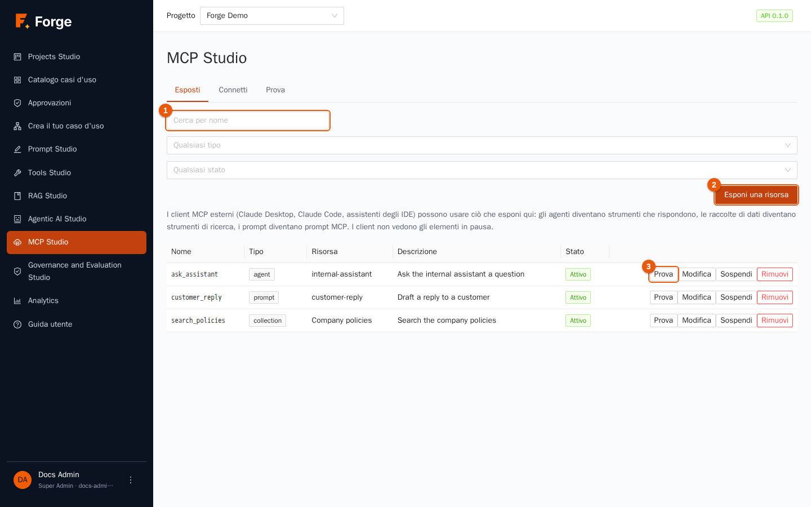
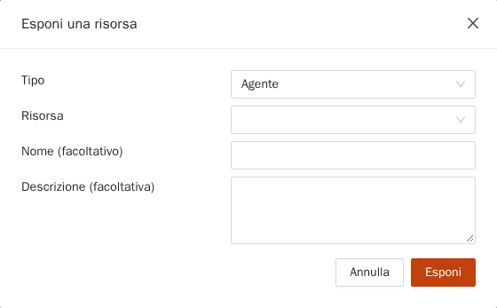
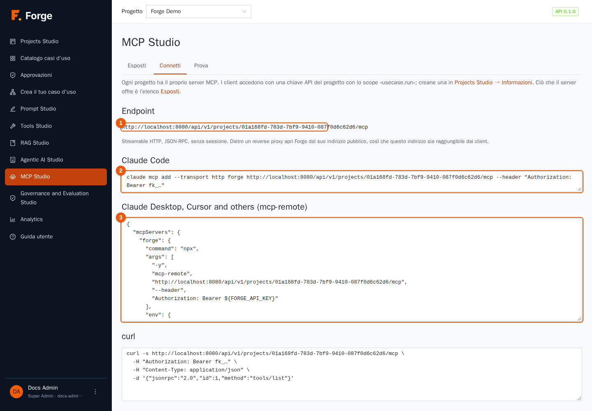
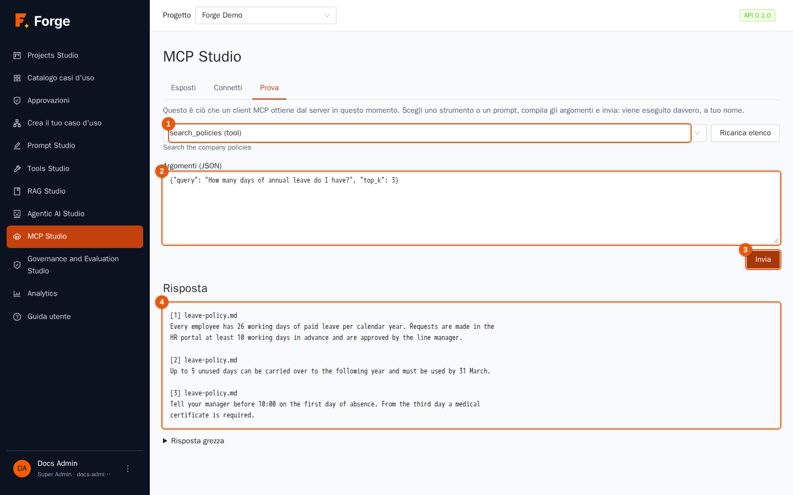
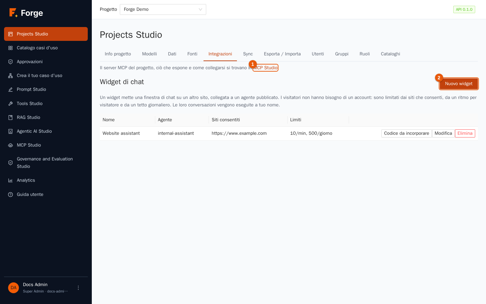
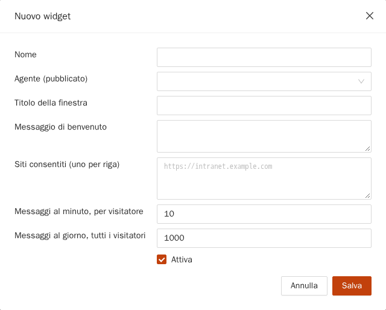
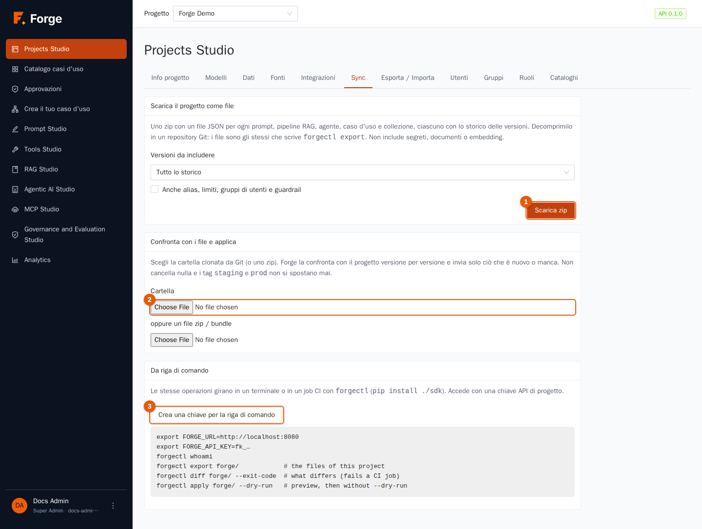
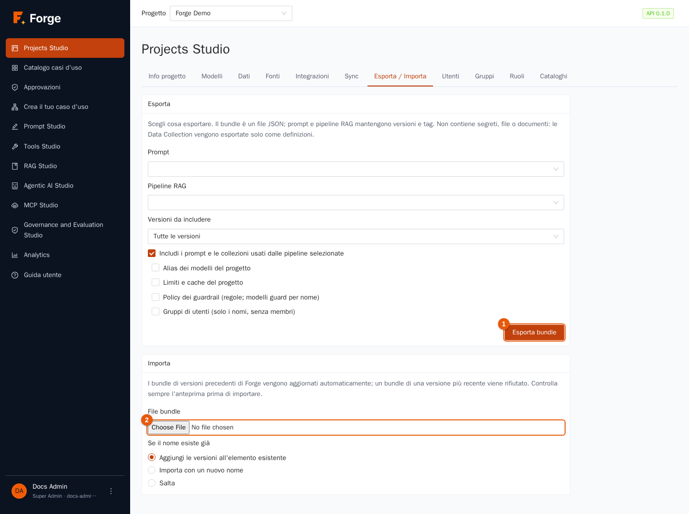

# 10. Integrazioni, sincronizzazione e trasferimento

[Indice](README.md) · Precedente: [9. Analytics](09-analytics.md) · Prossimo: [11. Console Super Admin](11-amministrazione.md)

Forge non vive da solo. Questo capitolo mostra come **far usare ad altre applicazioni ciò che hai costruito** (un server MCP, una bolla di chat per un sito web, un'API compatibile con OpenAI, esecuzioni avviate da script), come **tenere le risorse in Git** (la riga di comando `forgectl` e la pagina *Sync*) e come **spostare le risorse** tra progetti e installazioni (*Esporta / Importa*).

> **A chi serve?** A Project Admin e sviluppatori. Costruire le integrazioni che chiamano Forge richiede un **token API** del progetto (capitolo 2).

## 10.1 Quale porta per quale esigenza?

| Vuoi… | Usa | Sezione |
| --- | --- | --- |
| far chiamare ad un assistente AI (Claude Desktop, Claude Code, un IDE) i tuoi agenti, cercare nei tuoi documenti o usare i tuoi prompt | il **server MCP** del progetto | 10.2 |
| mettere in un sito web una bolla di chat collegata a un agente | un **widget di chat** | 10.3 |
| chiamare i modelli da qualsiasi programma che parla l'API di OpenAI, con i tuoi alias, limiti, cache, guardrail e contabilità | l'**API compatibile con OpenAI** | 10.4 |
| avviare un caso d'uso da uno script, uno scheduler o un altro sistema | l'**API di esecuzione**, un **URL di trigger** o `forgectl run` | 10.5 |
| tenere in Git prompt, pipeline, agenti e casi d'uso, rivedere le modifiche, distribuirle | **Sync** e `forgectl` | 10.6 |
| copiare risorse in un altro progetto o in un altro Forge | **Esporta / Importa** | 10.7 |

> **Dove sta cosa.** Il server MCP è in **MCP Studio** (menu laterale). I widget di chat sono in **Projects Studio → Integrazioni**.

## 10.2 Il server MCP del progetto

**MCP** (Model Context Protocol) è il modo standard con cui gli assistenti AI usano strumenti esterni. Ogni progetto Forge è un server MCP: scegli **cosa esporre**, e i client MCP lo vedono come strumenti e prompt. Tutto si fa in **MCP Studio** (menu laterale), in tre schede: **Esposti**, **Connetti** e **Prova**. Possono aprirlo Project Admin e Builder.

### Esposti: ciò che il server offre



La tabella elenca ogni esposizione con **Nome** (ciò che vede il client), **Tipo**, **Risorsa**, **Descrizione** e **Stato**: **Attivo**, oppure **Inattivo** se in pausa. Usa la casella di ricerca (indicatore 1) e i due filtri per restringere l'elenco. I pulsanti di riga sono **Prova** (indicatore 3, sezione sotto), **Modifica** (nome e descrizione), **Sospendi / Riprendi** (un'esposizione inattiva è invisibile ai client) e **Rimuovi**. Eliminare la risorsa ne elimina l'esposizione. Si può partire anche da un prompt: nella Libreria dei prompt, **Aggiungi ai server MCP** apre questa pagina con il modulo già compilato.

Premi **Esponi una risorsa** (indicatore 2).



1. Scegli il tipo: **Agente** (sono elencati solo gli agenti pubblicati), **Collezione di dati** o **Prompt**, poi **scegli la risorsa**.
2. Facoltativamente dagli un **Nome** (il nome dello strumento visto dal client: lettere, cifre, `_` e `-`, fino a 64) e una **Descrizione** che dica al *modello del client* quando usarlo.
3. Premi **Salva**.

Come appare ogni tipo a un client:

| Tipo | Diventa | Comportamento |
| --- | --- | --- |
| **agent** | uno **strumento** che risponde a una domanda | Il client invia un messaggio; Forge esegue l'agente come proprietario del token e restituisce la risposta (attendendo fino a circa tre minuti). Un id di conversazione permette al client di proseguire la stessa conversazione. |
| **collection** | uno **strumento di ricerca** sui documenti | Ricerca ibrida sull'indice pronto più recente; il client sceglie quanti risultati (da 1 a 10). I token vedono solo i documenti leggibili da **tutto il progetto** (capitolo 4). |
| **prompt** | un **prompt MCP** | Il client compila le variabili del prompt; Forge restituisce il testo composto. Viene servita l'ultima versione. |

> **Rifletti prima di esporre.** Chi possiede il token può usare tutto ciò che è esposto, e un agente gira con i diritti del *proprietario del token*. Crea un token dedicato con il solo `mcp.invoke`, esponi solo il necessario ed evita di esporre agenti con strumenti che modificano dati.

### Connetti: come accede un client



La scheda mostra l'**Endpoint** (indicatore 1), l'indirizzo a cui si collegano i client, e le impostazioni pronte da copiare per i client più comuni: il comando `claude mcp add` per Claude Code (indicatore 2), un blocco JSON per Claude Desktop, Cursor e altri client che passano da `mcp-remote` (indicatore 3) e un esempio con `curl`. Sostituisci `fk_…` con un **token API del progetto** che abbia lo scope `mcp.invoke` (sezione 2.2). I client usano solo ciò che è esposto, con i permessi del token.

> Se Forge sta dietro un reverse proxy, aprilo dal suo indirizzo pubblico: l'endpoint mostrato è costruito con l'indirizzo del tuo browser.

### Prova: vedere ciò che vede un client



**Prova** chiede al server, come farebbe un client, i suoi strumenti e prompt. Scegline uno (indicatore 1), modifica gli **Argomenti (JSON)** (indicatore 2; ti viene preparato uno schema con le proprietà dichiarate) e premi **Invia** (indicatore 3). La **Risposta** (indicatore 4) è mostrata come testo; **Risposta grezza** mostra il JSON che riceve il client. Ricorda che viene eseguito davvero, a tuo nome: un agente risponde (e costa quel che costa), una ricerca legge documenti. Se l'elenco è vuoto, non c'è nulla di esposto o tutto è in pausa. **Ricarica elenco** chiede di nuovo.

## 10.3 Widget di chat

Un **widget** mette una bolla di chat in **un altro sito web**, collegata a **un agente pubblicato**. I visitatori non hanno bisogno di un account.

> **Scegli l'agente con attenzione.** I visitatori sono sconosciuti e la conversazione gira con *i tuoi* diritti. Forge accetta qualsiasi agente pubblicato, ma un agente con strumenti che agiscono per conto di qualcuno può essere guidato da un estraneo, e la memoria a lungo termine è condivisa da tutti i visitatori. Preferisci un agente che cerca solo in documenti pubblici.

Apri **Projects Studio → Integrazioni**.



La pagina rimanda a MCP Studio (indicatore 1) ed elenca i widget. Premi **Nuovo widget** (indicatore 2).



| Campo | Significato |
| --- | --- |
| **Nome** | Nome interno. |
| **Agente (pubblicato)** | L'agente che risponde. |
| **Titolo della finestra**, **Messaggio di benvenuto** | Ciò che vedono i visitatori. |
| **Siti consentiti (uno per riga)** | Gli indirizzi (origini) dei siti autorizzati a mostrare il widget, per esempio `https://www.example.com`. Un sito non in elenco viene rifiutato. |
| **Messaggi al minuto, per visitatore** | Limite di frequenza per indirizzo del visitatore. |
| **Messaggi al giorno, tutti i visitatori** | Tetto giornaliero dell'intero widget. |
| **Attiva** | Sospende il widget senza eliminarlo. |

Dopo il salvataggio, **Codice da incorporare** mostra lo snippet: *incollalo prima del tag di chiusura `body` della pagina* (il sito deve essere nell'elenco dei consentiti). **Modifica**, **Sospendi / Riprendi** ed **Elimina** lo gestiscono.

Conosci le regole del gioco:

- Le conversazioni dei visitatori **girano con i diritti del Project Admin che ha creato il widget** e compaiono tra le sue chat. I visitatori sono anonimi.
- Poiché nessuno è autenticato, **non collegare agenti con strumenti che agiscono per conto di qualcuno**; dai al widget un agente con conoscenza di sola lettura, idealmente uno strumento RAG su documenti pubblici.
- Le risposte sono testo semplice, lette a intervalli di circa un secondo (non in streaming); non ci sono caricamenti di file né citazioni.
- Se l'applicazione è dietro un reverse proxy, il codice da incorporare usa l'indirizzo su cui è il tuo browser: assicurati che sia quello pubblico.

## 10.4 L'API compatibile con OpenAI

Forge espone gli endpoint `/v1/chat/completions` (con streaming), `/v1/embeddings` e `/v1/models`, quindi qualsiasi SDK OpenAI funziona cambiando due impostazioni. È il modo di dare alle tue applicazioni un accesso **governato** ai modelli: valgono i tuoi alias e fallback, i limiti del progetto, la cache, i guardrail e la contabilità dei costi.

1. Crea un **token API del progetto** con lo scope `llm.invoke` (sezione 2.2).
2. Punta il client al tuo Forge (`base_url` = `https://<il-tuo-forge>/v1`) e usa il token come chiave API.
3. Usa un **alias** (o il nome di un modello) come `model`.

```python
from openai import OpenAI

client = OpenAI(base_url="https://forge.example.com/v1", api_key="fk_…")
answer = client.chat.completions.create(
    model="default-chat",              # un alias del progetto
    messages=[{"role": "user", "content": "Di' ciao"}],
)
print(answer.choices[0].message.content)
```

`GET /v1/models` elenca i modelli e gli alias che il token può usare. Gli errori seguono il formato OpenAI. Una risposta servita dalla cache porta l'header `x-forge-cache: hit`.

## 10.5 Avviare casi d'uso dall'esterno

Tre modi, tutti per casi d'uso **pubblicati**:

- **URL di trigger** (capitolo 7, sezione 7.11): Forge crea un indirizzo segreto; qualsiasi sistema in grado di inviare una `POST` avvia l'esecuzione.
- **API di esecuzione**: `POST /api/v1/projects/<progetto>/use-cases/<id>/runs` con un token che ha `usecase.run` (e `run.read` per leggere il risultato). Il corpo ha gli `inputs` e una `delivery`: `async` (risponde subito con l'esecuzione; la interroghi o dai un `webhook_url` da chiamare alla fine), `sync` (attende fino a `timeout_s`, al massimo 300 s) o `stream` (un flusso di eventi in diretta).
- **Riga di comando**: `forgectl run "Policy helper" -i question="Quanti giorni di ferie ho?"` (sezione 10.6).

Un webhook riceve un piccolo messaggio JSON quando l'esecuzione termina. L'indirizzo deve essere tra gli host consentiti del progetto (capitolo 5).

## 10.6 Tieni le risorse in Git: Sync e `forgectl`

Prompt, pipeline RAG, agenti e casi d'uso sono **risorse versionate**. Metterli in Git permette di rivedere le modifiche nelle pull request, conservare uno storico e distribuire gli stessi file in test e produzione. Apri **Projects Studio → Sync**.



**Tutto ciò che fa la riga di comando si può fare in questa pagina**, ed entrambe usano lo stesso codice del server.

### Scaricare il progetto come file

1. Scegli le **Versioni da includere**: **Tutto lo storico**, **Solo la versione pubblicata** o **Solo l'ultima versione**. Spunta **Anche alias, limiti, gruppi di utenti e guardrail** per includere la configurazione del progetto (richiede il permesso di project admin).
2. Premi **Scarica zip** (indicatore 1) e decomprimilo in un repository Git.

Lo zip contiene **un file JSON per elemento** (`prompts/<nome>.json`, `agents/<nome>.json`…) più `forge.json`. I file sono stabili: esportare due volte dà file identici, quindi un diff di Git mostra solo le modifiche vere. **Non inclusi**: documenti, chunk, embedding, segreti e credenziali.

### Confrontare con i file e applicare

1. Scegli la **Cartella** che hai clonato (indicatore 2) oppure **un file zip / bundle**.
2. **Confronto con il progetto** elenca ogni elemento con il suo stato: *nuovo*, *cambiato* (con le versioni da inviare), *invariato*, *differisce* (differiscono solo campi fuori dalle versioni, come una descrizione: un'importazione non può aggiornarli) e *solo nel progetto* (mai eliminato).
3. Scegli **Se il nome esiste già**: **Aggiungi le versioni mancanti all'elemento esistente** (predefinito), **Importa con un nuovo nome** o **Salta**.
4. Premi **Anteprima**: non cambia ancora nulla; vedi cosa succederebbe. Poi **Applica le modifiche**; la tabella **Risultato** mostra elementi, **Versioni** e **Note**.

Come funziona: gli elementi si abbinano per **nome**, le versioni per **contenuto** (numeri di versione, note, date e tag non contano). Vengono inviate solo le versioni che mancano al progetto, in ordine. Un **ripristino in Git diventa una nuova versione** in Forge. **Non viene mai eliminato nulla**, e i tag `staging` e `prod` **non si spostano mai**: *pubblicare resta un atto deliberato dentro Forge*. Per rilasciare una modifica, aggiungi una versione al file dell'elemento (copia l'ultima e modificala), fai commit e applica.

### La riga di comando: `forgectl`

**Crea una chiave per la riga di comando** (indicatore 3) crea un token API del progetto e lo mostra una sola volta, con i comandi da copiare. `forgectl` è un piccolo programma Python (`pip install ./sdk` dal repository di Forge) configurato con `FORGE_URL`, `FORGE_API_KEY` e `FORGE_PROJECT` (oppure i flag `--url`, `--api-key`, `--project`).

| Comando | Cosa fa | Scope del token richiesto |
| --- | --- | --- |
| `forgectl whoami` | Mostra il progetto e i permessi della chiave. | qualsiasi |
| `forgectl export forge/` | Scrive le risorse del progetto come file (`--versions all\|published\|latest`, `--config`). | `asset.write` (+ `project.manage` per `--config`) |
| `forgectl diff forge/` | Confronta la cartella con il progetto (`--all`, `--exit-code` per fallire se diverso: ideale in CI). | `asset.write` |
| `forgectl apply forge/` | Importa ciò che è cambiato (`--dry-run`, `--policy new_version\|rename\|skip`). | `asset.write` |
| `forgectl run NOME -i chiave=valore` | Esegue un caso d'uso pubblicato e stampa il risultato (`--input-json FILE`, `--no-wait`). | `usecase.run`, `run.read` |
| `forgectl eval DATASET OGGETTO --evaluators FILE` | Esegue una valutazione (capitolo 8); `--fail-under 0.9` fallisce sotto una percentuale; `--baseline ID_ESECUZIONE --no-regressions` fallisce se qualcosa è peggiorato. | `asset.write` |
| `forgectl chat MODELLO "testo"` | Una chiamata di chat attraverso il gateway. | `llm.invoke` |

Una pipeline tipica: *pull request → `forgectl diff` mostra cosa cambierebbe → merge → `forgectl apply` in test → `forgectl eval --fail-under` → una persona pubblica in Forge*. Codice di uscita: 0 successo, 1 per differenze/fallimenti dove richiesto, 2 per errori d'uso o dell'API.

## 10.7 Esporta / Importa

Per una copia occasionale di poche risorse (invece di un flusso Git) usa **Esporta / Importa**.



### Esportare

1. Scegli i **Prompt** e le **Pipeline RAG** da esportare (due selettori). Le collezioni di dati viaggiano come **sole definizioni** (niente file) quando una pipeline selezionata le usa. Agenti e casi d'uso si spostano con *Sync* (sezione 10.6) o con l'API.
2. **Versioni da includere**: **Tutte le versioni**, **Solo la versione pubblicata** o **Solo l'ultima versione**.
3. Facoltativamente spunta **Includi i prompt e le collezioni usati dalle pipeline selezionate** (dipendenze), e la configurazione del progetto: **Alias dei modelli del progetto**, **Limiti e cache del progetto**, **Policy dei guardrail (regole; modelli guard per nome)**, **Gruppi di utenti (solo i nomi, senza membri)**.
4. Premi **Esporta bundle** (indicatore 1): ottieni un unico **file JSON**. Non contiene **segreti, file o documenti**.

### Importare

1. Scegli il **File bundle** (indicatore 2). I bundle prodotti da un Forge *più vecchio* vengono aggiornati automaticamente; uno di un Forge *più nuovo* viene rifiutato.
2. Scegli **Se il nome esiste già**: **Aggiungi le versioni all'elemento esistente**, **Importa con un nuovo nome** o **Salta**.
3. Controlla l'**Anteprima (non è ancora cambiato nulla)**: tipo, nome, risultato, versioni e note.
4. Conferma; il **Risultato dell'importazione** mostra cosa è stato creato o aggiunto.

Gli elementi si riferiscono l'uno all'altro **per nome**, quindi una pipeline importata in un progetto trova il prompt e la collezione con lo stesso nome. Strumenti, credenziali, origini dati, esposizioni MCP, widget e trigger **non** fanno parte dei bundle (contengono o dipendono da segreti e indirizzi): ricreali nel progetto di destinazione.

## 10.8 Buone pratiche

- **Un token per integrazione**, con il minor numero di scope, con il nome di ciò che lo usa; revocalo quando l'integrazione finisce.
- **Usa gli alias nelle applicazioni**, mai i nomi dei modelli dei provider: puoi cambiare modello senza toccare il codice.
- **Parti da Git per tutto ciò che va in produzione**; usa i bundle per copie veloci.
- **Pubblica in Forge, non dalla pipeline**: lascia che la pipeline proponga e provi, e che una persona decida.
- **Prova un'esposizione** da un vero client MCP prima di annunciarla.

## 10.9 Risoluzione dei problemi

| Sintomo | Causa e rimedio |
| --- | --- |
| Un client MCP riceve 401/403 | Token sbagliato, oppure al token manca `mcp.invoke`. |
| Il client non vede strumenti | Non è esposto nulla, oppure l'esposizione è sospesa (**Sospendi** / **Riprendi**). |
| Il widget non compare | Il sito non è in **Siti consentiti** (origine esatta, compreso `https://`), oppure il widget è disattivato. |
| Il widget dice di essere occupato | È stato raggiunto un limite di frequenza (per visitatore o giornaliero). Alzalo o attendi. |
| `/v1` restituisce «model not found» | L'alias o il modello non è abilitato per il progetto (capitolo 2). |
| `forgectl` dice non autorizzato | Controlla `FORGE_URL`, la chiave e i suoi scope (tabella sopra). |
| `diff` mostra *differisce* ma `apply` non fa nulla | I campi fuori dalle versioni (per esempio una descrizione) non si possono aggiornare con un'importazione. Modificali in Forge. |
| Un'importazione dice che manca un riferimento | Una pipeline si riferisce a un prompt o a una collezione che non è nel bundle né nel progetto. Esporta con l'opzione delle dipendenze. |

Prossimo: [11. Console Super Admin](11-amministrazione.md)
