# 11. Console Super Admin

[Indice](README.md) · Precedente: [10. Integrazioni, sincronizzazione e trasferimento](10-integrazioni-e-sincronizzazione.md) · Prossimo: [12. Installare e gestire Forge](12-operazioni.md)

La **console Super Admin** è il posto in cui chi gestisce l'installazione amministra ciò che è condiviso da **tutti** i progetti: gli account utente, i progetti stessi, i provider di modelli esterni, come le persone accedono, le impostazioni di sicurezza, la traccia di audit, l'email, il vault dei segreti e l'uso dei modelli su tutta la piattaforma.

> **A chi serve?** Solo ai **Super Admin**. Apri la console dal menu del profilo (tre puntini accanto al tuo nome) → **Console Super Admin** (capitolo 1). La console ha una propria barra di schede: **Utenti · Progetti · Provider di modelli · Autenticazione · Impostazioni · Registro di audit · Email · Vault dei segreti · Model Insights**.
>
> **Tieni pochi Super Admin.** Un Super Admin vede e cambia tutto e non è limitato dai progetti. Dai il ruolo a poche persone con nome e cognome, mai ad account condivisi.

## 11.1 Utenti

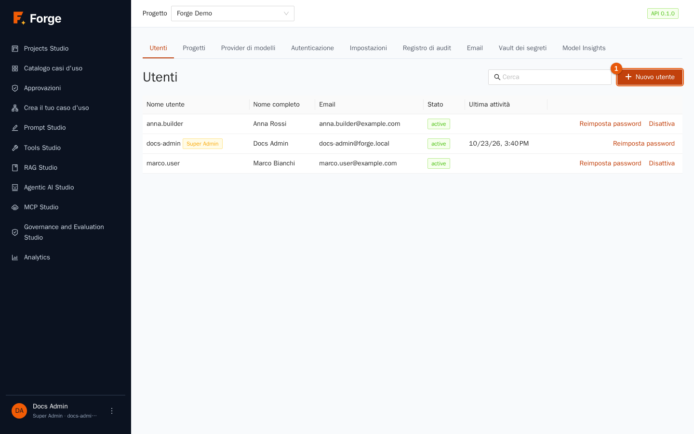

La tabella elenca ogni account con **Nome utente**, **Nome completo**, **Email**, **Stato** e **Ultima attività**. Usa **Cerca** per filtrare. Le persone che accedono con LDAP o OpenID Connect compaiono qui automaticamente dopo il primo accesso.

### Creare un utente

1. Premi **Nuovo utente** (indicatore 1).

   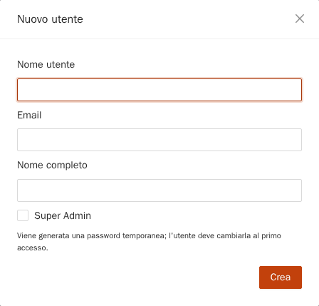

2. Compila **Nome utente**, **Email** e **Nome completo**. Spunta **Super Admin** solo per gli amministratori della piattaforma (poi compare come etichetta arancione).
3. Premi **Crea**. Un avviso verde mostra una **password temporanea, una sola volta**. Inviala alla persona con un canale sicuro; al primo accesso dovrà cambiarla, accettare le condizioni d'uso e, se richiesto, attivare l'autenticazione a due fattori (capitolo 1).

### Altre azioni su un utente

| Azione | Effetto |
| --- | --- |
| **Sblocca** (mostrata solo per un account bloccato) | Rimuove il blocco temporaneo dopo troppe password sbagliate (vedi *Blocco account* nelle impostazioni). |
| **Reimposta password** | Genera una nuova password temporanea (mostrata una sola volta); l'utente deve cambiarla al prossimo accesso. |
| **Disattiva** / **Attiva** | Un utente disattivato non può accedere e le sue sessioni vengono chiuse; non si cancella nulla, quindi lo storico resta completo. |
| **Super Admin** (etichetta arancione accanto al nome utente) | Segna gli amministratori della piattaforma. Si imposta alla creazione dell'utente. Non puoi disattivare il tuo stesso account. |

Gli utenti non si possono eliminare, solo disattivare, per mantenere significativa la traccia di audit. Aggiungere una persona a un progetto è un compito del **Project Admin** (capitolo 2).

## 11.2 Progetti

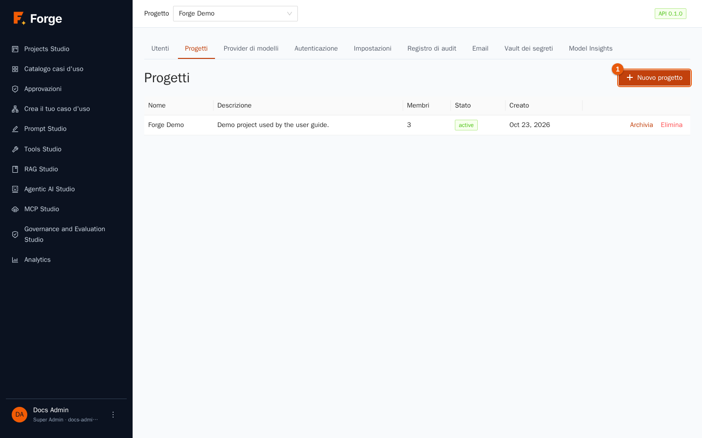

La tabella mostra ogni progetto con **Nome**, **Descrizione**, **Membri**, **Stato** e **Creato**.

### Creare un progetto

1. Premi **Nuovo progetto** (indicatore 1).

   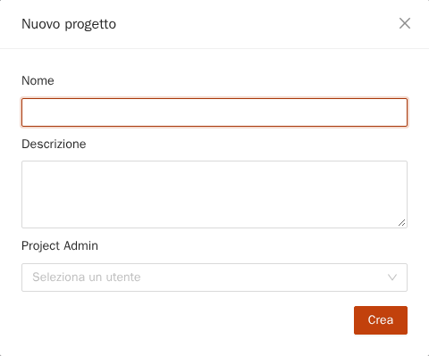

2. Scrivi il **Nome** e la **Descrizione**.
3. Scegli il **Project Admin**: l'utente (**Seleziona un utente**) che gestirà il progetto. Viene aggiunto con il ruolo *Project Admin*.
4. Premi **Crea**. L'avviso mostra anche un **Token del progetto, una sola volta**: un token API con gli ambiti predefiniti, per le prime integrazioni. Conservalo o revocalo più tardi (capitolo 2).

Poi abilita i modelli della piattaforma per il progetto (sezione 11.3) e chiedi al Project Admin di invitare il team.

### Archiviare, ripristinare, eliminare

- **Archivia** mette un progetto fuori uso ma ne conserva i dati. **Ripristina** lo riporta in uso.
- **Elimina** (con un **Motivo** obbligatorio) rimuove il progetto, i suoi dati e le sue operazioni, e i membri perdono subito l'accesso. È **irreversibile** ed è registrato nel registro di audit. Preferisci *Archivia* se non sei certo.

## 11.3 Provider di modelli (a livello di piattaforma)

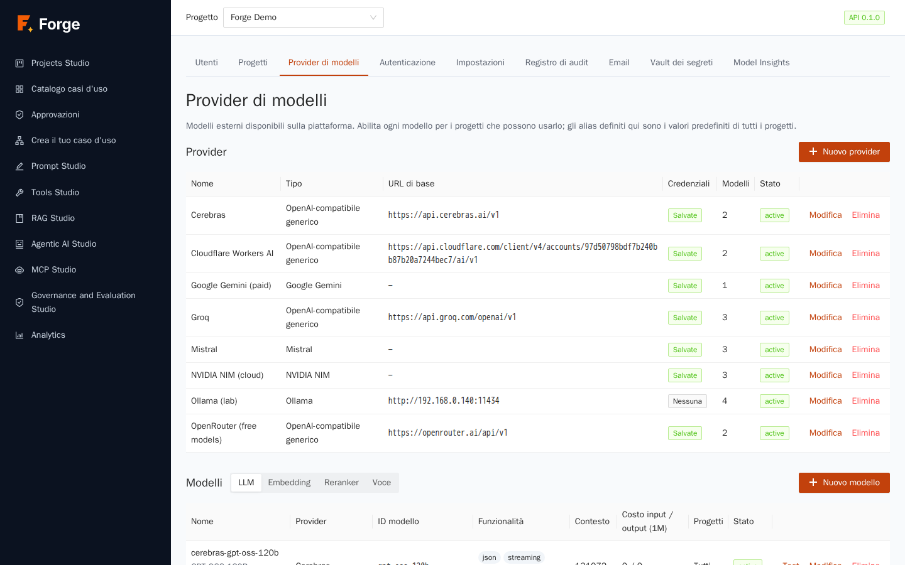

Questa pagina è il **registro della piattaforma** dei provider di modelli esterni, dei modelli e degli alias. Funziona esattamente come la pagina a livello di progetto descritta nel capitolo 2, con due differenze:

- ciò che crei qui è **condiviso** (l'ambito *Piattaforma*) e può essere usato dai progetti;
- ogni modello ha **Abilitato per tutti i progetti** oppure un elenco di **Progetti abilitati**: *un progetto può usare un modello della piattaforma solo se lo hai abilitato per quel progetto*. È il controllo che decide chi può usare quale provider, e quindi chi paga cosa.

Gli **alias** definiti qui (per esempio `default-chat`, `fast`, `embedding`, `guard`, `rerank`) sono i **predefiniti di ogni progetto**; un Project Admin può sostituirne uno creando un alias di progetto con lo stesso nome. Mantieni funzionanti i nomi standard degli alias: prompt, RAG, agenti, memoria a lungo termine e guardrail vi si riferiscono.

Le credenziali dei provider sono memorizzate cifrate e non vengono più mostrate (sezione 11.8). Usa **Test connessione** prima di abilitare un modello.

> **Buona pratica.** Registra i modelli con i loro **prezzi** reali: Analytics e i limiti di costo ne dipendono. Abilita prima per un progetto pilota, osserva, poi allarga.

## 11.4 Autenticazione

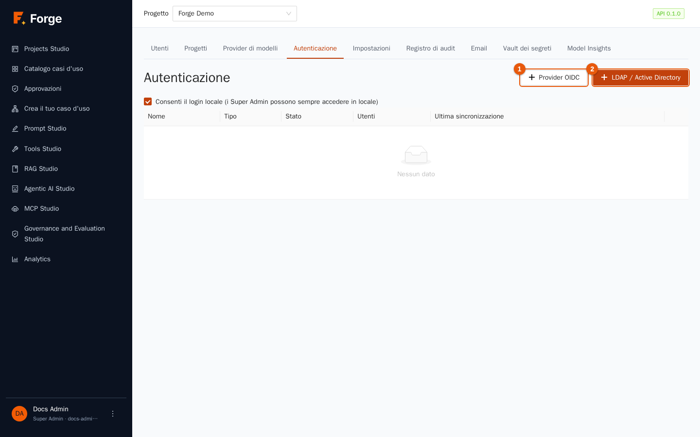

Forge supporta sempre gli **account locali**. Per le aziende può anche far accedere le persone con **LDAP / Active Directory** (nome utente e password verificati sulla directory) e **OpenID Connect** (un pulsante «Accedi con…» per il tuo identity provider, per esempio Microsoft Entra ID, Keycloak, Okta, Google). Usa **Nuovo provider** per aggiungerne uno (i pulsanti **Provider OIDC** e **LDAP / Active Directory** scelgono il tipo).

In alto, **Consenti il login locale (i Super Admin possono sempre accedere in locale)** permette di spegnere le password per tutti tranne i Super Admin quando un provider esterno funziona. Non si può spegnere finché nessun provider è attivo.

### LDAP / Active Directory

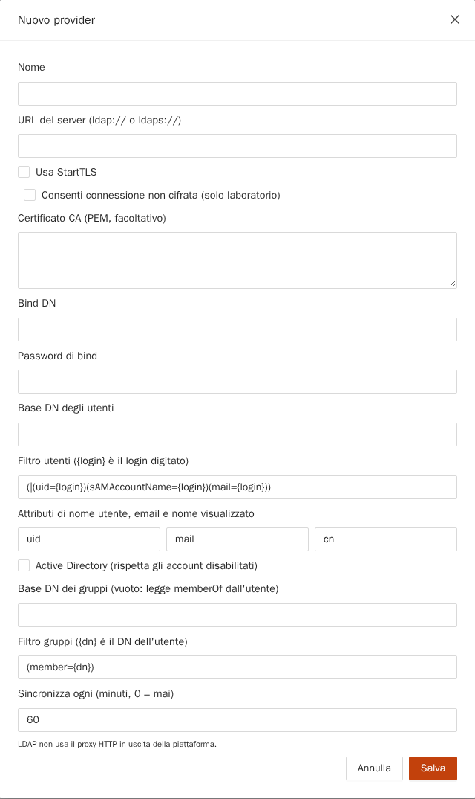

| Campo | Significato |
| --- | --- |
| **Nome** | Mostrato nell'elenco. |
| **URL del server** | Indirizzo `ldap://` o `ldaps://`. Preferisci `ldaps://` o **Usa StartTLS**. **Consenti connessione non cifrata (solo laboratorio)** serve per i test: mai in produzione. |
| **Certificato CA (PEM, facoltativo)** | Il certificato dell'autorità della tua directory, se non è pubblica. |
| **Bind DN** / **Password di bind** | Un account di servizio che può cercare nella directory. La password è memorizzata cifrata. |
| **Base DN degli utenti**, il filtro utente | Dove cercare gli utenti e come trovarne uno dal login digitato (`{login}` viene sostituito). |
| **Attributi di nome utente, email e nome visualizzato** | Gli attributi della directory da usare (`uid`, `mail`, `cn`, oppure `sAMAccountName`…). |
| **Active Directory (rispetta gli account disabilitati)** | Spunta per AD, così gli account disabilitati non possono accedere. |
| **Base DN dei gruppi**, il filtro dei gruppi | Dove sono i gruppi; lascia vuota la base per leggere `memberOf` dall'utente. |
| **Sincronizza ogni (minuti, 0 = mai)** | Ogni quanto Forge legge l'intera directory per applicare le modifiche ai gruppi e disattivare chi se n'è andato. |

Le connessioni LDAP non usano il proxy HTTP della piattaforma; per l'ispezione TLS usa il campo della CA.

### OpenID Connect

Compila **Nome**, **URL dell'issuer**, **Client ID**, **Client secret** (memorizzato cifrato), **Ambiti**, i **Claim** che portano nome utente, email, nome e gruppi, e l'**Etichetta del pulsante** mostrata nella pagina di accesso. Registra l'indirizzo di callback di Forge nel tuo identity provider come indicato dal provider. *Consenti issuer http:// (solo laboratorio)* serve per i test.

### Prova, sincronizza, gruppi

Nella riga del provider: **Prova** verifica la connessione; **Prova utente** cerca un utente (per nome utente o email) senza farlo accedere, così controlli attributi e gruppi; **Sincronizza ora** esegue la sincronizzazione della directory (un avviso riporta utenti visti, aggiunti, rimossi, disattivati); **Gruppi** apre le mappature; **Modifica**, **Attiva / Disattiva** ed **Elimina** gestiscono il provider.

### Mappatura dei gruppi: dai gruppi della directory ai ruoli di progetto

Nessuno ottiene accesso a nulla solo per essere nella directory. Le **mappature** collegano un gruppo della directory a un **progetto e a un Nome ruolo**. Nella finestra aperta da **Gruppi**:

1. Apri **Gruppi** sul provider.
2. Compila **DN o nome del gruppo** (il **Gruppo esterno**), scegli il **Progetto** e il **Nome ruolo** (capitolo 2) e premi **Aggiungi**.

A ogni accesso e sincronizzazione, Forge dà a ogni utente, per ogni progetto, il **ruolo di rango più alto** tra i gruppi che possiede, creando, aggiornando o rimuovendo le appartenenze che ha creato (appartenenze *mapped*). Le appartenenze aggiunte a mano da un Project Admin non vengono mai toccate. Un utente senza gruppi mappati può accedere ma non vede alcun progetto. Se una voce della directory ha la stessa email o lo stesso nome utente di un account locale esistente, l'accesso viene **rifiutato** e si registra un evento di audit: gli account non vengono mai uniti automaticamente, quindi un attributo della directory non può impossessarsi di un account locale.

## 11.5 Impostazioni

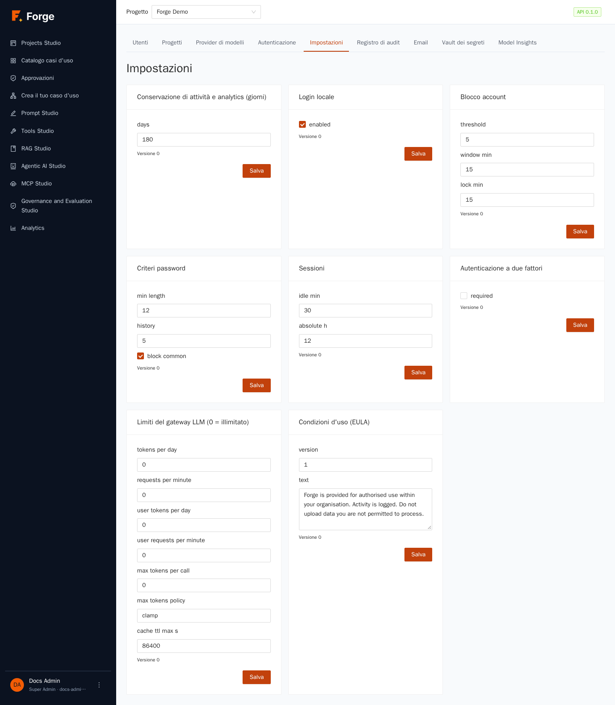

Ogni scheda si salva separatamente e viene **applicata senza riavvio** («Salvato; applicato senza riavvio»). I nomi dei campi sono mostrati come sono memorizzati (in inglese).

| Scheda | Impostazioni |
| --- | --- |
| **Criteri password** | *min length* (lunghezza minima, 12 di default), *history* (quante password precedenti non si possono riusare, 5), *block common* (rifiuta le password più comuni). |
| **Blocco account** | *threshold* (tentativi falliti, 5), *window min* (entro quanti minuti, 15), *lock min* (per quanto tempo l'account resta bloccato, 15). |
| **Sessioni** | *idle min* (disconnessione dopo questa inattività, 30) e *absolute h* (durata massima della sessione qualunque sia l'attività, 12). |
| **Autenticazione a due fattori** | *required*: se attiva, ogni utente deve attivare un'app di autenticazione al prossimo accesso. |
| **Login locale** | *enabled*: vedi sezione 11.4. |
| **Condizioni d'uso (EULA)** | La *version* e il *text* che le persone devono accettare all'accesso. **Aumenta la versione** per far accettare di nuovo a tutti. |
| **Limiti del gateway LLM (0 = illimitato)** | Tetti della piattaforma per progetto: *tokens per day*, *requests per minute*, gli stessi per utente, *max tokens per call*, la *max tokens policy* (*clamp* o *reject*) e il *cache ttl max* della cache. I Project Admin possono solo stare **sotto** questi valori (capitolo 2). |
| **Conservazione di attività e analytics (giorni)** | La finestra mostrata dal registro attività e da Analytics (da 1 a 3650, predefinito 180). Non si cancella nulla: è una finestra di lettura. |

## 11.6 Registro di audit

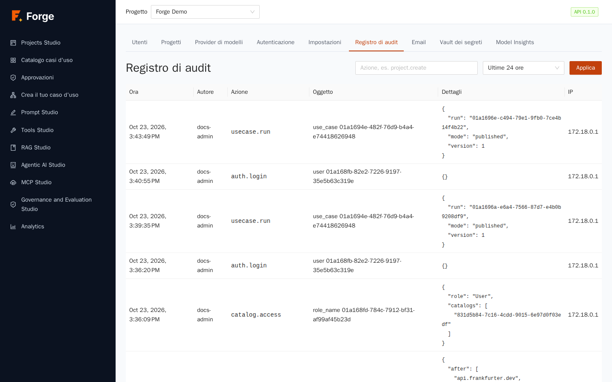

Il **registro di audit** è la **traccia di sicurezza completa** della piattaforma: accessi e fallimenti, modifiche a utenti e progetti, modifiche a ruoli e appartenenze, segreti e impostazioni, modifiche a modelli e provider, caricamenti ed eliminazioni di documenti, pubblicazioni e altro. È di sola aggiunta: nessuno può modificare o cancellare le voci.

Colonne: **Ora**, **Autore**, **Azione** (un codice come `project.create`), **Oggetto**, **Dettagli** e **IP**. Filtra con la casella **Azione** (per esempio `project.create`, `auth.login_failed`) e il periodo (**Ultime 24 ore**, **7 giorni**, **30 giorni**) e premi **Applica**. Segreti e prompt non vengono mai scritti nel registro; nomi e id sì.

Usalo per rispondere a *chi ha fatto cosa, quando e da dove*, per la revisione degli incidenti e per la conformità.

## 11.7 Email

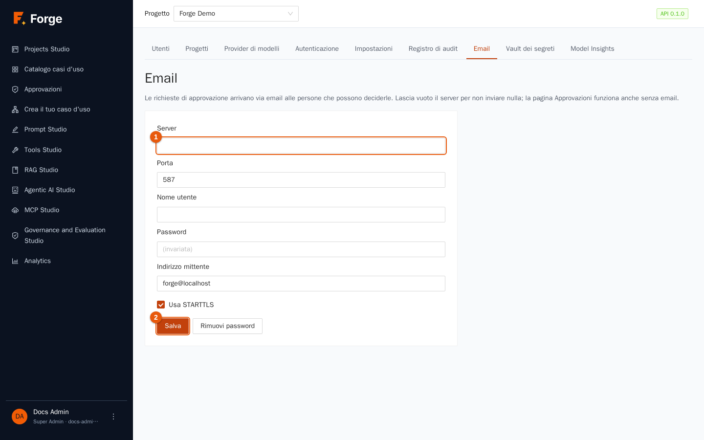

Forge invia **email solo per le richieste di approvazione** (capitolo 7): le persone che possono decidere ricevono un messaggio con un link monouso. Senza email la pagina **Approvazioni** continua a funzionare; le persone semplicemente non vengono avvisate.

Compila **Server** (e **Porta**), **Nome utente**, **Password**, **Indirizzo mittente** e **Usa STARTTLS**, poi **Salva**. Lascia vuoto il server per non inviare nulla. **Rimuovi password** cancella quella memorizzata. **Invia un messaggio di prova** a un indirizzo per verificare la configurazione; l'avviso dice *Messaggio inviato* o mostra l'errore. I valori che arrivano dall'ambiente del server (`FORGE_SMTP_*`) sono usati finché non salvi qui, e salvare qui li sostituisce. La password è memorizzata cifrata e mostrata come *(invariata)*.

## 11.8 Vault dei segreti

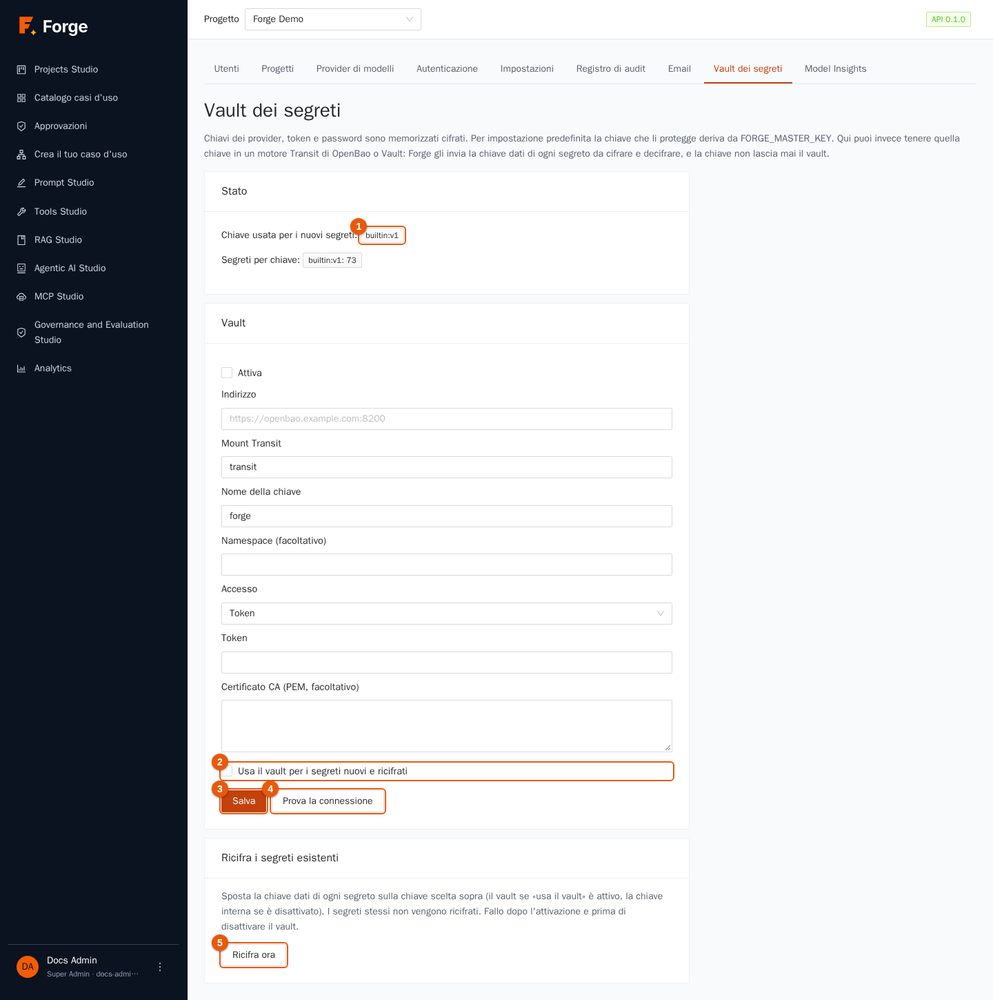

Ogni segreto di Forge (chiavi dei provider, credenziali degli strumenti, password dei database, segreti LDAP e OIDC, segreti dei webhook) è memorizzato **cifrato**. Ogni segreto ha una propria chiave dati; le chiavi dati sono protette da una **chiave principale (KEK)**. Per impostazione predefinita la KEK deriva dal `FORGE_MASTER_KEY` dell'installazione. Qui puoi invece tenere la KEK in un **motore *Transit* di OpenBao o HashiCorp Vault**, così la chiave che protegge tutto non sta mai nella configurazione di Forge, e ottieni l'audit e la rotazione propri del vault.

In alto vedi lo **Stato** (indicatore 1): la **Chiave usata per i nuovi segreti** (interna o la chiave del vault) e **Segreti per chiave** (quanti segreti stanno sotto ciascuna chiave).

### Attivare il vault

1. In **Vault** compila **Indirizzo** (l'URL del vault), **Mount Transit** e **Nome della chiave** (crea prima la chiave Transit nel vault; una chiave semplice `aes256-gcm96`), un **Namespace** facoltativo e l'**Accesso**: un **Token**, oppure un **AppRole** (**Role id** e **Secret id AppRole**). Aggiungi il **Certificato CA (PEM, facoltativo)** del vault se serve. Lascia vuoti i campi della credenziale per mantenere quella memorizzata.
2. Premi **Salva** (indicatore 3). Forge verifica le impostazioni con un **vero giro di andata e ritorno** prima di accettarle. **Prova la connessione** (indicatore 4) ripete la verifica in qualsiasi momento.
3. Spunta **Usa il vault per i segreti nuovi e ricifrati** (indicatore 2) e salva.
4. Premi **Ricifra ora** sotto **Ricifra i segreti esistenti** (indicatore 5): sposta la chiave dati di ogni segreto esistente sotto la chiave del vault. I segreti stessi non vengono ricifrati.

### Regole da conoscere

- Se il vault è **irraggiungibile**, i segreti protetti da esso non si possono leggere (le chiamate falliscono con *vault non disponibile*): Forge non ripiega mai su una chiave più debole. Esegui il vault in alta affidabilità.
- `FORGE_MASTER_KEY` **resta obbligatoria**: protegge la credenziale del vault stesso ed è la via del ritorno.
- **Per spegnere il vault**: prima smetti di usarlo (togli la spunta) e **ricifra** tutto sulla chiave interna; Forge rifiuta di disattivarlo finché dei segreti dipendono da esso.
- La rotazione della chiave Transit dentro il vault è trasparente. Per ruotare la credenziale di accesso: incolla qui la nuova.

## 11.9 Model Insights

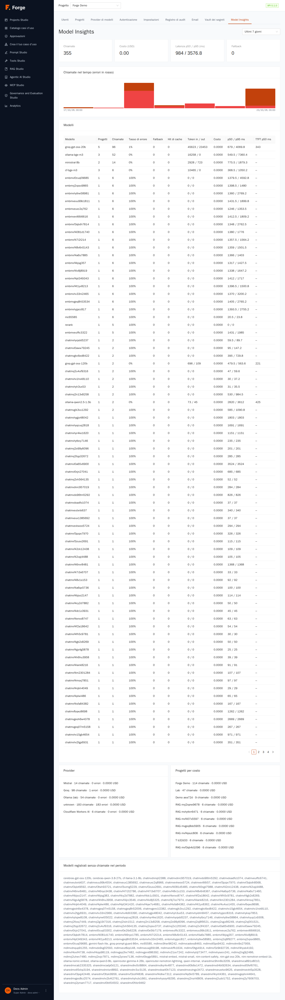

Il gemello a livello di piattaforma della dashboard di progetto: l'uso di **ogni modello in tutti i progetti**, su **Ultime 24 ore / 7 / 30 / 90 giorni**. Trovi il grafico **Chiamate nel tempo**, la tabella **Modelli** (**Progetti** che lo usano, **Chiamate**, **Tasso di errore**, **Fallback**, **Hit di cache**, **Token in / out**, **Costo**, **p50 / p95 ms**, **TTFT p50 ms**), i **Provider** con chiamate ed errori, i **Progetti per costo** e i **Modelli registrati senza chiamate nel periodo**, un elenco comodo di modelli che puoi ritirare. Usalo per decidere quali modelli tenere, quale provider è inaffidabile e quale progetto genera il costo.

## 11.10 Attività di routine

| Quando | Cosa fare |
| --- | --- |
| Parte un nuovo progetto | Crea il progetto (11.2) → abilita i modelli giusti della piattaforma (11.3) → mappa i gruppi della directory (11.4) o chiedi al Project Admin di invitare le persone. |
| Qualcuno se ne va | Disattiva il suo account (11.1); con LDAP/OIDC lo fa la sincronizzazione. Controlla i token del progetto (capitolo 2). |
| Un utente è bloccato | **Sblocca** (11.1) o **Reimposta password**. |
| Rotazione di una chiave di provider | Modifica il provider (11.3), scrivi la nuova chiave. |
| Ogni trimestre | Rivedi i Super Admin, il registro di audit delle azioni sensibili, i modelli senza chiamate (11.9) e l'elenco dei progetti (archivia quelli morti). |

## 11.11 Risoluzione dei problemi

| Sintomo | Causa e rimedio |
| --- | --- |
| Un utente accede ma non vede alcun progetto | Nessuna mappatura corrisponde ai suoi gruppi e nessuno l'ha aggiunto a mano. Usa **Prova utente** per vedere i suoi gruppi, poi aggiungi la mappatura o invitalo. |
| L'accesso LDAP fallisce per tutti | Controlla **Prova** sul provider: indirizzo del server, TLS/CA, account di bind. Ricorda che i Super Admin possono ancora accedere in locale. |
| Un utente della directory viene rifiutato dopo un cambio di email | La sua email o il suo nome utente ora corrisponde a un altro account: il conflitto è nel registro di audit; risolvilo a mano. |
| «Il login locale non si può spegnere» | Nessun provider esterno è attivo; attivane uno prima. |
| Un progetto non vede un modello della piattaforma | Il modello non è abilitato per quel progetto (11.3). |
| I segreti non si leggono dopo un'interruzione del vault | Il vault deve tornare; non provare a disattivarlo finché dei segreti ne dipendono (11.8). |
| Le modifiche alle impostazioni sembrano ignorate | Ogni scheda ha il proprio **Salva**; cerca *Salvato; applicato senza riavvio*. |

Prossimo: [12. Installare e gestire Forge](12-operazioni.md)
