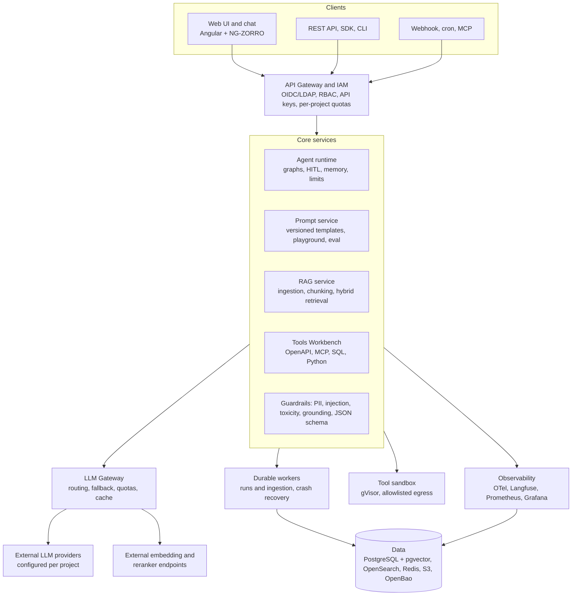
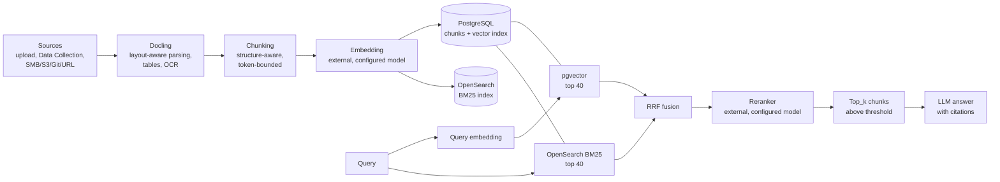

# Forge: platform specification

_Version: 2026-10-16_

- [Part 1 – Core platform specification](#part-1--core-platform-specification)
- [Part 2 – Functional specification](#part-2--functional-specification)

---

# Part 1 – Core platform specification

## Goal and scope

Build a self-hosted, LLM-agnostic platform to create and run agents, RAG pipelines and governed prompts, with multi-tenancy and observability. This document covers the core platform only, without vertical modules.

**Fixed technology choices**

- Backend: Python
- Frontend: Angular + NG-ZORRO ([ADR-017](adr/017-ng-zorro-angular-22.md))
- Database: PostgreSQL (also used for vectors and full-text search)
- Models: all LLM, embedding, reranker and guard/classifier models are external services, configured in the platform; Forge does not host or run any of them. Small CPU models bundled as libraries (Docling layout/OCR, spaCy NER for Presidio) run in-process ([ADR-013](adr/013-guardrail-models.md))
- Configuration: everything is configured from the GUI and stored in PostgreSQL; the `.env` file holds only the initial admin user and the minimum needed to boot (see [Configuration and bootstrap](#configuration-and-bootstrap))

**In scope**

- Multi-provider LLM gateway towards external, configurable models
- Prompt Builder and versioned Prompt Library
- RAG Builder (ingestion, chunking, embedding, retrieval)
- Tools Workbench (HTTP/OpenAPI connectors, MCP, scripts)
- Agentic Studio (agents and multi-step workflows)
- Input/output guardrails
- Observability, token and cost analytics
- IAM: local users, LDAP/OIDC, RBAC, projects as tenants
- Headless API and web UI

**Out of scope**

- Vertical modules: Software, Software.Mod, ITOps, Data, SAP, Oracle, Pega, Coding Agents
- IDE extensions, AI PC/edge deployment, voice input (possible phase 2)
- Model hosting, serving, training or fine-tuning

**Principles**

- API-first: the UI uses only the public APIs.
- GUI-first configuration: no YAML or config files to edit after install; every setting has a screen in the Admin Console or in the workspace settings.
- Every resource (prompt, agent, pipeline, tool) is versioned and belongs to a project.
- Models are external and pluggable: any provider is added, changed or removed from configuration, without code changes or restarts.
- No mandatory cloud dependency: Forge works air-gapped when the configured model endpoints are on-premises.
- Every LLM call and every tool call is traced and auditable.

## Logical architecture

All clients go through a single API gateway with IAM. The core services share one guardrail pipeline and reach models only through the LLM Gateway.



The Agent runtime orchestrates the other core services. Long runs and ingestion execute on durable workers. Every component emits traces to the observability stack.

## Functional requirements

### F1. LLM Gateway

1. All models are external: Forge only calls them. Supported provider types:

    | Provider type | Endpoint | Notes |
    | --- | --- | --- |
    | vLLM (remote) | `http(s)://host:port/v1` | OpenAI-compatible; chat, embeddings, rerank (`/v1/rerank`) |
    | llama.cpp server (remote) | `http(s)://host:port/v1` | OpenAI-compatible `llama-server`; chat and embeddings |
    | NVIDIA NIM (remote) | Self-hosted NIM URL or `integrate.api.nvidia.com/v1` | OpenAI-compatible LLM NIM; NeMo Retriever NIM for embedding and reranking |
    | Ollama (remote) | `http(s)://host:11434` | Native or OpenAI-compatible API |
    | OpenAI, Azure OpenAI | Cloud | Azure: deployment name and API version |
    | Anthropic, AWS Bedrock, Google Gemini/Vertex, Mistral | Cloud | Native APIs via LiteLLM |
    | Generic OpenAI-compatible | Any URL | For any other server (TGI, LM Studio, SGLang…) |

    Every provider is remote: Forge only stores the endpoint and credentials.
2. Model configuration (UI and API), per platform or per project:

    | Field | Notes |
    | --- | --- |
    | Display name, logical alias | Alias used by prompts, agents and RAG |
    | Type | Chat, Embedding, Reranker, Speech, Guard (classifier, ADR-013) |
    | Provider type | One of the supported types above |
    | Base URL | Endpoint, including on-prem or private network |
    | Credentials | API key or cloud credentials, stored in the vault, write-only |
    | Model ID | Provider-side model name |
    | Extra headers / parameters | Optional (API version, deployment name, region) |
    | Context window, max output tokens | Used for limits and context budgeting |
    | Embedding dimensions | Embedding models only |
    | Costs | Input/output per 1M tokens, for cost tracking |
    | Capabilities | Tool calling, vision, JSON mode, streaming |
    | Timeout, retries, rate limit | Per model |
    | Enabled projects | Which projects may use the model |

    A Test Connection button sends a minimal request before saving. Changes apply immediately, without restarts.
3. Single OpenAI-compatible `POST /v1/chat/completions` API, with SSE streaming.
4. Alias routing (`default-chat`, `fast`, `embedding`) configurable per project.
5. Ordered fallback on error or timeout; retries with exponential backoff.
6. Per-project and per-user limits: tokens/day, requests/minute, `max_tokens` per call.
7. Optional semantic cache (prompt + parameter hash) with TTL.
8. Provider secrets encrypted at rest, never returned by the APIs.

### F2. Prompt Builder and Library

1. Templates with typed variables (sandboxed Jinja2), system/user/assistant, few-shot.
2. Immutable versioning: every save creates a version; tags `draft`, `staging`, `prod`.
3. Playground: side-by-side runs on 2–4 models with the same inputs, comparing output, latency, tokens and cost.
4. Test datasets per prompt and batch runs with evaluators (exact match, regex, JSON schema, LLM-as-judge).
5. Shared library at project and global level, with search and cloning.

### F3. RAG Builder

1. Sources: file upload (PDF, DOCX, PPTX, XLSX, HTML, MD, TXT), SMB/NFS folders, S3/MinIO, Git, URL/crawler, databases via SQL, REST APIs.
2. Configurable pipeline: parsing → cleaning → chunking (fixed, recursive, by heading, semantic) → embedding → indexing.
3. Per-chunk metadata: source, path, page, date, ACLs inherited from the source.
4. Hybrid retrieval (vector + BM25) with RRF fusion, optional re-ranking (cross-encoder), metadata filters. See [RAG design](#rag-design) for the concrete pipeline.
5. Scheduled incremental re-sync (content hash) and propagated deletion.
6. Answers with citations: every RAG answer returns the chunks used, linked to the source.
7. Evaluation: question/expected-answer datasets, recall@k, faithfulness, answer relevance.

### F4. Tools Workbench

1. Tool types: HTTP (from an imported OpenAPI spec), MCP client (stdio and HTTP/SSE), sandboxed Python functions, read-only parameterized SQL queries, RAG retriever as a tool.
2. Each tool has a JSON input/output schema, timeout, per-project credentials, `requires_approval` flag.
3. Test a tool from the UI with sample input and a call log.
4. Minimum built-in connectors: ticketing (Jira, ServiceNow, GLPI), Git (GitHub/GitLab), chat (Slack, Teams), monitoring (Zabbix, Prometheus), email (SMTP/IMAP).

### F5. Agentic Studio

1. Agent = system prompt + model + tools + knowledge base + memory + guardrail policy.
2. Execution patterns: ReAct/tool-calling loop, plan-and-execute, router, multi-agent (supervisor → workers).
3. Graph workflow builder (nodes: LLM, tool, agent, condition, loop, parallel, human approval, code) with a visual editor and a definition exportable as YAML/JSON.
4. Execution limits: max steps, max tokens, total timeout, cost budget per run.
5. Human-in-the-loop: pause on an approval node or on a `requires_approval` tool, resume via UI or API.
6. Memory: conversational (window or summary) and long-term per agent/user on a vector store.
7. Triggers: chat, API, webhook, cron schedule, queue event.
8. Reproducible runs: every run stores inputs, prompt/agent/tool versions and all steps.
9. Catalog of reusable agents and templates, importable and exportable.

### F6. Guardrails

1. Applied as a pipeline on input, output and tool-call arguments; configurable per project and per agent.
2. Checks: PII detection and masking (Presidio), prompt injection and jailbreak, toxicity, banned topics (list + classifier), malicious links and URLs, secret leakage (key/token regex), JSON schema validation.
3. Grounding check for RAG: verify the answer is supported by the cited chunks.
4. Per-rule actions: `log`, `mask`, `block`, `rewrite`, `escalate`.
5. Every intervention is logged with rule, score and action.

### F7. Observability and analytics

1. End-to-end tracing per run: spans for each LLM call, retrieval, tool and guardrail (OpenTelemetry).
2. For each LLM call: model, tokens in/out, latency, TTFT, cost, outcome.
3. Dashboards: usage per project/user/model, costs, errors, p50/p95 latency, guardrail interventions, adoption.
4. User feedback (thumbs up/down + comment) linked to the trace.
5. Prometheus metrics export and structured JSON logs.
6. Immutable audit log of all administrative actions.

### F8. Tenancy and IAM

1. Hierarchy: Organization → Project (logical tenant) → resources.
2. Authentication: built into Forge. Local users (password + TOTP), LDAP/AD and OIDC (Entra ID, Keycloak, Google, any OIDC provider), all configured from the GUI; no external identity server is required.
3. Base roles: Org Admin, Project Admin, Builder, Operator, User, Viewer; fine-grained permissions per resource type.
4. LDAP/OIDC group → project role mapping.
5. Per-project data isolation in the DB (row-level security) and separate or tenant-filtered vector indexes.
6. Per-project API keys with scopes and expiry.

### F9. APIs and interfaces

1. REST + OpenAPI 3.1 for all resources; OpenAI-compatible endpoints for chat and embeddings.
2. Agent invocation: synchronous, streaming (SSE) and asynchronous (job id + completion webhook).
3. Python SDK and CLI for importing/exporting resources (GitOps).
4. Web UI (Angular + NG-ZORRO): chat, agent/workflow studio, prompt playground, RAG builder, tools, dashboards, administration.
5. Embeddable chat widget and an exposed MCP server to use agents from external clients.

## Data model

Every entity has `id` (UUIDv7), `project_id`, `created_at`, `created_by`. Versioned resources have an immutable `*_versions` table.

| Entity | Key fields | Notes |
| --- | --- | --- |
| organization | name, settings | Root |
| project | org_id, name, quotas, default_models | Logical tenant |
| user / group | email, auth_source, ldap_dn | Synced from LDAP/OIDC |
| role_binding | subject, project_id, role | RBAC |
| api_key | project_id, scopes, hash, expires_at | Only the hash is stored |
| provider | type, base_url, secret_ref | Secret in vault |
| model | provider_id, name, alias, ctx_len, costs, capabilities | Model registry |
| prompt / prompt_version | template, variables, model_params, tag | Immutable per version |
| knowledge_base | embedding_model, chunking, index_name | One KB = one index |
| source | kb_id, type, config, schedule, last_sync | Data connector |
| document / chunk | source_id, hash, acl, metadata, vector | Chunks in pgvector |
| tool / tool_version | type, schema_in, schema_out, auth_ref, requires_approval | |
| agent / agent_version | prompt_ref, model_alias, tools, kb_refs, guardrail_policy, limits | |
| workflow / workflow_version | graph (JSON), triggers | DAG with bounded cycles |
| guardrail_policy | rules[] (type, threshold, action, stage) | Per project/agent |
| run / run_step | trigger, status, inputs, outputs, tokens, cost, trace_id | Partitioned by month |
| approval | run_id, step_id, approver, decision | Human-in-the-loop |
| feedback | run_id, rating, comment | |
| audit_event | actor, action, target, diff | Append-only |

## Non-functional requirements

**Security**

- TLS 1.3 on all external traffic; optional mTLS between services.
- Secrets (API keys, LDAP bind password, OIDC client secret, SMTP password) encrypted in PostgreSQL with AES-256-GCM, using the master key from `.env`; optional external vault (OpenBao/Vault) configurable from the GUI.
- Data encrypted at rest at volume level, encrypted backups.
- Python code and tools run in an isolated sandbox (gVisor or Firecracker), with no network except via allowlist.
- HTTP tool egress only to allowlisted domains per project.
- Append-only audit log retained for at least 1 year.
- Security headers, CSRF, login rate limiting, lockout after failed attempts.

**Performance (MVP targets, LLM time excluded)**

- Gateway overhead under 50 ms p95.
- Hybrid retrieval under 300 ms p95 on 1M chunks.
- 200 concurrent agent runs per worker node.
- Ingestion of at least 50 pages/s per worker on text documents.

**Reliability**

- Stateless services, horizontally scalable; state only in PostgreSQL, Redis, object storage.
- Durable agent runs: resume from the last completed step after a worker crash.
- PostgreSQL backups with PITR; RPO 15 min, RTO 1 h.

**Deployment**

- Docker Compose for single node and lab.
- Helm chart for Kubernetes (k3s, RKE2, OpenShift).
- Air-gapped install with a local container registry; model endpoints must be reachable from the Forge network.
- Application configuration lives in the database and is edited from the GUI; `.env` holds only bootstrap values. No mandatory SaaS dependency.

## Proposed technology stack

Python backend, Angular + NG-ZORRO frontend, PostgreSQL as the system of record and OpenSearch for BM25 full-text search ([ADR-016](adr/016-external-bm25-opensearch.md)). Everything is open source and self-hostable.

| Layer | Choice | Alternative |
| --- | --- | --- |
| API backend | Python 3.12, FastAPI, Pydantic v2, SQLAlchemy 2 (async), Alembic | Litestar |
| LLM gateway | LiteLLM as a library inside the gateway | Custom adapters |
| Agent orchestration | LangGraph (graph, checkpoints in PostgreSQL, HITL) | Pydantic AI + custom engine |
| Durable jobs | Temporal (PostgreSQL persistence) | Celery + Redis |
| Database | PostgreSQL 16+ with RLS for tenant isolation | — |
| Vector search | pgvector (HNSW indexes) | pgvectorscale (DiskANN) for very large corpora |
| Full-text search | OpenSearch (BM25, Apache-2.0; [ADR-016](adr/016-external-bm25-opensearch.md)) | Native PostgreSQL FTS (`tsvector`, `ts_rank_cd`) |
| Cache and queues | Redis / Valkey | NATS |
| Object storage | MinIO (S3) | Ceph RGW |
| Document parsing | Docling | Unstructured |
| Model access | External endpoints only, through the LLM gateway (LiteLLM) | — |
| Recommended embedding / reranker | bge-m3, bge-reranker-v2-m3 (served outside Forge, e.g. TEI) | Any configured embedding / rerank API |
| Guardrails | Presidio, Llama Guard / Prompt Guard, custom rules | NeMo Guardrails |
| Code sandbox | gVisor (runsc) | Firecracker |
| Secrets | AES-256-GCM in PostgreSQL (master key in `.env`) | OpenBao / Vault, configurable from the GUI |
| IAM | Built-in: Argon2id passwords, TOTP (pyotp), LDAP (ldap3), OIDC (Authlib), JWT sessions | External OIDC provider (Keycloak, Entra ID) configured from the GUI |
| Observability | OpenTelemetry → Langfuse (LLM traces) + Prometheus/Grafana + Loki | Arize Phoenix |
| Frontend | Angular 22+ (standalone components, signals), NG-ZORRO, Ant Design icons | — |
| Workflow graph editor | Foblex Flow (Angular-native node editor) | ngx-vflow |
| Code / prompt editor | ngx-monaco-editor | CodeMirror 6 |
| API client | OpenAPI-generated TypeScript client (openapi-generator, Angular) | Hand-written services |
| Packaging | Docker Compose, Helm | — |

## RAG design

Proposed RAG implementation, entirely on PostgreSQL. The UI exposes the same parameters as RAG Studio (Part 2); the values below are the defaults.



**Ingestion**

| Step | Choice | Default |
| --- | --- | --- |
| Parsing | Docling: PDF, DOCX, PPTX, XLSX, HTML, MD, images (OCR); keeps headings, tables, page numbers | Tables exported as Markdown |
| Chunking | Structure-aware: split by heading, then recursive by paragraph/sentence within a token limit | Chunk Size 512 tokens, Overlap 64 (12.5%) |
| Context enrichment | Prefix each chunk with document title + heading path before embedding | On |
| Embedding | The knowledge base's configured embedding model (external). Recommended: bge-m3, multilingual, 1024 dims | Batch 32 |
| Deduplication | SHA-256 per chunk; unchanged chunks are not re-embedded on re-sync | On |
| Re-sync | Scheduled job compares document hashes; deleted documents cascade to chunks | Every 24 h |

**Storage (PostgreSQL)**

```sql
CREATE TABLE rag_chunk (
    id            uuid PRIMARY KEY,
    project_id    uuid NOT NULL,
    kb_id         uuid NOT NULL,
    document_id   uuid NOT NULL,
    ordinal       int  NOT NULL,
    content       text NOT NULL,
    heading_path  text,
    page          int,
    metadata      jsonb NOT NULL DEFAULT '{}',
    acl_groups    text[] NOT NULL DEFAULT '{}',
    content_hash  bytea NOT NULL,
    embedding     vector NOT NULL  -- dimension fixed per knowledge base
);

-- vector search
CREATE INDEX rag_chunk_hnsw ON rag_chunk
    USING hnsw (embedding vector_cosine_ops) WITH (m = 16, ef_construction = 128);

-- BM25 full-text: OpenSearch index `forge-chunks` (ADR-016), fed from this table by the
-- ingestion workflow; keyword fields project_id, kb_id, acl_groups are always query filters.

-- tenant isolation
ALTER TABLE rag_chunk ENABLE ROW LEVEL SECURITY;
CREATE POLICY rag_chunk_tenant ON rag_chunk
    USING (project_id = current_setting('app.project_id')::uuid);
```

- The embedding dimension comes from the knowledge base's model; the HNSW index is created per knowledge base (partial index on `kb_id` with a typed cast). Changing the embedding model of a knowledge base triggers a full re-index.
- One table for all knowledge bases, filtered by `kb_id` and isolated by RLS on `project_id`.
- ACL filter at query time: `acl_groups && :user_groups` (empty array = visible to the whole project).
- If a project exceeds a few million chunks: move it to its own partition (`PARTITION BY LIST (project_id)`) or switch the index to pgvectorscale.

**Retrieval**

| Search Method (UI) | Implementation |
| --- | --- |
| Vector Search | pgvector cosine similarity only, top_k directly |
| Semantic Search | pgvector top 40 → reranker → top_k |
| Hybrid Search (default) | pgvector top 40 + BM25 top 40 → RRF fusion (k = 60) → reranker → top_k |

| Parameter | Default | Notes |
| --- | --- | --- |
| Top_k | 6 | Chunks sent to the LLM after reranking |
| Candidates per retriever | 40 | Before fusion and reranking |
| Similarity Threshold | 0.30 | Applied to the reranker score (0–1); chunks below are dropped |
| `hnsw.ef_search` | 80 | Set per query; raise for higher recall |
| Context budget | 6,000 tokens | Chunks trimmed by rank if over budget |

**Answer generation**

- Response Mode `compact` (default): all selected chunks in one prompt, numbered `[1]…[n]`, the LLM must cite them.
- Response Mode `refine`: one chunk at a time, refining the answer; for long or heterogeneous context.
- If no chunk passes the threshold, the answer says no relevant information was found instead of answering from the model alone.
- The response returns the cited chunks with document, page and link for the UI.

**Libraries**

- Pipeline code in plain Python on top of SQLAlchemy and the LLM gateway (embedding, rerank and chat all go through it): retrieval is a few SQL queries, no external framework needed.
- Optional: LlamaIndex node parsers for extra chunking strategies, used as a library only.

**Starting values to validate**

The defaults above are starting points, not measured results. Tune chunk size, top_k and threshold per knowledge base with a small question/answer test set before go-live.

## Configuration and bootstrap

Everything is configured from the GUI and stored in PostgreSQL. The `.env` file is read only at startup and contains the initial admin user plus the few values the application needs before it can reach its own database.

**`.env` (complete list)**

```dotenv
# Initial administrator, created on first start only
FORGE_ADMIN_USERNAME=admin
FORGE_ADMIN_EMAIL=admin@example.com
FORGE_ADMIN_PASSWORD=change-me

# Boot values (cannot live in the database they point to)
FORGE_DATABASE_URL=postgresql+asyncpg://forge:secret@db:5432/forge
FORGE_MASTER_KEY=<32-byte base64 key used to encrypt secrets in the DB>
FORGE_PUBLIC_URL=https://forge.example.com
```

- On first start, if no user exists, Forge creates the admin from `FORGE_ADMIN_*` with the Super Admin role and forces a password change at first login. On later starts these variables are ignored.
- No other application setting is read from `.env` or from config files. Infrastructure wiring (Redis/Valkey, S3 and Temporal addresses and their credentials) comes from deployment environment variables set by Compose or Helm, with working defaults; users never edit it ([ADR-007](adr/007-runtime-configuration.md)).

**Admin Console (Super Admin)**

| Section | What is configured from the GUI |
| --- | --- |
| Model providers | Providers and models (vLLM, llama.cpp, NVIDIA NIM, Ollama, cloud APIs), credentials, Test Connection, enabled workspaces, default aliases |
| Authentication | Local login on/off, password policy, TOTP enforcement, LDAP/AD (URL, bind DN, base DN, filters, group mapping), OIDC providers (issuer, client id/secret, scopes, claim mapping) |
| Users and roles | Users, role types, permissions per module, group → role mapping |
| Workspaces | Create, archive, delete; assign Workspace Admin; quotas (tokens/day, requests/minute, storage) |
| Use case catalogs | Catalogs and categories, which roles see which catalog |
| Guardrails | Default policies, PII entities, banned topics and substrings, injection detector thresholds |
| Connectors | Global connectors (Git, ticketing, SMB, S3, email) and their credentials |
| Notifications | SMTP server, webhook targets for approvals and run failures |
| Observability | Langfuse / OTLP endpoint, log level, trace retention |
| Security | Secret storage (built-in or external vault), allowed egress domains, session timeout |
| System | Public URL, branding, license text, backup status, version |

- Every change is versioned and written to the audit log; a "Test" action is available wherever an external system is involved.
- Settings are cached in the backend and reloaded through a PostgreSQL `LISTEN/NOTIFY` event: no restart is needed.

## Workspaces and use cases

Workspaces isolate teams; use cases are the product end users run. This section is the implementation spec for both.

### Workspace

- A workspace owns: members and roles, model aliases enabled for it, data collections, prompts, RAG pipelines, tools, agents, MCP servers, use cases, runs and quotas.
- Isolation: every table has `project_id`; PostgreSQL RLS policies filter on the `app.project_id` session variable, set by the backend per request.
- Lifecycle: `active` → `archived` (read-only, no runs) → `deleted` (soft delete for 30 days, then purge of data, embeddings and files).
- Workspace settings (GUI, Workspace Admin): name, description, icon, default chat/embedding/rerank aliases, quotas within the platform limits, members and roles, API tokens, enabled catalogs.
- Sharing between workspaces: an asset (prompt, RAG, tool, agent, use case) can be **published to a catalog**; other workspaces use it read-only or **clone** it into their own workspace. A clone records its origin version.
- A user can belong to many workspaces; the GUI remembers the last workspace and shows a workspace switcher in the top bar.

**Workspace roles**

| Permission | Workspace Admin | Builder | Operator | End User | Viewer |
| --- | :-: | :-: | :-: | :-: | :-: |
| Manage members, settings, tokens | ✓ | | | | |
| Create/edit prompts, RAG, tools, agents | ✓ | ✓ | | | |
| Build use cases (Build Your Own) | ✓ | ✓ | | | |
| Publish use cases to a catalog | ✓ | ✓ | | | |
| Approve HITL steps | ✓ | ✓ | ✓ | | |
| Run use cases from the catalog | ✓ | ✓ | ✓ | ✓ | |
| View runs and traces | ✓ | ✓ | ✓ | own runs | ✓ |

Roles are customizable from the GUI; the table is the default set.

### Use case

A use case is a versioned, publishable workflow that combines agents, tools, prompts and RAG pipelines, with a defined input and output.

**Definition**

| Field | Notes |
| --- | --- |
| Name, description, icon | Shown in the catalog |
| Catalog, category, tags | Where it appears and how it is found |
| Pattern | `supervisor` (team of agents in sequence) or `graph` (nodes and edges) |
| Input form | Typed fields (text, long text, number, select, file, data collection) with required flag and help text; generated as an NG-ZORRO form |
| Output | Final output type: markdown, JSON (with schema), file (DOCX, XLSX, PDF), or the chat transcript |
| Workflow | Agent team (supervisor) or graph definition (JSON, see below) |
| Defaults | Model alias overrides, max cost per run, max duration, HITL policy |
| Visibility | Workspace only, or published to catalogs with role restrictions |

**Lifecycle and versioning**

`draft` → `testing` → `published` → `deprecated`

- Every publish creates an immutable version (`1`, `2`, …); runs always reference the version they used.
- Editing a published use case creates a new draft; the published version keeps running until the new one is published.
- Rollback: re-publish any previous version from the version history.
- Export/import as a single JSON bundle (use case + referenced agents, prompts, tools and RAG configuration, without secrets or data).

**Graph definition (stored as JSON)**

```json
{
  "pattern": "graph",
  "inputs": [{ "name": "prd_document", "type": "file", "required": true }],
  "nodes": [
    { "id": "start", "type": "start", "display_text": "Upload a PRD", "output": "prd_document" },
    { "id": "epics", "type": "agent", "agent_ref": "epic-writer@3",
      "task": "Generate epics", "input": "{prd_document}", "output": "epics_list",
      "after": ["start"] },
    { "id": "per_epic", "type": "for_each", "items": "{epics_list}", "after": ["epics"] },
    { "id": "stories", "type": "agent", "agent_ref": "story-writer@1",
      "input": "{item}", "output": "stories", "after": ["per_epic.loop"] },
    { "id": "review", "type": "agent", "agent_ref": "qa-reviewer@2",
      "hitl": true, "input": "{stories}", "after": ["per_epic.done"] }
  ],
  "limits": { "max_steps": 200, "max_cost_usd": 5, "timeout_s": 1800 }
}
```

- Node types: `start`, `agent`, `tool`, `llm`, `router`, `for_each`, `while`, `human_approval`, `end`.
- `after` lists dependencies; `"after_mode": "all" | "any"` sets AND/OR.
- References to agents, tools and prompts are pinned to a version (`name@version`).
- Validation on save: no unreachable nodes, every variable defined before use, loops bounded by `max_iterations`.

**Execution (sessions and runs)**

- A **session** is one user working with a use case (chat window); a session holds one or more **runs**.
- Run states: `queued` → `running` → `waiting_approval` → `running` → `succeeded` | `failed` | `cancelled`.
- Runs execute on durable workers; each step is persisted, so a run resumes after a crash and HITL waits can last days.
- The GUI streams progress over SSE: per-agent output panes, shared timeline, current node highlighted on the graph.
- HITL: the reviewer sees the output or the planned tool call, can edit it, reject with feedback (step re-runs) or approve; approvals can also be given from an email/webhook link.
- Run history per use case: inputs, outputs, files, cost, duration, version, who ran it; re-run with the same inputs; download outputs.
- API: every published use case gets `POST /api/v1/use-cases/{id}/runs` (sync, SSE stream or async with webhook), with the input form as JSON schema.

**Catalog (end-user view)**

- Card grid with search, filter by category and tag, "recently used" and "favorites".
- Opening a use case shows its description, the input form and the run history; running it opens the session view.
- End users never see agents, prompts or graphs: only the input form, progress and outputs.

**Data model additions**

| Entity | Key fields |
| --- | --- |
| catalog / category | name, description, visible_to_roles |
| use_case | project_id, name, catalog_id, category_id, tags, status, current_version |
| use_case_version | use_case_id, version, pattern, definition (JSON), input_schema, output_schema, limits, published_at, published_by |
| use_case_session | use_case_id, user_id, started_at |
| run / run_step | session_id, use_case_version_id, status, inputs, outputs, cost, trace_id |
| approval | run_step_id, assignee, decision, edited_output, comment |
| favorite | user_id, use_case_id |

### Workspace and use case screens (Angular + NG-ZORRO)

| Screen | Main NG-ZORRO components |
| --- | --- |
| Workspace switcher (top bar) | `nz-select` with search, recent workspaces |
| Workspace settings | `nz-tabs`: General, Members, Roles, Models, Quotas, API tokens |
| Catalog | `nz-list` / card grid, `nz-input-wrapper` search, `nz-tag` filters |
| Use case detail | Description, dynamic form (`nz-input`, `nz-select`, `nz-upload`), run history `nz-table` |
| Use case builder – Supervisor | Planner chat on the left, ordered agent team (CDK drag-and-drop list) on the right |
| Use case builder – Graph | Planner chat + Foblex Flow canvas, node config in `nz-drawer` |
| Session / run view | Agent panes in `nz-tabs` or `nz-splitter`, timeline `nz-timeline`, HITL in `nz-modal` with Monaco editor |
| Version history | `nz-table` with diff view and Re-publish action |

## Roadmap and acceptance criteria

Three incremental phases; each phase closes only when its criteria are verified. Durations are estimates for a team of 3–4 developers.

1. **Phase 1 – Foundations (6–8 weeks):** IAM and projects, LLM gateway, prompt library with playground, RAG on file upload, chat with a single tool-calling agent, basic tracing.
2. **Phase 2 – Agents and governance (6–8 weeks):** graph workflow builder, HTTP/OpenAPI and MCP tools, human-in-the-loop, full guardrails, cost and usage dashboards, scheduled RAG connectors.
3. **Phase 3 – Enterprise (4–6 weeks):** Helm and air-gapped install, evaluations (prompt and RAG), GitOps SDK/CLI, code sandbox, exposed MCP server, hardening and load tests.

**MVP acceptance criteria (end of phase 2)**

- [ ] A new external model is added from the UI, passes Test Connection and is usable immediately; the same agent switches between two providers by changing only the alias.
- [ ] An LDAP user logs in and sees only the projects mapped to their groups.
- [ ] An uploaded document is queryable within 60 s and the answer cites page and source.
- [ ] A user without ACL on the source receives no chunks from that document.
- [ ] A workflow with an approval node stops, notifies and resumes after approval via UI or API.
- [ ] A worker killed mid-run: the run resumes from the last completed step.
- [ ] A prompt with PII is masked before reaching a cloud model, and the intervention is logged.
- [ ] A known prompt-injection attempt (internal test set) is blocked in at least 90% of cases.
- [ ] Steps, tokens, cost and latency are visible for every run; project totals match the sum of runs.
- [ ] Once the project token quota is exceeded, new requests get HTTP 429.
- [ ] A fresh install starts with only the `.env` admin; every other setting (models, LDAP/OIDC, SMTP, connectors) is configured from the GUI without restarts.
- [ ] A use case built in one workspace is published, run by an End User from the catalog, paused for HITL approval, resumed, and its outputs downloaded; the run shows the exact use case version used.
- [ ] Editing a published use case does not affect running or new runs until the new version is published; rollback to a previous version works.

---

# Part 2 – Functional specification

Forge is a self-hosted platform for building, publishing and running generative and agentic AI solutions in the enterprise. In a single environment you create prompts, RAG pipelines, tools and agents, and compose them into ready-to-use multi-agent use cases.

Each team works in its own project, with separate users, roles, data and models. Forge is not tied to any specific model: models are external services configured in the platform and chosen project by project. Everything you build goes through testing and publishing to a library, so people who don't write code can reuse it from the use case catalog.

This part covers projects, Prompt Studio, RAG Studio, use cases and the interface.

## Workspaces (multi-project)

In this document *workspace* and *project* mean the same thing (`project` in the data model and API).

Implementation details (lifecycle, roles, sharing between workspaces): see [Workspaces and use cases](#workspaces-and-use-cases) in Part 1.


The project is the container for everything: users, roles, data, models, prompts, RAGs, tools, agents and MCP servers belong to a project. Every studio has a project selector at the top, with the default project preselected.

**Role hierarchy (two levels)**

| Level | Who | Manages |
| --- | --- | --- |
| Platform | Super Admin | Creates users (local, or imported from LDAP/OIDC), creates projects and assigns the Project Admin, defines Role Types and their per-module permissions; Users, Projects, Role Types, Model Insights dashboard |
| Project | Project Admin | Invites users, creates Role Names, manages catalog Access Control, edits or deletes the project |
| Project | Custom roles (Role Name) | Each Role Name is bound to a Role Type; on first login the role is User; End User cannot use Build Your Own Use Case |

**Project creation**

- Fields: name, description; from the Super Admin console also the Project Admin.
- On creation a unique project token is generated for API integrations, copyable from Project Info.
- Deletion: requires a reason and a double confirmation; deletes the project's users, data and operations.

**Project users**

- List: Full Name, Username, Email, Role Name, Last Active; search by partial name.
- Invite User: search by username or email, pick a Role Name; up to 500 users per invite.
- Only the Project Admin edits (Full Name, Role Name) or removes users.

**Roles and access**

- Role: Role Name, Role Type, Accessed Catalog, Status (active/inactive).
- Access Control Management: per Role Name, a toggle per Use Case Catalog; enabling a catalog enables all its categories, which can be unchecked individually.

**Activity**

- Project activity log retained for 180 days, with search and filters (last 24 hours, last 7 days).
- The home page shows the user's activity from the last 15 days (4 tiles + list).

**Data Management (Data Collections)**

- A collection is a reusable set of files for agents, RAG pipelines and use case execution.
- Source: Local (files or folders) or preconfigured external sources (repositories linked via connector).
- Limit: 100 MB per upload request; only allowed file types, others raise an error.
- Status per collection and per file: Success, In-progress, Failed; failed items have a log with timestamp and reason.
- File actions: Add/Remove from MCP, Download, Delete, Retry. Collection actions: View, Add/Remove MCP, Rename, Delete.
- Deleting a collection also deletes its generated embeddings.

**Model Configuration (per project)**

- Three registries: LLM, Embedding Model, Speech Model, each with add, edit, delete, Test Connection.
- Every model is an external endpoint: provider type, base URL, credentials, model ID and limits (full field list in Part 1, F1).
- In the studios the project's default LLM is preselected.

**Authentication and session**

- Login with username/email and password, or Microsoft Entra ID; EULA acceptance on first login.
- Session timeout: 30 minutes of inactivity.

## Prompt Studio

A prompt's lifecycle is: draft → test → publish to the project's Prompt Library.

**Prompt fields**

| Field | Details |
| --- | --- |
| Name | Inline ("Untitled Prompt") |
| LLM Model | Dropdown of the project's models, default preselected |
| System Prompt | Free text |
| User Prompt | Free text, variables as `{name}` |
| Variables | Name, Value, Is File Input, Is Required; created from a dialog or inline with `{}` |
| Examples | Input / Output pairs (few-shot), any number |
| Description | "Write a few lines about the prompt", asked on first save |

**Help Me Write**

- Generates System and User Prompt from a free-text description.
- Prompt Framework dropdown with a tooltip per framework; default Free Form.
- If no framework is chosen, the system recommends one based on the description.
- Actions: Generate Prompt, Insert, Re-generate; the framework used is shown in the result.

**Test**

1. Save & Test Prompt saves a draft and opens the test page.
2. Enter variable values → Proceed → Results page with input and output.
3. Call trace: Latency, Cost, Total Usage, preview of Input, Output, Metadata.
4. Publish releases the prompt to the Prompt Library.

**Prompt Library**

- Shows the project's prompts in Published or Draft status.
- Actions: Try, Edit, Add/Remove from MCP Servers, Duplicate (with a new name), Delete.
- An agent can use only one prompt; prompts can also be exposed via the project's MCP server.

## RAG Studio

A RAG pipeline is configured once and reused: it is tested and published to the RAG Library, from which agents call it (several RAGs per agent).

**Pipeline parameters**

| Parameter | Values / notes |
| --- | --- |
| Name, description | Inline + "Write a few lines about the RAG" |
| Data Source | File upload or a project Data Collection |
| LLM | Dropdown of the project's models |
| Embedding Model | Dropdown of the project's embedding models |
| Search Method | Semantic Search, Hybrid Search, Vector Search |
| Prompt | Optional, from the Prompt Library: tells the LLM how to use the retrieved chunks |
| Chunk Size | In tokens, typically 100–1000 |
| Chunk Overlap | In tokens, typically 10–20% of Chunk Size |
| Node Parser | Splitter that breaks documents into nodes (chunks) |
| Response Mode | Synthesis mode: `compact` (all chunks in one prompt) or `refine` (one chunk at a time) |
| Top_k | Number of chunks retrieved from the vector DB |
| Similarity Threshold | Minimum score 0–1 for a chunk to be used |

See [RAG design](#rag-design) in Part 1 for the implementation on PostgreSQL and the default values.

**Flow**

1. Save Configuration & Test RAG → enter a query → Proceed.
2. Result review page, with Trace (Latency, Cost, Total Usage, Input, Output, Metadata).
3. Publish RAG → the pipeline enters the RAG Library.

**RAG Library**

- Filter by Published / Draft status.
- Actions: Try, Edit, Duplicate, Delete.
- Data Collections (not pipelines) can be exposed via the project's MCP server.

## Use cases

Implementation details (versioning, graph JSON, run states, API, screens): see [Workspaces and use cases](#workspaces-and-use-cases) in Part 1.

A use case is a multi-agent workflow published to a catalog. You build it by describing it in natural language; a Planner Agent generates the workflow, which you then refine, test and publish.

**Use Case Catalog**

- Built-in catalogs: Forge.Software, Forge.ITOps, Forge.BizOps; enabled or not depending on role.
- Each catalog is split into categories; access is granted per catalog and per category (Access Control Management).
- Publishing: Use Case Name, Description, Catalogue, Category.

**Build Your Own Use Case: three pages**

1. Requirements: natural-language description (max 4000 characters) + optional attached file (max 100 MB); Pattern selection.
2. Workflow Configuration: the Planner Agent, which knows every agent on the platform, breaks the work into tasks and assigns agents; it flags missing capabilities and suggests creating new agents. Refinement via chat.
3. Test Workflow: execution with per-agent output, a shared real-time feed, HITL; then Publish.

- In chat, `#` opens the upload: Local, Forge Repository, external repositories via connector (e.g. Azure DevOps, ServiceNow). Files uploaded in chat apply only to the session.
- Save as Draft saves at any time (name + description); later saves overwrite the draft.

**Supervisor pattern**

- Agents run in sequence, in plan order; the first is the Team Leader, which collects input and orchestrates.
- Agent Team panel: clickable tiles with definition, model, associated prompts/RAGs/tools, Delete.
- Add agents from the Agent Garden with search, or create a new agent in Agentic AI Studio.

**Graphical pattern (DAG)**

Graph workflow on a visual canvas, built by the Planner via chat, by hand on the canvas, or both. Fields common to every node: Node Type, Node Name (unique, used in references), Execute After (one or more dependencies in AND or OR; not on Start).

| Node | Specific configuration |
| --- | --- |
| Start (Trigger) | Display Text shown to the user; Output = variable name for the input, then referenceable as `{name}` |
| Agentic | Agent (published agents only), Task (text), Input (static, variables or mixed), Output |
| Router | Unlimited sections; each section has Field / Operator (`=`, `!=`, `>`, `<`, `contains`) / Value conditions combined with AND/OR and a path name; several sections can be true at once; default path. Downstream nodes attach as `Router (Section)` |
| For Loop | Items List (variable or static list); Loop (per item) and Done outputs |
| While Loop | Field / Operator / Value condition with AND/OR; Loop and Done outputs |
| Tool | Tool from the Tools Library or an MCP server; input form generated from the schema; Output |

- Execution: sequential, parallel or conditional according to Execute After; it pauses on HITL nodes.
- At the end of a run the workflow shows the Start Display Text again for a new run.
- Loop nodes are allowed: the workflow is a directed graph with bounded cycles (max iterations per loop).

**Human in the Loop**

- Enabled by the agent's Human Input Mode option, on the output or before a tool call.
- The user can edit the output, give feedback in chat and rerun the task, then Proceed.

## Interface (GUI)

The whole app uses one shell: a vertical menu on the left, a project selector at the top and, in every studio, two tabs "New" and "Library". Only the central panel changes.

```text
+--------------------+------------------------------------------------------+
| Projects Studio    |  [ Project: Default v ]   project selector everywhere |
| Use Cases Catalog  |                                                      |
| Build Your Own     |  [ New Prompt ]  [ Prompt Library ]                  |
| > Prompt Studio    |  +------------------------------------------------+  |
| Tools Studio       |  | Untitled Prompt          (click to rename)     |  |
| RAG Studio         |  | Model          [ project default v           ] |  |
| Agentic AI Studio  |  | System Prompt  [ free text                   ] |  |
| MCP Studio         |  | User Prompt    [ {variables} · Help Me Write ] |  |
| Governance Studio  |  |                                                |  |
|--------------------|  | Add Variables · Examples      [ Save & Test ] |  |
| Profile: name, role|  +------------------------------------------------+  |
| Password, Log Out  |                                                      |
+--------------------+------------------------------------------------------+
```

The example shows Prompt Studio; RAG, Tools, Agentic AI and MCP Studio only change the fields in the central panel.

**Side menu**

1. Projects Studio
2. Use Cases Catalog
3. Build Your Own Use Case
4. Prompt Studio
5. Tools Studio
6. RAG Studio
7. Agentic AI Studio
8. MCP Studio
9. Governance and Evaluation Studio

At the bottom of the menu is the profile: initials, name, role, email, Change Password (local login only), Log Out and, for the Super Admin, access to the Super Admin Console.

**Home**

- Greeting with the user's name and a tagline.
- Two main actions: Explore Use Cases Catalog (dropdown with the catalogs and a short description, enabled per role) and Build Your Own Use Case.
- Recent activity from the last 15 days: 4 tiles (activity, project, last opened) + View All; otherwise "No Recent Activity".

**"New" page pattern (editor)**

- Project selector at the top, with the default project preselected.
- Inline name ("Untitled Prompt", "Untitled RAG"…) renamed with a click.
- Form fields with an info icon and tooltip on each.
- Primary save-and-test button ("Save & Test Prompt", "Save Configuration & Test RAG") → test page with input, Proceed, results and Trace link → Publish.
- Modal dialogs for helper functions: Help Me Write, Variables, Add Primitives, Configure Parameters.

**"Library" page pattern**

- Table with filters: status (Published / Draft), type where relevant, time range, search by name.
- "…" action menu on each row: Try, Edit, Duplicate, Delete, Add/Remove from MCP.
- Delete asks for confirmation (Yes); Duplicate asks for a new name.
- Status badges: Success, In-progress, Failed (data); Active / Inactive (MCP objects, safeguards).

**Projects Studio**

Sub-pages: Activity (default), Users, Roles, Access Control Management, Data, Model Configuration (LLM, Embedding, Speech tabs), Project Info. Administration pages are visible only to the Project Admin.

**Build Your Own Use Case**

1. Requirements page: large textarea (4000 characters), attachment, Pattern dropdown, Go button.
2. Configuration page: chat with the Planner on the left; on the right the Agent Team tile panel (Supervisor) or the node canvas with New Node, +/– zoom and node configuration panel (Graphical). Save as Draft and Test Workflow at the top.
3. Execution page: one output window per agent, shared real-time chat feed, HITL controls (Edit, Proceed) and Publish with a name, description, catalog, category dialog.