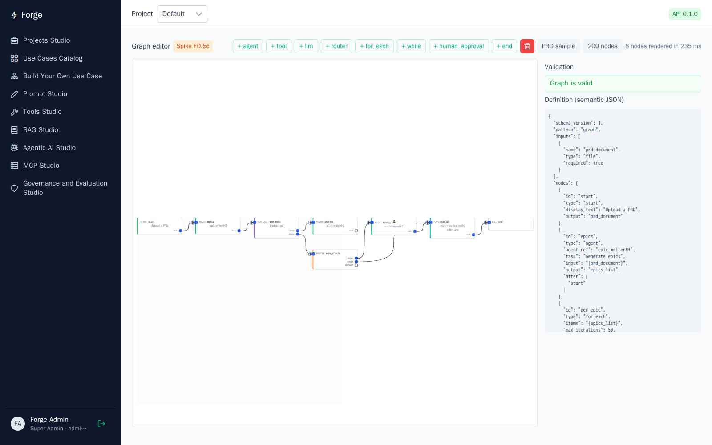

# Spike E0.5c – Graph use-case editor on Foblex Flow (ADR-010, ADR-012)

_Date: 2026-10-16. Code: [frontend/src/app/spikes/graph-editor/](../../frontend/src/app/spikes/graph-editor/), route `/spikes/graph-editor`. E2E: [frontend/e2e/graph-editor.spec.ts](../../frontend/e2e/graph-editor.spec.ts). Run: `make test/e2e`._

## Question

Can Foblex Flow, inside the Angular 21 + PrimeNG 21 shell, be the visual editor of the graph pattern ("Build Your Own Use Case", spec Part 2) on top of the ADR-010 JSON schema? The editor needs:

- typed ports;
- drag-to-connect that writes `after`;
- node configuration;
- live validation;
- a lossless JSON round trip;
- acceptable performance.

**Result: yes.** All 5 E2E scenarios pass in headless Chromium, and 13 unit tests cover the model and the validator. The spike found three integration issues, all fixed. Two of them are real defects in the skeleton's Content-Security-Policy and build configuration.

## Library check

| Item | Result |
| --- | --- |
| Package | `@foblex/flow` 19.3.0 (released 2026-09-27), plus `@foblex/platform`, `mediator`, `2d` and `utils` |
| Licence | **MIT for all five packages**, verified on the `LICENSE` file inside `node_modules`, not just the package.json field |
| Angular | Peer `>=17.3.0`; works with Angular 21.2 zoneless and PrimeNG 21 |
| Current API | Unified connectors `fConnector` with `fConnectorType="source"` or `"target"`, plus `f-connection` with `fSourceId` / `fTargetId`. `fNodeInput` / `fNodeOutput` / `fOutputId` / `fInputId` are deprecated. |
| Bundle | Lazy-loaded editor chunk of 415 kB raw / 86 kB gzip; nothing added to the initial bundle |
| Extras worth noting | `withFlowState` (managed state with undo/redo), minimap, node virtualization and connection workers for large scenes, `withA11y` keyboard support |

## How the editor maps ADR-010

- **One immutable signal holds the graph.** Foblex events emit outside Angular's zone; each event produces a new graph value, which is all zoneless change detection needs.
- **Output connector ids are exactly the `after` references.** That makes the canvas a direct view of the schema:

  | Node type | Output ports (connector id = reference in `after`) |
  | --- | --- |
  | start, agent, tool, llm, human_approval | `<id>` |
  | router | `<id>.<section>` for each section, plus `<id>.default` |
  | for_each, while | `<id>.loop`, `<id>.done` |
  | end | none |

- Every node except `start` has one input port, `<id>::in`.
- Dropping a connection adds the source reference to the target's `after`; deleting an edge removes it.
- **Renaming a node rewrites every reference to its ports**, for example `per_epic.loop` to `each_epic.loop`.
- **Positions live in a non-semantic `ui.positions` block.** `semantic()` strips it, so moving nodes never changes the versioned definition. The E2E test checks this.
- **Live validation** mirrors ADR-010's save-time rules:
  - errors: exactly one start, unknown references, unreachable nodes, explicit cycles (iteration must use loop nodes), loops without a body or without `max_iterations`;
  - warnings: router sections leading nowhere, agent nodes without an agent.
- Invalid nodes are outlined in red.

## Results

| E2E scenario (headless Chromium 1.64, against the Compose stack) | Result |
| --- | --- |
| PRD sample renders with typed ports, 8 nodes and 8 edges, valid, no console errors | ✅ |
| Add an agent; drag `epics` → new node; `after` becomes `["epics"]`; "unreachable" error clears | ✅ |
| Drag a router's `default` port → new end node; `after` becomes `["size_check.default"]` | ✅ |
| Move a node; the semantic JSON is unchanged | ✅ |
| 200-node graph renders within budget; drag still works; no console errors | ✅ |

| Performance (headless, software rendering, 4-vCPU host) | Value |
| --- | --- |
| Render, 8-node sample | about 240 ms |
| **Render, 200 nodes and 199 edges** | **620–680 ms** (budget 3 s) |
| Drag, cost per pointer move, 8 nodes | 21–24 ms (mostly Playwright round trip) |
| Drag, cost per pointer move, 200 nodes | 52–57 ms, so **about 30 ms extra** per move |
| Validation of 200 nodes (unit test) | < 50 ms |

Interpretation: realistic use cases (tens of nodes) are fully fluid. At 200 nodes dragging still works but runs at under 30 fps in this environment, which is software rendering on a loaded host. Foblex's node virtualization and render cache are the levers if large graphs become common.

Stability: 1 failure was seen in about 45 runs of the E2E suite and could not be reproduced in 25 further repetitions. The failure output was lost to output filtering. Before E2.8 the suite gets one retry in CI and traces kept on failure (already configured), so the next occurrence is diagnosable.

## Findings

1. **The CSP blocked the inline `onload` added by Angular's critical-CSS inlining.**
   - This affected **every page** of the app, not only the editor. It was a skeleton defect found by the E2E console check.
   - Fix: `optimization.styles.inlineCritical = false` in the production build.
2. **The CSP blocked Foblex's connection Web Workers**, which are created from `blob:` URLs.
   - Fix: `worker-src 'self' blob:` in nginx's CSP.
   - Security note: blob workers can only be created by scripts already allowed by `script-src 'self'`, so this does not open external script execution. This is recorded in the threat model's frontend controls.
3. **`fFullRendered` fires once per flow lifecycle.** After replacing the whole graph, call `FFlowComponent.reset()` so it fires again, which is needed for fit-to-screen and render metrics.
4. **Foblex runs outside Angular's zone.** With zoneless Angular this is a non-issue as long as state changes go through signals with new references. Mutating arrays in place would not re-render.
5. **The default theme must be wired**: `node_modules/@foblex/flow/styles/default.scss` goes in `angular.json`, and `f-flow` needs a non-zero height. Without them the canvas is blank.

## Not covered (follow-ups for E2.8)

| Gap | Note |
| --- | --- |
| Undo/redo | Use Foblex `withFlowState` instead of a hand-written history |
| Keyboard accessibility | `withA11y`; to be checked against WCAG 2.1 AA |
| Better auto-layout | The spike's simple layered layout gives wide graphs that fit-to-screen shrinks. Evaluate Foblex layout providers (dagre/elk) |
| Node configuration forms per type | Router sections editor, tool input form generated from the JSON schema, variable picker |
| Planner Agent writing into the canvas | Same schema, so it applies a new graph signal; needs a diff/merge UX |
| Real-GPU performance | Re-measure 200+ nodes on a typical laptop browser |

## Decision

Foblex Flow is **confirmed** as the graph editor (ADR-012). The ADR-010 schema needs no change. The `ui.positions` block is added as the only non-semantic field.
